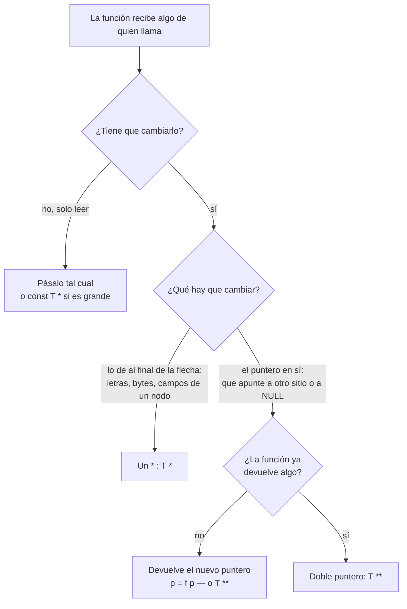

# Puntero a puntero

[[Inicio|← Inicio]] · C · [[Punteros en C]]

> ¿Por qué `ft_lstadd_front` recibe `t_list **lst` y `ft_lstiter` solo `t_list *lst`? ¿Por qué `ft_bzero` modifica tu memoria con un solo `*`? Todo sale de **una sola regla**: para que una función cambie una variable tuya, tiene que recibir **su dirección**. Lo único que hay que preguntarse es **qué variable quieres cambiar**. Si esa variable ya es un puntero, su dirección es un puntero a puntero.

> [!info] Antes de leer
> Necesitas tener claro qué hacen `&` y `*` y que en C los argumentos se pasan **por copia**. Está en [[Punteros en C#Dirección, `&` y `*`]].

## 0. La regla general (para cualquier tipo, no solo listas)

**Una función nunca recibe tus variables: recibe copias.** C crea variables nuevas para los parámetros y copia en ellas lo que le pasas. Al terminar, las copias desaparecen. Desde dentro de una función no hay forma de tocar una variable de quien llama, **salvo que sepas dónde está**: su dirección.

```c
void	f(int x)
{
	x = 99;           /* cambia la copia; el original no se entera */
}
```

**Un puntero es una variable más.** Guarda un número (una dirección) igual que un `int` guarda un número, así que sigue la misma regla: si pasas un `char *s`, la función recibe **una copia de la dirección**, y cambiar esa copia (`s = otra`) no cambia tu `s`.

> [!important] La regla
> Para que una función cambie una variable de tipo `T` de quien llama: la función recibe un **`T *`**, quien llama pasa **`&variable`**, y dentro se escribe **`*param = ...`**.

| Variable que quiero cambiar | Su tipo `T` | Parámetro | Llamada |
|---|---|---|---|
| `int n` | `int` | `int *` | `f(&n)` |
| `t_flags f` (una struct) | `t_flags` | `t_flags *` | `f(&f)` |
| `char *s` | `char *` | `char **` | `f(&s)` |
| `t_list *lista` | `t_list *` | `t_list **` | `f(&lista)` |
| `char **tab` | `char **` | `char ***` | `f(&tab)` |

Siempre es **un `*` más** que el tipo de la variable que cambias.

**Cada `*` es un nivel al que puedes llegar.** Con un `char *s` puedes cambiar `*s` / `s[i]` (las letras), pero no la variable `s` de quien llama. Con un `char **s` puedes cambiar `*s` (el puntero de quien llama) y también `**s` (las letras). Por eso la pregunta no es «¿modifica algo?» sino **«¿qué nivel modifica?»**: `ft_bzero` cambia bytes (basta `void *`); liberar y poner a `NULL` cambia el puntero (hace falta `char **`).

**El método**, para cualquier función:

1. Piensa en quien llama: después de la llamada, ¿qué variable suya debe tener otro valor?
2. Mira su tipo, `T`.
3. El parámetro es `T *` y quien llama pasa `&variable`.
4. Si ninguna variable de quien llama cambia (solo lees, o cambias lo que hay al final de un puntero), pasa el valor tal cual.

**La librería estándar de C funciona igual:**

| Función | Parámetro | Qué variable tuya cambia |
|---|---|---|
| `scanf("%d", &n)` | `int *` | Tu `int n` |
| `strtol(texto, &resto, 10)` | `char **endptr` | Tu `char *resto`: lo deja donde paró de leer |
| `getline(&linea, &tam, f)` | `char **`, `size_t *` | Tu puntero `linea` (puede hacer `realloc` y moverlo) y tu `tam` |
| `free(p)` | `void *` | Ninguna: por eso tras `free` tu `p` sigue con la dirección vieja |

```c
texto = "123abc";
n = strtol(texto, &resto, 10);
```
```text
n = 123, resto = "abc"
```

`strtol` tiene que devolver dos cosas: el número (por `return`) y dónde se quedó (escribiéndolo en tu `resto`). Como `resto` es un `char *`, recibe un `char **`. Y como `free` solo recibe `void *`, no puede ponerte el puntero a `NULL`: por eso en get_next_line es habitual escribir un `ft_free(char **ptr)` que libera y deja el puntero a `NULL`.

El resto de esta nota aplica esta regla caso a caso.

## 1. La regla

Una función recibe **copias** de sus argumentos. Si cambias la copia, el original no se entera. Para cambiar el original, la función tiene que recibir **dónde está** (su dirección) y escribir allí con `*`.

| Quiero cambiar… | Esa variable es de tipo | Así que la función recibe | Y dentro escribe |
|---|---|---|---|
| un `int` | `int` | `int *` | `*n = 99;` |
| las **letras** de una cadena | `char` (cada letra) | `char *` | `s[0] = 'H';` |
| **a dónde apunta** un `char *` | `char *` | `char **` | `*s = otra;` |
| **a dónde apunta** un `t_list *` (la cabeza de la lista) | `t_list *` | `t_list **` | `*lst = new;` |

**Siempre es un `*` más que el tipo de lo que quieres cambiar.** El doble puntero no es un caso especial: es la misma regla aplicada a una variable que ya es un puntero.

## 2. Los cuatro casos, ejecutados

```c
#include <stdio.h>

static void	cambia_int(int *n)
{
	*n = 99;
}

static void	cambia_letras(char *s)
{
	s[0] = 'H';
}

static void	cambia_puntero_mal(char *s)
{
	s = "adiós";
}

static void	cambia_puntero_bien(char **s)
{
	*s = "adiós";
}

int	main(void)
{
	int		n;
	char	buf[] = "hola";
	char	*s;

	n = 42;
	cambia_int(&n);
	printf("1. n = %d\n", n);
	cambia_letras(buf);
	printf("2. buf = %s\n", buf);
	s = "hola";
	cambia_puntero_mal(s);
	printf("3. s = %s\n", s);
	cambia_puntero_bien(&s);
	printf("4. s = %s\n", s);
	return (0);
}
```

```text
1. n = 99
2. buf = Hola
3. s = hola       ← no ha cambiado
4. s = adiós
```

La clave está en comparar el **2** y el **3**. Los dos reciben un `char *`:

- El **2** cambia **lo apuntado** (las letras). La copia del puntero apunta a las **mismas** letras que el original, así que el cambio se ve fuera. Basta un `*`.
- El **3** cambia **el puntero** (a dónde apunta). Solo cambia la copia; `s` en `main` sigue apuntando a `"hola"`. Hace falta `**`.

```text
Caso 2: cambia_letras(buf)                Caso 3: cambia_puntero_mal(s)

 main: buf ─┐                              main: s ───────► "hola"
            ├──► [ H | o | l | a | \0 ]
 f:    s ───┘    ↑ s[0] = 'H'              f:    s ───────► "adiós"   ← solo la copia
                 las dos flechas llegan                       se ha movido
                 al mismo sitio

Caso 4: cambia_puntero_bien(&s)

 main: s ───────► "adiós"        ← *s = "adiós" escribe DENTRO de la caja s de main
         ▲
 f:    s ┘  (s de f guarda la dirección de s de main)
```

> [!important] La pregunta que lo decide todo
> **¿La función tiene que cambiar el puntero de quien llama, o solo lo que hay al final de la flecha?**
> - Solo lo de al final de la flecha (las letras, los bytes, el `content` de los nodos) → **un `*`**.
> - El puntero en sí: que apunte a otro sitio, o a `NULL` → **dos `*`**.

## 3. Con listas: por qué `ft_lstadd_front` necesita `**`

Añadir al principio cambia **cuál es el primer nodo**: el puntero `lista` de `main` tiene que apuntar al nodo nuevo. Es el caso 3/4 de arriba con `t_list *` en vez de `char *`.

```c
static void	add_front_mal(t_list *lst, t_list *new)
{
	new->next = lst;
	lst = new;          /* cambia la copia */
}

static void	add_front_bien(t_list **lst, t_list *new)
{
	new->next = *lst;
	*lst = new;         /* cambia el puntero de main */
}
```

Con `lista = NULL` al principio, salida real:

```text
mal : NULL                   ← el nodo "a" se ha creado, pero lista sigue en NULL
bien: c -> b -> NULL
```

Y Valgrind encuentra el nodo de la versión mala, que ya nadie puede liberar:

```text
16 bytes in 1 blocks are definitely lost in loss record 1 of 1
```

### Cada función de lista de libft, con la regla

| Función | Recibe | ¿Cambia el puntero de quien llama? | Por qué |
|---|---|---|---|
| `ft_lstadd_front` | `t_list **` | ✅ | La cabeza pasa a ser el nodo nuevo |
| `ft_lstadd_back` | `t_list **` | ✅ **a veces** | Si la lista está vacía (`NULL`), el nodo nuevo pasa a ser la cabeza |
| `ft_lstclear` | `t_list **` | ✅ | El subject pide dejar el puntero a `NULL` |
| `ft_lstdelone` | `t_list *` | ❌ | Libera un nodo, pero no promete poner nada a `NULL`: eso lo hace quien llama |
| `ft_lstiter` | `t_list *` | ❌ | Solo cambia lo que hay **dentro** de los nodos (`content`) |
| `ft_lstsize`, `ft_lstlast` | `t_list *` | ❌ | Solo leen |
| `ft_lstmap` | `t_list *` | ❌ | No cambia tu lista: **devuelve** una nueva |

El caso de `ft_lstadd_back` es el que más confunde: casi siempre añade al final sin tocar la cabeza, pero **la primera vez** (lista vacía) sí la toca. Como la función no puede saber de antemano en qué caso está, el prototipo tiene que permitirlo.

`ft_lstiter` lo demuestra al revés: recorre con un solo `*` y cambia el contenido de todos los nodos, y el cambio se ve fuera:

```text
bien: c -> b -> NULL
iter: C -> B -> NULL         ← ft_lstiter con una función que pasa a mayúsculas
```

## 4. Dentro de la función: los tres niveles

Con `t_list **lst` tienes tres cosas distintas a mano. Confundirlas es el error más habitual:

| Expresión | Tipo | Qué es |
|---|---|---|
| `lst` | `t_list **` | La dirección del puntero de quien llama |
| `*lst` | `t_list *` | El puntero de quien llama: la cabeza de la lista |
| `**lst` o `(*lst)->...` | `t_list` | El primer nodo |

```text
   lst                *lst (= lista en main)        **lst (el primer nodo)
 ┌────────┐          ┌────────┐                   ┌─────────┬──────┐
 │  ──────┼────────► │  ──────┼─────────────────► │ content │ next │──► ...
 └────────┘          └────────┘                   └─────────┴──────┘
 t_list **           t_list *                     t_list
```

### Dos comprobaciones distintas

```c
if (!lst)        /* no me han dado dónde está la lista: argumento inválido */
	return ;
if (!*lst)       /* me la han dado, pero la lista está vacía */
	*lst = new;
```

`lst == NULL` y `*lst == NULL` son situaciones diferentes. En `ft_lstadd_back`, la segunda es normal (lista vacía) y la primera es un error de quien llama.

### Cuidado con la precedencia: `(*lst)->next`

`->` va **antes** que `*`. Así que `*lst->next` significa `*(lst->next)`, y `lst` no es un puntero a struct sino a puntero:

```text
error: member reference base type 't_list *' (aka 'struct s_list *') is not a structure or union
        x = *lst->next;
             ~~~^ ~~~~
```

Lo correcto es `(*lst)->next`. El compilador te avisa, pero el mensaje despista si no lo conoces.

## 5. La alternativa: devolver el puntero nuevo

Hay otra forma de que una función cambie tu puntero: que **devuelva** el valor nuevo y tú lo asignes. Las dos hacen lo mismo:

```c
static char	*libera_y_null_v1(char *p)      /* devuelve el nuevo valor */
{
	free(p);
	return (NULL);
}

static void	libera_y_null_v2(char **p)      /* escribe el nuevo valor */
{
	free(*p);
	*p = NULL;
}

a = libera_y_null_v1(a);
libera_y_null_v2(&b);
```

```text
a = (nil), b = (nil)
```

| | Devolver (`p = f(p)`) | Doble puntero (`f(&p)`) |
|---|---|---|
| Quien llama puede olvidarse de… | asignar el resultado | — |
| Sirve si la función ya devuelve otra cosa | ❌ | ✅ |
| Dónde lo ves | `stash = ft_read_to_stash(fd, stash)` en [[get_next_line - Guía paso a paso]], `ft_lstmap` | `ft_lstadd_front`, `ft_lstclear`, `ft_free(&stash)` en get_next_line |

Las dos son correctas. El doble puntero se usa cuando la función ya devuelve otra cosa, o cuando quieres que sea **imposible** olvidarse de actualizar el puntero.

## 6. El otro `char **`: un array de cadenas

Aquí está la segunda fuente de confusión: **el mismo tipo, `char **`, se usa para dos cosas que no tienen nada que ver**.

| | «Cambia mi puntero» | «Array de cadenas» |
|---|---|---|
| Ejemplo | `void ft_free(char **p)` | `char **ft_split(...)`, `int main(int argc, char **argv)` |
| Apunta a… | **un** `char *` (una variable de quien llama) | el **primero de muchos** `char *` seguidos |
| Dentro se usa | `*p` | `tab[i]`, y `tab[i][j]` para cada letra |
| Se llama con | `f(&mi_puntero)` | `f(tab)` |

```text
char **tab devuelto por ft_split("hola que tal", ' '):

 tab ──► [ ptr | ptr | ptr | NULL ]
            │     │     └──► "tal"
            │     └────────► "que"
            └──────────────► "hola"
```

Una función como `ft_count_if(char **tab, ...)` recibe `char **` pero **no** cambia ningún puntero tuyo: solo recorre el array. Para saber cuál de los dos usos tienes delante, mira **cómo se llama** (`&algo` o no) y **cómo se usa dentro** (`*p =` o `p[i]`).

> [!example] ¿Y si quiero liberar el array de `ft_split` y dejar `tab` a `NULL`?
> Aplica la regla: quieres cambiar `tab`, que es un `char **`; así que la función recibe su dirección, un `char ***`. Funciona, pero es raro de ver. Lo habitual es liberar con `void ft_free_split(char **tab)` y poner `tab = NULL;` a mano después.

## 7. Cómo decidirlo cuando escribes una función



## Errores frecuentes

> [!danger] Los que más aparecen
> - **Pasar `lista` en vez de `&lista`**: el compilador avisa, y hasta te dice la solución: `incompatible pointer types passing 't_list *' ... to parameter of type 't_list **' ...; take the address with &`. No lo silencies con un cast.
> - **Escribir `lst = new;` dentro de una función que recibe `t_list **`**: cambias la copia de la dirección, no la cabeza. Es `*lst = new;`.
> - **`*lst->next`** en vez de `(*lst)->next`.
> - **Comprobar `lst` cuando querías `*lst`** (o al revés).
> - **Recorrer la lista moviendo `*lst`**: `while (*lst) *lst = (*lst)->next;` deja la cabeza de quien llama al final de la lista. Para recorrer, usa una variable local: `t_list *tmp = *lst;`.
> - **Pensar que todo `char **` sirve para cambiar un puntero**: `ft_split` y `argv` son arrays de cadenas.

## Preguntas de evaluación

> [!question]- ¿Por qué `ft_lstadd_front` recibe un `t_list **`?
> Porque tiene que cambiar el puntero a la cabeza de quien llama. Con un `t_list *` solo tendría una copia, y el nodo nuevo quedaría fuera de la lista (y perdido: leak).

> [!question]- ¿Por qué `ft_lstiter` no necesita `**` si modifica la lista?
> Porque no cambia ningún puntero de quien llama: cambia el `content` de los nodos, que está al final de la flecha. La copia del puntero llega a los mismos nodos.

> [!question]- ¿Por qué `ft_lstadd_back` necesita `**` si añade al final?
> Porque si la lista está vacía, el nodo nuevo pasa a ser la cabeza, y eso cambia el puntero de quien llama.

> [!question]- ¿Qué diferencia hay entre `lst`, `*lst` y `**lst`?
> `lst` es la dirección del puntero de quien llama; `*lst` es ese puntero (la cabeza); `**lst` es el primer nodo.

## Relacionadas

[[Punteros en C]] · [[Listas enlazadas]] · [[malloc y free]] · [[Carácter nulo y puntero NULL]] · [[Arrays en C]] · [[ft_lstadd_front]] · [[ft_lstadd_back]] · [[ft_lstclear]] · [[ft_lstiter]] · [[ft_split]] · [[get_next_line - Guía paso a paso]]

## Referencias

- [cppreference: Pointer declaration](https://en.cppreference.com/w/c/language/pointer): punteros a puntero.
- [cppreference: C Operator Precedence](https://en.cppreference.com/w/c/language/operator_precedence): `->` tiene más prioridad que el `*` unario.
- [Beej's Guide to C: Pointers III](https://beej.us/guide/bgc/html/split/pointers-iii-pointers-to-pointers-and-more.html).
- Subject de libft v19.3: prototipos de `ft_lstadd_front`, `ft_lstadd_back`, `ft_lstclear`, `ft_lstdelone`, `ft_lstiter`.
- Todo el código se ha compilado con `cc -Wall -Wextra -Werror` (Ubuntu clang 12.0.1) y las salidas, incluidas las de Valgrind y los errores del compilador, son reales.
