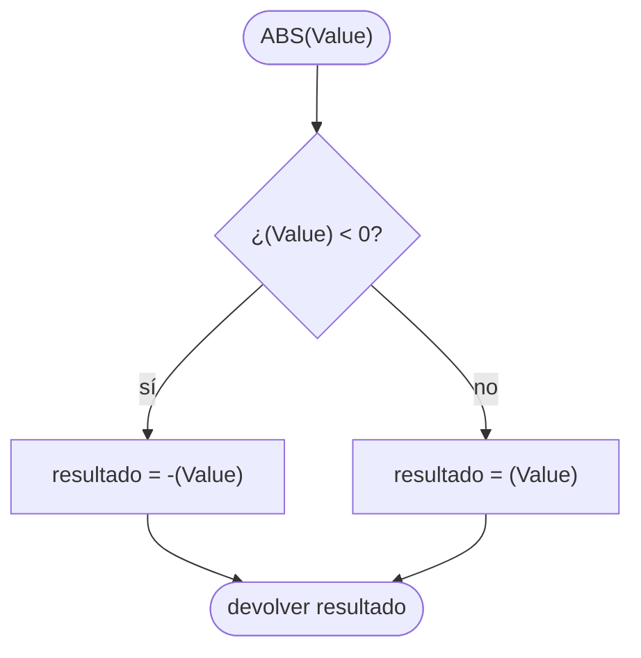

# ft_abs

[[Piscine Reloaded - Índice|← Índice]] · ex22 · Headers

> Un header `ft_abs.h` con una **macro** `ABS(Value)` que se sustituye por el valor absoluto de su argumento. No es una función: el preprocesador copia el texto antes de compilar.

## Explicación sencilla

```c
#include "ft_abs.h"

ABS(-42)    // el preprocesador lo convierte en ((-42) < 0 ? -(-42) : (-42))  → 42
ABS(7)      // ((7) < 0 ? -(7) : (7))                                         → 7
```

```text
 código que escribes          lo que ve el compilador (cc -E)
 ───────────────────          ─────────────────────────────────
 ABS(x)               ──►     ((x) < 0 ? -(x) : (x))
 ABS(-3 + 1)          ──►     ((-3 + 1) < 0 ? -(-3 + 1) : (-3 + 1))
```

Una macro es **sustitución de texto**: no hay llamada, no hay parámetros con tipo, no hay copia del valor. Por eso funciona con `int`, `long` o `double`, y por eso hay que poner paréntesis en todas partes. Cómo trabaja el preprocesador: ver [[Preprocesador y headers]].

## Prototipo

```c
#define ABS(Value)
```

> [!info] Sin función original
> No es una función de la libc. Existe `abs()` en `<stdlib.h>`, que sí es una función (solo para `int`). Su man avisa del mismo caso límite que tendrá la macro:
>
> > [!quote] man 3 abs — NOTES
> > Trying to take the absolute value of the most negative integer is not defined.
>
> > [!note] Traducción
> > Intentar calcular el valor absoluto del entero más negativo no está definido.

## Requisitos del subject

> [!quote] Subject Piscine Reloaded v2.0 — Ejercicio 22
> Directorio de entrega: ex22/
> Archivos a entregar: ft_abs.h
> Funciones autorizadas: Ninguna
>
> • Crea una macro ABS que sustituya su argumento por su valor absoluto:
>
> `#define ABS(Value)`
>
> Se te está pidiendo que hagas algo que, normalmente, está prohibido por la Norma. Esta será la única vez que lo autoricemos.

> [!warning] Excepción a la Norma
> [[La Norma]] solo permite `#define` para constantes simples: las **macros con parámetros** y las **macros multilínea** están prohibidas. Este ejercicio es la excepción explícita. En libft y en el resto del cursus no puedes usarlas.

## Cómo implementarla

```text
fichero ft_abs.h:
    si FT_ABS_H no está definido:
        definir FT_ABS_H
        definir ABS(Value) como ((Value) < 0 ? -(Value) : (Value))
```

- **Guardas de inclusión** (`#ifndef FT_ABS_H` / `# define FT_ABS_H` / `#endif`): si el header se incluye dos veces, la segunda vez se salta entero.
- **Paréntesis en cada `Value`**: protege frente a argumentos con operadores (`-3 + 1`).
- **Paréntesis alrededor de toda la expresión**: protege frente a lo que hay fuera (`10 - ABS(x)`).
- El operador ternario `c ? a : b` es una expresión, no una sentencia: puede ir dentro de un `printf` o de una suma. Un `if` no podría.

## Diagrama de flujo



## Ejemplos

```c
#include <limits.h>
#include <stdio.h>
#include "ft_abs.h"
#include "ft_abs.h"

#define BAD_ABS(Value) Value < 0 ? -Value : Value

int	main(void)
{
	int	x;
	int	i;

	x = -5;
	i = -1;
	printf("ABS(-42)        = %d\n", ABS(-42));
	printf("ABS(0)          = %d\n", ABS(0));
	printf("ABS(-3 + 1)     = %d\n", ABS(-3 + 1));
	printf("BAD_ABS(-3 + 1) = %d\n", BAD_ABS(-3 + 1));
	printf("10 - ABS(x)     = %d\n", 10 - ABS(x));
	printf("10 - BAD_ABS(x) = %d\n", 10 - BAD_ABS(x));
	printf("ABS(i++)        = %d\n", ABS(i++));
	printf("i despues       = %d\n", i);
	printf("ABS(INT_MIN)    = %d\n", ABS(INT_MIN));
	printf("ABS(-2.5)       = %.1f\n", ABS(-2.5));
	return (0);
}
```

```text
ABS(-42)        = 42
ABS(0)          = 0
ABS(-3 + 1)     = 2
BAD_ABS(-3 + 1) = 4
10 - ABS(x)     = 5
10 - BAD_ABS(x) = -5
ABS(i++)        = 0
i despues       = 1
ABS(INT_MIN)    = -2147483648
ABS(-2.5)       = 2.5
```

- `#include "ft_abs.h"` dos veces compila sin quejas gracias a las guardas.
- `BAD_ABS(-3 + 1)` se expande a `-3 + 1 < 0 ? --3 + 1 : -3 + 1`: el `-` solo afecta al `-3`, sale 4.
- `10 - BAD_ABS(x)` se expande a `10 - x < 0 ? -x : x`: la resta se hace **antes** de comparar (`15 < 0` es falso) y devuelve `x`, es decir, -5.
- Con `-fsanitize=undefined` el caso `INT_MIN` avisa:

```text
main.c:23:35: runtime error: negation of -2147483648 cannot be represented in type 'int'; cast to an unsigned type to negate this value to itself
```

## Puntos clave y casos límite

- **Doble evaluación**: `ABS(i++)` se convierte en `((i++) < 0 ? -(i++) : (i++))` (comprobado con `cc -E`). `i` se incrementa **dos veces** y el resultado es 0, no 1. Nunca pases a una macro algo con efectos secundarios (`i++`, llamadas a función que escriben, `read`...).
- **`ABS(INT_MIN)` desborda**: `-(-2147483648)` no cabe en un `int` (el máximo es 2147483647). Es comportamiento indefinido; en la práctica devuelve el mismo número negativo. Lo mismo pasa con `abs()` de la libc. Ver [[Tipos enteros y conversiones]].
- `ABS(0)` devuelve 0 y `ABS(-0.0)` en `double` devuelve `-0.0` (la comparación `-0.0 < 0` es falsa). Raro, pero inofensivo.
- La macro no tiene tipo: `ABS(-2.5)` funciona con `double`, cosa que `abs()` no hace.
- Nombre del parámetro: el subject lo fija como `Value`. Respétalo.

### Errores típicos

- **Olvidar los paréntesis** (de cada `Value` o de toda la expresión): ver `BAD_ABS` arriba.
- **Olvidar las guardas de inclusión**: con un `typedef` o una función dentro, incluir dos veces el header da `redefinition`. Con una macro idéntica no falla, pero la Norma exige las guardas en todo `.h`.
- **Poner `;` al final del `#define`**: `x = ABS(-1) + 1;` se convierte en `x = (...); + 1;` y con `-Werror` no compila (`expression result unused`). En otros contextos (dentro de un `printf`) es directamente un error de sintaxis.
- **Escribirla como función `ft_abs`**: el subject pide una macro llamada `ABS` en `ft_abs.h`, no una función.

## Relacionadas

[[ft_point]] · [[ft_is_negative]] · [[Preprocesador y headers]] · [[La Norma]] · [[Tipos enteros y conversiones]]

## Referencias

- Subject de Piscine Reloaded v2.0 (`/home/felixrod/cursus/piscine-reloaded/es.subject_piscine-reloaded.pdf`) — requisitos copiados literalmente.
- `man 3 abs` (Ubuntu 22.04, man-pages 5.10) — nota sobre el entero más negativo.
- [Replacing text macros — cppreference](https://en.cppreference.com/w/c/preprocessor/replace) — macros con parámetros.
- [Macro Pitfalls — GCC CPP manual](https://gcc.gnu.org/onlinedocs/cpp/Macro-Pitfalls.html) — paréntesis y duplicación de efectos secundarios.
- Ejemplos compilados con `cc -Wall -Wextra -Werror` (Ubuntu clang 12.0.1) en Linux x86_64.
