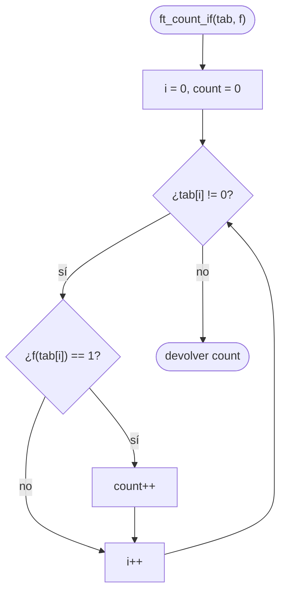

# ft_count_if

[[Piscine Reloaded - Índice|← Índice]] · ex26 · Punteros a función

> Recorre un array de strings terminado en `0` (`NULL`) y cuenta cuántos elementos hacen que `f` devuelva 1. `f` decide la condición; `ft_count_if` solo cuenta.

## Explicación sencilla

```c
ft_count_if(tab, &starts_with_a);   // cuántos strings empiezan por 'a'
```

```text
 tab:  ┌───────┬────────┬─────┬────┬─────────┬──────┐
       │ "abc" │ "hola" │ "a" │ "" │ "adios" │ NULL │ ◄── fin
       └───────┴────────┴─────┴────┴─────────┴──────┘
 f:        1        0       1    0       1
 count:    1        1       2    2       3          → devuelve 3
```

No hay `length`: el final del array lo marca un **puntero nulo**, igual que `argv[argc]` es `NULL`. Ver [[Carácter nulo y puntero NULL]].

## Prototipo

```c
int	ft_count_if(char **tab, int (*f)(char*));
```

> [!info] Sin función original
> No existe en la libc. El comportamiento lo define el **subject** de Piscine Reloaded.

## Requisitos del subject

> [!quote] Subject Piscine Reloaded v2.0 — Ejercicio 26
> Directorio de entrega: ex26/
> Archivos a entregar: ft_count_if.c
> Funciones autorizadas: Ninguna
>
> • Crea una función ft_count_if que devuelva el número de elementos del array que devuelven 1 al pasarlos por la función f.
>
> • Este debe ser el prototipo de la función:
>
> `int   ft_count_if(char **tab, int (*f)(char*));`
>
> • El array estará delimitado por 0.

## Cómo implementarla

```text
i = 0
count = 0
mientras tab[i] != 0:
    si f(tab[i]) == 1:
        count = count + 1
    i = i + 1
devolver count
```

## Diagrama de flujo



## Ejemplos

Dos versiones: `ft_count_if` compara `== 1` (lo que dice el subject) y `ft_count_if_nz` compara `!= 0` (cualquier valor "verdadero").

```c
#include <stdio.h>

int	ft_count_if(char **tab, int (*f)(char*));
int	ft_count_if_nz(char **tab, int (*f)(char*));

int	starts_with_a(char *str)
{
	return (str[0] == 'a');
}

int	len_or_zero(char *str)
{
	int	i;

	i = 0;
	while (str[i])
		i++;
	if (i > 3)
		return (i);
	return (0);
}

int	main(void)
{
	char	*tab[6];

	tab[0] = "abc";
	tab[1] = "hola";
	tab[2] = "a";
	tab[3] = "";
	tab[4] = "adios";
	tab[5] = 0;
	printf("starts_with_a  == 1 : %d\n", ft_count_if(tab, &starts_with_a));
	printf("starts_with_a  != 0 : %d\n", ft_count_if_nz(tab, &starts_with_a));
	printf("len_or_zero    == 1 : %d\n", ft_count_if(tab, &len_or_zero));
	printf("len_or_zero    != 0 : %d\n", ft_count_if_nz(tab, &len_or_zero));
	tab[0] = 0;
	printf("array vacio         : %d\n", ft_count_if(tab, &starts_with_a));
	return (0);
}
```

```text
starts_with_a  == 1 : 3
starts_with_a  != 0 : 3
len_or_zero    == 1 : 0
len_or_zero    != 0 : 2
array vacio         : 0
```

Con funciones de la libc la diferencia es real. `isdigit` devuelve "distinto de 0", no necesariamente 1:

```c
int	first_is_digit(char *str)
{
	return (isdigit(str[0]));
}
/* tab = {"42", "abc", "7up", 0} */
```

```text
isdigit('4') = 2048
== 1 : 0
!= 0 : 2
```

## Puntos clave y casos límite

- **Array vacío** (`tab[0] == 0`): el bucle no entra y devuelve 0.
- **"Delimitado por 0"**: el 0 es un puntero nulo (`NULL`), no un string vacío `""`. Un `""` es un elemento normal y se pasa a `f`.
- **¿Y si `f` devuelve 2?** El subject dice literalmente "devuelvan **1**". Con `== 1` no se cuenta; con `!= 0` sí. Lo más seguro para la Moulinette es seguir el texto: `== 1`. Si `f` es tuya, haz que devuelva exactamente 0 o 1 (`return (str[0] == 'a');` ya lo hace) y ambas versiones coinciden.
- Si `f` viene de la libc (`isdigit`, `isalpha`...) puede devolver valores como 2048: con `== 1` la cuenta sale 0. Por eso en libft tus `ft_is*` devuelven 0 o 1 (ver [[ft_isdigit]]).
- `tab == NULL` o `f == NULL`: segfault. El subject no lo pide; se puede proteger, pero no es obligatorio.

### Errores típicos

- **Usar un `length` o `sizeof(tab)`**: `tab` es un `char **`, `sizeof` da el tamaño del puntero (8), no del array. El final se detecta con `tab[i] == 0`.
- **Comprobar `tab[i][0] == '\0'` como fin**: confunde string vacío con fin del array.
- **Incrementar `i` solo cuando `f` devuelve 1**: bucle infinito en el primer elemento que no cumple.
- **Llamar a `f` dos veces por elemento** (una para comprobar y otra para contar): si `f` tiene efectos secundarios, se ejecutan dos veces.

## Relacionadas

[[ft_foreach]] · [[ft_print_params]] · [[ft_isdigit]] · [[Carácter nulo y puntero NULL]] · [[Punteros en C]]

## Referencias

- Subject de Piscine Reloaded v2.0 (`/home/felixrod/cursus/piscine-reloaded/es.subject_piscine-reloaded.pdf`) — requisitos copiados literalmente.
- [isdigit — man7.org](https://man7.org/linux/man-pages/man3/isdigit.3.html) — "nonzero if the character c falls into the tested class".
- [Pointer declaration — cppreference](https://en.cppreference.com/w/c/language/pointer) — punteros a función.
- Ejemplos compilados con `cc -Wall -Wextra -Werror` (Ubuntu clang 12.0.1) en Linux x86_64.
