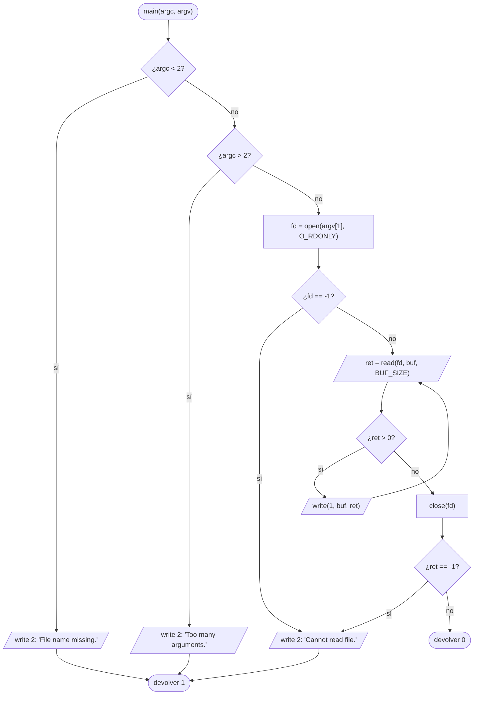

# ft_display_file

[[Piscine Reloaded - Índice|← Índice]] · ex27 · Programas

> Un programa (no una función) que muestra en la salida estándar el contenido del fichero que recibe como argumento. Es un `cat` mínimo: `open`, bucle de `read` + `write`, `close`, y tres mensajes de error exactos en la salida de error.

## Explicación sencilla

```text
$ ./ft_display_file hola.txt
Hola, 42.
Segunda linea.
```

```text
 argv[1] ──► open() ──► fd 3
                         │
          ┌──────────────┘
          ▼
   read(fd, buf, 4096) ──► ret > 0 ──► write(1, buf, ret) ──┐
          ▲                                                  │
          └──────────────────────────────────────────────────┘
   ret == 0  → fin del fichero → close(fd), salir con 0
   ret == -1 → error           → "Cannot read file." en fd 2
```

`buf` es un **array de tamaño fijo** en la pila: se reutiliza en cada vuelta. No hace falta saber el tamaño del fichero; se lee a trozos hasta que `read` devuelve 0. Cómo funcionan `open`, `read` y los descriptores: ver [[Descriptores de fichero y read]].

## Prototipo

```text
./ft_display_file <fichero>
```

```c
int	main(int argc, char **argv);
```

> [!info] Sin función original
> No es una función de la libc: es un programa con su propio `main` y su `Makefile`. Se parece a `cat fichero`, pero con un solo argumento y los mensajes de error que fija el subject.

## Requisitos del subject

> [!quote] Subject Piscine Reloaded v2.0 — Ejercicio 27
> Directorio de entrega: ex27/
> Archivos a entregar: Makefile, todos los archivos necesario para tu programa
> Funciones autorizadas: close, open, read, write
>
> • Crea un programa llamado ft_display_file que muestre, en la salida estándar, solo el contenido del archivo dado como argumento.
>
> • El directorio de entrega debe tener un Makefile con las reglas siguientes: all, clean, fclean. El binario se llamará ft_display_file.
>
> • La función malloc está prohibida. Solo puedes hacer este ejercicio declarando un array de tamaño fijo.
>
> • Todos los archivos dados como argumento serán válidos.
>
> • Los mensajes de error deben mostrarse en su salida reservada seguidos por un salto de línea.
>
> • Si no se da ningún argumento, el programa deberá mostrar
> File name missing.
>
> • Si hay más de un argumento, el programa deberá mostrar
> Too many arguments.
>
> • Si el archivo no puede leerse, el programa deberá mostrar
> Cannot read file.

> [!warning] "Su salida reservada" = stderr
> Los mensajes de error van a la **salida de error** (fd 2), no a la estándar (fd 1). Se escriben **exactamente** así, con el punto final y un `\n`: `"File name missing.\n"`, `"Too many arguments.\n"`, `"Cannot read file.\n"`.

## Cómo implementarla

```text
main(argc, argv):
    si argc < 2:
        write(2, "File name missing.\n")
        devolver 1
    si argc > 2:
        write(2, "Too many arguments.\n")
        devolver 1
    fd = open(argv[1], O_RDONLY)
    si fd == -1:
        write(2, "Cannot read file.\n")
        devolver 1
    ret = read(fd, buf, BUF_SIZE)
    mientras ret > 0:
        write(1, buf, ret)
        ret = read(fd, buf, BUF_SIZE)
    close(fd)
    si ret == -1:
        write(2, "Cannot read file.\n")
        devolver 1
    devolver 0
```

- `buf` es `char buf[BUF_SIZE]` con `BUF_SIZE` constante (por ejemplo 4096). Nada de `malloc`.
- Se escribe `ret` bytes, **no** `BUF_SIZE`: la última lectura casi nunca llena el buffer.
- Para no pasar de 25 líneas por función (ver [[La Norma]]), saca a funciones auxiliares el "escribir string en fd 2" y el bucle de lectura.
- El valor de salida (1 en error, 0 si todo va bien) no lo pide el subject, pero es la convención de Unix y se comprueba con `echo $?`.

## Diagrama de flujo



## Ejemplos

### Makefile mínimo

```makefile
NAME	= ft_display_file
CC	= cc
CFLAGS	= -Wall -Wextra -Werror
SRCS	= ft_display_file.c
OBJS	= $(SRCS:.c=.o)

all: $(NAME)

$(NAME): $(OBJS)
	$(CC) $(CFLAGS) $(OBJS) -o $(NAME)

%.o: %.c
	$(CC) $(CFLAGS) -c $< -o $@

clean:
	rm -f $(OBJS)

fclean: clean
	rm -f $(NAME)

.PHONY: all clean fclean
```

```text
$ make
cc -Wall -Wextra -Werror -c ft_display_file.c -o ft_display_file.o
cc -Wall -Wextra -Werror ft_display_file.o -o ft_display_file
$ make
make: Nothing to be done for 'all'.
$ make clean
rm -f ft_display_file.o
$ make fclean
rm -f ft_display_file.o
rm -f ft_display_file
```

> [!question] ¿Y la regla `re`?
> El subject de este ejercicio pide **solo** `all`, `clean` y `fclean`, así que `re` no es obligatoria (en el ex24 sí lo era). Añadirla (`re: fclean all`) no molesta y es buena costumbre, porque todos los Makefile del cursus la exigen. Lo que sí importa: que `make` dos veces seguidas no vuelva a compilar (sin *relink*) y que el binario se llame exactamente `ft_display_file`. Más en [[Makefile y librerías estáticas]].

### Ejecución real

```text
$ ./ft_display_file hola.txt; echo $?
Hola, 42.
Segunda linea.
0
$ ./ft_display_file; echo $?
File name missing.
1
$ ./ft_display_file a b; echo $?
Too many arguments.
1
$ ./ft_display_file noexiste.txt; echo $?
Cannot read file.
1
$ ./ft_display_file dir; echo $?
Cannot read file.
1
```

Comprobar que el error va a **stderr** y lleva salto de línea:

```text
$ ./ft_display_file > /dev/null; echo $?
File name missing.
1
$ ./ft_display_file noexiste.txt 2>/dev/null; echo $?
1
$ ./ft_display_file 2>&1 | cat -e
File name missing.$
```

- Con `> /dev/null` el mensaje **sigue saliendo**: no va por fd 1.
- Con `2>/dev/null` desaparece: va por fd 2.
- `cat -e` marca el final de línea con `$`: hay `\n` y no sobran espacios.

Fichero grande (más de un buffer) y fichero vacío:

```text
$ head -c 10000 /dev/urandom | base64 > big.txt
$ ./ft_display_file big.txt | cmp - big.txt && echo iguales
iguales
$ ./ft_display_file /dev/null | wc -c
0
```

### Directorio como argumento

`open` de un directorio con `O_RDONLY` **funciona**; es `read` el que falla. Con `strace` se ve:

```text
$ strace -e trace=openat,read ./ft_display_file dir
openat(AT_FDCWD, "dir", O_RDONLY)       = 3
read(3, 0x7fff1732b8c0, 4096)           = -1 EISDIR (Is a directory)
Cannot read file.
+++ exited with 1 +++
```

Y un fichero que no existe falla ya en `open`:

```text
openat(AT_FDCWD, "noexiste.txt", O_RDONLY) = -1 ENOENT (No such file or directory)
```

## Puntos clave y casos límite

- **`read` devuelve 0** al llegar al final del fichero: es la condición normal de salida del bucle, no un error.
- **`read` devuelve -1**: error real. El caso típico es un **directorio**: si solo compruebas `open`, el programa no muestra nada y sale con 0 sin avisar. Hay que comprobar también el `-1` de `read`.
- **Fichero vacío**: el primer `read` devuelve 0, no se escribe nada y sale con 0. No es un error.
- "Todos los archivos dados como argumento serán válidos": aun así, gestionar fichero inexistente y directorio no cuesta nada y evita sorpresas.
- **Cierra siempre el `fd`** que abriste, también en el camino de error de `read`.
- Los tres mensajes son literales: una mayúscula, un punto o un espacio de más y la Moulinette lo da por malo.

### Errores típicos

- **Escribir los errores en fd 1** (`write(1, ...)`): en pantalla se ve igual, pero el subject pide la salida de error. Compruébalo con `> /dev/null`.
- **Olvidar el `\n`** de los mensajes.
- **`write(1, buf, BUF_SIZE)`** en vez de `write(1, buf, ret)`: escribe basura al final del fichero.
- **Leer el fichero entero de una vez** con un buffer "grande": falla con ficheros mayores que el buffer. Hay que hacer bucle.
- **Usar `malloc`, `printf` o `strlen` de la libc**: solo están autorizadas `close`, `open`, `read` y `write`. Escribe tu propia función para la longitud (como [[ft_strlen]]) o para escribir en un fd (como [[ft_putstr_fd]]).
- **Makefile con wildcards** (`$(wildcard *.c)`) o que hace *relink* en cada `make`.

## Relacionadas

[[ft_putstr_fd]] · [[ft_strlen]] · [[ft_print_params]] · [[Descriptores de fichero y read]] · [[Control de errores en C]] · [[Makefile y librerías estáticas]]

## Referencias

- Subject de Piscine Reloaded v2.0 — requisitos copiados literalmente.
- [read(2) — man7.org](https://man7.org/linux/man-pages/man2/read.2.html) — "zero indicates end of file"; error `EISDIR`.
- [open(2) — man7.org](https://man7.org/linux/man-pages/man2/open.2.html) — `O_RDONLY` y error `ENOENT`.
- [GNU make manual](https://www.gnu.org/software/make/manual/make.html) — reglas, variables y `.PHONY`.
- Ejemplos compilados con `cc -Wall -Wextra -Werror` (Ubuntu clang 12.0.1) en Linux x86_64.
