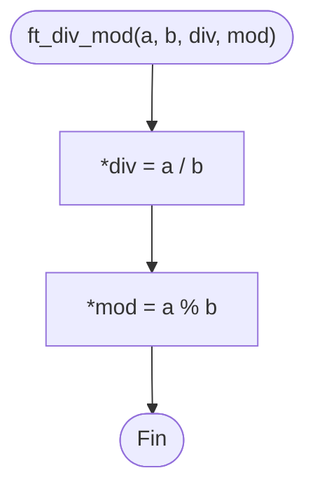

# ft_div_mod

[[Piscine Reloaded - Índice|← Índice]] · ex11 · Punteros

> Divide `a` entre `b` y guarda el **cociente** en `*div` y el **resto** en `*mod`. Una función solo puede devolver un valor con `return`; para «devolver» dos, se escriben en variables de quien llama a través de punteros.

## Explicación sencilla

```c
int	d;
int	m;

ft_div_mod(42, 5, &d, &m);   // d = 8, m = 2   (42 = 8 * 5 + 2)
```

```text
 main:   d ┌───┐   m ┌───┐
           │ ? │     │ ? │
           └─▲─┘     └─▲─┘
             │         │
 ft_div_mod: div       mod         *div = 42 / 5 = 8
                                   *mod = 42 % 5 = 2
```

En C, `/` entre enteros es **división entera**: descarta los decimales. `%` da el resto. Siempre se cumple:

```text
(a / b) * b + (a % b) == a
```

## Prototipo

```c
void	ft_div_mod(int a, int b, int *div, int *mod);
```

> [!info] Sin función original
> No existe en la libc. El comportamiento lo define el **subject** de Piscine Reloaded. La libc tiene algo parecido: `div()` de `<stdlib.h>`, que devuelve una `struct` con `quot` y `rem`.

## Requisitos del subject

> [!quote] Subject Piscine Reloaded v2.0 — Ejercicio 11
> Directorio de entrega: ex11/
> Archivos a entregar: ft_div_mod.c
> Funciones autorizadas: Ninguna
>
> • Crea una función ft_div_mod con el siguiente prototipo:
>
> `void   ft_div_mod(int a, int b, int *div, int *mod);`
>
> • Esta función divide el parámetro a entre el parámetro b y almacena el resultado en el entero al que apunta div. Además, almacena el resto de la división de a entre b en el entero al que apunta mod.

## Cómo implementarla

```text
*div = a / b
*mod = a % b
```

## Diagrama de flujo



## Ejemplos

```c
#include <stdio.h>

void	ft_div_mod(int a, int b, int *div, int *mod);

static void	test(int a, int b)
{
	int	d;
	int	m;

	ft_div_mod(a, b, &d, &m);
	printf("%3d, %3d -> div = %3d, mod = %3d  (div*b+mod = %d)\n",
		a, b, d, m, d * b + m);
}

int	main(void)
{
	test(42, 5);
	test(-42, 5);
	test(42, -5);
	test(-42, -5);
	test(3, 7);
	test(0, 5);
	return (0);
}
```

```text
$ ./a.out
 42,   5 -> div =   8, mod =   2  (div*b+mod = 42)
-42,   5 -> div =  -8, mod =  -2  (div*b+mod = -42)
 42,  -5 -> div =  -8, mod =   2  (div*b+mod = 42)
-42,  -5 -> div =   8, mod =  -2  (div*b+mod = -42)
  3,   7 -> div =   0, mod =   3  (div*b+mod = 3)
  0,   5 -> div =   0, mod =   0  (div*b+mod = 0)
```

Los dos casos peligrosos, con un `main` que lee `a` y `b` de `argv` (con `atoi`), lanzado desde `bash` para ver el código de salida:

```text
$ bash -c './a.out 7 2; ./a.out 42 0; echo "exit = $?"; ./a.out -2147483648 -1; echo "exit = $?"'
div = 3, mod = 1
bash: line 1: 68225 Floating point exception(core dumped) ./a.out 42 0
exit = 136
bash: line 1: 68228 Floating point exception(core dumped) ./a.out -2147483648 -1
exit = 136
```

Compilando con `-fsanitize=undefined` el error se explica solo:

```text
ft_div_mod.c:3:11: runtime error: division by zero
ft_div_mod.c:3:11: runtime error: division of -2147483648 by -1 cannot be represented in type 'int'
```

## Puntos clave y casos límite

- **Trunca hacia 0** (desde C99): `-42 / 5` es `-8`, no `-9`. No redondea «hacia abajo» como en matemáticas.
- **El resto lleva el signo de `a`** (el dividendo), nunca el de `b`: `-42 % 5 == -2` y `42 % -5 == 2`. Es consecuencia de la regla de arriba y de `(a / b) * b + a % b == a`.
- `a` menor que `b` en valor absoluto: cociente 0 y resto `a` (`3 / 7 = 0`, resto 3).

> [!danger] División entre 0 e `INT_MIN / -1`
> - `b == 0`: comportamiento indefinido. En x86_64 el procesador lanza una excepción y el programa muere con `SIGFPE` («Floating point exception», aunque no haya ningún `float`). Código de salida 136 = 128 + 8 (señal 8).
> - `a == INT_MIN` y `b == -1`: el resultado sería 2147483648, que no cabe en `int` → también indefinido y también `SIGFPE` en x86_64. El `%` con esos valores tampoco está definido. Ver [[Tipos enteros y conversiones]].
>
> El subject no dice qué hacer con estos casos y el prototipo es `void`, así que no hay forma de avisar del error. Una opción defensiva es no tocar `*div` ni `*mod` si `b == 0`.

### Errores típicos

- **`div = a / b;`** (sin `*`): guarda el resultado como dirección. Con `-Werror` no compila (`-Wint-conversion`).
- **Calcular el resto a mano** con `a - (a / b) * b`: funciona, pero `%` ya hace eso.
- **Esperar resto positivo con negativos**, como el «módulo» matemático. Si lo necesitas: `((a % b) + b) % b` con `b > 0`.

## Relacionadas

[[ft_ft]] · [[ft_swap]] · [[Punteros en C]] · [[Tipos enteros y conversiones]] · [[Control de errores en C]]

## Referencias

- Subject de Piscine Reloaded v2.0 (`/home/felixrod/cursus/piscine-reloaded/es.subject_piscine-reloaded.pdf`) — requisitos copiados literalmente.
- [Arithmetic operators — cppreference](https://en.cppreference.com/w/c/language/operator_arithmetic) — división entera truncada hacia cero, signo del resto y casos indefinidos.
- [div — cppreference](https://en.cppreference.com/w/c/numeric/math/div) — equivalente de la libc.
- Ejemplos compilados con `cc -Wall -Wextra -Werror` (Ubuntu clang 12.0.1) en Linux x86_64.
