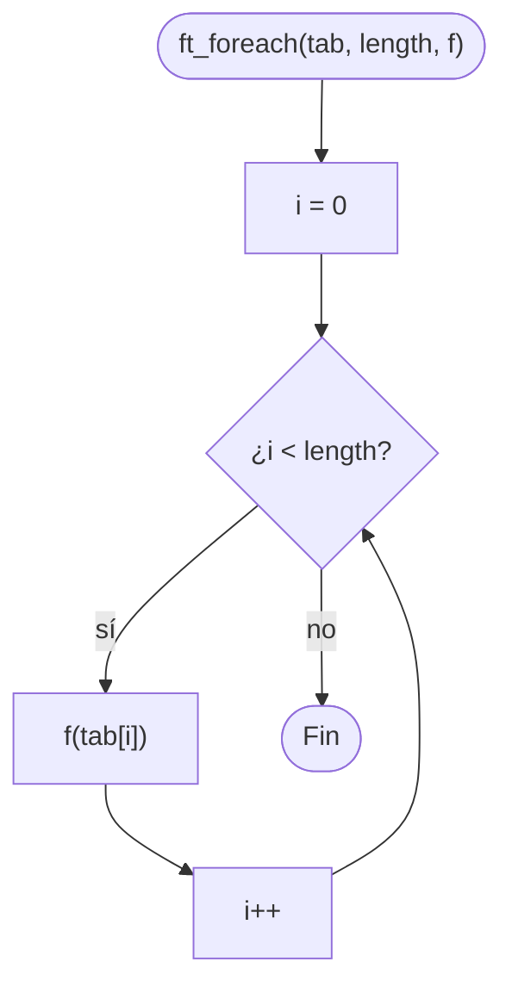

# ft_foreach

[[Piscine Reloaded - Índice|← Índice]] · ex25 · Punteros a función

> Recorre un array de enteros y llama a la función `f` con cada elemento, en orden. Es tu primer contacto con los **punteros a función**: `ft_foreach` no sabe qué hace `f`, solo la llama.

## Explicación sencilla

```c
ft_foreach(tab, 5, &print_nb);   // print_nb(tab[0]), print_nb(tab[1]), ... print_nb(tab[4])
```

```text
 tab:  ┌───┬────┬───┬───┬────┐
       │ 1 │ -2 │ 3 │ 0 │ 42 │      length = 5
       └───┴────┴───┴───┴────┘
         │    │    │   │    │
         ▼    ▼    ▼   ▼    ▼
        f(1) f(-2) f(3) f(0) f(42)    en este orden
```

`void (*f)(int)` se lee de dentro hacia fuera: `f` es un **puntero** (`*f`) a una **función** que recibe un `int` (`(int)`) y no devuelve nada (`void`). Para llamarla basta con `f(tab[i])`; también vale `(*f)(tab[i])`.

## Prototipo

```c
void	ft_foreach(int *tab, int length, void (*f)(int));
```

> [!info] Sin función original
> No existe en la libc. El comportamiento lo define el **subject** de Piscine Reloaded.

## Requisitos del subject

> [!quote] Subject Piscine Reloaded v2.0 — Ejercicio 25
> Directorio de entrega: ex25/
> Archivos a entregar: ft_foreach.c
> Funciones autorizadas: Ninguna
>
> • Crea la función ft_foreach que, para un array de enteros dado, aplique una función a todos sus elementos. Esta función se aplicará siguiendo el orden del array.
>
> • Este debe ser el prototipo de la función:
>
> `void   ft_foreach(int *tab, int length, void (*f)(int));`
>
> • Por ejemplo, la función ft_foreach puede llamarse de la siguiente manera para mostrar todos los enteros del array:
>
> `ft_foreach(tab, 1337, &ft_putnbr);`

## Cómo implementarla

```text
i = 0
mientras i < length:
    f(tab[i])
    i = i + 1
```

## Diagrama de flujo



## Ejemplos

```c
#include <stdio.h>

void	ft_foreach(int *tab, int length, void (*f)(int));

void	print_nb(int nb)
{
	printf("[%d]", nb);
}

void	print_double(int nb)
{
	printf("%d ", nb * 2);
}

int	main(void)
{
	int	tab[5];

	tab[0] = 1;
	tab[1] = -2;
	tab[2] = 3;
	tab[3] = 0;
	tab[4] = 42;
	ft_foreach(tab, 5, &print_nb);
	printf("\n");
	ft_foreach(tab, 5, print_double);
	printf("\n");
	ft_foreach(tab, 0, &print_nb);
	ft_foreach(tab, -3, &print_nb);
	ft_foreach(NULL, 0, &print_nb);
	printf("length 0, -3 y NULL con 0: nada\n");
	return (0);
}
```

```text
[1][-2][3][0][42]
2 -4 6 0 84 
length 0, -3 y NULL con 0: nada
```

- `&print_nb` y `print_nb` son equivalentes: el nombre de una función ya se convierte en su dirección.
- Con `length <= 0` la condición `i < length` es falsa desde el principio y no se llama a `f` ni se toca `tab` (por eso `NULL` con 0 no falla).

## Puntos clave y casos límite

- **`length <= 0`**: no hace nada. No hace falta un `if` aparte; el `while` ya lo cubre.
- **`length` mayor que el array real**: lee fuera del array, comportamiento indefinido. `ft_foreach` no puede saberlo; es responsabilidad de quien llama (el `1337` del subject es solo un ejemplo).
- **`f == NULL`**: llamar a un puntero nulo es segfault. El subject no lo pide, pero proteger con `if (!f) return ;` no molesta.
- `f` recibe **una copia** de cada entero: no puede modificar `tab`. Si quisieras modificarlo, el prototipo tendría que ser `void (*f)(int *)`.
- Hermanas en libft: [[ft_striteri]] hace lo mismo sobre un string, pero pasa a `f` el **índice** y un **puntero** al carácter (`void (*f)(unsigned int, char *)`), así que sí puede modificarlo y no necesita `length` porque para en `'\0'`. [[ft_lstiter]] recorre una lista enlazada (`void (*f)(void *)`) hasta `NULL`.

### Errores típicos

- **Recorrer al revés o empezar en 1**: el subject dice "siguiendo el orden del array".
- **Usar `<=` en la condición**: llama a `f` con `tab[length]`, un elemento de más.
- **Confundir el prototipo** escribiendo `void *f(int)`: eso declara una función que devuelve `void *`, no un puntero a función. Los paréntesis de `(*f)` son obligatorios.
- **Llamar a `f` como `f(tab)`** o `f(i)`: hay que pasar el **valor** del elemento, `tab[i]`.

## Relacionadas

[[ft_count_if]] · [[ft_striteri]] · [[ft_lstiter]] · [[ft_putnbr_fd]] · [[Punteros en C]] · [[Arrays en C]]

## Referencias

- Subject de Piscine Reloaded v2.0 — requisitos copiados literalmente.
- [Pointer declaration — cppreference](https://en.cppreference.com/w/c/language/pointer) — sección "Pointers to functions".
- [Beej's Guide to C — Function Pointers](https://beej.us/guide/bgc/) — capítulo "Pointers II", apartado de punteros a función.
- Ejemplos compilados con `cc -Wall -Wextra -Werror` (Ubuntu clang 12.0.1) en Linux x86_64.
