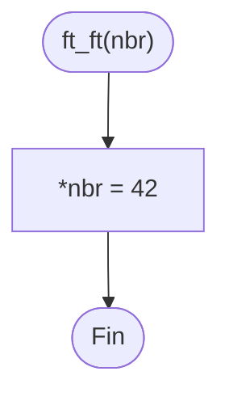

# ft_ft

[[Piscine Reloaded - Índice|← Índice]] · ex09 · Punteros

> Recibe la **dirección** de un entero y escribe `42` en él. Es el primer contacto con la desreferencia: `*nbr = 42` cambia la variable de quien llama.

## Explicación sencilla

```c
int	n;

n = 0;
ft_ft(&n);   // ahora n = 42
```

```text
 main:                      ft_ft:
   n ┌────┐                   nbr ┌────────────┐
     │  0 │ ◄─────────────────────│ dirección  │
     └────┘                       │   de n     │
                                  └────────────┘
 *nbr = 42  →  escribe en la caja a la que apunta nbr, es decir, en n:
   n ┌────┐
     │ 42 │
     └────┘
```

`nbr` es una copia de la dirección de `n`. Cambiar `nbr` no sirve de nada fuera de la función; cambiar **lo apuntado** (`*nbr`) sí. Ver [[Punteros en C]].

## Prototipo

```c
void	ft_ft(int *nbr);
```

> [!info] Sin función original
> No existe en la libc. El comportamiento lo define el **subject** de Piscine Reloaded.

## Requisitos del subject

> [!quote] Subject Piscine Reloaded v2.0 — Ejercicio 09
> Directorio de entrega: ex09/
> Archivos a entregar: ft_ft.c
> Funciones autorizadas: Ninguna
>
> • Crea una función que tome un puntero a un entero como un parámetro y fije el valor “42” al entero.

## Cómo implementarla

```text
*nbr = 42
```

## Diagrama de flujo



## Ejemplos

Da igual cómo llegue la dirección: `&n`, un puntero `p` que guarda `&n` o `*pp` (un puntero a puntero desreferenciado una vez). En los tres casos `ft_ft` recibe lo mismo, la dirección de `n`.

```c
#include <stdio.h>

void	ft_ft(int *nbr);

int	main(void)
{
	int	n;
	int	*p;
	int	**pp;

	n = 0;
	p = &n;
	pp = &p;
	printf("antes: n = %d\n", n);
	ft_ft(&n);
	printf("despues: n = %d\n", n);
	n = 0;
	ft_ft(p);
	printf("via p: n = %d\n", n);
	n = 0;
	ft_ft(*pp);
	printf("via *pp: n = %d\n", n);
	return (0);
}
```

```text
$ ./a.out
antes: n = 0
despues: n = 42
via p: n = 42
via *pp: n = 42
```

## Puntos clave y casos límite

- `ft_ft(NULL)` es comportamiento indefinido (segfault): el subject no pide comprobarlo. Ver [[Carácter nulo y puntero NULL]].
- Es el mismo mecanismo que usan [[ft_swap]] y [[ft_div_mod]] para «devolver» más de un valor.

### Errores típicos

- **`nbr = 42;`** (sin `*`): intenta guardar 42 como dirección. Con `-Werror` no compila:
  `error: incompatible integer to pointer conversion assigning to 'int *' from 'int' [-Werror,-Wint-conversion]`.
- **Recibir `int nbr`** en vez de `int *nbr`: la función cambia su copia y la variable de `main` sigue igual.
- **`*nbr = '42'`**: comillas simples con dos caracteres no es el número 42.

## Relacionadas

[[ft_swap]] · [[ft_div_mod]] · [[Punteros en C]] · [[Carácter nulo y puntero NULL]]

## Referencias

- Subject de Piscine Reloaded v2.0 (`/home/felixrod/cursus/piscine-reloaded/es.subject_piscine-reloaded.pdf`) — requisitos copiados literalmente.
- [Pointer declaration — cppreference](https://en.cppreference.com/w/c/language/pointer) — desreferencia con `*`.
- Ejemplos compilados con `cc -Wall -Wextra -Werror` (Ubuntu clang 12.0.1) en Linux x86_64.
