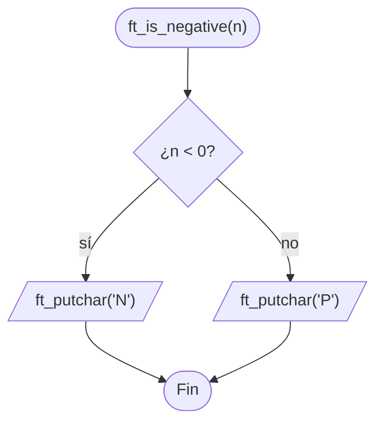

# ft_is_negative

[[Piscine Reloaded - Índice|← Índice]] · ex08 · Salida

> Escribe `'N'` si el entero es negativo y `'P'` si es positivo **o cero**. No devuelve nada: el resultado se ve en pantalla.

## Explicación sencilla

```c
ft_is_negative(-42);   // escribe N
ft_is_negative(0);     // escribe P
ft_is_negative(42);    // escribe P
```

```text
  ... -3  -2  -1 │  0   1   2   3 ...
  ◄──── 'N' ─────┤──────── 'P' ────►
              n < 0       n >= 0
```

Solo hay una pregunta: `¿n < 0?`. El cero va con los positivos porque el subject lo dice así («positivo o cero»).

## Prototipo

```c
void	ft_is_negative(int n);
```

> [!info] Sin función original
> No existe en la libc. El comportamiento lo define el **subject** de Piscine Reloaded.

## Requisitos del subject

> [!quote] Subject Piscine Reloaded v2.0 — Ejercicio 08
> Directorio de entrega: ex08/
> Archivos a entregar: ft_is_negative.c
> Funciones autorizadas: ft_putchar
>
> • Crea una función que muestre ’N’ o ’P’ dependiendo del signo del entero introducido como parámetro. Si n es negativo, muestra ’N’. Si n es positivo o cero, muestra ’P’.

> [!quote] Subject Piscine Reloaded v2.0 — Instrucciones generales
> • Si ft_putchar() es una función autorizada, la Moulinette compilará el código usando su propio ft_putchar.c

> [!info] Qué significa para ti
> - **No entregues `ft_putchar.c`**: solo `ft_is_negative.c`. La Moulinette añade el suyo al compilar.
> - Su `ft_putchar(c)` escribe un carácter en la salida estándar. Es lo mismo que [[ft_putchar_fd]] con `fd = 1`: `write(1, &c, 1)`.
> - En tu `.c` sí tiene que estar el **prototipo** `void	ft_putchar(char c);` antes de usarla.

## Cómo implementarla

```text
si n < 0
    ft_putchar('N')
si no
    ft_putchar('P')
```

## Diagrama de flujo



## Ejemplos

En local, tu propio `ft_putchar` va en un fichero aparte que **no** se entrega:

```c
/* ft_putchar.c — solo para probar, no se entrega */
#include <unistd.h>

void	ft_putchar(char c)
{
	write(1, &c, 1);
}
```

```c
/* main.c */
#include <limits.h>

void	ft_putchar(char c);
void	ft_is_negative(int n);

int	main(void)
{
	ft_is_negative(-42);
	ft_is_negative(-1);
	ft_is_negative(0);
	ft_is_negative(1);
	ft_is_negative(42);
	ft_is_negative(INT_MIN);
	ft_is_negative(INT_MAX);
	ft_putchar('\n');
	return (0);
}
```

```text
$ cc -Wall -Wextra -Werror main.c ft_putchar.c ft_is_negative.c
$ ./a.out | cat -e
NNPPPNP$
```

## Puntos clave y casos límite

- `0` → `'P'`. Es el único caso que se puede fallar.
- `INT_MIN` y `INT_MAX` no dan problemas: solo se compara, no se opera con `n`.
- Escribe un único carácter y **sin** salto de línea.

### Errores típicos

- **Usar `n <= 0`** para la `'N'`: el cero saldría como negativo.
- **Escribir `"N"` con comillas dobles**: es una cadena (`char *`), no un `char`; con `-Werror` no compila.
- **Añadir `'\n'`** o entregar `ft_putchar.c`.

## Relacionadas

[[ft_print_alphabet]] · [[ft_print_numbers]] · [[ft_putchar_fd]] · [[ft_abs]] · [[Tipos enteros y conversiones]]

## Referencias

- Subject de Piscine Reloaded v2.0 (`/home/felixrod/cursus/piscine-reloaded/es.subject_piscine-reloaded.pdf`) — requisitos e instrucción sobre `ft_putchar` copiados literalmente.
- [Comparison operators — cppreference](https://en.cppreference.com/w/c/language/operator_comparison)
- Ejemplos compilados con `cc -Wall -Wextra -Werror` (Ubuntu clang 12.0.1) en Linux x86_64.
