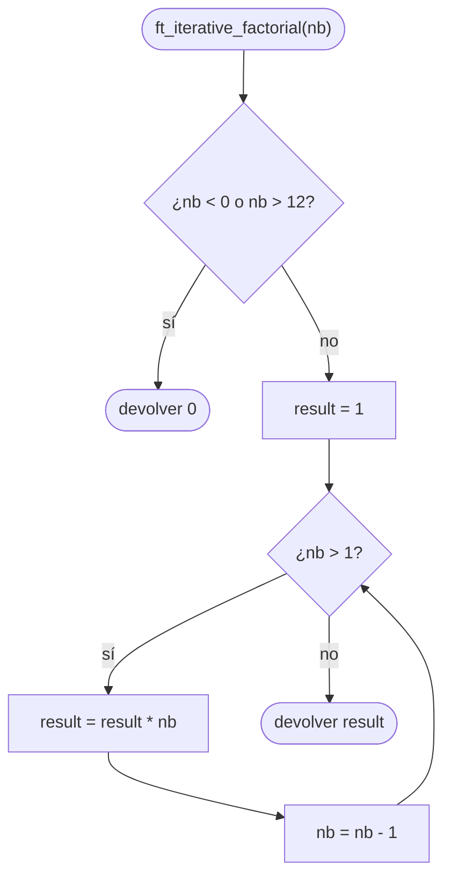

# ft_iterative_factorial

[[Piscine Reloaded - Índice|← Índice]] · ex12 · Matemáticas

> Devuelve el factorial de `nb` (`nb! = nb × (nb − 1) × … × 1`) con un **bucle**. Si hay error (número negativo, o resultado que no cabe en `int`), devuelve 0.

## Explicación sencilla

```c
ft_iterative_factorial(5);    // 120
ft_iterative_factorial(0);    // 1
ft_iterative_factorial(-3);   // 0  (error)
```

```text
 5! = 5 × 4 × 3 × 2 × 1

 nb      result
 5       1        ← empieza en 1
 5   →   5        result = result * nb, nb = nb - 1
 4   →   20
 3   →   60
 2   →   120
 1       120      ← nb ya no es > 1: fin
```

- `0! = 1` por definición (el producto de cero factores es 1). Con `result = 1` y el bucle `while (nb > 1)` sale solo.
- Los negativos no tienen factorial: es el «error» del subject → 0.
- El factorial crece **muy** rápido. `12!` cabe en `int`; `13!` ya no (ver abajo).

## Prototipo

```c
int	ft_iterative_factorial(int nb);
```

> [!info] Sin función original
> No existe en la libc. El comportamiento lo define el **subject** de Piscine Reloaded.

## Requisitos del subject

> [!quote] Subject Piscine Reloaded v2.0 — Ejercicio 12
> Directorio de entrega: ex12/
> Archivos a entregar: ft_iterative_factorial.c
> Funciones autorizadas: Ninguna
>
> • Crea una función iterativa que devuelva un número. Dicho número es el resultado de una operación factorial basada en el número introducido como parámetro.
>
> • Si hay un error, la función debe devolver 0.
>
> • Tu función debe devolver su resultado en menos de dos segundos.

## Cómo implementarla

```text
si nb < 0 o nb > 12: devolver 0      (negativo o no cabe en int)
result = 1
mientras nb > 1
    result = result * nb
    nb = nb - 1
devolver result
```

> [!tip] ¿Por qué `nb > 12`?
> El subject solo dice «si hay un error, devolver 0». Que el resultado no quepa en `int` es un error razonable, y el tope te salva de dos problemas: el desbordamiento con signo (comportamiento indefinido) y el **límite de 2 segundos** (sin tope, `nb = INT_MAX` hace unos 2 000 millones de vueltas; medido abajo: casi 4 s).

## Diagrama de flujo



## Ejemplos

```c
#include <stdio.h>
#include <limits.h>

int	ft_iterative_factorial(int nb);
int	ft_recursive_factorial(int nb);

static void	test(int n)
{
	printf("%11d! -> iter = %9d  rec = %9d\n", n,
		ft_iterative_factorial(n), ft_recursive_factorial(n));
}

int	main(void)
{
	test(-5);
	test(0);
	test(1);
	test(5);
	test(10);
	test(12);
	test(13);
	test(INT_MAX);
	test(INT_MIN);
	return (0);
}
```

```text
$ time ./a.out
         -5! -> iter =         0  rec =         0
          0! -> iter =         1  rec =         1
          1! -> iter =         1  rec =         1
          5! -> iter =       120  rec =       120
         10! -> iter =   3628800  rec =   3628800
         12! -> iter = 479001600  rec = 479001600
         13! -> iter =         0  rec =         0
 2147483647! -> iter =         0  rec =         0
-2147483648! -> iter =         0  rec =         0

real	0m0.001s
```

(Compara con [[ft_recursive_factorial]]: mismos resultados.)

**Dónde desborda.** Versión **sin** el tope `nb > 12`, comparada con el valor real calculado en `long`:

```c
#include <stdio.h>

int	ft_iterative_factorial(int nb);

int	main(void)
{
	long	real;
	int		n;

	real = 1;
	n = 1;
	while (n <= 14)
	{
		real = real * n;
		printf("%2d! int = %10d  real = %ld\n", n,
			ft_iterative_factorial(n), real);
		n++;
	}
	return (0);
}
```

```text
$ ./a.out | tail -4
11! int =   39916800  real = 39916800
12! int =  479001600  real = 479001600
13! int = 1932053504  real = 6227020800
14! int = 1278945280  real = 87178291200
```

`13! = 6 227 020 800` y `INT_MAX = 2 147 483 647`: no cabe. Sin tope, el `int` da un número que **parece** válido pero es basura. Con `-fsanitize=undefined`:

```text
ft_iterative_factorial.c:10:10: runtime error: signed integer overflow: 1037836800 * 3 cannot be represented in type 'int'
```

Y sin tope, un `main` que solo hace `printf("iter(INT_MAX) = %d\n", ft_iterative_factorial(INT_MAX))` se pasa del límite del subject (el resultado acaba en 0 porque, tras tantas multiplicaciones, el valor desbordado se llena de factores 2):

```text
$ time ./a.out
iter(INT_MAX) = 0

real	0m3.915s
```

## Puntos clave y casos límite

- `nb < 0` → 0. `nb == 0` → 1. `nb == 1` → 1.
- `12! = 479 001 600` es el mayor factorial que cabe en `int` de 32 bits.
- La iterativa no gasta pila: memoria constante, a diferencia de [[ft_recursive_factorial]].

### Errores típicos

- **`result = 0` al empezar**: todo sale 0.
- **Devolver 0 para `nb == 0`**: `0!` es 1.
- **Bucle `while (nb > 0)` con `result *= nb--`**: funciona, pero cuidado con modificar y leer `nb` en la misma expresión de formas más raras (comportamiento indefinido).
- **Usar `for`**: prohibido por la Norma. Ver [[La Norma]].

## Relacionadas

[[ft_recursive_factorial]] · [[ft_sqrt]] · [[ft_power]] · [[Recursión]] · [[Tipos enteros y conversiones]]

## Referencias

- Subject de Piscine Reloaded v2.0 — requisitos copiados literalmente.
- [Factorial — Wikipedia](https://es.wikipedia.org/wiki/Factorial) — definición y `0! = 1`.
- [Arithmetic operators — cppreference](https://en.cppreference.com/w/c/language/operator_arithmetic) — desbordamiento de enteros con signo.
- Ejemplos compilados con `cc -Wall -Wextra -Werror` (Ubuntu clang 12.0.1) en Linux x86_64.
