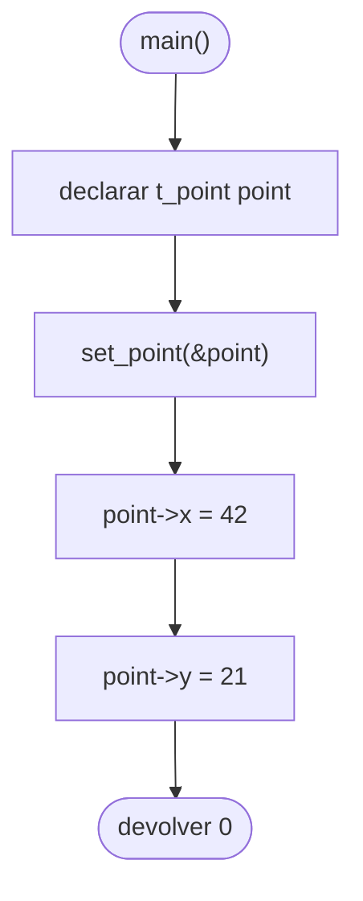

# ft_point

[[Piscine Reloaded - Índice|← Índice]] · ex23 · Headers

> Un header `ft_point.h` que define el tipo `t_point`: una estructura con dos enteros `x` e `y`. El objetivo es que compile el `main` que da el subject.

## Explicación sencilla

```c
t_point	point;

point.x = 42;      // acceso directo: variable de tipo struct
set_point(&point); // dentro: point->x, porque recibe un puntero
```

```text
 t_point point (8 bytes en la pila)
 ┌──────────┬──────────┐
 │  x: 42   │  y: 21   │
 └──────────┴──────────┘
   int (4)    int (4)
```

`struct s_point` es el **nombre de la estructura**; `t_point` es un **alias** creado con `typedef` para no escribir `struct` cada vez. La Norma obliga a que los `struct` empiecen por `s_` y los `typedef` por `t_`. Más detalle: [[Structs y typedef]].

## Prototipo

```c
typedef struct s_point
{
	int	x;
	int	y;
}	t_point;
```

> [!info] Sin función original
> No hay nada que buscar en la libc: el ejercicio solo pide un **tipo**. Lo define el subject a través del `main` que tiene que compilar.

## Requisitos del subject

> [!quote] Subject Piscine Reloaded v2.0 — Ejercicio 23
> Directorio de entrega: ex23/
> Archivos a entregar: ft_point.h
> Funciones autorizadas: Ninguna
>
> • Crea un archivo ft_point.h que deberá compilar el siguiente main:
>
> ```c
> #include "ft_point.h"
>
> void set_point(t_point *point)
> {
>   point->x = 42;
>   point->y = 21;
> }
>
> int   main(void)
> {
>   t_point   point;
>
>     set_point(&point);
>     return (0);
> }
> ```

> [!tip] Lee el main al revés
> Del `main` se deduce todo lo que hace falta: un tipo llamado `t_point` (sin `struct` delante), con campos `x` e `y` que aceptan `42` y `21`. `int` es la elección natural.

## Cómo implementarla

```text
fichero ft_point.h:
    si FT_POINT_H no está definido:
        definir FT_POINT_H
        typedef struct s_point
            int x
            int y
        con alias t_point
```

- **Guardas de inclusión** obligatorias: sin ellas, incluir el header dos veces da `redefinition of 's_point'`.
- **Estilo Norma**: `typedef struct s_point` en una línea, la llave en la siguiente, campos con tabulador entre tipo y nombre, y `}	t_point;` con tabulador antes del alias.
- Nada más: ni funciones, ni `#include` innecesarios.

## Diagrama de flujo



## Ejemplos

El `main` del subject, tal cual, compila y termina con 0:

```text
$ cc -Wall -Wextra -Werror main.c -o t && ./t; echo "ret=$?"
ret=0
```

Prueba un poco más completa (no se entrega):

```c
#include <stdio.h>
#include "ft_point.h"
#include "ft_point.h"

void	set_point(t_point *point)
{
	point->x = 42;
	point->y = 21;
}

int	main(void)
{
	t_point			point;
	struct s_point	other;

	set_point(&point);
	other = point;
	printf("x = %d, y = %d\n", point.x, point.y);
	printf("other: x = %d, y = %d\n", other.x, other.y);
	printf("sizeof(t_point) = %zu\n", sizeof(t_point));
	return (0);
}
```

```text
x = 42, y = 21
other: x = 42, y = 21
sizeof(t_point) = 8
```

- `t_point` y `struct s_point` son el mismo tipo: se pueden asignar entre sí.
- Una asignación de structs (`other = point`) copia todos los campos.
- Incluir el header dos veces no da error gracias a las guardas. Sin ellas:

```text
In file included from ng.c:2:
./noguard.h:2:16: error: redefinition of 's_point'
typedef struct s_point
               ^
```

## Puntos clave y casos límite

- **`.` frente a `->`**: con una variable `point.x`; con un puntero `point->x`, que equivale a `(*point).x`. Ver [[Punteros en C]].
- `set_point` recibe `&point` porque quiere **modificar** la estructura del `main`. Si recibiera `t_point point`, cambiaría una copia (mismo motivo que en [[ft_swap]]).
- El `main` del subject no sigue la Norma (espacios en vez de tabuladores). No pasa nada: tú solo entregas `ft_point.h`, y ese sí debe pasar `norminette`.
- La misma convención `s_`/`t_` la usarás en libft con `typedef struct s_list ... t_list` (ver [[Listas enlazadas]]).

### Errores típicos

- **Olvidar el `typedef`**: con solo `struct s_point { ... };` el `main` falla porque `t_point` no existe.
- **Nombre de guarda incoherente**: usa el nombre del fichero en mayúsculas, `FT_POINT_H`.
- **Poner el `typedef` en un `.c`**: el subject pide solo `ft_point.h`.
- **Campos `x`/`y` con otro nombre o tipo** (`char`, `float`): el `main` dejaría de compilar o se comportaría distinto.

## Relacionadas

[[ft_abs]] · [[ft_swap]] · [[Structs y typedef]] · [[Preprocesador y headers]] · [[Listas enlazadas]] · [[La Norma]]

## Referencias

- Subject de Piscine Reloaded v2.0 — requisitos y `main` copiados literalmente.
- [Struct declaration — cppreference](https://en.cppreference.com/w/c/language/struct) — estructuras y acceso a miembros.
- [Typedef declaration — cppreference](https://en.cppreference.com/w/c/language/typedef) — alias de tipos.
- Ejemplos compilados con `cc -Wall -Wextra -Werror` (Ubuntu clang 12.0.1) en Linux x86_64.
