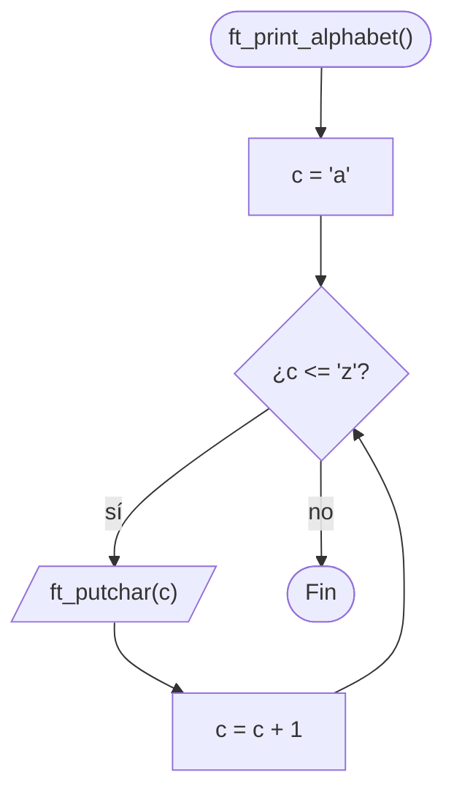

# ft_print_alphabet

[[Piscine Reloaded - Índice|← Índice]] · ex06 · Salida

> Muestra el alfabeto en minúsculas, de la `'a'` a la `'z'`, en una sola línea. Solo puede usar `ft_putchar`, así que escribe las letras una a una.

## Explicación sencilla

```c
ft_print_alphabet();
```

```text
$ ./a.out
abcdefghijklmnopqrstuvwxyz
```

Un `char` es un número pequeño. En ASCII, `'a'` vale 97, `'b'` vale 98… y `'z'` vale 122: las letras minúsculas son **consecutivas**. Por eso basta con empezar en `'a'` y sumar 1 hasta pasar de `'z'`.

```text
 c:   'a'  'b'  'c'  ...  'y'  'z'   '{'
       97   98   99  ...  121  122   123  ← aquí c > 'z': se sale del bucle
       │    │    │         │    │
       ▼    ▼    ▼         ▼    ▼
     ft_putchar(c) en cada vuelta
```

La función **no** escribe salto de línea: el subject solo pide el alfabeto.

## Prototipo

```c
void	ft_print_alphabet(void);
```

> [!info] Sin función original
> No existe en la libc. El comportamiento lo define el **subject** de Piscine Reloaded.

## Requisitos del subject

> [!quote] Subject Piscine Reloaded v2.0 — Ejercicio 06
> Directorio de entrega: ex06/
> Archivos a entregar: ft_print_alphabet.c
> Funciones autorizadas: ft_putchar
>
> • Crea una función que muestre el alfabeto en minúsculas, en una única línea, en orden ascendente, empezando por la letra ’a’.

> [!quote] Subject Piscine Reloaded v2.0 — Instrucciones generales
> • Si ft_putchar() es una función autorizada, la Moulinette compilará el código usando su propio ft_putchar.c

> [!info] Qué significa para ti
> - **No entregues `ft_putchar.c`**: solo `ft_print_alphabet.c`. La Moulinette añade el suyo al compilar.
> - Su `ft_putchar(c)` escribe un carácter en la salida estándar. Es lo mismo que [[ft_putchar_fd]] con `fd = 1`: `write(1, &c, 1)`.
> - En tu `.c` sí tiene que estar el **prototipo** `void	ft_putchar(char c);` antes de usarla. Sin él, `-Werror` convierte el aviso de declaración implícita en error y no compila.

## Cómo implementarla

```text
c = 'a'
mientras c <= 'z'
    ft_putchar(c)
    c = c + 1
```

## Diagrama de flujo



## Ejemplos

Para probarla en local necesitas un `ft_putchar` tuyo en un fichero aparte (el que **no** entregas):

```c
/* ft_putchar.c — solo para probar, no se entrega */
#include <unistd.h>

void	ft_putchar(char c)
{
	write(1, &c, 1);
}
```

```c
/* main.c */
void	ft_putchar(char c);
void	ft_print_alphabet(void);

int	main(void)
{
	ft_print_alphabet();
	ft_putchar('\n');
	return (0);
}
```

```text
$ cc -Wall -Wextra -Werror main.c ft_putchar.c ft_print_alphabet.c
$ ./a.out | cat -e
abcdefghijklmnopqrstuvwxyz$
```

El `$` de `cat -e` marca el final de línea: el `'\n'` lo pone el `main`, no la función.

Si compilas sin `ft_putchar.c`, el enlazador no encuentra la función:

```text
$ cc -Wall -Wextra -Werror main.c ft_print_alphabet.c
/usr/bin/ld: /tmp/main-ad5e88.o: in function `main':
main.c:(.text+0x1a): undefined reference to `ft_putchar'
/usr/bin/ld: /tmp/ft_print_alphabet-c8079c.o: in function `ft_print_alphabet':
ft_print_alphabet.c:(.text+0x1e): undefined reference to `ft_putchar'
clang: error: linker command failed with exit code 1 (use -v to see invocation)
```

## Puntos clave y casos límite

- No tiene parámetros ni casos límite: siempre escribe las mismas 26 letras.
- Usa `'a'` y `'z'` en lugar de 97 y 122: se lee mejor y la Norma no lo prohíbe.
- Cada letra es una llamada a `write`. Es lento comparado con escribir un buffer, pero aquí no importa.

### Errores típicos

- **Añadir `'\n'` al final**: el subject no lo pide y la Moulinette compara la salida exacta.
- **Entregar `ft_putchar.c` o un `main`**: el subject dice que no puede haber ficheros que no se pidan.
- **Olvidar el prototipo de `ft_putchar`**: `implicit declaration of function 'ft_putchar'` y, con `-Werror`, no compila.
- **Condición `c < 'z'`**: se come la `'z'`.

## Relacionadas

[[ft_print_numbers]] · [[ft_is_negative]] · [[ft_putchar_fd]] · [[Tipos enteros y conversiones]]

## Referencias

- Subject de Piscine Reloaded v2.0 — requisitos e instrucción sobre `ft_putchar` copiados literalmente.
- [ASCII — Wikipedia](https://es.wikipedia.org/wiki/ASCII) — tabla de códigos de las letras.
- Ejemplos compilados con `cc -Wall -Wextra -Werror` (Ubuntu clang 12.0.1) en Linux x86_64.
