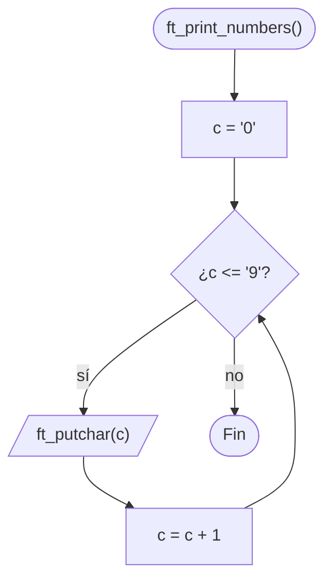

# ft_print_numbers

[[Piscine Reloaded - Índice|← Índice]] · ex07 · Salida

> Muestra los dígitos del `0` al `9` en una sola línea. Igual que [[ft_print_alphabet]], pero recorriendo los **caracteres** `'0'`…`'9'`, no los números 0…9.

## Explicación sencilla

```c
ft_print_numbers();
```

```text
$ ./a.out
0123456789
```

Hay que escribir **caracteres**. El número `0` y el carácter `'0'` no son lo mismo:

```text
 carácter:  '0'  '1'  '2'  ...  '9'
 ASCII:      48   49   50  ...   57
```

`ft_putchar(0)` escribe el byte nulo (invisible), no un cero. Por eso el bucle va de `'0'` a `'9'`. Otra forma válida: un `int` de 0 a 9 y escribir `i + '0'`, el mismo truco que usa [[ft_putnbr_fd]] para cada cifra.

## Prototipo

```c
void	ft_print_numbers(void);
```

> [!info] Sin función original
> No existe en la libc. El comportamiento lo define el **subject** de Piscine Reloaded.

## Requisitos del subject

> [!quote] Subject Piscine Reloaded v2.0 — Ejercicio 07
> Directorio de entrega: ex07/
> Archivos a entregar: ft_print_numbers.c
> Funciones autorizadas: ft_putchar
>
> • Crea una función que muestre todos los dígitos, en una única línea, en orden ascendente.

> [!quote] Subject Piscine Reloaded v2.0 — Instrucciones generales
> • Si ft_putchar() es una función autorizada, la Moulinette compilará el código usando su propio ft_putchar.c

> [!info] Qué significa para ti
> - **No entregues `ft_putchar.c`**: solo `ft_print_numbers.c`. La Moulinette añade el suyo al compilar.
> - Su `ft_putchar(c)` escribe un carácter en la salida estándar. Es lo mismo que [[ft_putchar_fd]] con `fd = 1`: `write(1, &c, 1)`.
> - En tu `.c` sí tiene que estar el **prototipo** `void	ft_putchar(char c);` antes de usarla.

## Cómo implementarla

```text
c = '0'
mientras c <= '9'
    ft_putchar(c)
    c = c + 1
```

## Diagrama de flujo



## Ejemplos

En local escribe tu propio `ft_putchar` en un fichero aparte, que **no** se entrega:

```c
/* ft_putchar.c — solo para probar, no se entrega */
#include <unistd.h>

void	ft_putchar(char c)
{
	write(1, &c, 1);
}
```

```c
/* main.c */
void	ft_putchar(char c);
void	ft_print_numbers(void);

int	main(void)
{
	ft_print_numbers();
	ft_putchar('\n');
	return (0);
}
```

```text
$ cc -Wall -Wextra -Werror main.c ft_putchar.c ft_print_numbers.c
$ ./a.out | cat -e
0123456789$
```

Si en `ft_print_numbers.c` falta la línea del prototipo de `ft_putchar`:

```text
$ cc -Wall -Wextra -Werror main.c ft_putchar.c ft_print_numbers.c
ft_print_numbers.c:8:3: error: implicit declaration of function 'ft_putchar' is invalid in C99 [-Werror,-Wimplicit-function-declaration]
                ft_putchar(c);
                ^
1 error generated.
```

## Puntos clave y casos límite

- Sin parámetros: siempre escribe los mismos 10 caracteres.
- Los dígitos `'0'`…`'9'` son consecutivos en ASCII (y el estándar C lo garantiza en cualquier juego de caracteres).

### Errores típicos

- **`ft_putchar(i)` con `i` de 0 a 9**: escribe bytes de control, no dígitos. Falta `+ '0'`.
- **Añadir `'\n'`**: la salida ya no coincide con la esperada.
- **Entregar `ft_putchar.c` o un `main`**.

## Relacionadas

[[ft_print_alphabet]] · [[ft_is_negative]] · [[ft_putchar_fd]] · [[ft_putnbr_fd]] · [[ft_isdigit]]

## Referencias

- Subject de Piscine Reloaded v2.0 — requisitos e instrucción sobre `ft_putchar` copiados literalmente.
- [Character sets and encodings — cppreference](https://en.cppreference.com/w/c/language/charset) — los dígitos decimales son consecutivos.
- Ejemplos compilados con `cc -Wall -Wextra -Werror` (Ubuntu clang 12.0.1) en Linux x86_64.
