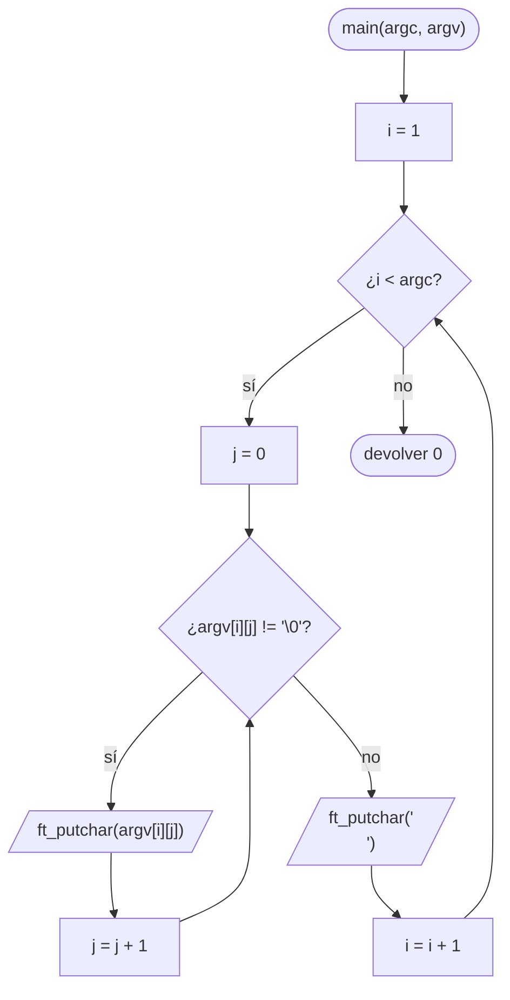

# ft_print_params

[[Piscine Reloaded - Índice|← Índice]] · ex18 · Programas

> Primer **programa** de Piscine Reloaded: un `main` que escribe los argumentos que recibe desde la terminal, uno por línea, sin el nombre del programa.

## Explicación sencilla

Cuando escribes `./ft_print_params a b c`, el sistema llama a `main` con dos datos:

- `argc` (*argument count*): cuántas palabras hay, **contando el nombre del programa**. Aquí, 4.
- `argv` (*argument vector*): un array de cadenas con esas palabras. Termina con un puntero `NULL`.

```text
 $ ./ft_print_params a b c

 argc = 4
 argv ──► ┌─────────┐
     [0]  │    ─────┼──► "./ft_print_params"   ← nombre del programa: no se escribe
     [1]  │    ─────┼──► "a"
     [2]  │    ─────┼──► "b"
     [3]  │    ─────┼──► "c"
     [4]  │  NULL   │                         ← argv[argc] == NULL siempre
          └─────────┘
```

El programa recorre `argv` desde la posición **1** hasta `argc - 1` y escribe cada cadena seguida de `'\n'`. Como `argv` es un array de punteros a `char`, ver [[Punteros en C]] y [[Arrays en C]].

## Prototipo

```c
int	main(int argc, char **argv);

// Autorizada (la pone la Moulinette, no se entrega)
void	ft_putchar(char c);
```

> [!info] Sin función original
> Es un programa, no una función de la libc. El comportamiento lo define el **subject** de Piscine Reloaded. Como solo puedes usar `ft_putchar`, escribir una cadena entera exige un bucle carácter a carácter (lo mismo que hace `ft_putstr`, ver [[ft_putstr_fd]]).

## Requisitos del subject

> [!quote] Subject Piscine Reloaded v2.0 — Ejercicio 18
> Directorio de entrega: ex18/
> Archivos a entregar: ft_print_params.c
> Funciones autorizadas: ft_putchar
>
> • Esto se trata de un programa, así que deberías tener una función main en tu archivo .c.
>
> • Crea un programa que muestre sus argumentos dados.
>
> • Ejemplo:
> $>./a.out test1 test2 test3
> test1
> test2
> test3
> $>

## Cómo implementarla

```text
i = 1
mientras i < argc:
    j = 0
    mientras argv[i][j] != '\0':
        ft_putchar(argv[i][j])
        j = j + 1
    ft_putchar('\n')
    i = i + 1
devolver 0
```

El bucle interior puede ir en una función auxiliar `ft_putstr` dentro del mismo `.c`: la Norma permite hasta 5 funciones por fichero (ver [[La Norma]]).

## Diagrama de flujo



## Ejemplos

Compilado junto a un `ft_putchar.c` propio (`write(1, &c, 1)`), que no se entrega:

```text
$ cc -Wall -Wextra -Werror ft_print_params.c ft_putchar.c -o ft_print_params
$ ./ft_print_params a b c
a
b
c
$ ./ft_print_params test1 test2 test3
test1
test2
test3
$ ./ft_print_params
$ ./ft_print_params "hola mundo" adios
hola mundo
adios
$ ./ft_print_params "" x | cat -e
$
x$
```

- Sin argumentos (`argc == 1`) no escribe nada: el bucle no llega a entrar.
- `"hola mundo"` entre comillas es **un** argumento: quien separa las palabras es la shell, no tu programa.
- Un argumento vacío `""` existe (es una cadena con solo `'\0'`) y produce una línea vacía; `cat -e` marca cada final de línea con `$`.

Para ver qué recibe `main`, este programa de prueba (con `printf`, solo para mirar) recorre `argv` hasta `argc` incluido:

```c
#include <stdio.h>

int	main(int argc, char **argv)
{
	int	i;

	printf("argc = %d\n", argc);
	i = 0;
	while (i <= argc)
	{
		printf("argv[%d] = %s\n", i, argv[i] ? argv[i] : "(NULL)");
		i++;
	}
	return (0);
}
```

```text
$ ./argv0 a b
argc = 3
argv[0] = ./argv0
argv[1] = a
argv[2] = b
argv[3] = (NULL)
```

## Puntos clave y casos límite

- `argv[0]` es el nombre con el que se ha lanzado el programa (`./argv0`, `./a.out`…), no un argumento del usuario. Por eso se empieza en `i = 1`.
- `argv[argc] == NULL` siempre (lo garantiza el estándar C). Por eso también vale recorrer con `while (argv[i])` en lugar de `while (i < argc)`.
- `argc` es como mínimo 1 en la práctica: sin argumentos, el bucle no hace nada y el programa termina sin escribir.
- Termina con `return (0);`: el valor de `main` es el código de salida que ve la shell (`echo $?`).

### Errores típicos

- **Empezar en `i = 0`**: escribe también el nombre del programa en la primera línea.
- **Llegar hasta `i <= argc`** con `ft_putchar`: `argv[argc]` es `NULL` y desreferenciarlo da segfault.
- **Olvidar el `'\n'`** después de cada argumento: salen todos pegados (`test1test2test3`).
- **Entregar `ft_putchar.c`** o definir `ft_putchar` dentro de `ft_print_params.c`: la Moulinette compila con el suyo y un archivo de más o una definición duplicada hace fallar el ejercicio.

## Relacionadas

[[ft_sort_params]] · [[ft_putstr_fd]] · [[ft_putchar_fd]] · [[Punteros en C]] · [[Arrays en C]] · [[Carácter nulo y puntero NULL]]

## Referencias

- Subject de Piscine Reloaded v2.0 — requisitos copiados literalmente.
- [Main function — cppreference](https://en.cppreference.com/w/c/language/main_function) — `argc`, `argv` y `argv[argc]` como puntero nulo.
- [Beej's Guide to C: The Outside Environment](https://beej.us/guide/bgc/html/split/the-outside-environment.html) — argumentos de línea de comandos y código de salida.
- Ejemplos compilados con `cc -Wall -Wextra -Werror` (Ubuntu clang 12.0.1) en Linux x86_64.
