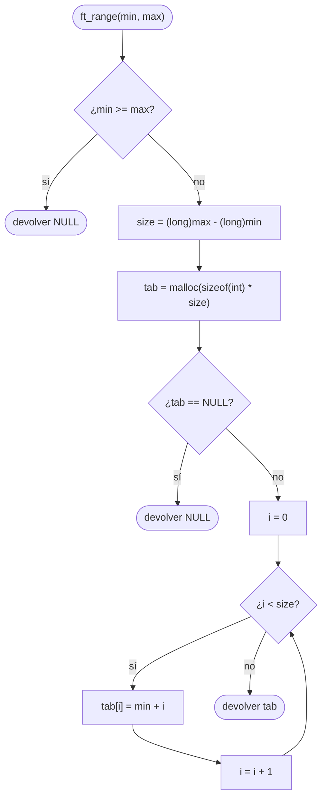

# ft_range

[[Piscine Reloaded - Índice|← Índice]] · ex21 · Cadenas y memoria

> Reserva con `malloc` un array de enteros y lo rellena con todos los valores de `min` a `max - 1`. Si `min >= max`, devuelve `NULL`. Es el primer ejercicio que **devuelve memoria dinámica** que otro tendrá que liberar.

## Explicación sencilla

```c
int	*tab;

tab = ft_range(3, 7);   // tab = {3, 4, 5, 6}
free(tab);
```

```text
 ft_range(3, 7)      size = 7 - 3 = 4 casillas

 tab ──► ┌───┬───┬───┬───┐    (en el heap, con malloc)
         │ 3 │ 4 │ 5 │ 6 │
         └───┴───┴───┴───┘
          [0] [1] [2] [3]      tab[i] = min + i

 El 7 no entra: min incluido, max excluido.
```

Dos pasos: **calcular cuántos** enteros hacen falta (`max - min`) y **reservar** esa cantidad multiplicada por `sizeof(int)`. Después, rellenar. El array vive en el heap y sigue existiendo al salir de la función: por eso se puede devolver (ver [[Segmentos de memoria en C]]). Quien llama tiene que hacer `free`.

El array no lleva marca de fin (no hay un «`'\0'` de los enteros»): quien llama sabe cuántos hay porque conoce `min` y `max`.

## Prototipo

```c
int	*ft_range(int min, int max);
```

> [!info] Sin función original
> No existe en la libc. El comportamiento lo define el **subject** de Piscine Reloaded.

## Requisitos del subject

> [!quote] Subject Piscine Reloaded v2.0 — Ejercicio 21
> Directorio de entrega: ex21/
> Archivos a entregar: ft_range.c
> Funciones autorizadas: malloc
>
> • Crea una función ft_range que devuelva un array de enteros. Este array de enteros debe contener todos los valores entre min y max.
>
> • Min incluido - max excluido.
>
> • Este debe ser su prototipo:
>
> int *ft_range(int min, int max);
>
> • Si el valor min es mayor o igual al valor max, debe devolverse un puntero nulo.

## Cómo implementarla

```text
si min >= max:
    devolver NULL
size = (long)max - (long)min           (en long: max - min puede no caber en int)
tab = malloc(sizeof(int) * size)
si tab == NULL:
    devolver NULL
i = 0
mientras i < size:
    tab[i] = min + i
    i = i + 1
devolver tab
```

`i` también es `long`, para poder compararlo con `size` sin mezclar tipos.

## Diagrama de flujo



## Ejemplos

```c
#include <stdio.h>
#include <stdlib.h>
#include <limits.h>

int	*ft_range(int min, int max);

static void	t(char *label, int min, int max)
{
	int		*tab;
	long	i;

	tab = ft_range(min, max);
	printf("%-32s", label);
	if (!tab)
		printf("NULL\n");
	else
	{
		i = 0;
		while (i < (long)max - (long)min)
		{
			printf("%d ", tab[i]);
			i++;
		}
		printf("\n");
		free(tab);
	}
}

int	main(void)
{
	t("ft_range(0, 5)", 0, 5);
	t("ft_range(-3, 3)", -3, 3);
	t("ft_range(7, 8)", 7, 8);
	t("ft_range(5, 5)", 5, 5);
	t("ft_range(5, 2)", 5, 2);
	t("ft_range(INT_MIN, INT_MIN + 3)", INT_MIN, INT_MIN + 3);
	t("ft_range(INT_MAX - 3, INT_MAX)", INT_MAX - 3, INT_MAX);
	t("ft_range(INT_MIN, INT_MAX)", INT_MIN, INT_MAX);
	return (0);
}
```

```text
ft_range(0, 5)                  0 1 2 3 4 
ft_range(-3, 3)                 -3 -2 -1 0 1 2 
ft_range(7, 8)                  7 
ft_range(5, 5)                  NULL
ft_range(5, 2)                  NULL
ft_range(INT_MIN, INT_MIN + 3)  -2147483648 -2147483647 -2147483646 
ft_range(INT_MAX - 3, INT_MAX)  2147483644 2147483645 2147483646 
ft_range(INT_MIN, INT_MAX)      NULL
```

La última línea es `NULL` porque **`malloc` falla**, no porque `min >= max`: pide 4 294 967 295 enteros (unos 16 GiB) y esta máquina tiene 7 GiB. Con Valgrind, todo liberado:

```text
==69306== HEAP SUMMARY:
==69306==     in use at exit: 0 bytes in 0 blocks
==69306==   total heap usage: 6 allocs, 6 frees, 4,168 bytes allocated
==69306== All heap blocks were freed -- no leaks are possible
```

### El desbordamiento de `max - min`

`max - min` puede ser mayor que `INT_MAX`. Con `ft_range(INT_MIN, INT_MAX)` el resultado real es 4 294 967 295, que no cabe en un `int`:

```c
#include <stdio.h>
#include <stdlib.h>
#include <limits.h>

int	main(void)
{
	int		min;
	int		max;
	int		size_int;
	long	size_long;
	void	*p;

	min = INT_MIN;
	max = INT_MAX;
	size_int = max - min;
	size_long = (long)max - (long)min;
	printf("int  size = %d\n", size_int);
	printf("long size = %ld\n", size_long);
	printf("bytes pedidos con int : %zu\n", sizeof(int) * size_int);
	printf("bytes pedidos con long: %zu\n", sizeof(int) * size_long);
	p = malloc(sizeof(int) * size_long);
	printf("malloc(%zu) -> %s\n", sizeof(int) * size_long, p ? "OK" : "NULL");
	free(p);
	return (0);
}
```

```text
int  size = -1
long size = 4294967295
bytes pedidos con int : 18446744073709551612
bytes pedidos con long: 17179869180
malloc(17179869180) -> NULL
```

- Con `int`, `max - min` es **comportamiento indefinido** (desbordamiento con signo). En la práctica sale `-1`, que convertido a `size_t` es un número enorme. Compilando la versión con `int size` con `-fsanitize=undefined`, el programa lo avisa:
  ```text
  ft_range_int.c:11:13: runtime error: signed integer overflow: 2147483647 - -2147483648 cannot be represented in type 'int'
  ```
  Aquí `malloc` falla y devuelve `NULL` «por suerte», pero el código ya es incorrecto.
- Con `long` (64 bits en Linux x86_64) la resta cabe siempre: el máximo es `INT_MAX - INT_MIN` = 4 294 967 295. También vale `unsigned int`: `(unsigned int)max - (unsigned int)min` da el valor correcto, porque la diferencia nunca pasa de `UINT_MAX`. Ver [[Tipos enteros y conversiones]].

## Puntos clave y casos límite

- `min >= max` → `NULL` **antes** de llamar a `malloc`. Así nunca haces `malloc(0)`, que puede devolver `NULL` o un puntero válido según el sistema.
- **Comprueba siempre el `NULL` de `malloc`** antes de escribir en `tab`. Ver [[Control de errores en C]].
- Quien llama a `ft_range` es responsable de hacer `free(tab)`. Si no, hay fuga de memoria (ver [[Valgrind y sanitizers]]).
- Rellenar con `tab[i] = min + i` evita incrementar `min` hasta `max`, pero las dos formas son correctas: `min` nunca pasa de `max - 1`, así que no desborda.
- Con mucha RAM y *overcommit*, `malloc` de 16 GiB podría devolver un puntero válido y el relleno tardaría mucho o acabaría matando el proceso. El subject no pide limitar el tamaño.

> [!tip] Relación con [[ft_calloc]]
> `ft_calloc(nmemb, size)` hace la misma reserva (`nmemb * size` bytes) pero rellena con ceros y comprueba que la multiplicación no desborde. En `ft_range` el relleno lo haces tú con valores reales, así que basta `malloc`; el problema del desbordamiento es el mismo, pero aquí aparece en la resta `max - min`.

> [!info] En el [[Exam Rank 02]]
> En las listas de práctica del nivel 3 aparecen `ft_range` y `ft_rrange` con **otro enunciado** que el de Piscine Reloaded: suelen incluir los **dos extremos** (`start` y `end`) y aceptar `start > end` (cuenta hacia abajo); `ft_rrange` devuelve los mismos valores en orden inverso. El tamaño pasa a ser `|end - start| + 1`. Lee siempre el enunciado del día.

### Errores típicos

- **Calcular el tamaño en `int`**: `max - min` desborda con rangos grandes (ver arriba).
- **`malloc(max - min)`** sin `sizeof(int)`: reserva bytes, no enteros. Escribes 4 veces más de lo reservado (Valgrind: *Invalid write*).
- **Devolver un array local** (`int tab[100];`): desaparece al salir de la función. Hay que usar `malloc`.
- **Reservar `max - min + 1`** o rellenar hasta `i <= size`: incluye `max`, que el subject excluye.
- **No comprobar `min >= max`**: con `min > max`, `max - min` es negativo y `malloc` recibe un tamaño absurdo.

## Relacionadas

[[ft_calloc]] · [[ft_strdup]] · [[Exam Rank 02]] · [[Tipos enteros y conversiones]] · [[Segmentos de memoria en C]] · [[Control de errores en C]] · [[Valgrind y sanitizers]]

## Referencias

- Subject de Piscine Reloaded v2.0 — requisitos copiados literalmente.
- [malloc(3) — man7.org](https://man7.org/linux/man-pages/man3/malloc.3.html) — valor de retorno `NULL` y *overcommit*.
- [Arithmetic operators — cppreference](https://en.cppreference.com/w/c/language/operator_arithmetic) — el desbordamiento de enteros con signo es comportamiento indefinido.
- [Beej's Guide to C: Manual Memory Allocation](https://beej.us/guide/bgc/html/split/manual-memory-allocation.html) — `malloc`, `free` y comprobar `NULL`.
- Ejemplos compilados con `cc -Wall -Wextra -Werror` (Ubuntu clang 12.0.1) en Linux x86_64.
