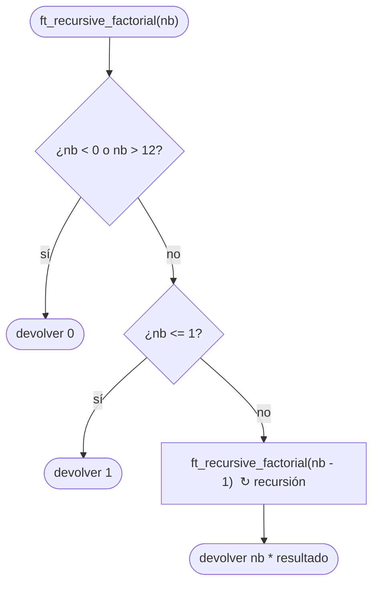

# ft_recursive_factorial

[[Piscine Reloaded - Índice|← Índice]] · ex13 · Matemáticas

> Lo mismo que [[ft_iterative_factorial]], pero **sin bucle**: la función se llama a sí misma con `nb - 1`. Si hay error (negativo o resultado que no cabe en `int`), devuelve 0.

## Explicación sencilla

La definición matemática ya es recursiva:

```text
 n! = n × (n − 1)!      si n > 1     ← caso recursivo
 n! = 1                 si n ≤ 1     ← caso base
```

```text
fact(4)
 └─ 4 * fact(3)
         └─ 3 * fact(2)
                 └─ 2 * fact(1)
                         └─ 1          ← caso base: no se llama más
                 = 2 * 1 = 2
         = 3 * 2 = 6
 = 4 * 6 = 24
```

Cada llamada espera a que termine la de debajo y luego multiplica. Las llamadas pendientes se apilan en la **pila** (*stack*): ver [[Recursión]], que usa justo este ejemplo para enseñar la pila en vivo.

## Prototipo

```c
int	ft_recursive_factorial(int nb);
```

> [!info] Sin función original
> No existe en la libc. El comportamiento lo define el **subject** de Piscine Reloaded.

## Requisitos del subject

> [!quote] Subject Piscine Reloaded v2.0 — Ejercicio 13
> Directorio de entrega: ex13/
> Archivos a entregar: ft_recursive_factorial.c
> Funciones autorizadas: Ninguna
>
> • Crea una función recursiva que devuelva el factorial del número introducido como parámetro.
>
> • Si hay un error, la función debe devolver 0.

## Cómo implementarla

```text
si nb < 0 o nb > 12: devolver 0      (negativo o no cabe en int)
si nb <= 1: devolver 1               (caso base: 0! = 1! = 1)
devolver nb * ft_recursive_factorial(nb - 1)
```

> [!tip] ¿Por qué `nb > 12`?
> `13!` no cabe en `int` (ver [[ft_iterative_factorial]]). Aquí el tope es aún más importante: sin él, `nb = INT_MAX` intenta anidar unos 2 000 millones de llamadas y **revienta la pila** (medido abajo). Como las comprobaciones se repiten en cada llamada, el tope solo actúa en la primera.

## Diagrama de flujo



## Ejemplos

Con el mismo `main` de prueba que en [[ft_iterative_factorial]] (llama a las dos versiones):

```text
$ ./a.out
         -5! -> iter =         0  rec =         0
          0! -> iter =         1  rec =         1
          1! -> iter =         1  rec =         1
          5! -> iter =       120  rec =       120
         10! -> iter =   3628800  rec =   3628800
         12! -> iter = 479001600  rec = 479001600
         13! -> iter =         0  rec =         0
 2147483647! -> iter =         0  rec =         0
-2147483648! -> iter =         0  rec =         0
```

**Sin el tope `nb > 12`**, con este `main`:

```c
#include <stdio.h>
#include <limits.h>

int	ft_recursive_factorial(int nb);

int	main(void)
{
	printf("rec(INT_MAX) = %d\n", ft_recursive_factorial(INT_MAX));
	return (0);
}
```

```text
$ bash -c './a.out; echo "exit = $?"'
bash: line 1: 72438 Segmentation fault      (core dumped) ./a.out
exit = 139
$ ulimit -s
8192
```

La pila mide 8 MiB por defecto; cada llamada ocupa unas decenas de bytes, así que se agota mucho antes de llegar a 1. Con el tope, el mismo `main` imprime `rec(INT_MAX) = 0` al instante. Y `13!` sin tope también desborda el `int`:

```text
ft_recursive_factorial.c:7:13: runtime error: signed integer overflow: 13 * 479001600 cannot be represented in type 'int'
```

## Puntos clave y casos límite

- `nb < 0` → 0. `nb == 0` → 1. `nb == 1` → 1.
- Hay **dos** salidas sin recursión (error y caso base) y una con recursión.

> [!question] ¿Iterativa o recursiva?
> | | [[ft_iterative_factorial]] | ft_recursive_factorial |
> |---|---|---|
> | Código | Bucle con `result` y `nb--` | Casi igual que la fórmula matemática |
> | Memoria | Constante (2 variables) | Un marco de pila por llamada: `nb` llamadas |
> | Riesgo | Tardar mucho (`INT_MAX` sin tope: casi 4 s) | *Stack overflow* (`INT_MAX` sin tope: segfault) |
> | Velocidad | Algo más rápida (sin coste de llamada) | Igual en la práctica con `nb ≤ 12` |
>
> Con el tope `nb > 12` las dos hacen como mucho 12 pasos y da igual. La recursiva se entiende mejor; la iterativa es más segura cuando el número de pasos puede ser grande.

### Errores típicos

- **Caso base `nb == 1` en vez de `nb <= 1`**: `ft_recursive_factorial(0)` llama con -1, que devuelve 0, y `0!` sale 0 en lugar de 1. Sin ningún caso base, *stack overflow*.
- **`return (nb * ft_recursive_factorial(nb))`**: no reduce el problema → recursión infinita.
- **Usar un bucle** dentro: el subject pide una función recursiva.
- **`nb--` en la llamada** (`ft_recursive_factorial(nb--)`): pasa el valor **antes** de restar → recursión infinita.

## Relacionadas

[[ft_iterative_factorial]] · [[Recursión]] · [[ft_putnbr_fd]] · [[ft_fibonacci]] · [[ft_power]] · [[Segmentos de memoria en C]]

## Referencias

- Subject de Piscine Reloaded v2.0 (`/home/felixrod/cursus/piscine-reloaded/es.subject_piscine-reloaded.pdf`) — requisitos copiados literalmente.
- [Factorial — Wikipedia](https://es.wikipedia.org/wiki/Factorial) — definición recursiva.
- [Recursión (ciencias de computación) — Wikipedia](https://es.wikipedia.org/wiki/Recursi%C3%B3n_(ciencias_de_computaci%C3%B3n))
- Ejemplos compilados con `cc -Wall -Wextra -Werror` (Ubuntu clang 12.0.1) en Linux x86_64.
