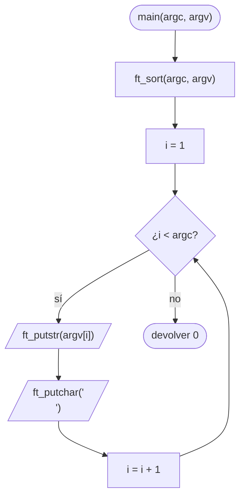
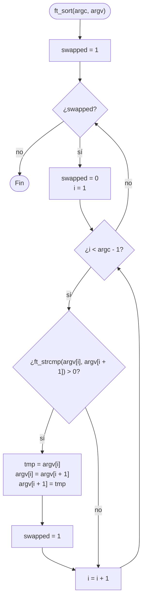

# ft_sort_params

[[Piscine Reloaded - Índice|← Índice]] · ex19 · Programas

> Programa que escribe sus argumentos **ordenados en orden ASCII**, uno por línea, sin `argv[0]`. Junta tres ejercicios anteriores: [[ft_print_params]] (recorrer `argv`), [[ft_strcmp]] (comparar) y [[ft_swap]] (intercambiar).

## Explicación sencilla

No se mueven las letras de las cadenas: se mueven los **punteros** de `argv`. Cada casilla de `argv` es un `char *` que apunta a una cadena; ordenar es cambiar a qué cadena apunta cada casilla.

```text
 $ ./ft_sort_params banana Manzana apple

 antes:                          después:
 argv[1] ──► "banana"            argv[1] ──► "Manzana"
 argv[2] ──► "Manzana"           argv[2] ──► "apple"
 argv[3] ──► "apple"             argv[3] ──► "banana"

 Las cadenas no se copian ni se mueven: solo se intercambian las flechas.
```

Para ordenar se usa el **método de la burbuja** (*bubble sort*): recorrer `argv` comparando cada par de vecinos con [[ft_strcmp]] y, si están al revés, intercambiarlos. Se repite la pasada hasta que una pasada entera no cambia nada. Es lento con muchos datos (O(n²)), pero con unos pocos argumentos sobra. Ver [[Algoritmos de ordenación y complejidad]].

```text
 pasada 1:  [banana] [Manzana] apple   → 'b' > 'M' → swap
             Manzana [banana] [apple]  → 'b' > 'a' → swap
 pasada 2:  [Manzana] [apple] banana   → 'M' < 'a' → nada
             Manzana [apple] [banana]  → 'a' < 'b' → nada
            sin cambios → ordenado: Manzana apple banana
```

## Prototipo

```c
int	main(int argc, char **argv);

// Autorizada (la pone la Moulinette, no se entrega)
void	ft_putchar(char c);
```

> [!info] Sin función original
> Es un programa, no una función de la libc. El comportamiento lo define el **subject** de Piscine Reloaded. `ft_strcmp` y `ft_putstr` no están autorizadas como funciones externas: tienes que escribirlas dentro de `ft_sort_params.c` (máximo 5 funciones por fichero, ver [[La Norma]]).

## Requisitos del subject

> [!quote] Subject Piscine Reloaded v2.0 — Ejercicio 19
> Directorio de entrega: ex19/
> Archivos a entregar: ft_sort_params.c
> Funciones autorizadas: ft_putchar
>
> • Esto se trata de un programa, así que deberías tener una función main en tu archivo .c.
>
> • Crea un programa que muestre sus argumentos dados ordenados en orden ascii.
>
> • El programa debe mostrar todos los argumentos, excepto argv[0].
>
> • Todos los argumentos deberán estar separados con un salto de línea.

## Cómo implementarla

```text
main(argc, argv):
    ft_sort(argc, argv)
    i = 1
    mientras i < argc:
        ft_putstr(argv[i])
        ft_putchar('\n')
        i = i + 1
    devolver 0

ft_sort(argc, argv):                        (burbuja)
    swapped = 1
    mientras swapped:
        swapped = 0
        i = 1
        mientras i < argc - 1:
            si ft_strcmp(argv[i], argv[i + 1]) > 0:
                tmp = argv[i]               (tmp es char *)
                argv[i] = argv[i + 1]
                argv[i + 1] = tmp
                swapped = 1
            i = i + 1
```

El intercambio es el de [[ft_swap]], pero con `char *` en lugar de `int`. `ft_strcmp` es la del [[ft_strcmp|ex17]] y `ft_putstr` el bucle de [[ft_print_params]].

## Diagrama de flujo



### Auxiliar ft_sort (burbuja)



## Ejemplos

Compilado junto a un `ft_putchar.c` propio (`write(1, &c, 1)`), que no se entrega:

```text
$ cc -Wall -Wextra -Werror ft_sort_params.c ft_putchar.c -o ft_sort_params
$ ./ft_sort_params banana Manzana apple Zorro 42
42
Manzana
Zorro
apple
banana
$ ./ft_sort_params abc ab "" a | cat -e
$
a$
ab$
abc$
$ ./ft_sort_params "hola mundo" hola Hola
Hola
hola
hola mundo
$ ./ft_sort_params b a b a
a
a
b
b
$ ./ft_sort_params
```

- **Mayúsculas antes que minúsculas**: `'M'` (77) y `'Z'` (90) van antes que `'a'` (97). Las cifras (`'4'` = 52) van antes que todas las letras.
- **Cadena vacía primero**: `""` empieza por `'\0'`, el byte más pequeño. `cat -e` muestra la línea vacía como `$`.
- **Prefijos**: `"a"` < `"ab"` < `"abc"` y `"hola"` < `"hola mundo"`: la cadena corta acaba antes (`'\0'` contra otro carácter).
- **Repetidos**: salen todos, uno detrás de otro. Sin argumentos no escribe nada.

## Puntos clave y casos límite

- Se ordena desde `argv[1]`: `argv[0]` (el nombre del programa) no se escribe y **no debe entrar** en la ordenación.
- Intercambiar `char *` es barato y no necesita `malloc`: las cadenas se quedan donde estaban. Modificar los punteros de `argv` está permitido.
- El orden es el de los **bytes** (ASCII), no el alfabético de un diccionario: `"Zorro"` va antes que `"apple"`.
- Con `argc` 1 o 2 no hay pares que comparar: el bucle interior no entra y la primera pasada ya deja `swapped = 0`.

### Errores típicos

- **Intercambiar caracteres en vez de punteros**: copiar una cadena encima de otra pisa memoria si tienen longitudes distintas.
- **Usar `int tmp`** para el intercambio: `argv[i]` es un `char *` y no cabe en un `int` en 64 bits (y no compila con `-Werror`).
- **Empezar la ordenación en `i = 0`**: `./a.out` se ordena con los demás y aparece en la salida (o desaparece un argumento real).
- **Comparar `argv[i + 1]` con `i < argc`**: en la última vuelta `argv[argc]` es `NULL` y `ft_strcmp` hace segfault. El límite es `i < argc - 1`.
- **Una sola pasada de burbuja**: deja el mayor al final, pero el resto puede seguir desordenado.
- **`ft_strcmp` comparando como `char`**: un argumento con bytes ≥ 128 (letras con tilde en UTF-8) quedaría antes de `"a"` en vez de después.

## Relacionadas

[[ft_print_params]] · [[ft_strcmp]] · [[ft_swap]] · [[Algoritmos de ordenación y complejidad]] · [[Punteros en C]] · [[ft_putstr_fd]]

## Referencias

- Subject de Piscine Reloaded v2.0 (`/home/felixrod/cursus/piscine-reloaded/es.subject_piscine-reloaded.pdf`) — requisitos copiados literalmente.
- [Bubble sort — Wikipedia](https://en.wikipedia.org/wiki/Bubble_sort) — el algoritmo y la versión con indicador `swapped`.
- [ASCII — Wikipedia](https://en.wikipedia.org/wiki/ASCII) — tabla de códigos que define el orden.
- Ejemplos compilados con `cc -Wall -Wextra -Werror` (Ubuntu clang 12.0.1) en Linux x86_64.
