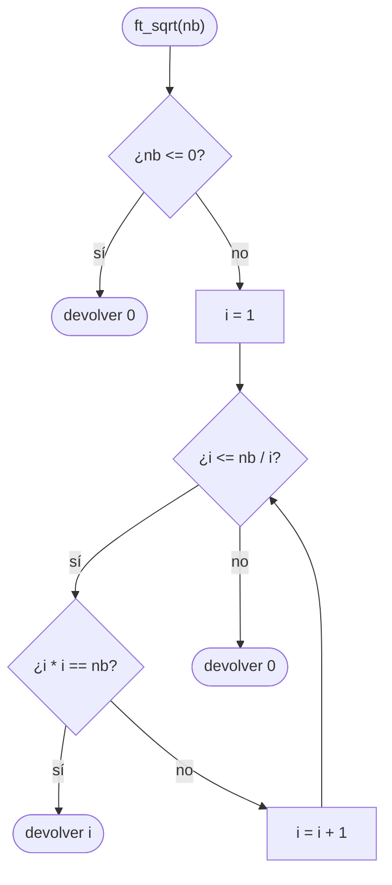

# ft_sqrt

[[Piscine Reloaded - Índice|← Índice]] · ex14 · Matemáticas

> Devuelve la raíz cuadrada **entera y exacta** de `nb`, o 0 si no la tiene (`ft_sqrt(16)` → 4, `ft_sqrt(17)` → 0). Hay que hacerlo en menos de 2 segundos y sin desbordar `i * i`.

## Explicación sencilla

Busca un `i` tal que `i * i == nb`. Se prueba `i = 1, 2, 3…` y se para en cuanto `i * i` se pasa de `nb`:

```text
 nb = 16                      nb = 17
 i   i*i                      i   i*i
 1    1   < 16 → sigue        1    1
 2    4   < 16 → sigue        2    4
 3    9   < 16 → sigue        3    9
 4   16  == 16 → devuelve 4   4   16   < 17 → sigue
                              5   25   > 17 → para: devuelve 0
```

Como mucho hay que probar hasta `√2147483647 ≈ 46340,95`: unas 46 000 vueltas. Es instantáneo, no hace falta nada más listo para cumplir los 2 segundos.

> [!warning] El subject dice «irracional»
> «Devuelve 0 si la raíz cuadrada es un número irracional». La raíz de un entero que no es un cuadrado perfecto siempre es irracional, así que en la práctica: **0 si no es un cuadrado perfecto**. Para `nb <= 0` también 0 (los negativos no tienen raíz real, y `√0 = 0` de todas formas).

## Prototipo

```c
int	ft_sqrt(int nb);
```

> [!info] Sin función original
> No existe en la libc. La libc tiene `sqrt()` en `<math.h>`, pero trabaja con `double` y da la raíz aproximada, no «0 si no es exacta».

## Requisitos del subject

> [!quote] Subject Piscine Reloaded v2.0 — Ejercicio 14
> Directorio de entrega: ex14/
> Archivos a entregar: ft_sqrt.c
> Funciones autorizadas: Ninguna
>
> • Crea una función que devuelva la raíz cuadrada de un número (si existe), o 0 si la raíz cuadrada es un número irracional.
>
> • Tu función debe devolver su resultado en menos de dos segundos.

## Cómo implementarla

```text
si nb <= 0: devolver 0
i = 1
mientras i <= nb / i            (lo mismo que i * i <= nb, pero sin desbordar)
    si i * i == nb: devolver i
    i = i + 1
devolver 0
```

> [!danger] El desbordamiento de `i * i`
> La condición «natural» es `while (i * i <= nb)`. Con `nb` cerca de `INT_MAX` falla: `46340 * 46340 = 2147395600` cabe, pero `46341 * 46341 = 2147488281` **no cabe** en `int` (máximo 2147483647). Es desbordamiento con signo, comportamiento indefinido: en la práctica sale un número negativo, la condición sigue siendo cierta y el bucle no termina (medido abajo).
>
> Soluciones: comparar `i <= nb / i` (la división no desborda), poner un tope `i <= 46340`, o hacer las cuentas en `long`.

## Diagrama de flujo



## Ejemplos

```c
#include <stdio.h>
#include <limits.h>

int	ft_sqrt(int nb);

static void	test(int n)
{
	printf("ft_sqrt(%d) = %d\n", n, ft_sqrt(n));
}

int	main(void)
{
	test(-4);
	test(0);
	test(1);
	test(2);
	test(4);
	test(16);
	test(17);
	test(2147395600);
	test(INT_MAX);
	test(INT_MIN);
	return (0);
}
```

```text
$ time ./a.out
ft_sqrt(-4) = 0
ft_sqrt(0) = 0
ft_sqrt(1) = 1
ft_sqrt(2) = 0
ft_sqrt(4) = 2
ft_sqrt(16) = 4
ft_sqrt(17) = 0
ft_sqrt(2147395600) = 46340
ft_sqrt(2147483647) = 0
ft_sqrt(-2147483648) = 0

real	0m0.001s
```

`2147395600 = 46340²` es el mayor cuadrado perfecto que cabe en `int`, y `INT_MAX` (el peor caso, unas 46 340 vueltas) tarda un milisegundo.

Con la versión ingenua `while (i * i <= nb)` y el mismo `main`, el programa no termina; lo corta `timeout` a los 10 s (código 124) sin haber impreso nada:

```text
$ time timeout 10 ./a.out; echo exit=$?

real	0m10.015s
exit=124
```

Con `-fsanitize=undefined` se ve la causa:

```text
sqrt_ingenua.c:6:11: runtime error: signed integer overflow: 46341 * 46341 cannot be represented in type 'int'
```

## Puntos clave y casos límite

- `nb <= 0` → 0. `nb == 1` → 1. `nb == 2147395600` → 46340. `nb == INT_MAX` → 0.
- La comparación `i <= nb / i` funciona porque, con enteros positivos, `i <= nb / i` equivale a `i * i <= nb` (la división entera trunca hacia abajo).
- Coste: como mucho √nb vueltas (≈ 46 340). Muy por debajo del límite de 2 s.

> [!tip] Alternativa: búsqueda binaria
> En lugar de probar `i` de uno en uno, busca entre `lo = 1` y `hi = 46340`: mira el medio `mid`; si `mid * mid` es menor que `nb`, sigue por la mitad de arriba; si es mayor, por la de abajo. Unas 16 vueltas en el peor caso en vez de 46 340. Aquí no hace falta, pero es la idea que usarías con números más grandes. Ver [[Algoritmos de ordenación y complejidad]].

### Errores típicos

- **`while (i * i <= nb)` sin más**: bucle infinito (o resultado basura) con `nb` cercano a `INT_MAX`.
- **Devolver la raíz aproximada** (`ft_sqrt(17)` → 4): el subject pide 0.
- **Empezar en `i = 0`** con `nb / i`: división entre 0.
- **Usar `sqrt()` de `<math.h>`**: no está autorizada.

## Relacionadas

[[ft_iterative_factorial]] · [[ft_recursive_factorial]] · [[ft_is_prime]] · [[ft_power]] · [[Tipos enteros y conversiones]] · [[Algoritmos de ordenación y complejidad]]

## Referencias

- Subject de Piscine Reloaded v2.0 (`/home/felixrod/cursus/piscine-reloaded/es.subject_piscine-reloaded.pdf`) — requisitos copiados literalmente.
- [Integer square root — Wikipedia](https://en.wikipedia.org/wiki/Integer_square_root) — búsqueda lineal y binaria.
- [Arithmetic operators — cppreference](https://en.cppreference.com/w/c/language/operator_arithmetic) — desbordamiento de enteros con signo.
- Ejemplos compilados con `cc -Wall -Wextra -Werror` (Ubuntu clang 12.0.1) en Linux x86_64.
