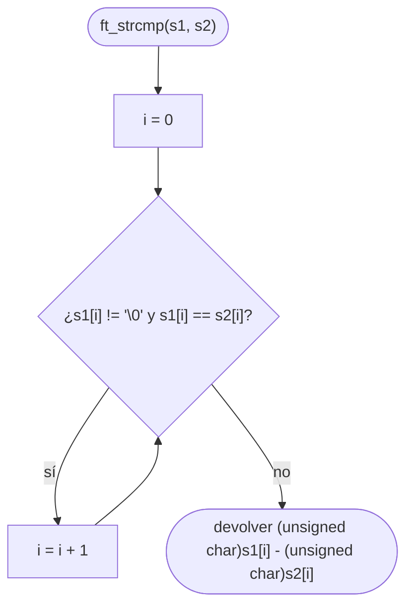

# ft_strcmp

[[Piscine Reloaded - Índice|← Índice]] · ex17 · Cadenas y memoria

> Compara dos cadenas **enteras**: devuelve 0 si son iguales, un número negativo si `s1` va antes que `s2` en orden ASCII y uno positivo si va después. Es [[ft_strncmp]] sin el límite `n`.

## Explicación sencilla

Avanza a la vez por las dos cadenas mientras los caracteres coincidan. Se para en la **primera diferencia** o cuando `s1` se acaba. El resultado es la resta de los dos caracteres donde se ha parado, leídos como `unsigned char`.

```text
 s1:  │ h │ o │ l │ a │ \0 │
 s2:  │ h │ o │ L │ a │ \0 │
        =   =   ≠
                └─ 'l' (108) - 'L' (76) = 32  → positivo: s1 > s2

 s1:  │ a │ b │ \0 │
 s2:  │ a │ b │ c  │ \0 │
        =   =   ≠
                └─ '\0' (0) - 'c' (99) = -99  → negativo: "ab" < "abc"
```

El `'\0'` también se compara: por eso una cadena que es **prefijo** de otra queda siempre antes (`"ab"` < `"abc"`). Y como compara códigos ASCII, las mayúsculas (65–90) van antes que las minúsculas (97–122): `"Z"` < `"a"`.

> [!tip] Diferencia con [[ft_strncmp]]
> `ft_strncmp(s1, s2, n)` se para como mucho a los `n` caracteres; `ft_strcmp` sigue hasta la diferencia o el `'\0'`. `ft_strncmp(s1, s2, n)` con `n` mayor que las dos cadenas da el mismo resultado que `ft_strcmp(s1, s2)`.

## Prototipo

```c
// Original — strcmp(3)
#include <string.h>
int strcmp(const char *s1, const char *s2);

// Piscine Reloaded (sin const)
int	ft_strcmp(char *s1, char *s2);
```

Consultar: `man 3 strcmp`

> [!info] Sin `const`
> El subject impone `char *` en vez de `const char *`. La función no modifica las cadenas igualmente, pero sin `const` no puedes pasarle un `const char *`: con `-Wall -Wextra -Werror` es un error (`passing 'const char *' to parameter of type 'char *' discards qualifiers`). En libft, [[ft_strncmp]] ya lleva `const`.

## Requisitos del subject

> [!quote] Subject Piscine Reloaded v2.0 — Ejercicio 17
> Directorio de entrega: ex17/
> Archivos a entregar: ft_strcmp.c
> Funciones autorizadas: Ninguna
>
> • Reproduce el comportamiento de la función strcmp (man strcmp).
>
> • Este debe ser su prototipo:
>
> int ft_strcmp(char *s1, char *s2);

## Comportamiento según el manual

> [!quote] man 3 strcmp — DESCRIPTION
> The strcmp() function compares the two strings s1 and s2.  The locale is not taken into account (for a locale-aware comparison, see strcoll(3)).  The comparison is done using unsigned characters.
>
> strcmp() returns an integer indicating the result of the comparison, as follows:
>
> • 0, if the s1 and s2 are equal;
>
> • a negative value if s1 is less than s2;
>
> • a positive value if s1 is greater than s2.

> [!note] Traducción
> La función strcmp() compara las dos cadenas s1 y s2. No se tiene en cuenta el locale (para una comparación que lo tenga en cuenta, ver strcoll(3)). La comparación se hace con caracteres sin signo.
>
> strcmp() devuelve un entero que indica el resultado de la comparación, así:
>
> • 0, si s1 y s2 son iguales;
>
> • un valor negativo si s1 es menor que s2;
>
> • un valor positivo si s1 es mayor que s2.

> [!quote] man 3 strcmp — RETURN VALUE
> The strcmp() and strncmp() functions return an integer less than, equal to, or greater than zero if s1 (or the first n bytes thereof) is found, respectively, to be less than, to match, or be greater than s2.

> [!note] Traducción
> strcmp() y strncmp() devuelven un entero menor, igual o mayor que cero si s1 (o sus primeros n bytes) es, respectivamente, menor, igual o mayor que s2.

## Cómo implementarla

```text
i = 0
mientras s1[i] != '\0' y s1[i] == s2[i]:
    i = i + 1
devolver (unsigned char)s1[i] - (unsigned char)s2[i]
```

No hace falta comprobar también `s2[i] != '\0'`: si `s1[i] == s2[i]` y `s1[i]` no es `'\0'`, `s2[i]` tampoco lo es.

## Diagrama de flujo



## Ejemplos

```c
#include <stdio.h>
#include <string.h>

int	ft_strcmp(char *s1, char *s2);

static void	t(char *label, char *s1, char *s2)
{
	printf("%-22s ft: %4d   strcmp: %4d\n", label,
		ft_strcmp(s1, s2), strcmp(s1, s2));
}

int	main(void)
{
	t("\"abc\" / \"abc\"", "abc", "abc");
	t("\"abc\" / \"abd\"", "abc", "abd");
	t("\"hola\" / \"hoLa\"", "hola", "hoLa");
	t("\"ab\" / \"abc\"", "ab", "abc");
	t("\"\" / \"a\"", "", "a");
	t("\"\" / \"\"", "", "");
	t("\"Z\" / \"a\"", "Z", "a");
	t("\"\\200\" / \"\"", "\200", "");
	return (0);
}
```

```text
"abc" / "abc"          ft:    0   strcmp:    0
"abc" / "abd"          ft:   -1   strcmp:   -1
"hola" / "hoLa"        ft:   32   strcmp:   32
"ab" / "abc"           ft:  -99   strcmp:  -99
"" / "a"               ft:  -97   strcmp:  -97
"" / ""                ft:    0   strcmp:    0
"Z" / "a"              ft:   -7   strcmp:   -7
"\200" / ""            ft:  128   strcmp:  128
```

Compilado con `-fno-builtin` para que `strcmp` sea de verdad la de glibc 2.35 y no un valor calculado por el compilador. Con la versión que compara como `char` (sin el cast), la última línea sale `ft: -128`: signo contrario al de `strcmp`.

> [!question] ¿Devuelve -1, 0 y 1?
> No necesariamente. En esta máquina (glibc 2.35, x86_64) `strcmp` devuelve **la resta exacta** de los dos bytes, igual que la versión de arriba: `-1`, `32`, `-99`, `128`… Pero el manual solo promete el **signo** (negativo, cero o positivo). Otra libc u otra arquitectura puede devolver otros números, por ejemplo `-1` y `1`. Si tu `ft_strcmp` devuelve la resta, coincide con glibc; lo que importa es que el signo sea siempre el mismo.

## Puntos clave y casos límite

- Cadenas vacías: `ft_strcmp("", "")` es 0 y `ft_strcmp("", "a")` es negativo (`'\0'` es el byte más pequeño).
- Prefijos: `"ab"` va antes que `"abc"`, porque se compara el `'\0'` de `"ab"` con la `'c'`.
- Compara como `unsigned char`: `ft_strcmp("\200", "")` debe ser **positivo** (128). Ver [[Tipos enteros y conversiones]].
- No tiene en cuenta el idioma: `'Z'` (90) va antes que `'a'` (97), y las letras con tilde en UTF-8 (bytes ≥ 128) van después de todo el ASCII.
- `ft_strcmp(NULL, "a")` es comportamiento indefinido (segfault), igual que `strcmp`. Ver [[Carácter nulo y puntero NULL]].
- La usarás en [[ft_sort_params]] para decidir el orden de los argumentos.

### Errores típicos

- **Comparar como `char`**: en Linux `char` tiene signo, `'\200'` vale −128 y `ft_strcmp("\200", "")` sale negativo. Debe ser positivo.
- **Devolver `s1[i] - s2[i]` solo dentro del bucle**: si el bucle acaba porque las dos cadenas llegan a `'\0'`, la función se queda sin `return` (o devuelve basura).
- **Parar cuando cualquiera de las dos se acaba y devolver 0**: `ft_strcmp("ab", "abc")` daría 0, como si fueran iguales.
- **Exigir en los tests `-1` o `1`**: el manual solo garantiza el signo. Compara signos.

## Relacionadas

[[ft_strncmp]] · [[ft_sort_params]] · [[ft_strlen]] · [[Tipos enteros y conversiones]] · [[Carácter nulo y puntero NULL]] · [[libft - Anexo comparativo]]

## Referencias

- Subject de Piscine Reloaded v2.0 (`/home/felixrod/cursus/piscine-reloaded/es.subject_piscine-reloaded.pdf`) — requisitos copiados literalmente.
- `man 3 strcmp` — Linux man-pages 5.10 (Ubuntu 22.04): las citas en inglés están copiadas literalmente del manual; la traducción es propia.
- [strcmp(3) — man7.org](https://man7.org/linux/man-pages/man3/strcmp.3.html) — versión en línea del manual de Linux (puede ser más reciente que la de Ubuntu 22.04).
- [strcmp — cppreference](https://en.cppreference.com/w/c/string/byte/strcmp) — el estándar C solo fija el signo del resultado.
- Ejemplos compilados con `cc -Wall -Wextra -Werror` (Ubuntu clang 12.0.1) en Linux x86_64.
