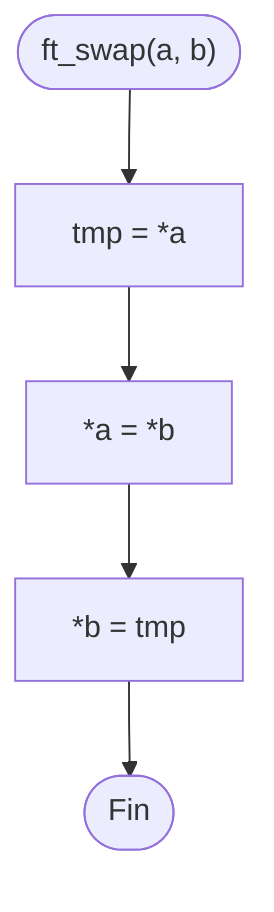

# ft_swap

[[Piscine Reloaded - Índice|← Índice]] · ex10 · Punteros

> Intercambia el valor de dos enteros. Recibe sus **direcciones**, no sus valores: solo así puede modificar las variables de quien la llama.

## Explicación sencilla

```c
int	x = 1;
int	y = 2;

ft_swap(&x, &y);   // ahora x = 2, y = 1
```

```text
 antes:                     después:
 a ──► x ┌───┐              a ──► x ┌───┐
         │ 1 │                      │ 2 │
         └───┘                      └───┘
 b ──► y ┌───┐              b ──► y ┌───┐
         │ 2 │                      │ 1 │
         └───┘                      └───┘
 tmp guarda el 1 mientras *a recibe el 2.
```

Hace falta una variable auxiliar `tmp`: si escribes `*a = *b` primero, el valor original de `*a` se pierde. Por qué hay que pasar direcciones: ver [[Punteros en C]].

## Prototipo

```c
void	ft_swap(int *a, int *b);
```

> [!info] Sin función original
> No existe en la libc. El comportamiento lo define el **subject** de Piscine Reloaded.

## Requisitos del subject

> [!quote] Subject Piscine Reloaded v2.0 — Ejercicio 10
> Directorio de entrega: ex10/
> Archivos a entregar: ft_swap.c
> Funciones autorizadas: Ninguna
>
> • Crea una función que intercambie el valor de dos enteros cuyas direcciones se introducen como parámetros.

## Cómo implementarla

```text
tmp = *a
*a = *b
*b = tmp
```

## Diagrama de flujo



## Puntos clave y casos límite

- `ft_swap(&x, &x)` funciona: `tmp` guarda el valor y se vuelve a escribir el mismo.
- `ft_swap(NULL, &y)` es comportamiento indefinido (segfault), igual que en cualquier función que desreferencia sin comprobar.
- La usarás en [[ft_sort_params]] y en cualquier ordenación (ver [[Algoritmos de ordenación y complejidad]]).

### Errores típicos

- **Recibir `int a, int b`**: la función cambia sus copias locales y las variables de quien llama no cambian.
- **Intercambiar los punteros** (`tmp = a; a = b; b = tmp;`): cambia a dónde apuntan las variables locales `a` y `b`, no los enteros.
- **Truco del XOR** (`*a ^= *b; *b ^= *a; *a ^= *b;`): sin `tmp`, pero con `a == b` pone el valor a 0. Ver [[Operadores de bits]].

## Relacionadas

[[ft_ft]] · [[ft_div_mod]] · [[ft_sort_params]] · [[Punteros en C]] · [[Operadores de bits]]

## Referencias

- Subject de Piscine Reloaded v2.0 (`/home/felixrod/cursus/piscine-reloaded/es.subject_piscine-reloaded.pdf`) — requisitos copiados literalmente.
- [Pointer declaration — cppreference](https://en.cppreference.com/w/c/language/pointer) — paso de direcciones y desreferencia.
