# libft - Diagramas de flujo

[[libft - Índice|← Índice]] · Diagramas

> Un diagrama de flujo por cada una de las 43 funciones de libft (Parte 1, 2 y 3). Cada diagrama dibuja **el mismo pseudocódigo** que la sección «Cómo implementarla» de su nota, con los mismos pasos y los mismos nombres de variables. Sirve para repasar el algoritmo de un vistazo antes de escribir el código o antes de la defensa.

> [!info] Cómo leer los diagramas
> - **Inicio**: óvalo con el nombre y los parámetros, `(["ft_strlen(s)"])`.
> - **Fin / retorno**: óvalo `([Fin])` o `(["devolver x"])`.
> - **Proceso**: rectángulo, una asignación o una llamada (`i = i + 1`, `ft_bzero(p, total)`).
> - **Decisión**: rombo `{"¿...?"}` con dos salidas etiquetadas **sí** / **no**.
> - **Escritura**: paralelogramo `[/"write ..."/]` para las llamadas a `write`.
> - **Recursión**: rectángulo marcado con **↻ recursión** (la función se llama a sí misma).
> - **Bucle**: una flecha que vuelve hacia atrás, a la decisión que lo controla.
> - Cada diagrama se puede incrustar en otra nota: `![[libft - Diagramas de flujo#ft_strlen]]`. Obsidian dibuja Mermaid sin plugins.

## Parte 1 — Funciones de la libc

### Caracteres

### ft_isalpha

[[ft_isalpha]] — devuelve 1 si `c` es una letra (mayúscula o minúscula) y 0 si no.

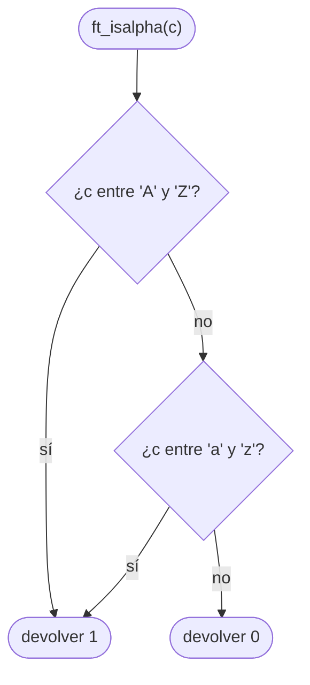

### ft_isdigit

[[ft_isdigit]] — devuelve 1 si `c` es un dígito decimal y 0 si no.

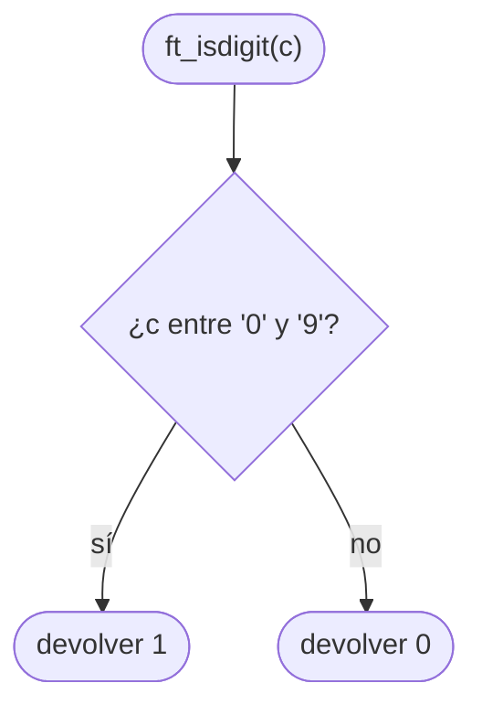

### ft_isalnum

[[ft_isalnum]] — devuelve 1 si `c` es letra o dígito, reutilizando `ft_isalpha` y `ft_isdigit`.

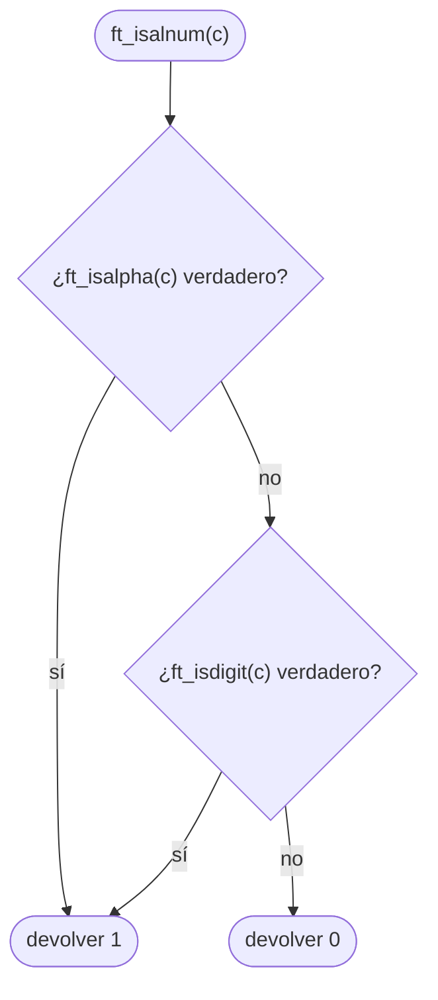

### ft_isascii

[[ft_isascii]] — devuelve 1 si `c` está en la tabla ASCII (0–127) y 0 si no.

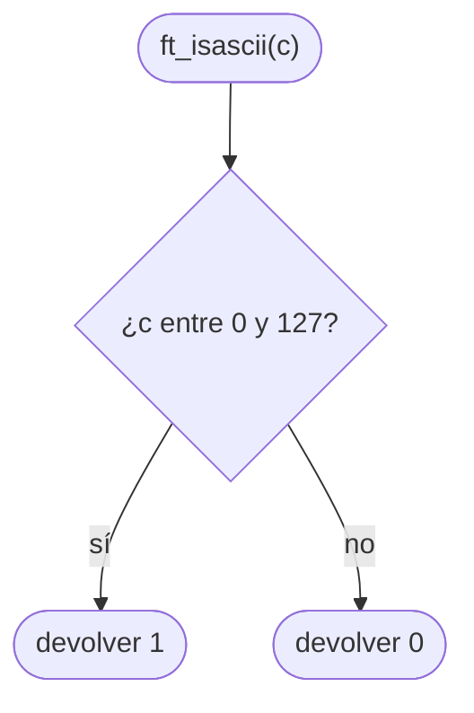

### ft_isprint

[[ft_isprint]] — devuelve 1 si `c` es imprimible (del espacio, 32, a `'~'`, 126) y 0 si no.

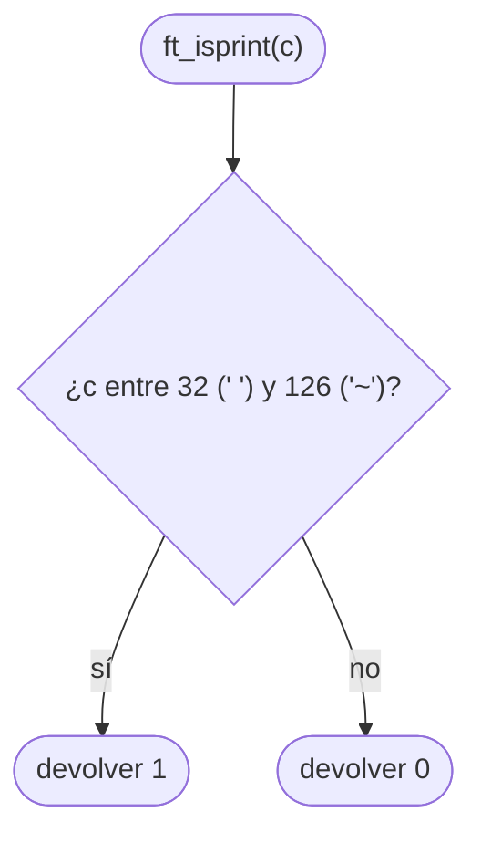

### ft_toupper

[[ft_toupper]] — convierte una minúscula en mayúscula; cualquier otro valor sale igual.


### ft_tolower

[[ft_tolower]] — convierte una mayúscula en minúscula; cualquier otro valor sale igual.

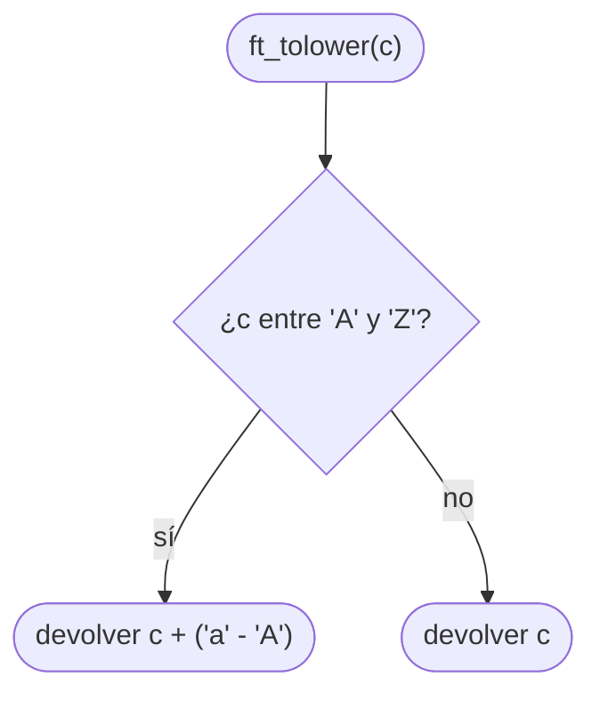

### Memoria

### ft_memset

[[ft_memset]] — rellena `n` bytes de `s` con el valor `c` y devuelve `s`.

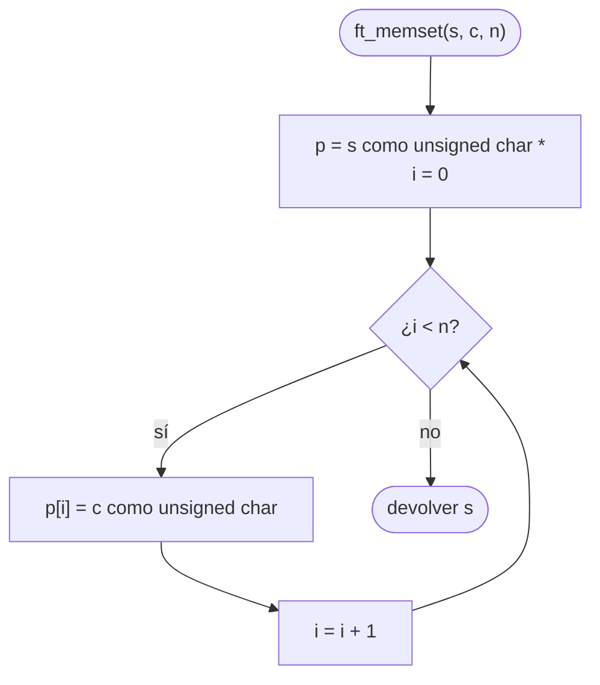

- Se devuelve `s`, el puntero original, no `p` ni `p + i`.

### ft_bzero

[[ft_bzero]] — pone a 0 los `n` primeros bytes de `s`.

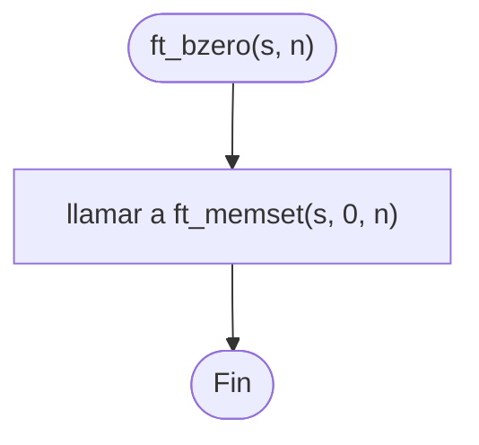

- Variante sin reutilizar: `p = s` como `unsigned char *` y un bucle `p[i] = 0` para `i` de 0 a `n - 1` (el mismo bucle que [[ft_memset]]).

### ft_memcpy

[[ft_memcpy]] — copia `n` bytes de `src` a `dest` (las zonas no deben solaparse).

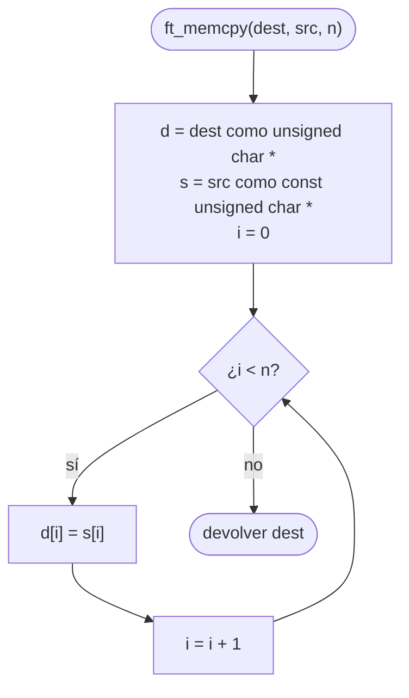

### ft_memmove

[[ft_memmove]] — copia `n` bytes de `src` a `dest` aunque las zonas se solapen.

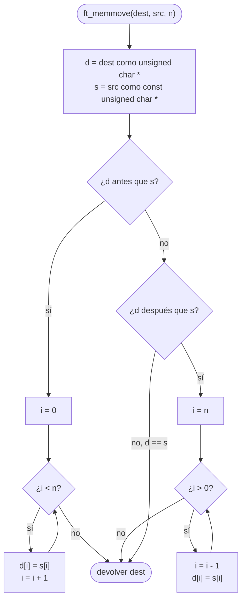

- La clave: si `d` está **después** de `s`, copiar hacia delante pisaría bytes de `s` que aún no se han leído; por eso se copia **hacia atrás**.
- Con `size_t` el índice no puede ser negativo: en el código, «mientras n > 0: n = n − 1; d[n] = s[n]» (tip de la nota).

### ft_memchr

[[ft_memchr]] — busca el primer byte igual a `c` en los `n` primeros bytes de `s`.

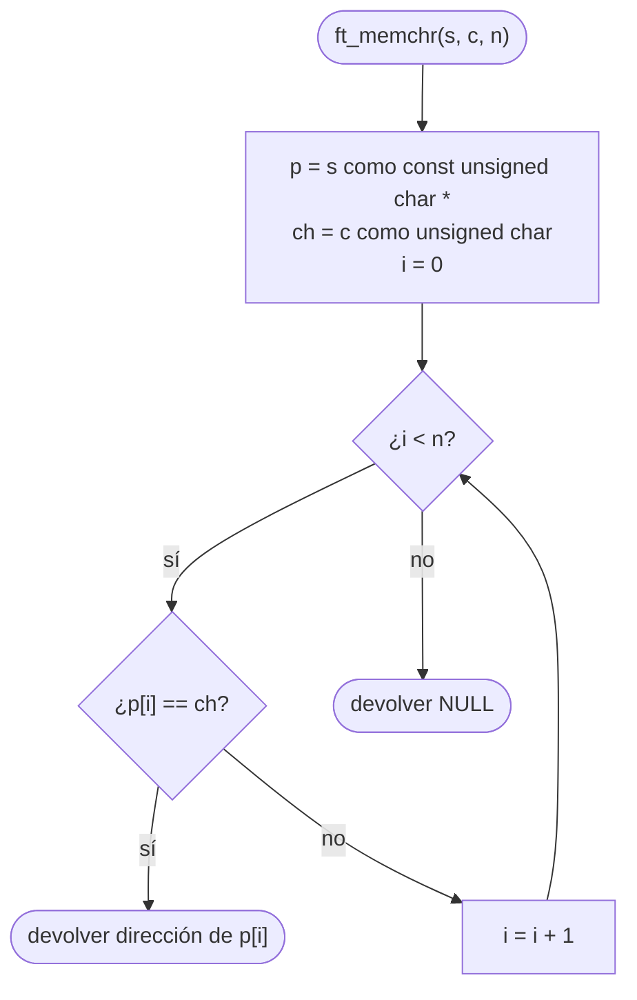

- No se para en `'\0'`: recorre exactamente `n` bytes.

### ft_memcmp

[[ft_memcmp]] — compara `n` bytes de `s1` y `s2` y devuelve la diferencia del primer byte distinto.

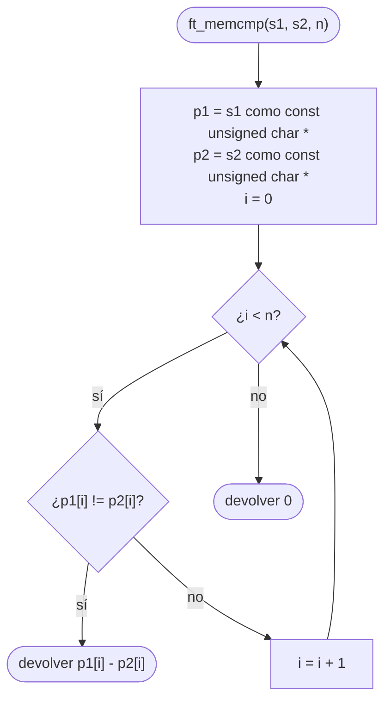

- Restar como `unsigned char`: con `char` con signo, un byte como 200 saldría negativo.

### Cadenas

### ft_strlen

[[ft_strlen]] — cuenta los caracteres de `s` antes del `'\0'`.

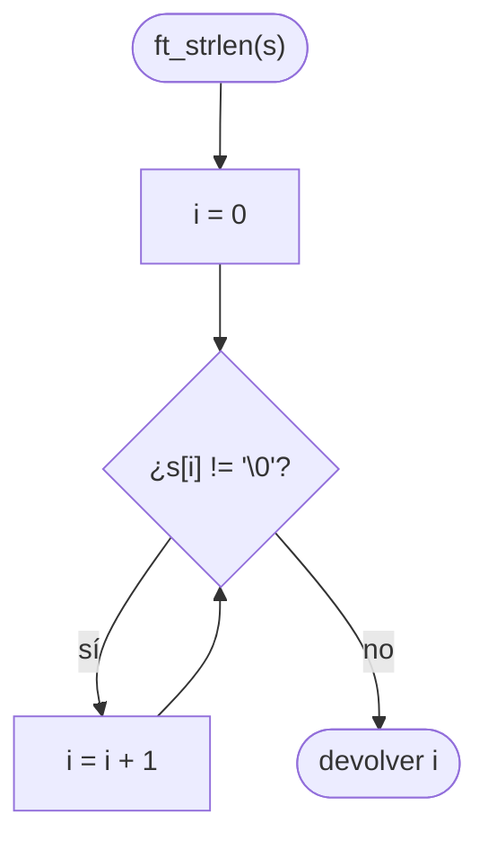

### ft_strlcpy

[[ft_strlcpy]] — copia `src` en `dst` sin pasar de `size` bytes (incluido el `'\0'`) y devuelve la longitud de `src`.

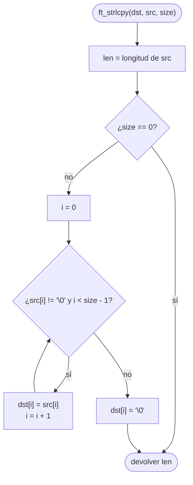

- `size == 0` se comprueba antes del bucle: `size - 1` con `size_t` a 0 daría un número enorme.

### ft_strlcat

[[ft_strlcat]] — añade `src` al final de `dst` sin pasar de `size` bytes en total y devuelve la longitud que intentó crear.

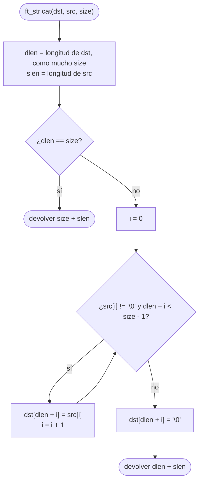

- Si `dst` no tiene `'\0'` dentro de los `size` primeros bytes, `dlen == size`: no se escribe nada y se devuelve `size + slen`.

### ft_strchr

[[ft_strchr]] — devuelve un puntero a la primera aparición de `c` en `s`, o NULL.

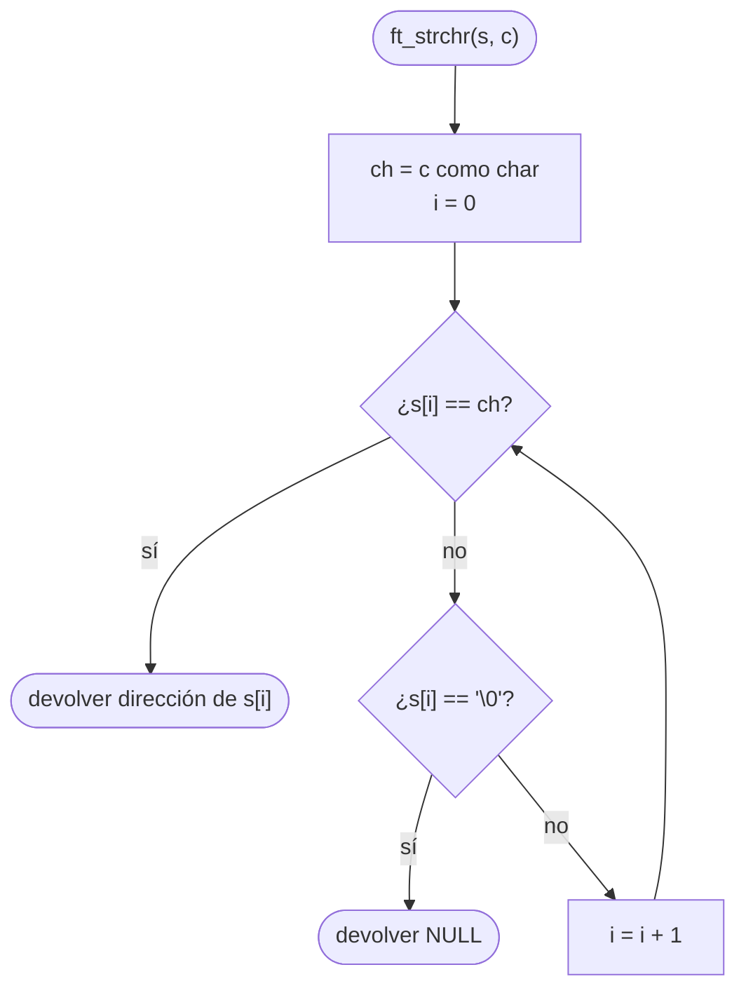

- El orden de las dos preguntas hace que buscar `'\0'` devuelva la dirección del terminador.

### ft_strrchr

[[ft_strrchr]] — devuelve un puntero a la última aparición de `c` en `s`, o NULL (opción A de la nota: recorrer hacia delante).

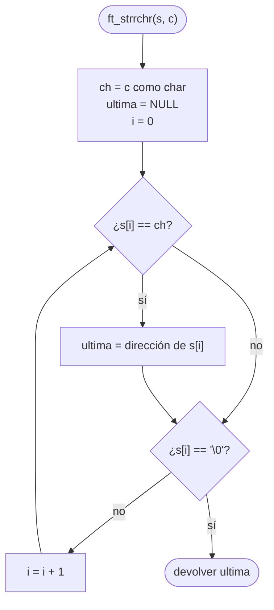

- Opción B de la nota: empezar en `i = longitud de s` (el `'\0'`) e ir hacia atrás devolviendo la primera coincidencia; si `i` llega a 0 sin encontrarla, NULL.

### ft_strncmp

[[ft_strncmp]] — compara como mucho `n` caracteres de `s1` y `s2`.

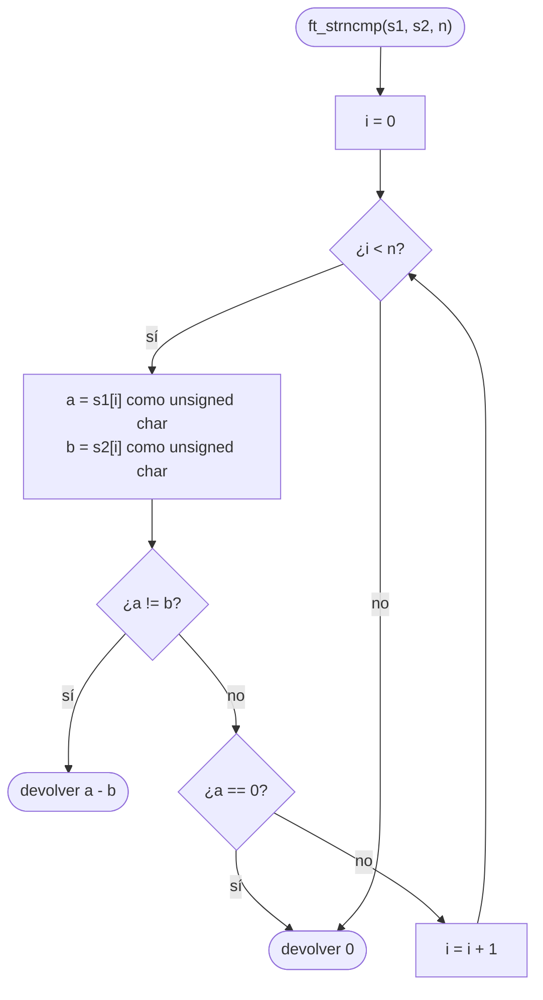

- `a == 0` (con `a == b`) significa que las dos cadenas terminan a la vez: son iguales.

### ft_strnstr

[[ft_strnstr]] — busca `little` dentro de los `len` primeros caracteres de `big`.

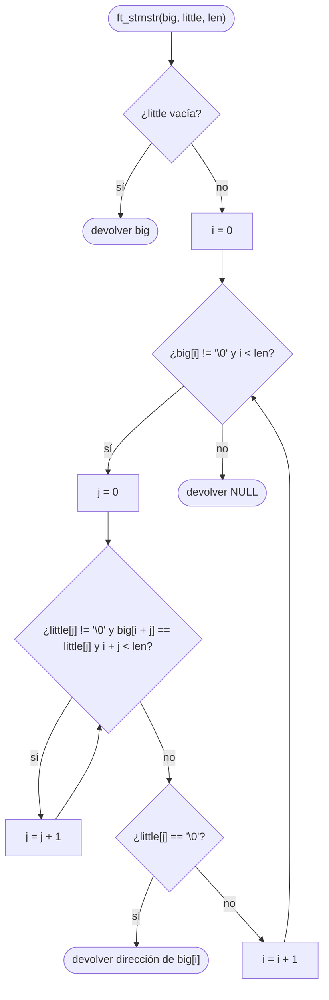

- La condición `i + j < len` impide que la coincidencia «se salga» de los `len` caracteres permitidos.

### Conversión

### ft_atoi

[[ft_atoi]] — convierte el principio de `nptr` en un `int` (espacios, un signo opcional y dígitos).

```mermaid
flowchart TD
    A(["ft_atoi(nptr)"]) --> B["i = 0"]
    B --> C{"¿nptr[i] es ' ', '\t', '\n', '\v', '\f' o '\r'?"}
    C -->|sí| D["i = i + 1"]
    D --> C
    C -->|no| E["signo = 1"]
    E --> F{"¿nptr[i] es '-' o '+'?"}
    F -->|sí| G{"¿es '-'?"}
    G -->|sí| H["signo = -1"]
    G -->|no| I["i = i + 1"]
    H --> I
    F -->|no| J["resultado = 0 (long)"]
    I --> J
    J --> K{"¿nptr[i] es un dígito?"}
    K -->|sí| L["resultado = resultado * 10 + (nptr[i] - '0')<br>i = i + 1"]
    L --> K
    K -->|no| M(["devolver resultado * signo como int"])
```

- Solo se acepta **un** signo: con `"+-5"` el bucle de dígitos no entra y el resultado es 0.

### Memoria dinámica

### ft_calloc

[[ft_calloc]] — reserva `nmemb * size` bytes puestos a cero, comprobando antes el desbordamiento.

```mermaid
flowchart TD
    A(["ft_calloc(nmemb, size)"]) --> B{"¿size != 0 y nmemb > SIZE_MAX / size?"}
    B -->|sí| N(["devolver NULL"])
    B -->|no| C["total = nmemb * size"]
    C --> D["p = malloc(total)"]
    D --> E{"¿p == NULL?"}
    E -->|sí| N
    E -->|no| F["llamar a ft_bzero(p, total)"]
    F --> G(["devolver p"])
```

- La división `SIZE_MAX / size` detecta el desbordamiento **sin** hacer la multiplicación que desbordaría.

### ft_strdup

[[ft_strdup]] — devuelve una copia de `s` en memoria nueva reservada con `malloc`.

```mermaid
flowchart TD
    A(["ft_strdup(s)"]) --> B["len = ft_strlen(s)"]
    B --> C["copia = malloc(len + 1)"]
    C --> D{"¿copia == NULL?"}
    D -->|sí| E(["devolver NULL"])
    D -->|no| F["llamar a ft_memcpy(copia, s, len + 1)<br>(los len caracteres y el '\0')"]
    F --> G(["devolver copia"])
```

- El `+ 1` es el hueco del `'\0'`. La nota admite `ft_strlcpy(copia, s, len + 1)` en lugar de `ft_memcpy`.

## Parte 2 — Funciones adicionales

### ft_substr

[[ft_substr]] — devuelve en memoria nueva la subcadena de `s` que empieza en `start` y mide como mucho `len`.

```mermaid
flowchart TD
    A(["ft_substr(s, start, len)"]) --> B{"¿s == NULL?"}
    B -->|sí| N(["devolver NULL"])
    B -->|no| C["slen = ft_strlen(s)"]
    C --> D{"¿start >= slen?"}
    D -->|sí| E(["devolver ft_strdup('')"])
    D -->|no| F{"¿len > slen - start?"}
    F -->|sí| G["len = slen - start"]
    F -->|no| H["r = malloc(len + 1)"]
    G --> H
    H --> I{"¿r == NULL?"}
    I -->|sí| N
    I -->|no| J["ft_strlcpy(r, s + start, len + 1)"]
    J --> K(["devolver r"])
```

- `start >= slen` va primero: así `slen - start` nunca se calcula con `start` fuera de la cadena (con `size_t` daría un número enorme).

### ft_strjoin

[[ft_strjoin]] — concatena `s1` y `s2` en una cadena nueva.

```mermaid
flowchart TD
    A(["ft_strjoin(s1, s2)"]) --> B{"¿s1 o s2 NULL?"}
    B -->|sí| N(["devolver NULL"])
    B -->|no| C["len1 = ft_strlen(s1)<br>len2 = ft_strlen(s2)"]
    C --> D["r = malloc(len1 + len2 + 1)"]
    D --> E{"¿r == NULL?"}
    E -->|sí| N
    E -->|no| F["ft_strlcpy(r, s1, len1 + 1)"]
    F --> G["ft_strlcat(r, s2, len1 + len2 + 1)"]
    G --> H(["devolver r"])
```

### ft_strtrim

[[ft_strtrim]] — quita de `s1` los caracteres de `set` que haya al principio y al final.

```mermaid
flowchart TD
    A(["ft_strtrim(s1, set)"]) --> B{"¿s1 o set NULL?"}
    B -->|sí| N(["devolver NULL"])
    B -->|no| C["inicio = 0"]
    C --> D{"¿s1[inicio] != '\0' y s1[inicio] está en set?"}
    D -->|sí| E["inicio = inicio + 1"]
    E --> D
    D -->|no| F["fin = ft_strlen(s1)"]
    F --> G{"¿fin > inicio y s1[fin - 1] está en set?"}
    G -->|sí| H["fin = fin - 1"]
    H --> G
    G -->|no| I(["devolver ft_substr(s1, inicio, fin - inicio)"])
```

- «Está en set» es `ft_strchr(set, carácter) != NULL`; por eso se comprueba `s1[inicio] != '\0'` antes, porque `ft_strchr` encuentra siempre el `'\0'` de `set`.
- `fin > inicio` evita que `fin` cruce a `inicio` cuando toda la cadena es de `set`.

### ft_split

[[ft_split]] — divide `s` por el carácter `c` y devuelve un array de palabras terminado en NULL.

```mermaid
flowchart TD
    A(["ft_split(s, c)"]) --> B{"¿s == NULL?"}
    B -->|sí| N(["devolver NULL"])
    B -->|no| C["n = contar_palabras(s, c)"]
    C --> D["tab = malloc((n + 1) * sizeof(char *))"]
    D --> E{"¿tab == NULL?"}
    E -->|sí| N
    E -->|no| F["i = 0, pos = 0"]
    F --> G{"¿i < n?"}
    G -->|sí| H["saltar los c de s desde pos"]
    H --> I["inicio = pos<br>avanzar pos hasta el siguiente c o '\0'"]
    I --> J["tab[i] = ft_substr(s, inicio, pos - inicio)"]
    J --> K{"¿tab[i] == NULL?"}
    K -->|sí| L(["devolver liberar_todo(tab, i)"])
    K -->|no| M["i = i + 1"]
    M --> G
    G -->|no| O["tab[n] = NULL"]
    O --> P(["devolver tab"])
```

- El `n + 1` reserva el hueco del NULL final. Si falla un `ft_substr`, hay que liberar las `i` palabras ya creadas y el propio `tab`.

#### Auxiliar: contar_palabras

La nota lo describe en prosa («cada carácter != c al principio o justo después de un c»); aquí con un índice `i`.

```mermaid
flowchart TD
    A(["contar_palabras(s, c)"]) --> B["cuenta = 0<br>i = 0"]
    B --> C{"¿s[i] != '\0'?"}
    C -->|sí| D{"¿s[i] != c y (i == 0 o s[i - 1] == c)?"}
    D -->|sí| E["cuenta = cuenta + 1"]
    D -->|no| F["i = i + 1"]
    E --> F
    F --> C
    C -->|no| G(["devolver cuenta"])
```

#### Auxiliar: liberar_todo

```mermaid
flowchart TD
    A(["liberar_todo(tab, hasta)"]) --> B["i = 0"]
    B --> C{"¿i < hasta?"}
    C -->|sí| D["free(tab[i])<br>i = i + 1"]
    D --> C
    C -->|no| E["free(tab)"]
    E --> F(["devolver NULL"])
```

### ft_itoa

[[ft_itoa]] — convierte el entero `n` en una cadena nueva.

```mermaid
flowchart TD
    A(["ft_itoa(n)"]) --> B["nb = n (long)"]
    B --> C["len = contar_len(nb)"]
    C --> D["cadena = malloc(len + 1)"]
    D --> E{"¿cadena == NULL?"}
    E -->|sí| N(["devolver NULL"])
    E -->|no| F["cadena[len] = '\0'<br>nb = n"]
    F --> G{"¿nb == 0?"}
    G -->|sí| H["cadena[0] = '0'"]
    G -->|no| I{"¿nb < 0?"}
    H --> I
    I -->|sí| J["cadena[0] = '-'<br>nb = -nb"]
    I -->|no| K{"¿nb > 0?"}
    J --> K
    K -->|sí| L["len = len - 1<br>cadena[len] = (nb % 10) + '0'<br>nb = nb / 10"]
    L --> K
    K -->|no| M(["devolver cadena"])
```

- Las cifras se escriben **de derecha a izquierda**, desde la posición `len - 1`. Con `long`, `-INT_MIN` cabe sin desbordar.

#### Auxiliar: contar_len

El paso 2 de la nota, separado en una función `static` (como recomienda la nota para cumplir las 25 líneas).

```mermaid
flowchart TD
    A(["contar_len(nb)"]) --> B["len = 0"]
    B --> C{"¿nb <= 0?"}
    C -->|sí| D["len = 1"]
    C -->|no| E{"¿nb != 0?"}
    D --> E
    E -->|sí| F["nb = nb / 10<br>len = len + 1"]
    F --> E
    E -->|no| G(["devolver len"])
```

### ft_strmapi

[[ft_strmapi]] — crea una cadena nueva aplicando `f(i, s[i])` a cada carácter.

```mermaid
flowchart TD
    A(["ft_strmapi(s, f)"]) --> B{"¿s o f NULL?"}
    B -->|sí| N(["devolver NULL"])
    B -->|no| C["len = ft_strlen(s)"]
    C --> D["r = malloc(len + 1)"]
    D --> E{"¿r == NULL?"}
    E -->|sí| N
    E -->|no| F["i = 0"]
    F --> G{"¿i < len?"}
    G -->|sí| H["r[i] = f(i, s[i])<br>i = i + 1"]
    H --> G
    G -->|no| I["r[len] = '\0'"]
    I --> J(["devolver r"])
```

### ft_striteri

[[ft_striteri]] — aplica `f(i, &s[i])` a cada carácter de `s`, modificándolo en el sitio.

```mermaid
flowchart TD
    A(["ft_striteri(s, f)"]) --> B{"¿s o f NULL?"}
    B -->|sí| Z([Fin])
    B -->|no| C["i = 0"]
    C --> D{"¿s[i] != '\0'?"}
    D -->|sí| E["f(i, dirección de s[i])"]
    E --> F["i = i + 1"]
    F --> D
    D -->|no| Z
```

- A diferencia de [[ft_strmapi]], no reserva memoria: `f` recibe la **dirección** del carácter y lo cambia directamente.

### ft_putchar_fd

[[ft_putchar_fd]] — escribe el carácter `c` en el descriptor `fd`.

```mermaid
flowchart TD
    A(["ft_putchar_fd(c, fd)"]) --> B[/"write(fd, dirección de c, 1)"/]
    B --> C([Fin])
```

### ft_putstr_fd

[[ft_putstr_fd]] — escribe la cadena `s` en el descriptor `fd`.

```mermaid
flowchart TD
    A(["ft_putstr_fd(s, fd)"]) --> B{"¿s == NULL?"}
    B -->|sí| Z([Fin])
    B -->|no| C["len = ft_strlen(s)"]
    C --> D[/"write(fd, s, len)"/]
    D --> Z
```

- Una sola llamada a `write` para toda la cadena. La alternativa de la nota (un [[ft_putchar_fd]] por carácter) funciona, pero hace una llamada al sistema por byte.

### ft_putendl_fd

[[ft_putendl_fd]] — escribe la cadena `s` y un salto de línea en el descriptor `fd`.

```mermaid
flowchart TD
    A(["ft_putendl_fd(s, fd)"]) --> B{"¿s == NULL?"}
    B -->|sí| Z([Fin])
    B -->|no| C[/"ft_putstr_fd(s, fd)"/]
    C --> D[/"ft_putchar_fd('\n', fd)"/]
    D --> Z
```

### ft_putnbr_fd

[[ft_putnbr_fd]] — escribe el entero `n` en el descriptor `fd`, cifra a cifra.

```mermaid
flowchart TD
    A(["ft_putnbr_fd(n, fd)"]) --> B["nb = n (long)"]
    B --> C{"¿nb < 0?"}
    C -->|sí| D[/"escribir '-'"/]
    D --> E["nb = -nb"]
    C -->|no| F{"¿nb >= 10?"}
    E --> F
    F -->|sí| G["ft_putnbr_fd(nb / 10, fd)  ↻ recursión"]
    G --> H[/"escribir (nb % 10) + '0'"/]
    F -->|no| H
    H --> Z([Fin])
```

- La recursión escribe primero las cifras de la izquierda y, al volver, la última. Para recurrir con `long` hace falta una auxiliar `static` que reciba `long`; la alternativa de la nota es tratar `INT_MIN` aparte escribiendo `"-2147483648"`.

## Parte 3 — Listas enlazadas

### ft_lstnew

[[ft_lstnew]] — crea un nodo nuevo con `content` y `next` a NULL.

```mermaid
flowchart TD
    A(["ft_lstnew(content)"]) --> B["nodo = malloc(sizeof(t_list))"]
    B --> C{"¿nodo == NULL?"}
    C -->|sí| N(["devolver NULL"])
    C -->|no| D["nodo->content = content"]
    D --> E["nodo->next = NULL"]
    E --> F(["devolver nodo"])
```

### ft_lstadd_front

[[ft_lstadd_front]] — añade el nodo `new` al principio de la lista.

```mermaid
flowchart TD
    A(["ft_lstadd_front(lst, new)"]) --> B{"¿lst o new NULL?"}
    B -->|sí| Z([Fin])
    B -->|no| C["new->next = *lst"]
    C --> D["*lst = new"]
    D --> Z
```

- El orden importa: si se hace `*lst = new` primero, se pierde la dirección de la lista antigua.

### ft_lstsize

[[ft_lstsize]] — cuenta los nodos de la lista.

```mermaid
flowchart TD
    A(["ft_lstsize(lst)"]) --> B["cuenta = 0"]
    B --> C{"¿lst != NULL?"}
    C -->|sí| D["cuenta = cuenta + 1"]
    D --> E["lst = lst->next"]
    E --> C
    C -->|no| F(["devolver cuenta"])
```

### ft_lstlast

[[ft_lstlast]] — devuelve el último nodo de la lista.

```mermaid
flowchart TD
    A(["ft_lstlast(lst)"]) --> B{"¿lst == NULL?"}
    B -->|sí| N(["devolver NULL"])
    B -->|no| C{"¿lst->next != NULL?"}
    C -->|sí| D["lst = lst->next"]
    D --> C
    C -->|no| E(["devolver lst"])
```

- Compárala con [[ft_lstsize]]: allí la condición es `lst != NULL`; aquí `lst->next != NULL`, para pararse **en** el último.

### ft_lstadd_back

[[ft_lstadd_back]] — añade el nodo `new` al final de la lista.

```mermaid
flowchart TD
    A(["ft_lstadd_back(lst, new)"]) --> B{"¿lst o new NULL?"}
    B -->|sí| Z([Fin])
    B -->|no| C{"¿*lst == NULL?"}
    C -->|sí| D["*lst = new"]
    D --> Z
    C -->|no| E["ultimo = ft_lstlast(*lst)"]
    E --> F["ultimo->next = new"]
    F --> Z
```

- Con la lista vacía no hay último nodo: hay que cambiar la cabeza `*lst`, por eso recibe `t_list **`.

### ft_lstdelone

[[ft_lstdelone]] — libera un nodo y su contenido (no toca el siguiente).

```mermaid
flowchart TD
    A(["ft_lstdelone(lst, del)"]) --> B{"¿lst o del NULL?"}
    B -->|sí| Z([Fin])
    B -->|no| C["del(lst->content)"]
    C --> D["free(lst)"]
    D --> Z
```

- Primero el contenido: después de `free(lst)` ya no se puede leer `lst->content`.

### ft_lstclear

[[ft_lstclear]] — libera todos los nodos de la lista y deja `*lst` a NULL.

```mermaid
flowchart TD
    A(["ft_lstclear(lst, del)"]) --> B{"¿lst o del NULL?"}
    B -->|sí| Z([Fin])
    B -->|no| C{"¿*lst != NULL?"}
    C -->|sí| D["sig = (*lst)->next"]
    D --> E["ft_lstdelone(*lst, del)"]
    E --> F["*lst = sig"]
    F --> C
    C -->|no| Z
```

- `sig` se guarda **antes** de liberar: después, `(*lst)->next` sería memoria ya liberada.

### ft_lstiter

[[ft_lstiter]] — aplica `f` al contenido de cada nodo.

```mermaid
flowchart TD
    A(["ft_lstiter(lst, f)"]) --> B{"¿f == NULL?"}
    B -->|sí| Z([Fin])
    B -->|no| C{"¿lst != NULL?"}
    C -->|sí| D["f(lst->content)"]
    D --> E["lst = lst->next"]
    E --> C
    C -->|no| Z
```

### ft_lstmap

[[ft_lstmap]] — crea una lista nueva aplicando `f` al contenido de cada nodo; si algo falla, lo libera todo.

```mermaid
flowchart TD
    A(["ft_lstmap(lst, f, del)"]) --> B{"¿lst, f o del NULL?"}
    B -->|sí| N(["devolver NULL"])
    B -->|no| C["nueva = NULL"]
    C --> D{"¿lst != NULL?"}
    D -->|sí| E["contenido = f(lst->content)"]
    E --> F["nodo = ft_lstnew(contenido)"]
    F --> G{"¿nodo == NULL?"}
    G -->|sí| H["del(contenido)"]
    H --> I["ft_lstclear(dirección de nueva, del)"]
    I --> N
    G -->|no| J["ft_lstadd_back(dirección de nueva, nodo)"]
    J --> K["lst = lst->next"]
    K --> D
    D -->|no| L(["devolver nueva"])
```

- Si falla `ft_lstnew`, `contenido` aún no está en ningún nodo: hay que liberarlo con `del` aparte, y después toda la lista `nueva`.

## Relacionadas

[[libft - Índice]] · [[libft - Anexo comparativo]] · [[libft - Edge cases y tests por función]] · [[Piscine Reloaded - Diagramas de flujo]] · [[Recursión]] · [[Listas enlazadas]] · [[Punteros en C]] · [[Carácter nulo y puntero NULL]]

## Referencias

Diagramas de elaboración propia a partir de la sección «Cómo implementarla» de cada nota.

- Subject de libft v19.3 — lista de funciones de la Parte 1, 2 y 3 y su comportamiento.
- Notas de cada función (enlazadas bajo cada encabezado) — pseudocódigo del que sale cada diagrama.
- [Mermaid: Flowchart syntax](https://mermaid.js.org/syntax/flowchart.html) — formas de nodo, aristas etiquetadas y `flowchart TD`.
- [Obsidian Help: Advanced formatting syntax — Diagram](https://help.obsidian.md/Editing+and+formatting/Advanced+formatting+syntax#Diagram) — Obsidian renderiza bloques `mermaid` de forma nativa.
