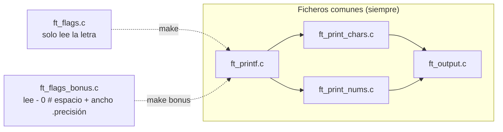

# ft_printf - Guía paso a paso (con bonus)

[[Inicio|← Inicio]] · [[ft_printf - Índice|ft_printf]] · Guía

> Esta guía construye ft_printf **con el bonus pensado desde el primer día**. El subject lo avisa: *«Si quieres completar la parte bonus, piensa en la implementación de las características extras desde el principio. De esta forma, evitarás los peligros de un enfoque ingenuo.»* Aquí verás cuál es ese enfoque ingenuo, por qué obliga a reescribirlo casi todo y cómo diseñarlo para que el bonus sea **un solo fichero más**.

> [!info] Cómo usar esta guía
> - Léela **en orden**: cada sección usa lo de la anterior.
> - En cada etapa hay un **«Pruébalo tú»**. Hazlo antes de seguir.
> - Las soluciones están en cajas **plegadas** («Ver una posible solución»). Ábrelas después de intentarlo, o para comparar.
> - El subject (v12.0) dice que no pidas respuestas directas a la IA y que en la evaluación te pueden pedir una modificación en directo. Si copias, te quedarás en blanco.

> [!abstract] Notas relacionadas
> - [[ft_printf - Índice]]: resumen del proyecto, conversiones obligatorias y preguntas de evaluación.
> - [[printf]]: cómo se comporta la `printf` original.
> - [[stdarg y funciones variádicas]]: `va_list`, `va_start`, `va_arg`, `va_end` y la promoción de tipos.
> - [[Structs y typedef]]: las tres `struct` de esta guía.
> - [[ft_printf - Funciones auxiliares]]: `ft_out_field`, `ft_utoa_base` y el resto de piezas, una a una.
> - [[ft_printf - Pruebas y depuración]]: tester contra `printf`, Makefile, gdb y errores típicos.
> - [[get_next_line - Guía paso a paso]]: la guía hermana, con el mismo formato.

---

## 1. Qué te piden, en una frase

Una librería `libftprintf.a` con esta función:

```c
int	ft_printf(char const *, ...);
```

que imita a `printf`: recorre la cadena de formato, escribe el texto normal tal cual y sustituye cada `%algo` por el siguiente argumento convertido a texto. Devuelve **cuántos caracteres ha escrito** (o `-1` si `write` falla).

Lo que dice el subject v12.0:

| Aspecto | Requisito |
|---|---|
| Entrega | `Makefile`, `*.h`, `*/*.h`, `*.c`, `*/*.c` |
| Librería | `libftprintf.a` en la **raíz** del repo, creada con `ar` (prohibido `libtool`) |
| Funciones permitidas | `malloc`, `free`, `write`, `va_start`, `va_arg`, `va_copy`, `va_end` |
| libft | Permitida: se copia en `libft/` con su Makefile, y tu Makefile la compila **primero** |
| Buffer | **No** se debe implementar la gestión del buffer del `printf` original |
| Conversiones | `c s p d i u x X %` |
| Bonus 1 | Cualquier combinación de `-`, `0`, `.` y ancho mínimo, **en todas las conversiones** |
| Bonus 2 | Las banderas `#`, `+` y espacio |
| Ficheros bonus | En ficheros aparte `_bonus.c` / `_bonus.h`, con una regla `bonus` en el Makefile |
| README | Obligatorio, con **explicación y justificación del algoritmo y la estructura de datos** |

> [!warning] El bonus solo cuenta si la obligatoria está PERFECTA
> Palabra del subject. Diseña pensando en el bonus, pero **termina y prueba la obligatoria primero**. Con el diseño de esta guía la obligatoria funciona sola y el bonus se enciende después sin tocarla.

## 2. El enfoque ingenuo y por qué se rompe con el bonus

La forma «natural» de empezar es que cada conversión **escriba directamente**:

```c
int	ft_print_nbr(int n)          /* enfoque ingenuo */
{
	/* escribe '-' si hace falta, luego los dígitos uno a uno con write */
}
```

Funciona para la obligatoria. Ahora mira lo que pide el bonus con un solo número, `-42`:

| Formato | Salida real de `printf` | Qué necesitas saber **antes** de escribir |
|---|---|---|
| `%8d` | `[     -42]` | Cuántos caracteres ocupa el número, para poner 5 espacios **delante** |
| `%-8d` | `[-42     ]` | Lo mismo, pero los espacios van **detrás** |
| `%08d` | `[-0000042]` | Los ceros van **entre** el signo y los dígitos, no delante del signo |
| `%08.3d` | `[    -042]` | Con precisión, el `0` se ignora y la precisión rellena con ceros los dígitos |

Con el enfoque ingenuo, el `-` y los dígitos ya están escritos cuando te das cuenta de que hacía falta algo delante o en medio. `write` no tiene marcha atrás. La «solución» habitual es meter `if` de banderas dentro de cada función de conversión, y acabas con 9 funciones que repiten la misma lógica de relleno, cada una con sus propios fallos.

> [!important] La idea que lo arregla todo
> **Ninguna conversión escribe directamente.** Cada conversión solo **prepara las piezas** (el signo, los dígitos, cuántos ceros) y se las pasa a **una única función** que sabe colocarlas con espacios y ceros. El relleno se programa **una sola vez**.

## 3. La idea: todo es un «campo» de cinco piezas

Cualquier conversión, con cualquier combinación de banderas, produce siempre esto, en este orden:

```text
 ┌──────────┬─────────┬───────┬─────────┬──────────┐
 │ espacios │ prefijo │ ceros │ cuerpo  │ espacios │
 │ (izq.)   │         │       │         │ (der.)   │
 └──────────┴─────────┴───────┴─────────┴──────────┘
   si NO -    "-" "+"   de la    dígitos   si -
              " " "0x"  precisión  o texto
              "0X" ""   o del 0
```

| Formato y valor | Espacios izq. | Prefijo | Ceros | Cuerpo | Espacios der. | Resultado |
|---|---|---|---|---|---|---|
| `%8d`, `-42` | 5 | `-` | 0 | `42` | 0 | `[     -42]` |
| `%-8d`, `-42` | 0 | `-` | 0 | `42` | 5 | `[-42     ]` |
| `%08d`, `-42` | 0 | `-` | 5 | `42` | 0 | `[-0000042]` |
| `%08.3d`, `-42` | 4 | `-` | 1 | `42` | 0 | `[    -042]` |
| `%#08x`, `255` | 0 | `0x` | 4 | `ff` | 0 | `[0x0000ff]` |
| `%+d`, `42` | 0 | `+` | 0 | `42` | 0 | `[+42]` |
| `%-7.3s`, `"hola"` | 0 | | 0 | `hol` | 4 | `[hol    ]` |
| `%5c`, `'a'` | 4 | | 0 | `a` | 0 | `[    a]` |
| `%d`, `42` (obligatoria) | 0 | | 0 | `42` | 0 | `[42]` |

Fíjate en la última fila: **la parte obligatoria es el caso en que no hay banderas**. Ancho `0`, sin precisión, sin `-`: los espacios y los ceros salen a `0` y solo se imprime prefijo + cuerpo. Por eso puedes escribir la función del campo desde el principio y la obligatoria funciona con ella sin enterarse.

> [!example] La analogía de la caja de envío
> El **cuerpo** es lo que envías (los dígitos). El **prefijo** es la etiqueta pegada encima (`-`, `0x`). Los **ceros** son relleno de protección que va *dentro* de la caja, pegado al contenido. El **ancho** es el tamaño de la caja. Los **espacios** son el hueco que sobra en la caja: con `-` el contenido se empuja a la izquierda y el hueco queda a la derecha; sin `-`, al revés. Y con la bandera `0`, en vez de dejar hueco lo rellenas todo de protección.

Las dos únicas cuentas del proyecto:

```text
ceros    = precisión - longitud del cuerpo           (si sale positivo; solo números)
espacios = ancho - (prefijo + ceros + cuerpo)        (si sale positivo)
con bandera 0 (y sin '-' ni precisión): los espacios se convierten en ceros
```

## 4. Tres estructuras

Con la [[La Norma|Norma]] (máximo 4 parámetros y 5 variables por función) no puedes ir pasando diez valores sueltos. Se agrupan en tres `struct` (repaso en [[Structs y typedef]]):

| Struct | Qué guarda | Vive… |
|---|---|---|
| `t_out` | Cuántos caracteres llevas escritos y si `write` ha fallado | Toda la llamada a `ft_printf` |
| `t_flags` | Lo que has leído entre el `%` y la letra: banderas, ancho, precisión y la letra | Una conversión |
| `t_field` | Las piezas preparadas: prefijo, cuerpo, longitud del cuerpo y ceros | Una conversión |

```c
typedef struct s_out
{
	int	len;      /* caracteres escritos hasta ahora: lo que devuelve ft_printf */
	int	error;    /* 1 en cuanto un write devuelva -1 */
}	t_out;

typedef struct s_flags
{
	int		minus;      /* '-'  alinear a la izquierda */
	int		zero;       /* '0'  rellenar con ceros */
	int		width;      /* ancho mínimo del campo */
	int		precision;  /* '.'  -1 = no se ha escrito '.' */
	int		sharp;      /* '#'  0x / 0X */
	int		space;      /* ' '  espacio delante de positivos */
	int		plus;       /* '+'  signo delante de positivos */
	char	spec;       /* la letra: c s p d i u x X % */
}	t_flags;

typedef struct s_field
{
	const char	*prefix;    /* "", "-", "+", " ", "0x", "0X" */
	const char	*body;      /* los dígitos o el texto (no tiene por qué acabar en '\0') */
	int			body_len;   /* cuántos caracteres de body se imprimen */
	int			zeros;      /* ceros entre el prefijo y el cuerpo */
}	t_field;
```

> [!danger] `precision` empieza en `-1`, no en `0`
> «No hay precisión» y «precisión 0» son cosas distintas: `printf("[%d]", 0)` da `[0]`, pero `printf("[%.0d]", 0)` da `[]` (¡no imprime nada!). Y `%.0s` imprime una cadena vacía. Si inicializas la precisión a `0` no puedes distinguir los dos casos. Es la decisión de diseño que más fallos evita.

> [!note] ¿Por qué `body` es `const char *` y no una cadena con `malloc`?
> Los dígitos de un número caben siempre en 20 caracteres (un `unsigned long` de 64 bits tiene como mucho 20 cifras decimales y 16 hexadecimales). Así que se escriben en un `char digits[20]` en la pila y no hace falta `malloc`: **no hay memoria que liberar y es imposible tener leaks**. Para `%s`, `body` apunta directamente a la cadena del usuario. Y como llevas `body_len`, no necesitas el `'\0'`.

## 5. Obligatoria y bonus sin duplicar código

El subject exige que el bonus esté en ficheros `_bonus.c` y que la obligatoria y el bonus se evalúen **por separado**. El truco es que **la única diferencia entre las dos es cómo se lee lo que hay entre el `%` y la letra**:

| | Lee `"%-08.3d"` así | Resultado |
|---|---|---|
| `ft_flags.c` (obligatoria) | spec = `'-'` | Las banderas nunca se activan: ancho 0, precisión -1 |
| `ft_flags_bonus.c` (bonus) | minus, zero, width 8, precisión 3, spec = `'d'` | Todas las banderas |

Las dos definen **la misma función con el mismo prototipo**, `ft_set_flags`. El Makefile compila **una u otra**, nunca las dos (si compilas las dos, el enlazador se queja de que `ft_set_flags` está definida dos veces).



> [!question] «Pero el relleno está en ficheros que no son `_bonus`»
> Es la pregunta que te puede hacer un evaluador. Respuesta: la funcionalidad del bonus (que `ft_printf` entienda banderas) **solo existe** si se compila `ft_flags_bonus.c`. Con `make`, `ft_printf("%5d", 1)` no tiene ancho. El código común trata «ancho 0, sin precisión» como un caso más, igual que trata un número de 1 o de 10 cifras. Si tu evaluador no lo acepta, la alternativa estricta es copiar los comunes como `ft_printf_bonus.c`, `ft_output_bonus.c`… y que `SRCS_BONUS` sea la lista completa de copias. Con este diseño es un `cp` y cambiar el Makefile; no hay que reescribir nada.

## 6. Errores típicos al montar el header y el Makefile

Antes de escribir código, revisa estos fallos frecuentes en el esqueleto del proyecto. Muchos no dan error al compilar y se descubren tarde (o en la evaluación).

### En el header

| Error típico | Problema | Solución |
|---|---|---|
| Un prototipo sin `;` al final | No compila: error de sintaxis antes del `#endif` | Añadir el `;` |
| Un `t_buffer` con `char data[BUFFER_SIZE]` e `index` para acumular la salida | El subject dice *«No se debe implementar la gestión del buffer del printf() original»*. Un evaluador puede considerarlo eso. Además, si mezclas `printf` y `ft_printf` en un test, el orden de salida cambia | Quedarte solo con un contador: `t_out { len; error; }` |
| Una macro `BUFFER_SIZE` | No hace falta y confunde con la de get_next_line | No definirla |
| Campos de la `struct` alineados con espacios y comentarios `//` al final de línea | norminette exige tabuladores para alinear | Alinear con tabs, como en la sección 4 |
| `t_flags` sin la letra de la conversión | Tendrás que pasar la letra aparte a cada función | Añadir `char spec;` |
| `#include <stdio.h>` | No se usa `printf` dentro de la librería | Quitarlo; incluir `"libft.h"` |
| Comentarios copiados de otro proyecto (p. ej. de get_next_line) | Confunden al evaluador | Revisarlos |
| Varias funciones para leer las banderas (`ft_set_flags`, `ft_parse_flags`, `ft_is_specifier`…) | Hacen lo mismo y se pisan | Una sola: `t_flags ft_set_flags(const char *s, int *i);` |

### En el Makefile

1. **Una regla de patrón que no coincide con los objetos.** Si los objetos son `srcs/ft_print_chars.o` y la regla es `%.o: $(SRCS)/%.c $(HEADER)`, make busca `srcs/srcs/ft_print_chars.c`, no lo encuentra y usa su regla interna. Consecuencias: no ves tu mensaje de compilación y, lo grave, **si cambias `ft_printf.h` no se recompila nada** (compruébalo con `touch includes/ft_printf.h && make`). Solución: `$(SRCS)/%.o: $(SRCS)/%.c $(HEADER)`.
2. **Olvidar `ft_printf.c` en la lista de fuentes.** La librería compila, pero sale sin la función `ft_printf`. Compruébalo con `ar t libftprintf.a`.
3. **Añadir el bonus encima de la obligatoria.** Con el diseño de la sección 5, el fichero de banderas bonus **sustituye** al obligatorio: necesitas tres listas (comunes, solo obligatoria, solo bonus).
4. **Olvidar `bonus` en `.PHONY`.**

Ideas que sí conviene usar: `cp $(LIBFT) $(NAME)` seguido de `ar` (mete libft dentro de `libftprintf.a`), `$(MAKE) WITH_BONUS=1 all` para el bonus y compilar libft con su propio Makefile (`$(MAKE) -C libft`).

> [!faq]- Ver la parte del Makefile que gestiona obligatoria y bonus
> ```makefile
> # Ficheros que se compilan SIEMPRE
> SRCS_COMMON    = ft_printf.c        ft_output.c \
>                  ft_print_chars.c   ft_print_nums.c
> # Solo en la obligatoria / solo en el bonus: definen la MISMA función
> SRCS_MANDATORY = ft_flags.c
> SRCS_BONUS     = ft_flags_bonus.c
>
> ifdef WITH_BONUS
>     SRC_FILES = $(SRCS_COMMON) $(SRCS_BONUS)
> else
>     SRC_FILES = $(SRCS_COMMON) $(SRCS_MANDATORY)
> endif
>
> OBJS        = $(addprefix $(SRCS)/, $(SRC_FILES:.c=.o))
>
> # ... all, bonus, $(NAME) y $(LIBFT) ...
>
> $(SRCS)/%.o: $(SRCS)/%.c $(HEADER)
> 	@printf "[ COMPILANDO ] %s -> %s\n" "$<" "$@"
> 	@$(CC) $(CFLAGS) -c $< -o $@
>
> clean:
> 	@$(RM) $(SRCS)/*.o
> 	@$(MAKE) clean -C $(LIBFT_DIR)
>
> .PHONY: all bonus clean fclean re
> ```
> - `clean` borra `$(SRCS)/*.o` y no `$(OBJS)`: si acabas de hacer `make bonus`, `$(OBJS)` (calculado **sin** `WITH_BONUS`) no incluye `ft_flags_bonus.o` y se quedaría sin borrar.
> - Comprueba que no hay relink: `make` dos veces → `Nothing to be done for 'all'`; `make bonus` dos veces → la segunda no ejecuta ni `cc` ni `ar`; después de `make bonus`, `ar t libftprintf.a` contiene `ft_flags_bonus.o` y **no** `ft_flags.o` (el `cp` de libft machaca la librería anterior antes del `ar`).

## 7. Antes de programar: lo que tienes que dominar

- [ ] Escribir una función variádica que sume N enteros → [[stdarg y funciones variádicas#Ejemplo: sumar N enteros]]
- [ ] Por qué `va_arg(args, char)` está mal y se pide `int` → [[stdarg y funciones variádicas#Promoción de tipos por defecto]]
- [ ] Pasar un `va_list` a otra función **por puntero** (`va_list *args`) → [[stdarg y funciones variádicas#Aplicación en ft_printf]]
- [ ] Declarar una `struct` con `typedef`, acceder con `.` y con `->` → [[Structs y typedef]]
- [ ] Por qué `-INT_MIN` desborda un `int` → [[Tipos enteros y conversiones]]
- [ ] Que `write` devuelve `-1` si falla → [[Control de errores en C]]
- [ ] Qué hace `ar` y cómo meter libft en tu `.a` → [[Makefile y librerías estáticas]]
- [ ] Cómo se comportan `%p` con `NULL`, `%s` con `NULL` y el valor de retorno → [[printf]]

## 8. Construirlo por etapas

Igual que en get_next_line: **pieza a pieza y probando cada una**. Las etapas 1 a 6 son la obligatoria; la 7 es el bonus.

### Etapa 0: los ficheros

```text
ft_printf/
├── Makefile
├── README.md
├── includes/
│   └── ft_printf.h          ← las tres struct y todos los prototipos
├── libft/                   ← tu libft con su Makefile
└── srcs/
    ├── ft_printf.c          ← ft_printf, ft_init_flags y el reparto por letra
    ├── ft_output.c          ← lo ÚNICO que llama a write: ft_out_char, ft_out_nstr, ft_out_field
    ├── ft_print_chars.c     ← %c, %s, %p
    ├── ft_print_nums.c      ← %d %i %u %x %X y el pasar a texto en cualquier base
    ├── ft_flags.c           ← ft_set_flags OBLIGATORIA (solo lee la letra)
    └── ft_flags_bonus.c     ← ft_set_flags BONUS (banderas, ancho, precisión)
```

> [!faq]- Ver el header completo
> ```c
> #ifndef FT_PRINTF_H
> # define FT_PRINTF_H
>
> # include <stdarg.h>
> # include <unistd.h>
> # include "libft.h"
>
> typedef struct s_out
> {
> 	int	len;
> 	int	error;
> }	t_out;
>
> typedef struct s_flags
> {
> 	int		minus;
> 	int		zero;
> 	int		width;
> 	int		precision;
> 	int		sharp;
> 	int		space;
> 	int		plus;
> 	char	spec;
> }	t_flags;
>
> typedef struct s_field
> {
> 	const char	*prefix;
> 	const char	*body;
> 	int			body_len;
> 	int			zeros;
> }	t_field;
>
> int		ft_printf(char const *format, ...);
> t_flags	ft_init_flags(void);
> t_flags	ft_set_flags(const char *s, int *i);
> void	ft_out_char(t_out *o, char c);
> void	ft_out_nstr(t_out *o, const char *s, int n);
> void	ft_out_field(t_out *o, t_flags *f, t_field *fl);
> void	ft_print_char(t_out *o, t_flags *f, int c);
> void	ft_print_str(t_out *o, t_flags *f, const char *s);
> void	ft_print_ptr(t_out *o, t_flags *f, void *p);
> void	ft_print_int(t_out *o, t_flags *f, int n);
> void	ft_print_unsigned(t_out *o, t_flags *f, unsigned int n);
> void	ft_print_number(t_out *o, t_flags *f, unsigned long n,
> 			const char *prefix);
>
> #endif
> ```
> - `"libft.h"` aporta `ft_strlen`, `ft_strchr` y `ft_isdigit`. Tu Makefile ya pasa `-I$(LIBFT_DIR)`.
> - `ft_print_number` ocupa dos líneas: la Norma no deja pasar de 80 columnas. La segunda línea se indenta con tabuladores.
> - Falta la cabecera de 42 (`:+:`); ponla con tu editor.

Un `main` de pruebas que **no se entrega**. Imprime cada resultado entre corchetes para ver los espacios, y compara el valor de retorno:

```c
#include <stdio.h>
#include "ft_printf.h"

int	main(void)
{
	int	r1;
	int	r2;

	r1 = printf("[%c|%s|%d]\n", 'a', "hola", -42);
	r2 = ft_printf("[%c|%s|%d]\n", 'a', "hola", -42);
	printf("printf=%d ft_printf=%d\n", r1, r2);
	return (0);
}
```

```bash
make && cc -Wall -Wextra -Werror -Iincludes -Ilibft main.c libftprintf.a -o test && ./test
```

### Etapa 1: la salida (`ft_out_char`, `ft_out_nstr`)

Toda la escritura pasa por aquí. Así el conteo de caracteres y el error de `write` se gestionan en **un único sitio**, y ninguna otra función llama a `write`.

**Qué tienen que hacer:**

```text
ft_out_char(o, c):
    si ya hubo un error: no hacer nada
    escribir 1 byte; si write devuelve -1: o->error = 1
    si no: o->len++

ft_out_nstr(o, s, n):           (escribe los n primeros bytes de s)
    igual, pero con n bytes de golpe; si n <= 0 no hace nada
```

- **¿Por qué un `error` en vez de devolver `-1` en cada función?** Porque con `-1` tendrías que comprobar el retorno de cada `write` y propagarlo hacia arriba por todas las funciones: el código se llena de `if (ret == -1) return (-1);` y te pasas de 25 líneas. Con la bandera `error` en `t_out`, las funciones no devuelven nada, y al final `ft_printf` mira una sola vez si hubo error.
- Comprobado: con la salida cerrada (`./test >&-`) o llena (`./test > /dev/full`), `ft_printf` devuelve `-1`, igual que `printf`.

> [!faq]- Ver una posible solución
> ```c
> void	ft_out_char(t_out *o, char c)
> {
> 	if (o->error)
> 		return ;
> 	if (write(1, &c, 1) == -1)
> 		o->error = 1;
> 	else
> 		o->len++;
> }
>
> void	ft_out_nstr(t_out *o, const char *s, int n)
> {
> 	if (o->error || n <= 0)
> 		return ;
> 	if (write(1, s, n) == -1)
> 		o->error = 1;
> 	else
> 		o->len += n;
> }
> ```

> [!tip] Pruébalo tú
> Antes de seguir, escribe un `main` con `t_out o = ...` (asigna `len` y `error` campo a campo), llama a `ft_out_char(&o, 'h')` y `ft_out_nstr(&o, "ola\n", 4)` e imprime `o.len` con `printf`: debe salir `5`.

### Etapa 2: el campo (`ft_out_field`)

El corazón del proyecto. Recibe las banderas y las piezas, y escribe las cinco partes de la sección 3.

**Qué tiene que hacer:**

```text
ft_out_field(o, f, fl):
    pad = f->width - longitud(prefijo) - fl->zeros - fl->body_len
    si f->zero y pad > 0:          (bandera 0: el hueco se rellena con ceros)
        fl->zeros += pad
        pad = 0
    si NO f->minus: escribir pad espacios
    escribir el prefijo
    escribir fl->zeros ceros
    escribir fl->body_len caracteres de fl->body
    si f->minus: escribir pad espacios
```

- `pad` puede salir negativo (el contenido es más largo que el ancho: `%1s` con `"hola"`). Escribir «-3 espacios» tiene que no hacer nada. Por eso la función de repetir usa `while (n-- > 0)`.
- **¿Y si `f->zero` no debería aplicarse?** (con `-`, con precisión en números, en `%c` y `%s`). No se decide aquí: quien prepara las piezas pone `f->zero = 0` antes de llamar. Así esta función no necesita saber qué conversión está imprimiendo.
- En la obligatoria, `width = 0` → `pad` siempre ≤ 0 → solo se escriben prefijo, ceros y cuerpo.

> [!faq]- Ver una posible solución
> ```c
> static void	ft_out_repeat(t_out *o, char c, int n)
> {
> 	while (n-- > 0)
> 		ft_out_char(o, c);
> }
>
> void	ft_out_field(t_out *o, t_flags *f, t_field *fl)
> {
> 	int	prefix_len;
> 	int	pad;
>
> 	prefix_len = ft_strlen(fl->prefix);
> 	pad = f->width - prefix_len - fl->zeros - fl->body_len;
> 	if (f->zero && pad > 0)
> 	{
> 		fl->zeros += pad;
> 		pad = 0;
> 	}
> 	if (!f->minus)
> 		ft_out_repeat(o, ' ', pad);
> 	ft_out_nstr(o, fl->prefix, prefix_len);
> 	ft_out_repeat(o, '0', fl->zeros);
> 	ft_out_nstr(o, fl->body, fl->body_len);
> 	if (f->minus)
> 		ft_out_repeat(o, ' ', pad);
> }
> ```
> `ft_out_repeat` es `static`: solo se usa dentro de `ft_output.c`. El fichero queda con 4 funciones (máximo 5).

### Etapa 3: el bucle principal y el reparto

Recorres el formato. Si no es `%`, lo escribes. Si es `%`, `ft_set_flags` lee lo que viene detrás (en la obligatoria, solo la letra) y avanza el índice; luego `ft_convert` llama a la función de esa letra.

```text
ft_printf(format, ...):
    si format es NULL: devolver -1
    va_start; out = {0, 0}; i = 0
    mientras format[i] y no haya error:
        si format[i] no es '%': escribirlo, i++
        si es '%': i++; flags = ft_set_flags(format, &i); ft_convert(&out, &flags, &args)
    va_end
    devolver -1 si hubo error, si no out.len
```

- **`&i` y no `i`**: `ft_set_flags` tiene que dejar `i` justo **después** de la letra, y para eso necesita modificar la variable de `ft_printf`. Con el bonus avanzará varios caracteres (`-08.3d`), con la obligatoria uno.
- **`va_list *args`**: el `va_list` se pasa por puntero a `ft_convert` para que cada `va_arg` avance el **mismo** `va_list` (explicado en [[stdarg y funciones variádicas#Aplicación en ft_printf]]).
- **Un `%` al final** (`"hola %"`): `format[i]` es `'\0'`. `ft_set_flags` no debe avanzar `i` más allá del `'\0'`, o el `while` leería fuera de la cadena. Por eso hace `if (s[*i]) (*i)++;`.
- **Letra desconocida** (`%k`): es comportamiento indefinido en `printf`. Esta solución imprime `%k`, que es lo que hace glibc.
- **`va_end` en todos los caminos**: aquí solo hay uno porque el error no sale del bucle con `return`, sino que lo corta la condición del `while`.

> [!faq]- Ver una posible solución (ft_printf.c)
> ```c
> t_flags	ft_init_flags(void)
> {
> 	t_flags	f;
>
> 	f.minus = 0;
> 	f.zero = 0;
> 	f.width = 0;
> 	f.precision = -1;
> 	f.sharp = 0;
> 	f.space = 0;
> 	f.plus = 0;
> 	f.spec = 0;
> 	return (f);
> }
>
> static void	ft_convert(t_out *o, t_flags *f, va_list *args)
> {
> 	if (f->spec == 'c')
> 		ft_print_char(o, f, va_arg(*args, int));
> 	else if (f->spec == 's')
> 		ft_print_str(o, f, va_arg(*args, char *));
> 	else if (f->spec == 'p')
> 		ft_print_ptr(o, f, va_arg(*args, void *));
> 	else if (f->spec == 'd' || f->spec == 'i')
> 		ft_print_int(o, f, va_arg(*args, int));
> 	else if (f->spec == 'u' || f->spec == 'x' || f->spec == 'X')
> 		ft_print_unsigned(o, f, va_arg(*args, unsigned int));
> 	else if (f->spec == '%')
> 		ft_out_char(o, '%');
> 	else if (f->spec)
> 	{
> 		ft_out_char(o, '%');
> 		ft_out_char(o, f->spec);
> 	}
> }
>
> int	ft_printf(char const *format, ...)
> {
> 	va_list	args;
> 	t_out	out;
> 	t_flags	flags;
> 	int		i;
>
> 	if (!format)
> 		return (-1);
> 	va_start(args, format);
> 	out.len = 0;
> 	out.error = 0;
> 	i = 0;
> 	while (format[i] && !out.error)
> 	{
> 		if (format[i++] != '%')
> 			ft_out_char(&out, format[i - 1]);
> 		else
> 		{
> 			flags = ft_set_flags(format, &i);
> 			ft_convert(&out, &flags, &args);
> 		}
> 	}
> 	va_end(args);
> 	if (out.error)
> 		return (-1);
> 	return (out.len);
> }
> ```
> - `format[i++] != '%'`: compara y avanza a la vez. Si no era `%`, el carácter a escribir es `format[i - 1]`.
> - `%c` lee `int` (promoción de argumentos), `%u` `%x` `%X` leen `unsigned int` y `%p` `void *`.
> - `ft_init_flags` vive aquí y no en `ft_flags.c` para no repetirla en `ft_flags_bonus.c`.

> [!faq]- Ver una posible solución (ft_flags.c, la obligatoria)
> ```c
> #include "ft_printf.h"
>
> t_flags	ft_set_flags(const char *s, int *i)
> {
> 	t_flags	f;
>
> 	f = ft_init_flags();
> 	f.spec = s[*i];
> 	if (s[*i])
> 		(*i)++;
> 	return (f);
> }
> ```

> [!tip] Pruébalo tú
> Con `ft_convert` solo con `%c` y `%%` (comenta el resto) ya puedes probar `ft_printf("%c%c%%\n", 'o', 'k')`. Debe escribir `ok%` y devolver `4`. Prueba también `ft_printf("%c", '\0')`: escribe un byte nulo y devuelve `1` (míralo con `./test | cat -A`, sale `^@`).

### Etapa 4: `%c` y `%s`

Ya no escriben nada: **preparan el campo** y llaman a `ft_out_field`.

| Conversión | prefix | body | body_len | zeros | además |
|---|---|---|---|---|---|
| `%c` | `""` | dirección de un `char` local | `1` | `0` | `f->zero = 0` |
| `%s` | `""` | la cadena | `strlen`, recortado a la precisión si la hay | `0` | `f->zero = 0` |

Casos con `NULL` (glibc en Linux, medidos):

| Formato | Salida |
|---|---|
| `%s` | `(null)` |
| `%8s` | `[  (null)]` |
| `%.6s` | `[(null)]` |
| `%.3s` | `[]` ← con precisión menor que 6, glibc no imprime nada |

> [!faq]- Ver una posible solución
> ```c
> void	ft_print_char(t_out *o, t_flags *f, int c)
> {
> 	char	ch;
> 	t_field	fl;
>
> 	ch = (char)c;
> 	fl.prefix = "";
> 	fl.body = &ch;
> 	fl.body_len = 1;
> 	fl.zeros = 0;
> 	f->zero = 0;
> 	ft_out_field(o, f, &fl);
> }
>
> void	ft_print_str(t_out *o, t_flags *f, const char *s)
> {
> 	t_field	fl;
>
> 	if (!s && f->precision >= 0 && f->precision < 6)
> 		s = "";
> 	else if (!s)
> 		s = "(null)";
> 	fl.prefix = "";
> 	fl.body = s;
> 	fl.body_len = ft_strlen(s);
> 	if (f->precision >= 0 && f->precision < fl.body_len)
> 		fl.body_len = f->precision;
> 	fl.zeros = 0;
> 	f->zero = 0;
> 	ft_out_field(o, f, &fl);
> }
> ```
> - `ch = (char)c` y `fl.body = &ch`: el `int` recibido se guarda en un `char` local para tener una dirección de 1 byte que darle a `write`.
> - `%c` con `'\0'` funciona solo: `body_len` es `1` aunque el byte sea un `0`. Por eso `body_len` va aparte y no se usa `strlen`.
> - `f->zero = 0`: glibc ignora el `0` en `%s` y `%c` (`%05s` con `"ab"` da `[   ab]`).

### Etapa 5: los números (`ft_utoa_base`, `ft_print_number`)

Una sola función, `ft_print_number`, sirve para `d i u x X` **y** `p`. Recibe el número ya **sin signo** (`unsigned long`) y el prefijo ya elegido. La base la saca de la letra.

**Pasar un número a texto en cualquier base**, sin `malloc` (la teoría, en [[Bases numéricas]]):

```text
ft_utoa_base(n, base, buf):           base = "0123456789abcdef", por ejemplo
    b = strlen(base)
    contar cuántas cifras tiene n en base b  (al menos 1: el 0 tiene una cifra)
    rellenar buf DE DERECHA A IZQUIERDA:  buf[i] = base[n % b]; n /= b
    devolver el número de cifras
```

```text
n = 255, base 16:   255 % 16 = 15 → 'f'     255 / 16 = 15
                     15 % 16 = 15 → 'f'      15 / 16 = 0
buf = [ f | f ]  → 2 cifras
```

**Preparar el campo de un número:**

```text
ft_print_number(o, f, n, prefix):
    body = cifras de n; body_len = cuántas
    si precisión == 0 y n == 0: body_len = 0      (%.0d con 0 no imprime nada)
    zeros = precisión - body_len (si es positivo)
    si hay precisión: f->zero = 0                (la precisión anula la bandera 0)
    ft_out_field
```

**Elegir el prefijo:**

| Conversión | Condición | prefix |
|---|---|---|
| `%d` `%i` | `n < 0` | `"-"` y se imprime `-n` |
| | `n >= 0` y `+` | `"+"` |
| | `n >= 0` y espacio (sin `+`) | `" "` |
| `%x` `%X` | `#` y `n != 0` | `"0x"` / `"0X"` (`%#x` con 0 da `0`) |
| `%p` | puntero no nulo | `"0x"` siempre |
| `%p` | `NULL` | ninguno: cuerpo `(nil)` |

> [!danger] `INT_MIN`
> `-n` con `n = -2147483648` desborda un `int` (el positivo no existe en 32 bits). Conviértelo **antes** de cambiar el signo: `-(long)n`. Detalles en [[Tipos enteros y conversiones]].

> [!faq]- Ver una posible solución (ft_print_nums.c)
> ```c
> #include "ft_printf.h"
>
> static int	ft_utoa_base(unsigned long n, const char *base, char *buf)
> {
> 	unsigned long	b;
> 	unsigned long	tmp;
> 	int				len;
> 	int				i;
>
> 	b = ft_strlen(base);
> 	tmp = n;
> 	len = 1;
> 	while (tmp >= b)
> 	{
> 		tmp /= b;
> 		len++;
> 	}
> 	i = len;
> 	while (i-- > 0)
> 	{
> 		buf[i] = base[n % b];
> 		n /= b;
> 	}
> 	return (len);
> }
>
> static const char	*ft_base(char spec)
> {
> 	if (spec == 'x' || spec == 'p')
> 		return ("0123456789abcdef");
> 	if (spec == 'X')
> 		return ("0123456789ABCDEF");
> 	return ("0123456789");
> }
>
> void	ft_print_number(t_out *o, t_flags *f, unsigned long n,
> 			const char *prefix)
> {
> 	char	digits[20];
> 	t_field	fl;
>
> 	fl.prefix = prefix;
> 	fl.body = digits;
> 	fl.body_len = ft_utoa_base(n, ft_base(f->spec), digits);
> 	if (f->precision == 0 && n == 0)
> 		fl.body_len = 0;
> 	fl.zeros = 0;
> 	if (f->precision > fl.body_len)
> 		fl.zeros = f->precision - fl.body_len;
> 	if (f->precision >= 0)
> 		f->zero = 0;
> 	ft_out_field(o, f, &fl);
> }
>
> void	ft_print_int(t_out *o, t_flags *f, int n)
> {
> 	if (n < 0)
> 		ft_print_number(o, f, -(long)n, "-");
> 	else if (f->plus)
> 		ft_print_number(o, f, n, "+");
> 	else if (f->space)
> 		ft_print_number(o, f, n, " ");
> 	else
> 		ft_print_number(o, f, n, "");
> }
>
> void	ft_print_unsigned(t_out *o, t_flags *f, unsigned int n)
> {
> 	if (f->sharp && n != 0 && f->spec == 'x')
> 		ft_print_number(o, f, n, "0x");
> 	else if (f->sharp && n != 0 && f->spec == 'X')
> 		ft_print_number(o, f, n, "0X");
> 	else
> 		ft_print_number(o, f, n, "");
> }
> ```
> - `ft_base` devuelve la base según la letra: así `ft_print_number` cabe en 4 parámetros.
> - `char digits[20]`: 20 cifras es el máximo de un `unsigned long` de 64 bits en base 10.
> - `%u` recibe `unsigned int`, que se convierte solo a `unsigned long` al llamar.

> [!tip] Pruébalo tú
> Compara con `printf`: `%d` con `0`, `-42`, `INT_MIN`, `INT_MAX`; `%u` con `-1` (debe dar `4294967295`); `%x` y `%X` con `255`, `0`, `-1`.

### Etapa 6: `%p`

Con `ft_print_number` ya hecho, `%p` es un caso especial pequeño:

- Puntero `NULL` → glibc imprime `(nil)` (en macOS es `0x0`; en 42 se corrige en Linux).
- Si no → `ft_print_number(o, f, (unsigned long)p, "0x")` con la letra `p`, que usa la base hexadecimal en minúscula.
- `unsigned long` y no `unsigned int`: una dirección de 64 bits no cabe en 32 (`%p` de `ULONG_MAX` es `0xffffffffffffffff`).

> [!faq]- Ver una posible solución
> ```c
> void	ft_print_ptr(t_out *o, t_flags *f, void *p)
> {
> 	t_field	fl;
>
> 	if (!p)
> 	{
> 		fl.prefix = "";
> 		fl.body = "(nil)";
> 		fl.body_len = 5;
> 		fl.zeros = 0;
> 		f->zero = 0;
> 		ft_out_field(o, f, &fl);
> 		return ;
> 	}
> 	ft_print_number(o, f, (unsigned long)p, "0x");
> }
> ```
> Está en `ft_print_chars.c` para dejar ese fichero en 3 funciones y `ft_print_nums.c` en 5.

### ✅ Punto de control: la obligatoria

Con `make` (sin bonus), pasa todos los casos obligatorios de la sección 10 y Valgrind sin errores **antes** de seguir. Si la obligatoria no es perfecta, el bonus no se evalúa.

### Etapa 7: el bonus (`ft_flags_bonus.c`)

Lo único nuevo. El orden en que `printf` espera las cosas entre `%` y la letra es fijo:

```text
 %   [banderas]   [ancho]   [.precisión]   letra
      - 0 # ␣ +    dígitos   . dígitos
 %       -0          8          .3           d
```

**Qué tiene que hacer:**

```text
ft_set_flags(s, &i):                (i apunta al carácter justo después del %)
    f = ft_init_flags()
    mientras s[i] sea uno de "-0# +": activar esa bandera, i++
    f.width = leer número (0 si no hay dígitos)
    si s[i] es '.': i++; f.precision = leer número (0 si no hay dígitos: "%.d" = "%.0d")
    si minus: zero = 0        ('-' gana a '0')
    si plus:  space = 0       ('+' gana a ' ')
    f.spec = s[i]; si s[i] no es '\0': i++
```

- **¿Por qué `"%50d"` no activa la bandera `0`?** Porque el `0` solo es bandera si va **antes** del ancho. Al llegar al `5`, el bucle de banderas termina y el `0` de `50` se lee como parte del número.
- **`s[i] && ft_strchr("-0# +", s[i])`**: `ft_strchr` encuentra también el `'\0'` del final de la cadena que busca. Sin el `s[i] &&` delante, un `%` al final del formato se tomaría por bandera y el bucle se saldría de la cadena.
- **Números enormes** (`%99999999999d`): se deja de acumular a partir de cierto tamaño para no desbordar el `int`. Es comportamiento indefinido, pero no debe crashear.
- Ahora que `f->width`, `f->precision`… tienen valores, **todo lo de las etapas 2 a 6 ya funciona con banderas**: no hay que tocar nada más.

> [!faq]- Ver una posible solución
> ```c
> #include "ft_printf.h"
>
> static int	ft_read_number(const char *s, int *i)
> {
> 	int	n;
>
> 	n = 0;
> 	while (ft_isdigit(s[*i]))
> 	{
> 		if (n < 100000000)
> 			n = n * 10 + (s[*i] - '0');
> 		(*i)++;
> 	}
> 	return (n);
> }
>
> static void	ft_set_one_flag(t_flags *f, char c)
> {
> 	if (c == '-')
> 		f->minus = 1;
> 	else if (c == '0')
> 		f->zero = 1;
> 	else if (c == '#')
> 		f->sharp = 1;
> 	else if (c == ' ')
> 		f->space = 1;
> 	else if (c == '+')
> 		f->plus = 1;
> }
>
> t_flags	ft_set_flags(const char *s, int *i)
> {
> 	t_flags	f;
>
> 	f = ft_init_flags();
> 	while (s[*i] && ft_strchr("-0# +", s[*i]))
> 		ft_set_one_flag(&f, s[(*i)++]);
> 	f.width = ft_read_number(s, i);
> 	if (s[*i] == '.')
> 	{
> 		(*i)++;
> 		f.precision = ft_read_number(s, i);
> 	}
> 	if (f.minus)
> 		f.zero = 0;
> 	if (f.plus)
> 		f.space = 0;
> 	f.spec = s[*i];
> 	if (s[*i])
> 		(*i)++;
> 	return (f);
> }
> ```
> - `ft_set_one_flag` existe para que `ft_set_flags` no pase de 25 líneas.
> - `s[(*i)++]`: lee el carácter y avanza el índice en la misma expresión.

## 9. Dónde se aplica cada regla del bonus

Esto es lo que te preguntarán: «¿dónde gestionas el `0` con `-`?». Cada regla está en **un único sitio**:

| Regla | Ejemplo real de `printf` | Dónde |
|---|---|---|
| Ancho: espacios delante | `%5d` 42 → `[   42]` | `ft_out_field` (`pad`) |
| `-`: espacios detrás | `%-5d` 42 → `[42   ]` | `ft_out_field` |
| `0`: ceros en vez de espacios | `%05d` 42 → `[00042]` | `ft_out_field` (`pad` → `zeros`) |
| El `0` va detrás del signo | `%05d` -42 → `[-0042]` | `ft_out_field` (orden de escritura) |
| `-` anula `0` | `%-08d` -42 → `[-42     ]` | `ft_set_flags` bonus |
| Precisión: mínimo de cifras | `%.5d` 42 → `[00042]` | `ft_print_number` (`zeros`) |
| Precisión anula `0` | `%08.5d` 42 → `[   00042]` | `ft_print_number` (`f->zero = 0`) |
| Precisión 0 con valor 0 | `%.0d` 0 → `[]`, `%5.0d` 0 → `[     ]` | `ft_print_number` (`body_len = 0`) |
| Precisión en `%s`: máximo de caracteres | `%.2s` "hola" → `[ho]` | `ft_print_str` |
| `0` ignorado en `%c` `%s` | `%05s` "ab" → `[   ab]` | `ft_print_char`, `ft_print_str` |
| `+` | `%+d` 42 → `[+42]` | `ft_print_int` (prefijo) |
| Espacio | `% d` 42 → `[ 42]` | `ft_print_int` (prefijo) |
| `+` anula espacio | `%+ d` 42 → `[+42]` | `ft_set_flags` bonus |
| `+` con precisión 0 | `%+.0d` 0 → `[+]` | Sale solo: prefijo `+`, cuerpo vacío |
| `#` | `%#x` 255 → `[0xff]`, `%#X` 255 → `[0XFF]` | `ft_print_unsigned` (prefijo) |
| `#` con 0 | `%#x` 0 → `[0]` | `ft_print_unsigned` (`n != 0`) |
| `#` con `0` y precisión | `%#08x` 255 → `[0x0000ff]`, `%#.5x` 255 → `[0x000ff]` | Sale solo: los ceros van tras el prefijo |
| `%p` con ancho | `%20p` → `[      0x7ffd1234abcd]`, `%10p` NULL → `[     (nil)]` | `ft_print_ptr` |
| `%%` con banderas | `%5%` → `[%]` | `ft_convert`: `%%` se escribe tal cual, sin campo |

Combinaciones que el estándar de C declara **indefinidas** (ver [[Comportamiento indefinido]]) y que no tienes que imitar: `#` en `d`, `+` o espacio en `u x X c s p`, precisión en `c` y `p`, `0` en `c s p`. Los testers no las comprueban. Esta solución da lo mismo que glibc en `%015p` y `%.5p` porque salen solas del diseño.

## 10. Por dentro: `ft_printf("[%08.3d]", -42)`

Sigue la ejecución en papel antes de leer esto; es la típica pregunta de evaluación.

```text
ft_printf
    '['  → ft_out_char                          len = 1
    '%'  → i apunta a '0'
ft_set_flags (bonus)
    "0"  → zero = 1                             (el bucle de banderas para en '8')
    "8"  → width = 8
    ".3" → precision = 3
    "d"  → spec = 'd'                           i apunta a ']'
ft_convert → ft_print_int(o, f, -42)
    n < 0 → ft_print_number(o, f, 42, "-")
ft_print_number
    digits = "42", body_len = 2
    precision 3 > 2 → zeros = 1
    precision >= 0  → zero = 0                  (la precisión anula el 0)
ft_out_field
    pad = 8 - 1 (prefijo) - 1 (ceros) - 2 (cuerpo) = 4
    zero = 0 → pad se queda en espacios
    "    " + "-" + "0" + "42"                   len = 1 + 8 = 9
ft_printf
    ']'  → ft_out_char                          len = 10
    devuelve 10                                 salida: [    -042]
```

> [!tip] Pruébalo tú: hazlo en papel
> Haz la misma tabla para `"[%-#10.4x]"` con `255` y para `"[%08d]"` con `-42`. Comprueba con `printf`: deben salir `[0x00ff    ]` y `[-0000042]`.

## 11. Probarlo

> [!abstract] Todo esto, con más detalle, en [[ft_printf - Pruebas y depuración]]
> El tester explicado, el script que revisa el Makefile, cómo ver las banderas por dentro con `fprintf` y gdb, y cómo se ve cada error típico (salidas reales).

### Comparar contra `printf` automáticamente

Mirar a ojo no escala. Este tester redirige la salida a un fichero, llama a `printf` y a `ft_printf` con **los mismos argumentos** y compara bytes y valor de retorno. Imprime solo los que fallan.

> [!faq]- Ver el tester (no se entrega)
> ```c
> #include <stdio.h>
> #include <string.h>
> #include <unistd.h>
> #include <fcntl.h>
> #include <limits.h>
> #include "ft_printf.h"
>
> static char	a[4096], b[4096];
> static int	ok, ko;
>
>
> #define CASE(...) do { \
> 	int r1, r2, n1, n2, fd, sv; \
> 	fflush(stdout); sv = dup(1); \
> 	fd = open("/tmp/ft_o1", O_RDWR|O_CREAT|O_TRUNC, 0644); dup2(fd, 1); \
> 	r1 = printf(__VA_ARGS__); fflush(stdout); \
> 	lseek(fd, 0, SEEK_SET); n1 = read(fd, a, sizeof a); close(fd); \
> 	fd = open("/tmp/ft_o2", O_RDWR|O_CREAT|O_TRUNC, 0644); dup2(fd, 1); \
> 	r2 = ft_printf(__VA_ARGS__); \
> 	lseek(fd, 0, SEEK_SET); n2 = read(fd, b, sizeof b); close(fd); \
> 	dup2(sv, 1); close(sv); \
> 	if (r1 == r2 && n1 == n2 && !memcmp(a, b, n1)) ok++; \
> 	else { ko++; printf("KO line %d: %s\n  printf    [%.*s] %d\n  ft_printf [%.*s] %d\n", __LINE__, #__VA_ARGS__, n1, a, r1, n2, b, r2); } \
> } while (0)
>
> int	main(void)
> {
> 	char	*nul = NULL;
> 	int		x;
>
> 	CASE("hola mundo\n");
> 	CASE("%c%c%c", 'a', 0, 'z');
> 	CASE("%s|%s|%s", "abc", "", nul);
> 	CASE("%p %p %p", &x, (void *)0, (void *)ULONG_MAX);
> 	CASE("%d %i %d %d", 0, -42, INT_MIN, INT_MAX);
> 	CASE("%u %u %u", 0, -1, 4242);
> 	CASE("%x %X %x %X", 0, 255, -1, INT_MIN);
> 	CASE("%% %%%% 100%%");
> 	CASE("%c %s %p %d %i %u %x %X %%", 'x', "s", &x, 1, 2, 3u, 4, 5);
> #ifdef BONUS
> 	CASE("[%5c][%-5c][%-3c]", 'a', 'b', 0);
> 	CASE("[%10s][%-10s][%.2s][%7.3s][%-7.3s][%.0s]", "hola", "hola", "hola", "hola", "hola", "hola");
> 	CASE("[%10s][%.3s][%.6s][%-8s]", nul, nul, nul, nul);
> 	CASE("[%20p][%-20p][%10p][%-10p]", &x, &x, nul, nul);
> 	CASE("[%5d][%-5d][%05d][%.5d][%8.5d][%-8.5d][%08.5d]", 42, 42, 42, 42, 42, 42, 42);
> 	CASE("[%5d][%-5d][%05d][%.5d][%8.5d][%-8.5d][%08.5d]", -42, -42, -42, -42, -42, -42, -42);
> 	CASE("[%.0d][%5.0d][%-5.0d][%.0i][%.d]", 0, 0, 0, 0, 0);
> 	CASE("[%+d][% d][%+ d][% +d][%+d][% d]", 42, 42, 42, 42, -42, -42);
> 	CASE("[%+05d][% 05d][%+.3d][% 8.3d][%-+8d]", 7, 7, 7, 7, 7);
> 	CASE("[%+.0d][% .0d][%+5.0d]", 0, 0, 0);
> 	CASE("[%#x][%#X][%#x][%#08x][%#-8x][%#.5x][%#10.5X]", 255, 255, 0, 255, 255, 255, 255);
> 	CASE("[%#.0x][%.0x][%5.0X][%#5x]", 0, 0, 0, 0);
> 	CASE("[%10u][%-10u][%010u][%.10u][%.0u]", 42u, 42u, 42u, 42u, 0u);
> 	CASE("[%011d][%-11d][%.11d][%+d][% d]", INT_MIN, INT_MIN, INT_MIN, INT_MAX, INT_MAX);
> 	CASE("[%-05d][%0-5d][%--5d][%005d]", 1, 2, 3, 4);
> 	CASE("[%015p][%.5p][%-#5x]", &x, (void *)255, 1);
> 	CASE("[%1s][%1d][%0d][%.1x]", "hola", 12345, 9, 255);
> #endif
> 	printf("%s: %d OK, %d KO\n", BONUS_NAME, ok, ko);
> 	return (ko != 0);
> }
> ```
> ```bash
> make && cc -Wall -Wextra -Wno-format -Iincludes -Ilibft -DBONUS_NAME='"obligatoria"' tester.c libftprintf.a -o t && ./t
> make bonus && cc -Wall -Wextra -Wno-format -Iincludes -Ilibft -DBONUS -DBONUS_NAME='"bonus"' tester.c libftprintf.a -o t && ./t
> ```
> - `-Wno-format`: gcc/clang avisan de combinaciones indefinidas como `% s` y de `%s` con `NULL`. En el tester queremos probarlas igualmente.
> - Las comparaciones se hacen sobre ficheros porque `printf` usa buffer y `ft_printf` no ([[Buffer de stdout]]): en la terminal saldrían desordenadas (ver [[ft_printf - Pruebas y depuración#2. No mezcles printf y ft_printf en la terminal]]).

Resultado con la solución de esta guía:

```text
obligatoria: 9 OK, 0 KO
bonus: 26 OK, 0 KO
```

### Lo demás

- **Valgrind**: `valgrind -q --leak-check=full ./t` no debe imprimir nada. Este diseño no usa `malloc`, así que no puede haber leaks, pero sí lecturas fuera de una cadena (ver [[Valgrind y sanitizers]]).
- **Error de `write`**: `./test >&-` y `./test > /dev/full` → `ft_printf` debe devolver `-1`.
- **Relink**: `make; make` y `make bonus; make bonus` → la segunda vez no se ejecuta ni `cc` ni `ar`.
- **Norminette**: `norminette includes srcs`. La solución de esta guía solo da el error de la cabecera de 42 que falta.
- **Testers públicos**, **después** de los tuyos: printfTester (`make m` y `make b`) y francinette. Enlaces en [[ft_printf - Índice#Referencias]].

## 12. El README

Requisitos del subject v12.0: primera línea en cursiva (*Este proyecto ha sido creado como parte del currículo de 42 por \<login\>.*), secciones **Descripción**, **Instrucciones** y **Recursos** (con para qué has usado la IA y en qué partes), y para ft_printf: **explicación y justificación del algoritmo y la estructura de datos**. Las secciones 2 a 5 de esta guía son exactamente eso: el campo de cinco piezas, las tres `struct` y por qué `precision` empieza en `-1`. Escríbelo con tus palabras. Plantilla en [[README de un proyecto]].

## 13. Preparar la evaluación

> [!question]- ¿Por qué no escribes directamente desde cada conversión?
> Porque con ancho, `-` y `0` necesito saber cuánto ocupa todo antes de escribir el primer carácter, y los ceros van entre el signo y los dígitos. Cada conversión prepara prefijo, cuerpo y ceros, y una sola función (`ft_out_field`) los coloca.

> [!question]- ¿Por qué `precision` empieza en `-1`?
> Porque «sin precisión» y «precisión 0» se comportan distinto: `%d` con 0 imprime `0` y `%.0d` con 0 no imprime nada.

> [!question]- ¿Cómo separas la obligatoria del bonus?
> Las dos versiones definen `ft_set_flags` con el mismo prototipo. La obligatoria solo lee la letra; la bonus lee banderas, ancho y precisión. El Makefile compila una u otra. El resto del código es común y trata «sin banderas» como un caso más.

> [!question]- ¿Por qué no usas `malloc`?
> Los dígitos caben en un `char[20]` en la pila y para `%s` apunto a la cadena original. Sin `malloc` no hay leaks posibles ni fallos de memoria que gestionar.

> [!question]- ¿Qué pasa si `write` falla?
> `ft_out_char`/`ft_out_nstr` marcan `error = 1` y dejan de escribir. El bucle de `ft_printf` termina, se hace `va_end` y se devuelve `-1`.

> [!question]- ¿Por qué `-(long)n` y no `-n`?
> Porque `-INT_MIN` no cabe en un `int`: es desbordamiento con signo, comportamiento indefinido.

> [!question]- ¿Por qué `%c` se lee con `va_arg(*args, int)`?
> Por la promoción de argumentos por defecto: un `char` que pasa por `...` llega como `int`.

### Modificaciones en directo

Con este diseño cada una toca **una o dos líneas**. Practícalas (ejemplos, no la lista oficial):

- [ ] Añadir `%b` (binario): una letra en `ft_base` (`"01"`) y otra en el `if` de `ft_convert` junto a `u x X`.
- [ ] Añadir `%o` (octal) y que `#` ponga el prefijo `"0"`.
- [ ] Que `%s` con `NULL` imprima `(nada)` en vez de `(null)`.
- [ ] Que `%p` con `NULL` imprima `0x0` como en macOS.
- [ ] Que el relleno de la bandera `0` use `*` en vez de `0` (un carácter en `ft_out_field`).
- [ ] Contar cuántas conversiones se han hecho y devolver ese número en vez de los caracteres.

## 14. Errores frecuentes

> [!danger] Los que más suspenden
> - **Diseñar sin pensar en el bonus** y luego reescribir todas las conversiones (sección 2).
> - **`precision` inicializada a `0`**: `%.0d` y `%d` se vuelven iguales.
> - **El `0` delante del signo**: `000-42` en vez de `-0000042`.
> - **No anular el `0`** con `-` o con precisión en números.
> - **`%.0d` con 0** imprimiendo `0`.
> - **`#` con 0** imprimiendo `0x0`.
> - **`ft_strchr("-0# +", s[i])` sin comprobar `s[i]`**: un `%` al final del formato se sale de la cadena.
> - **Avanzar el índice después del `'\0'`** con un `%` final.
> - **`-n` con `INT_MIN`**, `%u`/`%x` leídos como `int`, `%p` guardado en `unsigned int`.
> - **Compilar `ft_flags.c` y `ft_flags_bonus.c` a la vez**: `multiple definition of 'ft_set_flags'`.
> - **Makefile**: la regla `%.o` que no se usa, `ft_printf.c` fuera de la lista, relink, `bonus` fuera de `.PHONY` (sección 6).

## Vocabulario

| Término | Qué significa |
|---|---|
| **especificador / conversión** | La letra tras el `%`: `c s p d i u x X %` |
| **bandera** (*flag*) | `-`, `0`, `#`, espacio, `+`: modifican cómo se imprime |
| **ancho** (*field minimum width*) | Mínimo de caracteres que ocupa el campo; se rellena con espacios |
| **precisión** | Lo que va tras el `.`: mínimo de cifras en números, máximo de caracteres en `%s` |
| **campo** | Lo que produce una conversión: espacios + prefijo + ceros + cuerpo + espacios |
| **prefijo** | Lo que va antes de los ceros: signo o `0x` |
| **cuerpo** | Los dígitos o el texto |
| **comportamiento indefinido** | Lo que el estándar de C no define: cada `printf` puede hacer una cosa distinta |

## Relacionadas

[[ft_printf - Índice]] · [[ft_printf - Funciones auxiliares]] · [[ft_printf - Pruebas y depuración]] · [[printf]] · [[stdarg y funciones variádicas]] · [[Structs y typedef]] · [[Tipos enteros y conversiones]] · [[Makefile y librerías estáticas]] · [[Control de errores en C]] · [[Valgrind y sanitizers]] · [[README de un proyecto]] · [[La Norma]] · [[get_next_line - Guía paso a paso]] · [[Bases numéricas]] · [[Comportamiento indefinido]] · [[Buffer de stdout]]

## Referencias

- Subject de ft_printf v12.0: prototipo, funciones permitidas, buffer, conversiones, `ar`, bonus en `_bonus.{c/h}`, aviso de «pensar el bonus desde el principio», README y modificación en la evaluación.
- [printf(3), man7.org](https://man7.org/linux/man-pages/man3/printf.3.html): banderas `#0- +`, ancho, precisión, `%.0d` con 0 y combinaciones indefinidas.
- [cppreference: printf](https://en.cppreference.com/w/c/io/fprintf): las mismas reglas según el estándar de C.
- [stdarg(3), man7.org](https://man7.org/linux/man-pages/man3/stdarg.3.html): `va_list` y `va_arg`.
- Todo el código de esta nota se ha compilado con `cc -Wall -Wextra -Werror` (Ubuntu clang 12.0.1, Ubuntu 22.04) junto a una libft, pasa norminette (salvo la cabecera de 42), y se ha comparado contra el `printf` de glibc con el tester de la sección 11 (9/9 obligatoria, 26/26 bonus) y Valgrind sin errores. Las salidas de `printf` de las tablas son reales. Las comprobaciones de la sección 6 se hicieron con el Makefile de esa sección.
