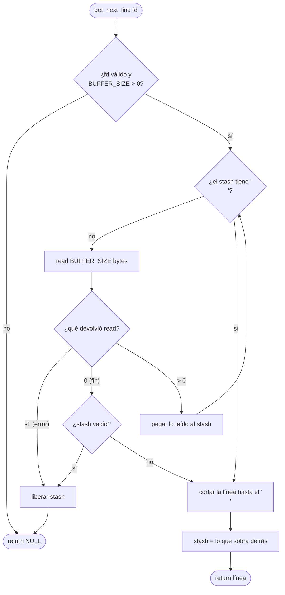

# get_next_line - Guía paso a paso

[[Inicio|← Inicio]] · [[get_next_line - Índice|get_next_line]] · Guía

> Esta guía es para quien **no entiende el ejercicio**. Empieza desde cero: qué te piden, por qué es difícil y cómo construir la función poco a poco, probando cada pieza antes de pasar a la siguiente. No hace falta que sepas nada más que lo de la Piscina y libft.

> [!info] Cómo usar esta guía
> - Léela **en orden**. Cada sección usa lo de la anterior.
> - En cada etapa hay un **«Pruébalo tú»**. Hazlo antes de seguir: escribir el código tú es lo que te hará entenderlo.
> - Las soluciones están en cajas **plegadas** («Ver una posible solución»). Ábrelas solo después de intentarlo, o para comparar.
> - El subject (v14.0) dice que no pidas respuestas directas a la IA y que en la evaluación tendrás que explicar **cada línea**. Usa las soluciones para entender, no para copiar: si copias, en la evaluación (o en el examen, sin internet) te quedarás en blanco.

> [!abstract] Notas de esta serie
> 1. **Esta guía**: la idea y la construcción paso a paso.
> 2. [[get_next_line - Funciones auxiliares]]: las utilidades de `get_next_line_utils.c` explicadas una a una.
> 3. [[get_next_line - Pruebas y depuración]]: cómo comprobar que funciona, buscar leaks y ver por dentro qué pasa.
> 4. [[get_next_line - Índice]]: el resumen del proyecto, para repasar cuando ya lo entiendas.
>
> Conceptos de C que vas a necesitar: [[Descriptores de fichero y read]] · [[Variables static y ámbito]] · [[malloc y free]] · [[Carácter nulo y puntero NULL]] · [[Preprocesador y headers]].

---

## 1. Qué te piden, en una frase

Escribir una función:

```c
char	*get_next_line(int fd);
```

que, **cada vez que la llamas**, te devuelve **la siguiente línea** de un fichero (o de lo que haya detrás del número `fd`). Cuando ya no quedan líneas, devuelve `NULL`.

Desde fuera se usa así:

```c
fd = open("poema.txt", O_RDONLY);
line = get_next_line(fd);       /* "Érase una vez\n"      */
line = get_next_line(fd);       /* "un fichero de texto\n" */
line = get_next_line(fd);       /* "que se acababa"        */
line = get_next_line(fd);       /* NULL: no queda nada     */
```

Fíjate en tres detalles que pide el subject:

| Detalle                                   | Qué significa                                                                       |
| ----------------------------------------- | ----------------------------------------------------------------------------------- |
| La línea se devuelve **con su `'\n'`**    | `"Érase una vez\n"`, no `"Érase una vez"`                                           |
| La última línea puede **no** tener `'\n'` | Si el fichero acaba en `...acababa` sin salto, devuelves `"que se acababa"`         |
| Quien llama hace `free`                   | Cada línea es memoria nueva de `malloc`; el `main` la libera cuando ya no la quiere |

Y las reglas:

- Solo puedes usar `read`, `malloc` y `free`.
- **No** puedes usar tu libft (tendrás que reescribir las funciones que necesites en `get_next_line_utils.c`).
- **No** puedes usar variables globales ni `lseek`.
- Se compila con `-D BUFFER_SIZE=n`, y el evaluador cambiará ese número (1, 42, 9999, 10000000…).
- Se debe leer **lo menos posible**: no vale leer el fichero entero en la primera llamada.

## 2. Por qué no es tan fácil como parece

Si C tuviera una función «dame una línea» no existiría este proyecto. Lo único que tienes para leer es `read`:

```c
ssize_t	read(int fd, void *buf, size_t count);
```

`read` coge **como mucho `count` bytes** del fichero, los copia en `buf` y te dice cuántos ha copiado. **No sabe lo que es una línea.** Lee bytes, sin más.

`count` en este proyecto es `BUFFER_SIZE`. Imagina el fichero `"ab\ncdef\ng"` (tres líneas: `ab`, `cdef` y `g`) leído con `BUFFER_SIZE = 4`:

```text
fichero:   a  b  \n  c  d  e  f  \n  g
           └── read 1 ─┘└── read 2 ─┘└ read 3 ┘   read 4 → 0 (fin)
              "ab\nc"      "def\n"      "g"
```

Mira el primer `read`: trae `"ab\nc"`. Es **una línea entera y un trozo de la siguiente**. Tú tienes que devolver solo `"ab\n"`. ¿Y la `c`? Ya la has sacado del fichero: si vuelves a llamar a `read`, te dará `"def\n"`, **no** la `c`. Si no la guardas, se pierde.

Con otros tamaños pasan otras cosas:

| `BUFFER_SIZE` | Qué trae cada `read`                             | Problema                                             |
| ------------- | ------------------------------------------------ | ---------------------------------------------------- |
| `1`           | Un byte cada vez                                 | Tienes que juntar muchos `read` para tener una línea |
| `4`           | Trozos que cortan las líneas por cualquier sitio | Te sobra un trozo de la siguiente línea              |
| `10000000`    | Todo el fichero de golpe                         | Te sobran **todas** las demás líneas                 |

> [!important] El problema real del proyecto
> `read` te da trozos de tamaño fijo y tú tienes que devolver líneas de tamaño variable. Casi siempre te va a **sobrar algo**, y ese sobrante tiene que **sobrevivir hasta la siguiente llamada** a `get_next_line`.

## 3. La idea: un cajón donde guardar lo que sobra

> [!example] La analogía de la cinta transportadora
> Trabajas en una oficina de correos. Por una cinta te llegan **cajas con 4 letras cada una** (eso es `read`). Cada vez que un cliente se acerca (una llamada a `get_next_line`), le tienes que dar **una frase completa**, que acaba en un punto (el `'\n'`).
>
> Si una caja trae el final de una frase y el principio de otra, entregas la frase y **guardas las letras que sobran en un cajón**. Cuando venga el siguiente cliente, primero miras el cajón: quizá ya tienes media frase ahí, y solo necesitas sacar más cajas de la cinta hasta completarla.
>
> El cajón tiene que ser **tuyo y estar siempre en el mismo sitio**, aunque el cliente se vaya. Ese cajón, en C, es una variable `static`.

A ese cajón se le suele llamar **stash** (reserva, alijo). Es una cadena de caracteres con todo lo que has leído y aún no has devuelto.

Cada llamada a `get_next_line` hace siempre lo mismo:

1. **Mirar el stash**: ¿ya hay un `'\n'` dentro? Entonces ya tienes una línea completa y no hace falta leer.
2. **Si no lo hay, leer**: llamar a `read` y **pegar** lo leído al final del stash. Repetir hasta que aparezca un `'\n'` o el fichero se acabe.
3. **Cortar la línea**: copiar desde el principio del stash hasta el `'\n'` (incluido). Eso es lo que devuelves.
4. **Guardar el resto**: lo que queda detrás del `'\n'` pasa a ser el nuevo stash, para la próxima llamada.



## 4. Por qué el cajón tiene que ser `static`

Una variable normal declarada dentro de una función **se destruye al salir** de la función. La próxima vez que llamas a la función se crea otra nueva, vacía.

Una variable **`static`** declarada dentro de una función se crea **una sola vez**, cuando arranca el programa, y **conserva su valor** entre llamadas. Solo se puede nombrar desde dentro de la función, pero vive todo el programa (ver [[Variables static y ámbito]]).

Mira lo que pasa si el stash no es `static`. El fichero es `"hola\nmundo\n"` y `BUFFER_SIZE = 8`:

```c
char	*get_next_line(int fd)
{
	char	*stash;      /* ← SIN static: se crea de nuevo en cada llamada */

	stash = NULL;
	/* ... el resto igual ... */
}
```

```text
$ ./gnl_sin_static hola_mundo.txt
[1] "hola
"
[2] "do
"
[3] NULL
```

¿Qué ha pasado?

```text
1.ª llamada:  read → "hola\nmun"     devuelvo "hola\n"     sobra "mun" → lo guardo en stash
              la función termina → stash desaparece → "mun" se pierde (y su memoria también: leak)
2.ª llamada:  stash empieza vacío    read → "do\n"         devuelvo "do\n"   ❌ debería ser "mundo\n"
```

Además, Valgrind se queja: `definitely lost: 4 bytes in 1 blocks` (los 4 bytes de `"mun"` + `'\0'` que nadie liberó).

Con `static char *stash;` el puntero sobrevive, la segunda llamada encuentra `"mun"` en el stash, le pega `"do\n"` y devuelve `"mundo\n"`. ✅

> [!tip] Pruébalo tú: entiende `static` antes de seguir
> Escribe esta función y llámala tres veces desde un `main`:
> ```c
> int	contar(void)
> {
> 	static int	veces;
>
> 	veces++;
> 	return (veces);
> }
> ```
> Imprime lo que devuelve cada vez. Debe salir `1`, `2`, `3`. Ahora quita la palabra `static` (y pon `veces = 0;` antes del `++`): saldrá `1`, `1`, `1`. Si entiendes por qué, entiendes el corazón de get_next_line.

### ¿Por qué un puntero `static` y no un array `static`?

Podrías pensar en `static char stash[1000];`. El problema es que **no sabes cuánto mide una línea**: puede tener 3 caracteres o 100 000. Por eso el stash es un **puntero** (`static char *stash;`) a memoria de `malloc`, que vas haciendo más grande según lees. La `static` solo guarda la **dirección**; los caracteres viven en el heap (ver [[malloc y free]]).

```text
  segmento .bss (vive todo el programa)        heap (malloc)
 ┌─────────────────────────┐            ┌───┬───┬───┬────┐
 │ static char *stash  ────┼──────────► │ m │ u │ n │ \0 │
 └─────────────────────────┘            └───┴───┴───┴────┘
```

## 5. Antes de programar: lo que tienes que dominar

Comprueba que sabes hacer cada cosa. Si alguna te suena a chino, lee su nota antes de seguir.

- [ ] Abrir un fichero con `open` y leerlo entero con `read` en un bucle → [[Descriptores de fichero y read]]
- [ ] Saber que `read` devuelve `>0` (bytes leídos), `0` (fin) o `-1` (error) → [[Descriptores de fichero y read#Las cuatro llamadas]]
- [ ] Saber que `read` **no** pone el `'\0'` y que tienes que ponerlo tú → [[Carácter nulo y puntero NULL]]
- [ ] Reservar con `malloc`, comprobar que no devuelve `NULL` y liberar con `free` → [[malloc y free]]
- [ ] Entender por qué `s = funcion(s)` puede perder memoria → [[malloc y free#El patrón p = f(p)]]
- [ ] Saber qué hace `#ifndef ... #define ... #endif` → [[Preprocesador y headers]]
- [ ] Recorrer una cadena con un índice o un puntero hasta el `'\0'` → [[Punteros en C]]

## 6. Construirlo por etapas

No escribas la función entera de golpe. Ve pieza a pieza y **prueba cada una** antes de seguir.

### Etapa 0: preparar los ficheros

Crea esta estructura:

```text
get_next_line/
├── get_next_line.h          ← prototipos y BUFFER_SIZE por defecto
├── get_next_line.c          ← get_next_line y sus helpers static
├── get_next_line_utils.c    ← tus funciones de cadenas (ft_strlen, ft_strchr…)
├── main.c                   ← solo para probar, NO se entrega
└── test.txt                 ← fichero de prueba
```

El header. Lo importante es el bloque de `BUFFER_SIZE`: si compilas **sin** `-D BUFFER_SIZE=...`, se usa 42; si compilas **con** él, el `#ifndef` («si no está definido») es falso y se respeta el tuyo.

```c
#ifndef GET_NEXT_LINE_H
# define GET_NEXT_LINE_H

# include <stdlib.h>
# include <unistd.h>

# ifndef BUFFER_SIZE
#  define BUFFER_SIZE 42
# endif

char	*get_next_line(int fd);
size_t	ft_strlen(const char *s);
char	*ft_strchr(const char *s, int c);
char	*ft_strndup(const char *s, size_t n);
char	*ft_strjoin_free(char *stash, const char *buf);
char	*ft_free(char **ptr);

#endif
```

- `<stdlib.h>` trae `malloc`, `free` y `NULL`.
- `<unistd.h>` trae `read` y el tipo `ssize_t`.
- Los nombres de las utilidades son una elección; puedes llamarlas como quieras.

Un `main` de prueba que imprime cada línea entre comillas y numerada, para ver exactamente qué devuelve tu función (incluidos los `'\n'`):

```c
#include <fcntl.h>
#include <stdio.h>
#include "get_next_line.h"

int	main(int argc, char **argv)
{
	int		fd;
	int		n;
	char	*line;

	fd = 0;
	if (argc == 2)
		fd = open(argv[1], O_RDONLY);
	if (fd == -1)
	{
		perror(argv[1]);
		return (1);
	}
	n = 1;
	line = get_next_line(fd);
	while (line)
	{
		printf("[%d] \"%s\"\n", n++, line);
		free(line);
		line = get_next_line(fd);
	}
	printf("[%d] NULL\n", n);
	if (fd != 0)
		close(fd);
	return (0);
}
```

- Sin argumentos lee de `fd = 0` (la entrada estándar, el teclado). El subject pide que funcione también ahí.
- Este `main` usa `printf`, `open` y `close`: se puede porque **no se entrega**. En `get_next_line.c` solo `read`, `malloc` y `free`.

Crea un fichero de prueba:

```bash
printf 'ab\ncdef\ng' > test.txt
```

(`printf` en vez de `echo` para controlar exactamente los `\n`: este fichero **no** acaba en salto de línea).

### Etapa 1: leer un fichero entero con `read`

Antes de pensar en líneas, asegúrate de que sabes leer.

> [!tip] Pruébalo tú
> Escribe un programa (sin get_next_line) que abra `test.txt` y llame a `read(fd, buf, BUFFER_SIZE)` en bucle, imprimiendo lo que devuelve cada vez, hasta que devuelva `0`. Compílalo con `-D BUFFER_SIZE=4` y con `-D BUFFER_SIZE=1`. ¿Cuántas vueltas da cada uno?
>
> Pistas: el buffer mide `BUFFER_SIZE + 1` para que quepa el `'\0'`, y después de cada `read` haces `buf[n] = '\0'`.
>
> Tienes el ejemplo completo en [[Descriptores de fichero y read#Leer por bloques]].

### Etapa 2: las funciones auxiliares

Vas a necesitar cuatro herramientas para manejar el stash. Están explicadas una a una, con dibujos y errores típicos, en [[get_next_line - Funciones auxiliares]]. Resumen:

| Función | Qué hace | Para qué en GNL |
|---|---|---|
| `ft_strlen(s)` | Longitud de `s`; **`0` si `s` es `NULL`** | Saber cuánto reservar |
| `ft_strchr(s, c)` | Dirección del primer `c` en `s`; **`NULL` si `s` es `NULL`** | ¿Hay ya un `'\n'` en el stash? |
| `ft_strndup(s, n)` | Copia nueva de los `n` primeros caracteres | Cortar la línea y guardar el resto |
| `ft_strjoin_free(stash, buf)` | Nueva cadena `stash + buf` y **libera el stash viejo** | Pegar lo leído al stash sin leaks |
| `ft_free(&p)` | `free(p)` y `p = NULL` | Liberar y no dejar punteros colgando |

Las diferencias con libft (aceptar `NULL`, liberar el primer argumento) no son caprichos: el stash empieza valiendo `NULL` y en cada vuelta se sustituye por uno más grande.

> [!tip] Pruébalo tú
> Escríbelas y pruébalas **solas** con un `main` pequeño antes de seguir: `ft_strchr(NULL, '\n')` debe devolver `NULL` sin crashear; `ft_strjoin_free(NULL, "hola")` debe devolver `"hola"`; `ft_strndup("ab\ncd", 3)` debe devolver `"ab\n"`.

### Etapa 3: leer hasta tener una línea (`ft_read_to_stash`)

Esta es la función que llama a `read`. Recibe el stash actual y devuelve el stash ampliado.

**Qué tiene que hacer**, en palabras:

```text
ft_read_to_stash(fd, stash):
    reservar buf de BUFFER_SIZE + 1 bytes
    mientras el stash NO tenga '\n' y read no haya dicho "fin":
        bytes = read(fd, buf, BUFFER_SIZE)
        si bytes == -1:          (error)
            liberar buf y stash, devolver NULL
        buf[bytes] = '\0'        (read no lo pone)
        stash = stash + buf      (pegar, liberando el viejo)
    liberar buf
    si el stash está vacío (""):  (no había nada que leer)
        liberarlo y devolver NULL
    devolver stash
```

Detalles importantes, uno por uno:

1. **`buf` con `malloc`, no en la pila.** `char buf[BUFFER_SIZE + 1];` funciona con 42, pero con `BUFFER_SIZE=10000000` son 10 MB y la pila suele medir 8 MB (míralo con `ulimit -s`): el programa muere con *segmentation fault* antes de leer nada. Lo he comprobado: `exit=139` (segfault). En el heap no hay ese límite.
2. **La condición del bucle tiene dos partes.** Paras de leer en cuanto haya un `'\n'` en el stash (ya tienes una línea: leer más iría contra el «lee lo menos posible» del subject) **o** cuando `read` devuelve `0` (se acabó el fichero).
3. **`bytes` empieza en `1`.** Es un truco para que la condición `bytes > 0` sea cierta la primera vez y se entre al bucle.
4. **Si `read` falla (`-1`)**, por ejemplo porque el fd está cerrado, hay que liberar **todo**: el `buf` y el stash. Si no, leak, y la próxima llamada devolvería datos viejos.
5. **`buf[bytes] = '\0'`.** Sin esto, `buf` no es una cadena y `ft_strjoin_free` seguiría leyendo basura hasta encontrar un `0` por casualidad. Valgrind lo detecta como `Conditional jump or move depends on uninitialised value(s)`.
6. **Stash vacío al final.** Si el fichero estaba vacío o ya lo habías terminado, `read` devuelve `0` a la primera, el join deja un stash `""`, y no hay línea que devolver: se libera y se devuelve `NULL`.

> [!faq]- Ver una posible solución
> ```c
> static char	*ft_read_to_stash(int fd, char *stash)
> {
> 	char	*buf;
> 	ssize_t	bytes;
>
> 	buf = malloc((size_t)BUFFER_SIZE + 1);
> 	if (!buf)
> 		return (ft_free(&stash));
> 	bytes = 1;
> 	while (bytes > 0 && !ft_strchr(stash, '\n'))
> 	{
> 		bytes = read(fd, buf, BUFFER_SIZE);
> 		if (bytes == -1)
> 		{
> 			free(buf);
> 			return (ft_free(&stash));
> 		}
> 		buf[bytes] = '\0';
> 		stash = ft_strjoin_free(stash, buf);
> 		if (!stash)
> 			break ;
> 	}
> 	free(buf);
> 	if (stash && !*stash)
> 		return (ft_free(&stash));
> 	return (stash);
> }
> ```
> - `static` delante de la función: es un helper privado de este `.c` (la otra cara de `static`, ver [[Variables static y ámbito]]).
> - `(size_t)BUFFER_SIZE + 1`: el *cast* evita que `BUFFER_SIZE + 1` desborde un `int` si alguien compila con `BUFFER_SIZE=2147483647`.
> - `ssize_t` y no `size_t`: `read` puede devolver `-1` y `size_t` no tiene signo (ver [[Tipos enteros y conversiones]]).
> - `if (!stash) break ;`: si el `malloc` del join falla, el join ya liberó el stash viejo y devolvió `NULL`; salimos y devolvemos `NULL`.
> - `!*stash` significa «el primer carácter es `'\0'`», es decir, cadena vacía.

### Etapa 4: cortar la línea (`ft_extract_line`)

Ahora el stash tiene al menos una línea entera (o es la última, sin `'\n'`). Hay que **copiar** la línea a memoria nueva.

```text
stash:   [ a | b | \n | c | \0 ]
           0   1   2    3   4
                   ▲
          primer '\n' en la posición 2 → la línea mide 3 (incluye el '\n')

línea:   [ a | b | \n | \0 ]   ← malloc nuevo, lo liberará el main
```

**Qué tiene que hacer:**

```text
ft_extract_line(stash):
    len = 0
    avanzar len mientras stash[len] no sea '\0' ni '\n'
    si stash[len] es '\n': len++   (para incluirlo)
    devolver una copia de los len primeros caracteres
```

- Si no hay `'\n'` (última línea del fichero), el bucle llega al `'\0'` y copias todo el stash. Así se cumple «excepto si se ha llegado al final del archivo y este no termina con un `\n`».

> [!faq]- Ver una posible solución
> ```c
> static char	*ft_extract_line(char *stash)
> {
> 	size_t	len;
>
> 	len = 0;
> 	while (stash[len] && stash[len] != '\n')
> 		len++;
> 	if (stash[len] == '\n')
> 		len++;
> 	return (ft_strndup(stash, len));
> }
> ```

### Etapa 5: guardar el resto (`ft_save_rest`)

Ya has copiado la línea. Del stash solo quieres **lo que va detrás del `'\n'`**:

```text
stash viejo:  [ a | b | \n | c | \0 ]
                        ▲    └─ resto ─┘
                        nl   nl + 1

stash nuevo:  [ c | \0 ]     ← copia nueva; el viejo se libera
```

**Qué tiene que hacer:**

```text
ft_save_rest(stash):
    nl = posición del primer '\n' en stash
    si no hay '\n', o no hay nada detrás:
        liberar stash, devolver NULL       (no queda nada para la próxima)
    resto = copia de lo que va desde nl + 1 hasta el final
    liberar stash viejo
    devolver resto
```

- ¿Por qué no simplemente mover el puntero (`stash = nl + 1`)? Porque `free` solo acepta la dirección **exacta** que devolvió! `malloc`. Si el stash apunta a la mitad del bloque, nunca podrás liberarlo: `free(stash)` daría `Invalid free()` (ver [[malloc y free#Las reglas de free]]).
- Devolver `NULL` cuando no queda nada (en vez de `""`) deja el stash limpio y evita reservar memoria para nada.

> [!faq]- Ver una posible solución
> ```c
> static char	*ft_save_rest(char *stash)
> {
> 	char	*nl;
> 	char	*rest;
>
> 	nl = ft_strchr(stash, '\n');
> 	if (!nl || !*(nl + 1))
> 		return (ft_free(&stash));
> 	rest = ft_strndup(nl + 1, ft_strlen(nl + 1));
> 	free(stash);
> 	return (rest);
> }
> ```
> `*(nl + 1)` es el carácter que va justo después del `'\n'`. Si es `'\0'`, no hay resto.

### Etapa 6: juntarlo todo (`get_next_line`)

Ya tienes las tres piezas. `get_next_line` solo las llama en orden y comprueba errores:

```text
get_next_line(fd):
    static stash               (empieza valiendo NULL)
    si fd < 0 o BUFFER_SIZE <= 0: devolver NULL
    stash = ft_read_to_stash(fd, stash)
    si stash es NULL: devolver NULL        (fin de fichero o error)
    line = ft_extract_line(stash)
    si line es NULL: liberar stash, devolver NULL   (falló malloc)
    stash = ft_save_rest(stash)
    devolver line
```

- Una `static` sin valor inicial empieza a `0`, que para un puntero es `NULL`. No hace falta escribir `= NULL` (aunque se puede).
- `stash = f(stash)`: cada helper **recibe** el stash viejo y **devuelve** el nuevo. Así el que posee la memoria está siempre claro: el helper libera el viejo y tú guardas el nuevo.

> [!faq]- Ver una posible solución
> ```c
> char	*get_next_line(int fd)
> {
> 	static char	*stash;
> 	char		*line;
>
> 	if (fd < 0 || BUFFER_SIZE <= 0)
> 		return (NULL);
> 	stash = ft_read_to_stash(fd, stash);
> 	if (!stash)
> 		return (NULL);
> 	line = ft_extract_line(stash);
> 	if (!line)
> 		return (ft_free(&stash));
> 	stash = ft_save_rest(stash);
> 	return (line);
> }
> ```
> `get_next_line.c` queda con 4 funciones y `get_next_line_utils.c` con 5: dentro del máximo de 5 por fichero que pone [[La Norma]], y ninguna pasa de 25 líneas.

### Etapa 7: compilar y probar

```bash
cc -Wall -Wextra -Werror -D BUFFER_SIZE=4 get_next_line.c get_next_line_utils.c main.c -o gnl
./gnl test.txt
```

```text
[1] "ab
"
[2] "cdef
"
[3] "g"
[4] NULL
```

- Las líneas 1 y 2 traen su `'\n'` (por eso la comilla de cierre baja a la línea siguiente).
- La 3 no, porque el fichero no acaba en salto.
- Después, `NULL`.

Prueba también con `-D BUFFER_SIZE=1`, `42`, `10000000` y **sin** `-D`. Tiene que salir lo mismo siempre. Todo lo demás (casos raros, leaks, stdin…) está en [[get_next_line - Pruebas y depuración]].

## 7. Lo que pasa por dentro, llamada a llamada

Esta es la salida real de la función con unos `fprintf(stderr, ...)` temporales puestos dentro (cómo hacerlo en [[get_next_line - Pruebas y depuración#7. Ver el stash por dentro]]). Fichero `"ab\ncdef\ng"`, `BUFFER_SIZE = 4`. Los `\n` se muestran como `\n` para que se vean:

```text
--- llamada
    stash   = NULL
    read    -> 4 bytes
    buf     = "ab\nc"
    stash   = "ab\nc"        ← ya hay '\n': deja de leer
    line    = "ab\n"         ← se devuelve
    resto   = "c"            ← se guarda en la static
--- llamada
    stash   = "c"            ← ¡la c ha sobrevivido!
    read    -> 4 bytes
    buf     = "def\n"
    stash   = "cdef\n"
    line    = "cdef\n"
    resto   = NULL           ← no queda nada detrás del '\n'
--- llamada
    stash   = NULL
    read    -> 1 bytes       ← solo quedaba la g
    buf     = "g"
    stash   = "g"            ← sin '\n': sigue leyendo
    read    -> 0 bytes       ← fin de fichero
    buf     = ""
    stash   = "g"
    line    = "g"            ← última línea, sin '\n'
    resto   = NULL
--- llamada
    stash   = NULL
    read    -> 0 bytes
    buf     = ""
    stash   = ""             ← vacío → se libera → return NULL
```

> [!tip] Pruébalo tú: hazlo en papel
> Antes de mirar esto, coge papel y haz la misma tabla para el fichero `"hola\nmundo\n"` con `BUFFER_SIZE = 3`. ¿Cuántos `read` hace cada llamada? ¿Qué hay en el stash al final de cada una? Luego compruébalo con tu propia versión con `fprintf`. Este ejercicio es casi seguro una pregunta de evaluación.

## 8. Quién es dueño de cada trozo de memoria

La mayoría de leaks en GNL vienen de no tener claro **quién debe liberar qué**. Regla: cada bloque de `malloc` tiene **un único dueño** en cada momento, y el dueño es quien hace `free` (ver [[malloc y free#Quién libera cada bloque]]).

| Memoria | La reserva | Dueño | Se libera… |
|---|---|---|---|
| `buf` | `ft_read_to_stash` | `ft_read_to_stash` | Al salir de `ft_read_to_stash`, **por cualquier camino** (también el de error) |
| stash viejo al pegar | (llamada anterior) | `ft_strjoin_free` | Dentro de `ft_strjoin_free`, una vez copiado |
| stash viejo al cortar | (join) | `ft_save_rest` | Dentro de `ft_save_rest`, una vez copiado el resto |
| stash actual | `ft_save_rest` | la `static` | En la próxima llamada, o al llegar al final / error |
| `line` | `ft_extract_line` | **quien llama** (`main`) | El `main` hace `free(line)` |

> [!note] Si el `main` deja de leer antes del final
> Si el `main` solo pide una línea y cierra, el resto sigue en el stash. Valgrind lo marca como `still reachable` (aún alcanzable: la `static` sigue apuntando a él), **no** como `definitely lost`. Si lees hasta recibir `NULL`, no queda nada: `All heap blocks were freed -- no leaks are possible`.

## 9. Los cuatro resultados posibles de una llamada

| Situación | Qué devuelves | Stash después |
|---|---|---|
| Había una línea con `'\n'` | La línea con su `'\n'` | Lo que sobraba detrás (o `NULL`) |
| Última línea del fichero sin `'\n'` | La línea sin `'\n'` | `NULL` |
| Ya no queda nada (EOF) | `NULL` | `NULL` |
| Error: fd inválido, `read` da `-1`, `malloc` falla | `NULL` | `NULL` (liberado) |

## 10. El bonus

El bonus pide dos cosas:

1. Usar **una sola** variable `static` (la versión de esta guía ya lo cumple).
2. Poder alternar entre **varios fd** sin mezclarlos: leer una línea del 3, una del 4, otra del 3…

Con un solo stash eso no funciona: el resto del fichero A se mezclaría con el B. La solución habitual es que la `static` sea un **array de stashes**, uno por cada número de fd. Sigue siendo **una** variable `static`:

```text
static char *stash[FD_MAX];

stash[0] ──► NULL
stash[3] ──► "resto del fichero A"
stash[4] ──► "resto del fichero B"
stash[5] ──► NULL
```

En el código solo cambia `stash` por `stash[fd]` y se añade la comprobación `fd >= FD_MAX` para no salirse del array. `FD_MAX` es una macro tuya (por ejemplo `1024`, el límite habitual de fds abiertos que ves con `ulimit -n`). Ficheros: `get_next_line_bonus.c`, `get_next_line_bonus.h`, `get_next_line_utils_bonus.c`.

Probado alternando dos ficheros con `BUFFER_SIZE=4` (los `\n` se muestran escapados para que se vean):

```text
A -> "ab\n"
B -> "hola\n"
A -> "cdef\n"
B -> "mundo\n"
A -> "g"
B -> NULL
```

> [!warning] El bonus solo cuenta si la parte obligatoria está perfecta
> Lo dice el subject: si falla cualquier cosa de la parte obligatoria, el bonus no se evalúa. Termina y prueba bien la obligatoria primero.

## 11. El README (obligatorio en la v14)

El subject v14.0 exige un `README.md` en la raíz del repositorio con:

- La **primera línea en cursiva**: *Este proyecto ha sido creado como parte del currículo de 42 por \<tu_login\>.*
- Una sección **Descripción**: qué es el proyecto y su objetivo.
- Una sección **Instrucciones**: cómo compilar y usar la función.
- Una sección **Recursos**: documentación que has usado y **para qué has usado la IA y en qué partes**.
- Propio de GNL: **una explicación detallada y justificada del algoritmo elegido**. Las secciones 3 y 6 de esta guía son exactamente eso; escríbelo con tus palabras.

Plantilla general en [[README de un proyecto]].

## 12. Preparar la evaluación

### Explicarlo con tus palabras

Si puedes responder a esto sin mirar, lo has entendido:

> [!question]- ¿Por qué hace falta una variable `static`?
> Porque `read` lee bloques de tamaño fijo y casi siempre trae más de una línea. Lo que sobra tiene que llegar a la siguiente llamada. Una variable local se destruye al salir de la función; una `static` conserva su valor entre llamadas.

> [!question]- ¿Dónde vive la `static`? ¿Y los caracteres del stash?
> El puntero `stash` vive en el segmento `.bss` (variables estáticas sin valor inicial), todo el programa. Los caracteres a los que apunta están en el heap, porque los reservo con `malloc`.

> [!question]- ¿Qué pasa con `BUFFER_SIZE=1`? ¿Y con `10000000`?
> Con 1 funciona, pero hace un `read` por cada byte (muy lento). Con 10 000 000 funciona porque el buffer está en el heap; si estuviera en la pila (`char buf[BUFFER_SIZE]`) desbordaría los 8 MB de pila y daría segfault.

> [!question]- ¿Por qué el buffer mide `BUFFER_SIZE + 1`?
> Porque `read` no pone el `'\0'` y necesito un hueco más para añadirlo y poder tratar el buffer como una cadena.

> [!question]- ¿Cuándo dejas de llamar a `read`?
> Cuando el stash ya contiene un `'\n'` (tengo una línea completa) o cuando `read` devuelve `0` (fin) o `-1` (error).

> [!question]- ¿Qué pasa si te paso un fd cerrado o `-1`?
> Con `-1` la comprobación inicial devuelve `NULL`. Con un fd cerrado, `read` devuelve `-1`: libero el buffer y el stash y devuelvo `NULL`. Sin crash ni leak.

> [!question]- ¿Por qué no lees todo el fichero de golpe?
> Porque el subject pide leer lo menos posible en cada llamada, y porque un fd puede ser la entrada estándar o una tubería, donde «el final» llega cuando el usuario quiere.

### La modificación en directo

El subject avisa de que en la evaluación te pueden pedir **un cambio pequeño** en unos minutos, para comprobar que el código es tuyo. Practica cosas como estas (son ejemplos, no la lista oficial):

- [ ] Devolver la línea **sin** el `'\n'` final.
- [ ] Devolver solo las líneas que no estén vacías.
- [ ] Cambiar el valor por defecto de `BUFFER_SIZE` y explicar dónde está.
- [ ] Contar cuántas veces se llama a `read` en total e imprimirlo desde el `main`.
- [ ] Hacer que devuelva las líneas de dos en dos.

Si entiendes qué hace cada una de tus cuatro funciones, cada cambio toca una sola de ellas.

## 13. Errores frecuentes de principiante

> [!danger] Los que más suspenden
> - **No usar `static`**: se pierde lo sobrante (`"do\n"` en vez de `"mundo\n"`, ver sección 4).
> - **Buffer en la pila**: segfault con `BUFFER_SIZE` grande.
> - **Olvidar `buf[bytes] = '\0'`**: lecturas de memoria sin inicializar.
> - **`stash = ft_strjoin(stash, buf)` con el strjoin de libft**: el stash viejo nunca se libera (Valgrind: `definitely lost`). Usa uno que libere el primero.
> - **No liberar el stash cuando `read` devuelve `-1`**.
> - **Devolver `""` en vez de `NULL`** al final del fichero: el `main` haría un bucle infinito.
> - **Mover el puntero del stash** (`stash = nl + 1`) en vez de copiar el resto: luego no se puede liberar.
> - **Leer todo el fichero en la primera llamada**.
> - Usar funciones de tu libft o `printf` dentro de `get_next_line.c`.

Cada uno de estos, con la salida real de Valgrind, en [[get_next_line - Pruebas y depuración#8. Errores típicos y cómo se ven]].

## Vocabulario

| Término | Qué significa |
|---|---|
| **fd** (*file descriptor*) | Número entero que identifica algo abierto para leer o escribir. `0` es la entrada estándar |
| **`BUFFER_SIZE`** | Cuántos bytes pides a `read` en cada llamada. Lo decide quien compila |
| **stash** | La cadena `static` donde guardas lo leído y aún no devuelto |
| **EOF** (*end of file*) | Fin del fichero: `read` devuelve `0` |
| **heap** | Zona de memoria de `malloc`/`free`. Dura hasta que haces `free` |
| **leak** | Memoria de `malloc` que nadie liberará ya nunca |
| **`ssize_t`** | Entero con signo que devuelve `read` (puede ser `-1`) |

## Relacionadas

[[get_next_line - Índice]] · [[get_next_line - Funciones auxiliares]] · [[get_next_line - Pruebas y depuración]] · [[Descriptores de fichero y read]] · [[Variables static y ámbito]] · [[malloc y free]] · [[Segmentos de memoria en C]] · [[Carácter nulo y puntero NULL]] · [[Preprocesador y headers]] · [[Valgrind y sanitizers]] · [[README de un proyecto]] · [[La Norma]]

## Referencias

- Subject de get_next_line v14.0 (`~/cursus/es.subject_get_next_line.pdf`): prototipo, funciones permitidas, `\n` final, `BUFFER_SIZE`, «leer lo menos posible», prohibiciones, README, bonus y modificación en la evaluación.
- [read(2), man7.org](https://man7.org/linux/man-pages/man2/read.2.html): valores de retorno y lecturas parciales.
- [malloc(3), man7.org](https://man7.org/linux/man-pages/man3/malloc.3.html): `malloc` y `free`.
- [cppreference: Storage duration](https://en.cppreference.com/w/c/language/storage_duration): duración estática e inicialización a cero.
- Todo el código de esta nota se ha compilado con `cc -Wall -Wextra -Werror` (Ubuntu clang 12.0.1, Ubuntu 22.04), pasa norminette (salvo la cabecera de 42) y se ha probado con `BUFFER_SIZE` 1, 2, 4, 5, 42, 9999 y 10 000 000 y con Valgrind sin errores. Las salidas son reales.
