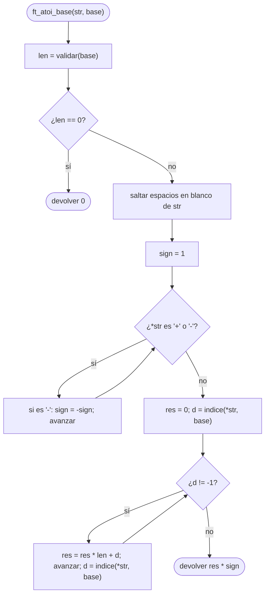
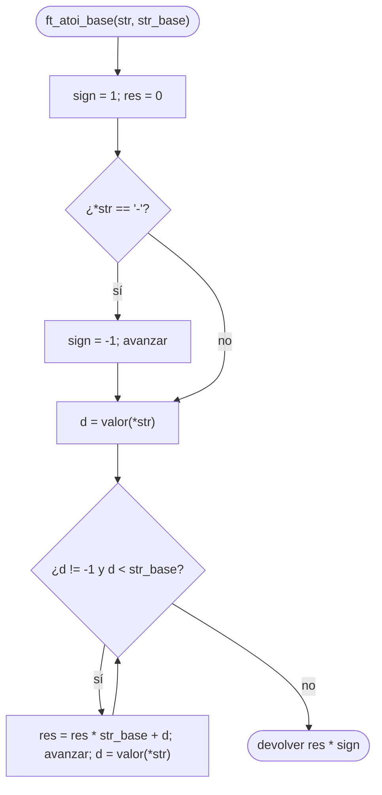

# ft_atoi_base

[[Variaciones - Índice|← Índice]] · Variaciones · Bases

> Lee un número escrito en **cualquier base** y devuelve su valor como `int`. Es [[ft_atoi]] generalizada: donde allí hacías `res * 10 + (c - '0')`, aquí haces `res * len + índice del símbolo`. Es la operación inversa de [[ft_putnbr_base]].

## Explicación sencilla

Cada símbolo vale **su posición** dentro de la base. Lees de izquierda a derecha y, por cada símbolo, multiplicas lo que llevas por la base y sumas su valor.

```text
ft_atoi_base("101010", "01")          len = 2

 símbolo  índice   res = res * 2 + índice
   '1'      1        0 * 2 + 1 =  1
   '0'      0        1 * 2 + 0 =  2
   '1'      1        2 * 2 + 1 =  5
   '0'      0        5 * 2 + 0 = 10
   '1'      1       10 * 2 + 1 = 21
   '0'      0       21 * 2 + 0 = 42
   '\0'   no está → parar

Resultado: 42
```

Al primer carácter que **no esté en la base**, se para y devuelve lo que lleva, igual que [[ft_atoi]] se para en la primera letra.

## Prototipo

Hay **dos versiones** con el mismo nombre y prototipos distintos. Fíjate en cuál te piden.

```c
/* C Piscine: la base es una cadena de símbolos */
int	ft_atoi_base(char *str, char *base);

/* Exam Rank 02 (nivel 3): la base es un número <= 16 */
int	ft_atoi_base(const char *str, int str_base);
```

> [!info] Variación, no forma parte de libft
> La versión con `char *base` viene de la C Piscine (hermana de [[ft_putnbr_base]]). La versión con `int str_base` es un ejercicio del nivel 3 del [[Exam Rank 02]]. No hay `man` ni cita literal: los enunciados de abajo son los habituales, resumidos. Si tienes el PDF de tu Piscina o el subject del examen, manda lo que diga él.

## Enunciado habitual

### Versión C Piscine: `(char *str, char *base)`

- Convierte `str`, escrito en la base `base`, a un `int` en base 10.
- La base sigue **las mismas reglas** que en [[ft_putnbr_base]]. No es válida si:
  - está vacía o tiene **un solo** símbolo,
  - tiene algún símbolo **repetido**,
  - contiene `'+'`, `'-'` o espacios en blanco.
- Si la base no es válida, devuelve **0**.
- Antes del número puede haber **espacios en blanco** (`' '`, `'\t'`, `'\n'`, `'\v'`, `'\f'`, `'\r'`) y **varios signos** `'+'`/`'-'` seguidos, como en el `ft_atoi` de la Piscina: si hay un número impar de `'-'`, el resultado es negativo.

> [!warning] No es el atoi de libft
> [[ft_atoi]] de libft (como el `atoi` real) acepta **un solo** signo. El de la Piscina acepta `"---+--42"` y cuenta los `'-'`. Aquí se sigue la regla de la Piscina.

### Versión Exam Rank 02: `(const char *str, int str_base)`

- Convierte `str`, escrito en base `str_base` (como mucho 16), a `int` en base 10.
- Los dígitos posibles son `"0123456789abcdef"`, recortados a la base: base 4 solo reconoce `"0123"`, base 16 todos.
- Las **mayúsculas** también valen: `"12fdb3"` y `"12FDB3"` son el mismo número.
- Un `'-'` solo cuenta si es el **primer** carácter. No se saltan espacios.

## Cómo implementarla

### Versión C Piscine

```text
1. len = validar(base)                  (0 si no es válida)
2. Si len == 0: devolver 0.
3. Saltar espacios en blanco de str.
4. sign = 1. Mientras str sea '+' o '-':
       si es '-': sign = -sign. Avanzar.
5. res = 0. d = índice de *str en base   (-1 si no está)
6. Mientras d != -1:
       res = res * len + d. Avanzar. d = índice de *str en base.
7. Devolver res * sign.
```

Necesitas dos auxiliares `static`: `validar(base)` (como en [[ft_putnbr_base]]) e `indice(c, base)`, que recorre la base y devuelve la posición de `c` o `-1`.

### Versión Exam Rank 02

```text
1. sign = 1, res = 0.
2. Si *str == '-': sign = -1. Avanzar.
3. d = valor(*str)        ('0'-'9' → 0-9, 'a'-'f' y 'A'-'F' → 10-15, otro → -1)
4. Mientras d != -1 y d < str_base:
       res = res * str_base + d. Avanzar. d = valor(*str).
5. Devolver res * sign.
```

La condición `d < str_base` es la que «recorta» los dígitos: en base 4, el `'4'` vale 4 y ya no es un dígito válido.

## Diagrama de flujo



### Versión Exam Rank 02



## Ejemplos

Versión C Piscine:

```c
printf("%d\n", ft_atoi_base("101010", "01"));
printf("%d\n", ft_atoi_base("  \t---+--ff", "0123456789abcdef"));
printf("%d\n", ft_atoi_base("FF", "0123456789abcdef"));   // mayúsculas no están en la base
printf("%d\n", ft_atoi_base("-vn", "poneyvif"));
printf("%d\n", ft_atoi_base("42abc", "0123456789"));
printf("%d\n", ft_atoi_base("101", "0"));                 // base de 1
printf("%d\n", ft_atoi_base("101", "01+"));               // con '+'
printf("%d\n", ft_atoi_base("101", "010"));               // repetido
printf("%d\n", ft_atoi_base("", "01"));
```

```text
42
-255
0
-42
42
0
0
0
0
```

`"---+--ff"` tiene cinco `'-'` (impar) → negativo. `"-vn"` en `"poneyvif"`: `v` = 5, `n` = 2 → 5·8 + 2 = 42, con signo `-42`. Es justo lo que escribe `ft_putnbr_base(-42, "poneyvif")`.

Versión Exam Rank 02:

```c
printf("%d\n", ft_atoi_base("12fdb3", 16));
printf("%d\n", ft_atoi_base("12FDB3", 16));
printf("%d\n", ft_atoi_base("-101010", 2));
printf("%d\n", ft_atoi_base("123", 4));
printf("%d\n", ft_atoi_base("1234", 4));      // el '4' no existe en base 4
printf("%d\n", ft_atoi_base("7fffffff", 16));
printf("%d\n", ft_atoi_base("zz", 16));
printf("%d\n", ft_atoi_base("", 10));
printf("%d\n", ft_atoi_base(" 42", 10));      // no salta espacios
```

```text
1244595
1244595
-42
27
27
2147483647
0
0
0
```

## Puntos clave y casos límite

- **Base inválida → 0** (versión Piscina), y hay que validarla **antes** de leer `str`.
- **Mayúsculas**: en la versión Piscina, `'F'` solo vale si está en la cadena `base`; en la del examen, `'F'` y `'f'` valen lo mismo.
- **Desbordamiento**: `"-80000000"` en base 16 necesita llegar a `2147483648` en positivo, que no cabe en `int`. Desbordar un `int` con signo es comportamiento indefinido (ver [[Tipos enteros y conversiones]]). Los correctores no suelen probarlo, pero si quieres hacerlo bien, acumula en un `long`.
- **Cadena vacía** o sin dígitos válidos → `0`.

### Errores típicos

- **Usar `c - '0'`** en la versión Piscina: solo sirve si la base empieza por `"0123…"`. El valor es el **índice** del símbolo en `base`.
- **Ignorar el «recorte» en el examen**: sin `d < str_base`, en base 2 el `'5'` se aceptaría y sumaría 5.
- **Mezclar las reglas**: saltar espacios y aceptar varios signos en la versión del examen, o aceptar un solo signo en la de la Piscina.
- **No parar al primer símbolo desconocido**: hay que devolver lo acumulado, no saltarlo y seguir.

## Relacionadas

[[ft_atoi]] · [[ft_putnbr_base]] · [[ft_itoa_base]] · [[ft_convert_base]] · [[Tipos enteros y conversiones]] · [[Exam Rank 02]]

## Referencias

- [Positional notation — Wikipedia](https://en.wikipedia.org/wiki/Positional_notation) — el valor de cada cifra según su posición y la base.
- [Horner's method — Wikipedia](https://en.wikipedia.org/wiki/Horner%27s_method) — por qué `res = res * base + d` calcula el número sin potencias.
- [alexhiguera/Exam_Rank_02_42_School](https://github.com/alexhiguera/Exam_Rank_02_42_School) — `ft_atoi_base` en la lista del nivel 3 del examen.
- Ejemplos compilados con `cc -Wall -Wextra -Werror` (Ubuntu clang 12.0.1) en Linux x86_64.
