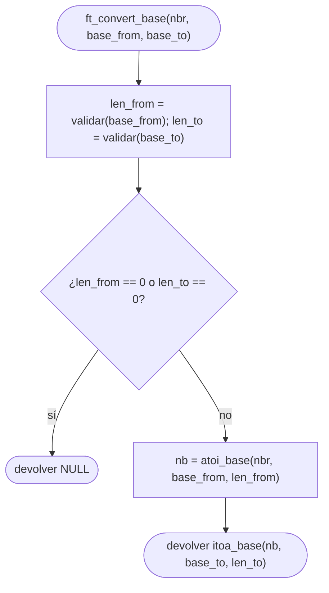
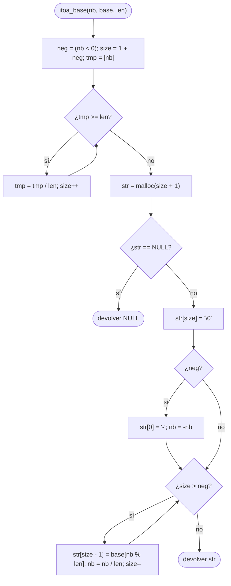

# ft_convert_base

[[Variaciones - Índice|← Índice]] · Variaciones · Bases

> Recibe un número **escrito como cadena** en una base y devuelve una **cadena nueva** (con `malloc`) con ese mismo número escrito en otra base. Es la suma de dos piezas que ya conoces: [[ft_atoi_base]] para leerlo y un «itoa en base cadena» para escribirlo.

## Explicación sencilla

No conviertas de base a base directamente. Pasa por un `int` en medio:

```text
ft_convert_base("101010", "01", "0123456789ABCDEF")

  "101010"  ──ft_atoi_base(·, "01")──►  42  ──itoa_base(·, "0123…F")──►  "2A"
  base_from                           (int)                    base_to
```

La primera mitad es exactamente [[ft_atoi_base]] (versión Piscina). La segunda es [[ft_itoa_base]], pero con la base como **cadena de símbolos**, igual que en [[ft_putnbr_base]]: en vez de escribir con `write`, guardas los símbolos en un `malloc`.

## Prototipo

```c
char	*ft_convert_base(char *nbr, char *base_from, char *base_to);
```

> [!info] Variación, no forma parte de libft
> Viene de la C Piscine, como continuación de [[ft_putnbr_base]] y [[ft_atoi_base]]. No hay `man` ni cita literal: el enunciado de abajo es el habitual, resumido. Si tienes el PDF de tu Piscina, manda lo que diga él.

## Enunciado habitual

- Devuelve el resultado de convertir `nbr`, escrito en `base_from`, a `base_to`.
- `nbr` sigue las reglas de [[ft_atoi_base]]: espacios en blanco al principio, varios `'+'`/`'-'`, y se para en el primer símbolo que no esté en `base_from`.
- Las dos bases siguen las reglas de [[ft_putnbr_base]] (al menos 2 símbolos, sin repetidos, sin `'+'`, `'-'` ni espacios).
- Si **alguna** base no es válida, devuelve `NULL`.
- El resultado se reserva con `malloc`. Si el número es negativo, lleva `'-'` delante.
- Se suele permitir repartir el código en **dos ficheros** (`ft_convert_base.c` y `ft_convert_base2.c`), porque con las auxiliares no cabe en las 5 funciones por fichero de [[La Norma]].

## Cómo implementarla

```text
ft_convert_base(nbr, base_from, base_to)
1. len_from = validar(base_from); len_to = validar(base_to).
2. Si len_from == 0 o len_to == 0: devolver NULL.
3. nb = atoi_base(nbr, base_from, len_from)      (como long)
4. Devolver itoa_base(nb, base_to, len_to).

itoa_base(nb, base, len)                          (auxiliar)
1. neg = (nb < 0). size = 1 + neg.
2. tmp = |nb|. Mientras tmp >= len: tmp = tmp / len; size++.
3. str = malloc(size + 1). Si falla: devolver NULL.
4. str[size] = '\0'. Si neg: str[0] = '-' y nb = -nb.
5. Mientras size > neg:
       str[size - 1] = base[nb % len]; nb = nb / len; size--.
6. Devolver str.
```

Reparto típico: `validar`, `indice` y `atoi_base` en un fichero; `itoa_base` y `ft_convert_base` en el otro. Las del segundo fichero que se usen desde el primero no pueden ser `static` (ver [[Variables static y ámbito]]).

## Diagrama de flujo



### Auxiliar itoa_base



## Ejemplos

```c
ft_convert_base("42", "0123456789", "01");
ft_convert_base("101010", "01", "0123456789ABCDEF");
ft_convert_base("  --+ff", "0123456789abcdef", "0123456789");
ft_convert_base("-2147483648", "0123456789", "0123456789abcdef");
ft_convert_base("0", "0123456789", "poneyvif");
ft_convert_base("-42", "0123456789", "poneyvif");
ft_convert_base("42", "0123456789", "0");          // base_to de 1
ft_convert_base("42", "01+", "0123456789");        // base_from con '+'
ft_convert_base("12xyz", "0123456789", "01");      // para en la 'x'
```

```text
"42" 0123456789 -> 01 : 101010
"101010" 01 -> 0123456789ABCDEF : 2A
"  --+ff" 0123456789abcdef -> 0123456789 : 255
"-2147483648" 0123456789 -> 0123456789abcdef : -80000000
"0" 0123456789 -> poneyvif : p
"-42" 0123456789 -> poneyvif : -vn
"42" 0123456789 -> 0 : (null)
"42" 01+ -> 0123456789 : (null)
"12xyz" 0123456789 -> 01 : 1100
```

(Salida de un `main` que imprime cada resultado con `printf` y lo libera con `free`. Sin fugas ni lecturas sin inicializar según `valgrind`.)

`"0"` en `"poneyvif"` es `base_to[0]` = `p`. `"  --+ff"` tiene dos `'-'` (par) → positivo.

## Puntos clave y casos límite

- **Valida las dos bases antes de nada**: si `base_to` es mala, no tiene sentido leer `nbr`.
- **`INT_MIN`**: guarda el número en un `long` entre las dos mitades; así `-nb` cabe al escribirlo.
- **`0`**: `size` empieza en 1, así que sale `base_to[0]`, no una cadena vacía.
- **Memoria**: el resultado es de quien llama, que debe hacer `free`. No reserves nada antes de validar, o tendrás que liberarlo al devolver `NULL`.

### Errores típicos

- **Reservar el `'-'` y no escribirlo** (o al revés): la condición del bucle `size > neg` es la que deja libre la casilla 0.
- **Comprobar `str[0] == '-'` en el bucle**: esa casilla aún no está escrita cuando lo miras (lectura sin inicializar, `valgrind` lo detecta).
- **Convertir símbolo a símbolo** sin pasar por un entero: las bases no se corresponden cifra a cifra (salvo casos como 2 ↔ 16).
- **Olvidar el segundo fichero** al entregar: si usas `ft_convert_base2.c`, tiene que estar en la carpeta.

## Relacionadas

[[ft_atoi_base]] · [[ft_putnbr_base]] · [[ft_itoa_base]] · [[ft_itoa]] · [[ft_atoi]] · [[Tipos enteros y conversiones]] · [[Variables static y ámbito]] · [[La Norma]]

## Referencias

- [Positional notation — Wikipedia](https://en.wikipedia.org/wiki/Positional_notation) — leer y escribir números en cualquier base.
- [malloc — cppreference](https://en.cppreference.com/w/c/memory/malloc) — reserva de memoria y valor de retorno `NULL`.
- [Valgrind Quick Start](https://valgrind.org/docs/manual/quick-start.html) — cómo detectar fugas y lecturas sin inicializar.
- Ejemplos compilados con `cc -Wall -Wextra -Werror` (Ubuntu clang 12.0.1) en Linux x86_64.
