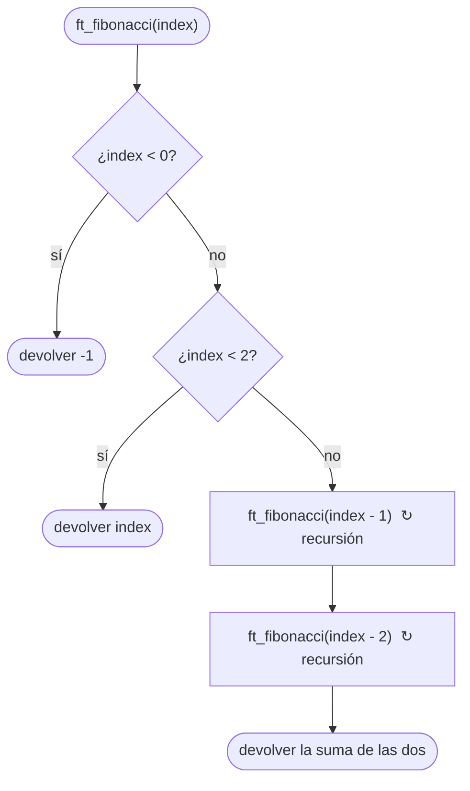

# ft_fibonacci

[[Variaciones - Índice|← Índice]] · Variaciones · Matemáticas

> Devuelve el elemento número `index` de la sucesión de Fibonacci (`0, 1, 1, 2, 3, 5, 8…`) usando [[Recursión]]. Si `index` es negativo, devuelve `-1`. Se escribe en tres líneas, pero es el ejemplo clásico de recursión **exponencialmente lenta**.

## Explicación sencilla

Cada número de la sucesión es la suma de los dos anteriores. Los dos primeros son fijos:

```text
 index:  0  1  2  3  4  5  6   7   8   9  10
 valor:  0  1  1  2  3  5  8  13  21  34  55
               └──┴──┘
               1 + 1 = 2
```

La definición ya es recursiva: `fib(n) = fib(n - 1) + fib(n - 2)`, con `fib(0) = 0` y `fib(1) = 1`. El problema es que **cada llamada abre dos llamadas más**, y muchas repiten trabajo ya hecho:

```text
                         fib(5)
                ┌──────────┴──────────┐
             fib(4)                 fib(3)
          ┌────┴────┐             ┌───┴───┐
       fib(3)     fib(2)        fib(2)  fib(1)
       ┌──┴──┐    ┌──┴──┐       ┌──┴──┐
    fib(2) fib(1) fib(1) fib(0) fib(1) fib(0)
    ┌──┴──┐
 fib(1) fib(0)
```

`fib(3)` se calcula **2 veces**, `fib(2)` **3 veces**… y cuanto mayor es `index`, más se repite.

## Prototipo

```c
int	ft_fibonacci(int index);
```

> [!info] Variación, no forma parte de libft
> Es un ejercicio de la C Piscine. No tiene original en la libc. No hay subject local: el enunciado de abajo es el habitual, resumido. Si tienes el PDF de tu Piscina, manda lo que diga él.

## Enunciado habitual

- Devuelve el elemento `index` de la sucesión de Fibonacci; el primer elemento está en el índice `0`.
- Si `index` es menor que `0`, devuelve `-1`.
- Tiene que ser **recursiva**.
- No hay funciones autorizadas.

## Cómo implementarla

```text
1. Si index < 0:  devolver -1
2. Si index < 2:  devolver index               (fib(0) = 0, fib(1) = 1)
3. Devolver ft_fibonacci(index - 1) + ft_fibonacci(index - 2)
```

El paso 2 cubre los dos casos base a la vez: para `0` y `1` el resultado es el propio índice.

## Diagrama de flujo



## Ejemplos

```c
#include <stdio.h>

int	ft_fibonacci(int index);

int	main(void)
{
	int	i;

	i = -2;
	while (i <= 10)
	{
		printf("ft_fibonacci(%d) = %d\n", i, ft_fibonacci(i));
		i++;
	}
	printf("ft_fibonacci(46) = %d\n", ft_fibonacci(46));
	return (0);
}
```

```text
ft_fibonacci(-2) = -1
ft_fibonacci(-1) = -1
ft_fibonacci(0) = 0
ft_fibonacci(1) = 1
ft_fibonacci(2) = 1
ft_fibonacci(3) = 2
ft_fibonacci(4) = 3
ft_fibonacci(5) = 5
ft_fibonacci(6) = 8
ft_fibonacci(7) = 13
ft_fibonacci(8) = 21
ft_fibonacci(9) = 34
ft_fibonacci(10) = 55
ft_fibonacci(46) = 1836311903
```

`fib(46) = 1836311903` es el **último** que cabe en un `int`; `fib(47)` ya desborda (ver [[Tipos enteros y conversiones]]).

### Cuánto tarda: index 30, 40 y 45

Misma función, con un contador global de llamadas y `clock()` de `<time.h>` alrededor de la llamada (programa de prueba, no parte del ejercicio):

```c
long	g_calls;

int	ft_fibonacci(int index)
{
	g_calls++;
	if (index < 0)
		return (-1);
	if (index < 2)
		return (index);
	return (ft_fibonacci(index - 1) + ft_fibonacci(index - 2));
}
```

```text
index 30 ->     832040  llamadas:     2692537  tiempo: 0.005 s
index 40 ->  102334155  llamadas:   331160281  tiempo: 0.671 s
index 45 -> 1134903170  llamadas:  3672623805  tiempo: 7.476 s
```

Sin el contador, la versión del ejercicio tarda prácticamente lo mismo (`0.006 s`, `0.707 s` y `7.847 s` en la misma máquina, un Intel Core i5-8500 sin optimizaciones `-O`). Los tiempos cambian de un ordenador a otro; lo que importa es **cómo crecen**.

> [!question] ¿Por qué crece tanto?
> - El número de llamadas para `fib(n)` es exactamente `2 · fib(n + 1) - 1`. Para `n = 45`: `2 · 1836311903 - 1 = 3672623805`. Cada llamada hace muy poco, pero son **más de 3.600 millones**.
> - `fib(n)` crece multiplicándose por `φ ≈ 1,618` (el número áureo) en cada paso. Por tanto el trabajo también: es **coste exponencial**, `O(φ^n)` (ver [[Algoritmos de ordenación y complejidad]]).
> - Comprobación con los datos: de 40 a 45 hay 5 pasos, `φ^5 ≈ 11,09`. Y en efecto `7.476 / 0.671 ≈ 11,1`. Cada `+5` en `index` multiplica el tiempo por 11; `index 50` tardaría más de un minuto.
> - La causa es la **repetición**: el árbol de arriba recalcula los mismos valores una y otra vez.

### Alternativa iterativa

Si guardas solo los dos últimos valores y avanzas, cada número se calcula **una vez**: `index` vueltas de bucle, coste lineal `O(n)`.

```text
1. Si index < 0: devolver -1
2. a = 0, b = 1                      (fib(0), fib(1))
3. Repetir index veces:
       tmp = a + b
       a = b
       b = tmp
4. Devolver a
```

```text
iterativa: index 30 ->     832040  tiempo: 0.000 s
iterativa: index 40 ->  102334155  tiempo: 0.000 s
iterativa: index 45 -> 1134903170  tiempo: 0.000 s
iterativa: index 46 -> 1836311903  tiempo: 0.000 s
```

Mismos resultados, en un tiempo que `clock()` ni siquiera llega a medir. Pero el ejercicio de la Piscina pide la **recursiva**: entrega esa.

## Puntos clave y casos límite

- **`index < 0` → `-1`**, comprobado antes que los casos base.
- **Casos base `0` y `1`**: sin ellos (o con solo uno), la recursión llega a índices negativos y los resultados salen mal.
- **Desbordamiento a partir de `index = 47`**: el enunciado no pide gestionarlo.
- **Lentitud, no fallo**: con `index` grandes el programa no se cuelga ni hace segfault (la profundidad máxima es solo `index` llamadas); simplemente tarda muchísimo.

### Errores típicos

- **Devolver `0` para `index < 0`** en lugar de `-1`.
- **Un solo caso base** (`if (index == 0) return (0);`): `fib(1)` llama a `fib(0)` y a `fib(-1)`, que devuelve `-1`, y todos los valores salen mal.
- **Empezar la sucesión en 1** (`1, 1, 2, 3…` para `index = 0, 1, 2…`): el enunciado dice que `index 0` vale `0`.
- **Pensar que está colgada** al probar con `index = 50`: solo es lenta. Mide con 30, 35, 40 para ver la tendencia.

## Relacionadas

[[ft_power]] · [[ft_recursive_factorial]] · [[ft_iterative_factorial]] · [[ft_is_prime]] · [[Recursión]] · [[Algoritmos de ordenación y complejidad]] · [[Tipos enteros y conversiones]]

## Referencias

- [Fibonacci sequence — Wikipedia](https://en.wikipedia.org/wiki/Fibonacci_sequence) — definición, relación con el número áureo y crecimiento.
- [Golden ratio — Wikipedia](https://en.wikipedia.org/wiki/Golden_ratio) — `φ ≈ 1,618`.
- [clock — cppreference](https://en.cppreference.com/w/c/chrono/clock) — cómo se midió el tiempo de CPU.
- Ejemplos compilados con `cc -Wall -Wextra -Werror` (Ubuntu clang 12.0.1) en Linux x86_64.
