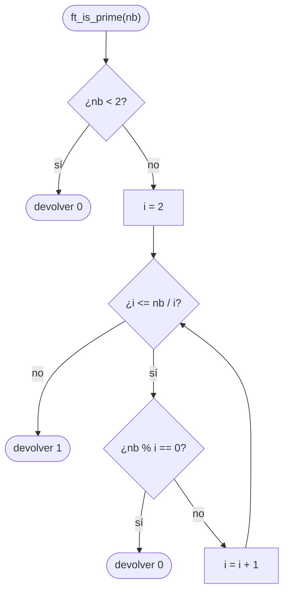
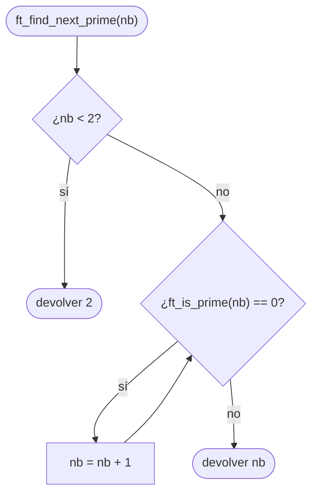

# ft_is_prime

[[Variaciones - Índice|← Índice]] · Variaciones · Matemáticas

> `ft_is_prime` devuelve `1` si `nb` es primo y `0` si no. `ft_find_next_prime` devuelve el primer primo **mayor o igual** que `nb`. Las dos dependen del mismo truco: solo hace falta probar divisores hasta la **raíz cuadrada** de `nb`, y hay que hacerlo **sin desbordar** el `int`.

## Explicación sencilla

Un primo es un entero **mayor que 1** que solo se divide entre 1 y él mismo. Para saber si `nb` lo es, pruebas divisores `i = 2, 3, 4…`. Si alguno divide exacto (`nb % i == 0`), no es primo.

¿Hasta dónde probar? Los divisores van **en parejas** que se multiplican para dar `nb`. En cada pareja, uno es `≤ √nb` y el otro `≥ √nb`:

```text
 nb = 36      2 · 18     3 · 12     4 · 9     6 · 6
              ▲          ▲          ▲         ▲
              todos los "pequeños" son ≤ 6 = √36
```

Si no hay ningún divisor hasta `√nb`, tampoco lo habrá por encima. Para `2147483647` eso son unas **46.000** pruebas en vez de **2.000 millones**.

`ft_find_next_prime` solo tiene que probar `nb`, `nb + 1`, `nb + 2`… con `ft_is_prime` hasta dar con uno.

## Prototipo

```c
int	ft_is_prime(int nb);
int	ft_find_next_prime(int nb);
```

> [!info] Variación, no forma parte de libft
> Son dos ejercicios de la C Piscine que suelen ir seguidos. No tienen original en la libc. No hay subject local: el enunciado de abajo es el habitual, resumido. Si tienes el PDF de tu Piscina, manda lo que diga él. En el [[Exam Rank 02]] (nivel 3) aparece `add_prime_sum`, un programa que suma todos los primos hasta un número: necesita exactamente este `ft_is_prime`.

## Enunciado habitual

- `ft_is_prime`: devuelve `1` si `nb` es primo y `0` si no lo es.
- `0` y `1` **no** son primos.
- `ft_find_next_prime`: devuelve el siguiente primo **mayor o igual** que `nb` (si `nb` ya es primo, devuelve `nb`).
- Deben responder **rápido** también con números grandes (las correcciones suelen probar con `INT_MAX`).
- No hay funciones autorizadas.

## Cómo implementarla

**ft_is_prime**

```text
1. Si nb < 2: devolver 0               (negativos, 0 y 1)
2. i = 2
3. Mientras i <= nb / i:               (equivale a i * i <= nb, sin desbordar)
       Si nb % i == 0: devolver 0
       i = i + 1
4. Devolver 1
```

**ft_find_next_prime**

```text
1. Si nb < 2: devolver 2               (el primer primo)
2. Mientras ft_is_prime(nb) sea 0:
       nb = nb + 1
3. Devolver nb
```

> [!warning] `i * i <= nb` desborda
> La condición "natural" es `i * i <= nb`. Pero si `nb` es primo y está cerca de `INT_MAX`, el bucle llega a `i = 46341`, y `46341 * 46341 = 2147488281` **no cabe** en un `int`. Escribir `i <= nb / i` es la misma condición en matemáticas y nunca pasa de `nb`. Ver la demostración en Ejemplos.

## Diagrama de flujo

### ft_is_prime



### ft_find_next_prime



## Ejemplos

```c
#include <stdio.h>
#include <time.h>

int	ft_is_prime(int nb);
int	ft_find_next_prime(int nb);

int	main(void)
{
	int		v[12];
	int		k;
	clock_t	start;
	int		res;

	v[0] = -7;
	v[1] = 0;
	v[2] = 1;
	v[3] = 2;
	v[4] = 3;
	v[5] = 4;
	v[6] = 9;
	v[7] = 25;
	v[8] = 97;
	v[9] = 2147483646;
	v[10] = 2147483647;
	v[11] = -2147483648;
	k = 0;
	while (k < 12)
	{
		printf("ft_is_prime(%d) = %d   ft_find_next_prime(%d) = %d\n",
			v[k], ft_is_prime(v[k]), v[k], ft_find_next_prime(v[k]));
		k++;
	}
	start = clock();
	res = ft_find_next_prime(2147483647);
	printf("ft_find_next_prime(2147483647) = %d en %.6f s\n", res,
		(double)(clock() - start) / CLOCKS_PER_SEC);
	start = clock();
	res = ft_find_next_prime(2147483630);
	printf("ft_find_next_prime(2147483630) = %d en %.6f s\n", res,
		(double)(clock() - start) / CLOCKS_PER_SEC);
	return (0);
}
```

```text
ft_is_prime(-7) = 0   ft_find_next_prime(-7) = 2
ft_is_prime(0) = 0   ft_find_next_prime(0) = 2
ft_is_prime(1) = 0   ft_find_next_prime(1) = 2
ft_is_prime(2) = 1   ft_find_next_prime(2) = 2
ft_is_prime(3) = 1   ft_find_next_prime(3) = 3
ft_is_prime(4) = 0   ft_find_next_prime(4) = 5
ft_is_prime(9) = 0   ft_find_next_prime(9) = 11
ft_is_prime(25) = 0   ft_find_next_prime(25) = 29
ft_is_prime(97) = 1   ft_find_next_prime(97) = 97
ft_is_prime(2147483646) = 0   ft_find_next_prime(2147483646) = 2147483647
ft_is_prime(2147483647) = 1   ft_find_next_prime(2147483647) = 2147483647
ft_is_prime(-2147483648) = 0   ft_find_next_prime(-2147483648) = 2
ft_find_next_prime(2147483647) = 2147483647 en 0.000187 s
ft_find_next_prime(2147483630) = 2147483647 en 0.000221 s
```

Compilado además con `-fsanitize=undefined`: ningún aviso de desbordamiento. `2147483647` (`INT_MAX`) es primo, así que `ft_find_next_prime` nunca necesita pasar de ahí.

### Las dos versiones que fallan con INT_MAX

Mismo bucle con dos condiciones distintas, probadas con `2147483647`:

```text
lento: while (i < nb)        ixi: while (i * i <= nb)
```

```text
lento(2147483647) = 1 en 6.424 s
ixi(2147483647) = 0 en 6.075 s
```

- **`i < nb`**: la respuesta es correcta, pero prueba más de 2.000 millones de divisores. Más de 6 segundos para **un** número (la versión buena tarda 0,0002 s). En `add_prime_sum` o en la corrección se acaba el tiempo.
- **`i * i <= nb`**: la respuesta es **incorrecta** (`0`: dice que `INT_MAX` no es primo) y además es lenta. Con `i = 46341`, `i * i` desborda, da un número negativo, la condición sigue siendo cierta y el bucle continúa hasta que `i` llega a `2147483647`, que divide a `nb`. Con `-fsanitize=undefined`:

```text
prime_bad.c:12:11: runtime error: signed integer overflow: 46341 * 46341 cannot be represented in type 'int'
```

Es comportamiento indefinido: en tu máquina o con otras opciones de compilación puede salir otro resultado (ver [[Tipos enteros y conversiones]]).

## Puntos clave y casos límite

- **Negativos, `0` y `1` → no primos.** El `nb < 2` del principio los cubre todos, incluido `INT_MIN`.
- **`2` es primo**: con `i = 2`, `2 <= 2 / 2` es falso, el bucle no entra y devuelve `1`.
- **Cuadrados perfectos** (`9`, `25`): la condición tiene que ser `<=`, no `<`. Con `i < nb / i`, el `5` de `25` no se probaría y diría que `25` es primo.
- **`ft_find_next_prime` con `nb < 2`** devuelve `2`. Sin ese caso, con un negativo como `INT_MIN` haría 2.000 millones de vueltas hasta llegar a `2`.
- **Nunca se pasa de `INT_MAX`**: `nb + 1` desbordaría, pero `INT_MAX` es primo, así que el bucle para antes.

### Errores típicos

- **Probar hasta `nb`** o hasta `nb / 2`: correcto pero demasiado lento con números grandes.
- **`i * i <= nb`** sin pensar en el desbordamiento (ver arriba).
- **Devolver `1` para `0` o `1`**: el bucle no entra y la función "cree" que son primos. Hace falta el `nb < 2`.
- **`ft_find_next_prime` que empieza en `nb + 1`**: si `nb` ya es primo, hay que devolver `nb`.

## Relacionadas

[[ft_sqrt]] · [[ft_power]] · [[ft_fibonacci]] · [[Exam Rank 02]] · [[Tipos enteros y conversiones]] · [[Algoritmos de ordenación y complejidad]]

## Referencias

- [Primality test — Wikipedia](https://en.wikipedia.org/wiki/Primality_test) — división por tentativa y por qué basta llegar a `√n`.
- [2,147,483,647 — Wikipedia](https://en.wikipedia.org/wiki/2,147,483,647) — `INT_MAX` es un primo de Mersenne (`2^31 - 1`).
- [Arithmetic operators: overflows — cppreference](https://en.cppreference.com/w/c/language/operator_arithmetic#Overflows) — el desbordamiento de enteros con signo es comportamiento indefinido.
- Ejemplos compilados con `cc -Wall -Wextra -Werror` (Ubuntu clang 12.0.1) en Linux x86_64.
