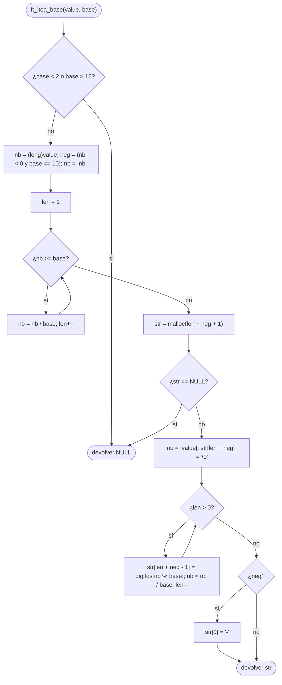

# ft_itoa_base

[[Variaciones - Índice|← Índice]] · Variaciones · Bases

> Convierte un `int` en una **cadena nueva** (con `malloc`) que lo representa en base 2 a 16. Es [[ft_itoa]] generalizada: donde allí dividías entre 10 y sumabas `'0'`, aquí divides entre `base` y sacas el símbolo de `"0123456789ABCDEF"`.

## Explicación sencilla

Igual que [[ft_itoa]]: primero **cuentas** cuántas cifras tendrá, reservas justo eso (+ `'\0'`) y luego **rellenas desde el final**, porque el resto de dividir entre la base da la última cifra.

```text
ft_itoa_base(255, 16)

 1. Contar cifras:  255 >= 16 → 15 ; 15 < 16 → len = 2
 2. malloc(2 + 1)                       ┌───┬───┬────┐
                                        │ ? │ ? │ \0 │
                                        └───┴───┴────┘
 3. Rellenar desde el final:
      255 % 16 = 15 → 'F' en [1] ; 255 / 16 = 15
       15 % 16 = 15 → 'F' en [0] ;  15 / 16 = 0
                                        ┌───┬───┬────┐
                                        │ F │ F │ \0 │
                                        └───┴───┴────┘
```

## Prototipo

```c
char	*ft_itoa_base(int value, int base);
```

> [!info] Variación, no forma parte de libft
> Es un ejercicio clásico de los exámenes de 42 (versiones antiguas del examen; no está en la lista actual del [[Exam Rank 02]], donde sale [[ft_itoa]] en base 10). No hay `man` ni cita literal: lo de abajo es la versión **habitual**, resumida.

> [!warning] Los enunciados varían
> Hay versiones con dígitos en minúscula, otras que ponen `'-'` en cualquier base, otras que muestran los negativos en complemento a dos, y otras que reciben la base como cadena (como [[ft_putnbr_base]]). Lee el tuyo con lupa: cambia una línea del código, pero el corrector no perdona.

## Enunciado habitual

- Devuelve una cadena nueva, reservada con `malloc`, con `value` escrito en base `base`.
- `base` va de 2 a 16. Los dígitos son `"0123456789ABCDEF"` (**mayúsculas**).
- Si `value` es negativo, solo en **base 10** se pone `'-'` delante. En las demás bases se escribe el valor absoluto.
- Funciones autorizadas: `malloc`.

> [!tip] Base fuera de rango
> El enunciado clásico no dice qué hacer con `base < 2` o `base > 16`. Devolver `NULL` es lo más prudente: con base 1 el bucle de contar no terminaría nunca, y con base 17 te saldrías de la cadena de dígitos.

## Cómo implementarla

```text
1. Si base < 2 o base > 16: devolver NULL.
2. nb = (long)value                    (para que -INT_MIN quepa)
3. neg = 0. Si nb < 0:
       si base == 10: neg = 1.
       nb = -nb.
4. len = 1. Mientras nb >= base: nb = nb / base; len++.
5. str = malloc(len + neg + 1). Si falla: devolver NULL.
6. nb = |value| (otra vez, como long). str[len + neg] = '\0'.
7. Mientras len > 0:
       str[len + neg - 1] = "0123456789ABCDEF"[nb % base]
       nb = nb / base; len--.
8. Si neg: str[0] = '-'.
9. Devolver str.
```

El paso 6 hace falta porque el paso 4 ha «gastado» `nb` dividiéndolo.

## Diagrama de flujo



## Ejemplos

```c
ft_itoa_base(42, 2);
ft_itoa_base(255, 16);
ft_itoa_base(-42, 10);
ft_itoa_base(-42, 16);           // sin '-' fuera de base 10
ft_itoa_base(0, 8);
ft_itoa_base(2147483647, 16);
ft_itoa_base(-2147483648, 10);
ft_itoa_base(-2147483648, 2);
ft_itoa_base(42, 1);             // base fuera de rango
ft_itoa_base(42, 17);            // base fuera de rango
```

```text
ft_itoa_base(42, 2) = 101010
ft_itoa_base(255, 16) = FF
ft_itoa_base(-42, 10) = -42
ft_itoa_base(-42, 16) = 2A
ft_itoa_base(0, 8) = 0
ft_itoa_base(2147483647, 16) = 7FFFFFFF
ft_itoa_base(-2147483648, 10) = -2147483648
ft_itoa_base(-2147483648, 2) = 10000000000000000000000000000000
ft_itoa_base(42, 1) = (null)
ft_itoa_base(42, 17) = (null)
```

(Salida de un `main` que imprime cada resultado con `printf` y lo libera con `free`.)

## Puntos clave y casos límite

- **`INT_MIN`**: `-(-2147483648)` no cabe en `int`. Trabaja con un `long` desde el principio (ver [[Tipos enteros y conversiones]]).
- **`0`**: `len` empieza en 1, así que sale `"0"` sin caso especial.
- **Tamaño exacto**: cifras + `'-'` (si toca) + `'\0'`. Quien llama debe hacer `free` (ver [[Segmentos de memoria en C]]).
- **El `'-'` depende de la base**: en la versión clásica `-42` en base 16 da `"2A"`, no `"-2A"`.

### Errores típicos

- **Olvidar el `+ 1` del `'\0'`** en el `malloc`.
- **Sumar `'0'` al resto**: en base 16, `15 + '0'` es `'?'`, no `'F'`. Usa la cadena de dígitos.
- **Reutilizar `nb` tras contar**: al terminar el paso 4 vale menos que `base`; hay que recuperar `|value|`.
- **Contar el `'-'` siempre**: si lo reservas en base 16 pero no lo escribes, `str[0]` queda sin inicializar.

## Relacionadas

[[ft_itoa]] · [[ft_putnbr_base]] · [[ft_atoi_base]] · [[ft_convert_base]] · [[Tipos enteros y conversiones]] · [[Segmentos de memoria en C]] · [[Exam Rank 02]]

## Referencias

- [Positional notation — Wikipedia](https://en.wikipedia.org/wiki/Positional_notation) — por qué dividir entre la base da las cifras.
- [malloc — cppreference](https://en.cppreference.com/w/c/memory/malloc) — reserva de memoria y valor de retorno `NULL`.
- [Beej's Guide to C: Types II](https://beej.us/guide/bgc/html/split/types-ii-way-more-types.html) — enteros con signo, `long` y desbordamiento.
- Ejemplos compilados con `cc -Wall -Wextra -Werror` (Ubuntu clang 12.0.1) en Linux x86_64.
