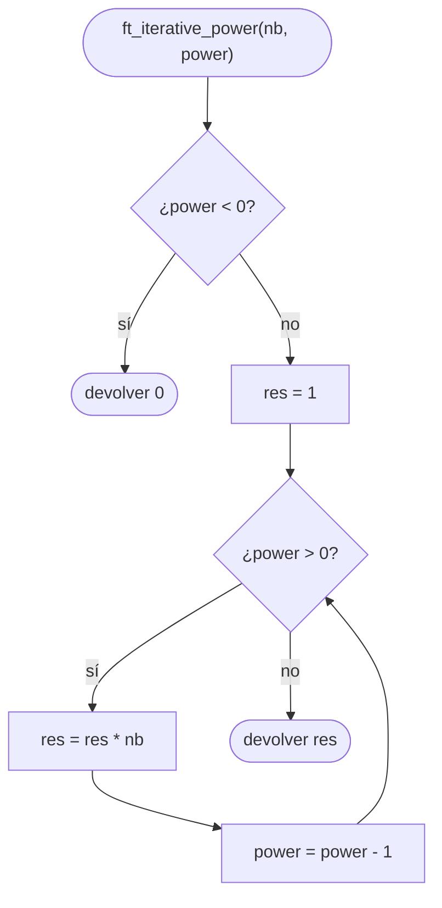
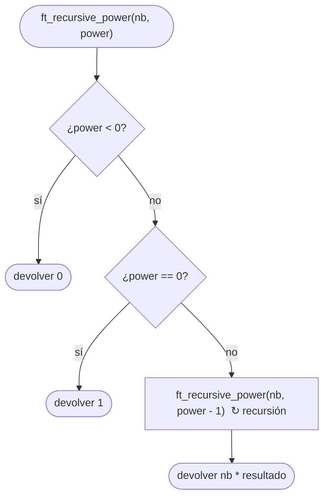

# ft_power

[[Variaciones - Índice|← Índice]] · Variaciones · Matemáticas

> Calcula `nb` elevado a `power` de dos formas: con un bucle (`ft_iterative_power`) y con [[Recursión]] (`ft_recursive_power`). Mismas reglas en las dos: exponente negativo → `0`, y `0^0 = 1`.

## Explicación sencilla

Elevar a una potencia es multiplicar `nb` por sí mismo `power` veces, empezando desde `1`:

```text
 2^5 = 1 · 2 · 2 · 2 · 2 · 2 = 32
       ▲
       elemento neutro: con power = 0 no se multiplica nada → 1
```

- **Iterativa**: un acumulador `res = 1` y un bucle que multiplica `power` veces.
- **Recursiva**: `nb^power = nb · nb^(power - 1)`, hasta llegar al caso base `nb^0 = 1`.

```text
 ft_recursive_power(2, 3)
 = 2 * ft_recursive_power(2, 2)
       = 2 * ft_recursive_power(2, 1)
             = 2 * ft_recursive_power(2, 0)
                   = 1                      ← caso base
 = 2 * 2 * 2 * 1 = 8
```

Es el mismo esquema que el factorial de [[ft_iterative_factorial]] y [[ft_recursive_factorial]], cambiando «multiplicar por `n`, `n - 1`…» por «multiplicar siempre por `nb`».

## Prototipo

```c
int	ft_iterative_power(int nb, int power);
int	ft_recursive_power(int nb, int power);
```

> [!info] Variación, no forma parte de libft
> Son dos ejercicios de la C Piscine que suelen ir juntos. No tienen original en la libc (la `pow` de `<math.h>` trabaja con `double`). No hay subject local: el enunciado de abajo es el habitual, resumido. Si tienes el PDF de tu Piscina, manda lo que diga él.

## Enunciado habitual

- Devuelve `nb` elevado a `power`.
- Si `power` es **negativo**, devuelve `0`.
- `0` elevado a `0` vale `1`.
- No hay que gestionar los desbordamientos de `int`.
- Una versión con bucle (iterativa) y otra que se llame a sí misma (recursiva).
- No hay funciones autorizadas.

> [!tip] ¿Por qué 0^0 = 1?
> Por convenio en combinatoria y programación: es el producto de **cero** factores, y el producto vacío vale `1` (igual que `0! = 1`). Además sale solo si empiezas el acumulador en `1` y no haces ninguna vuelta del bucle.

## Cómo implementarla

**Iterativa**

```text
1. Si power < 0: devolver 0
2. res = 1
3. Mientras power > 0:
       res = res * nb
       power = power - 1
4. Devolver res
```

**Recursiva**

```text
1. Si power < 0: devolver 0
2. Si power == 0: devolver 1                       (caso base)
3. Devolver nb * ft_recursive_power(nb, power - 1)
```

No hace falta un caso especial para `0^0` ni para `nb = 0`: con `power == 0` se devuelve `1` antes de mirar `nb`.

## Diagrama de flujo

### Versión iterativa



### Versión recursiva



## Ejemplos

```c
#include <stdio.h>

int	ft_iterative_power(int nb, int power);
int	ft_recursive_power(int nb, int power);

void	test(int nb, int power)
{
	printf("%3d ^ %3d  iter: %11d  rec: %11d\n", nb, power,
		ft_iterative_power(nb, power), ft_recursive_power(nb, power));
}

int	main(void)
{
	test(2, 10);
	test(3, 4);
	test(-2, 3);
	test(-2, 4);
	test(5, 0);
	test(0, 0);
	test(0, 5);
	test(2, -1);
	test(1, -3);
	test(2, 30);
	test(-2, 31);
	test(2, 31);
	return (0);
}
```

```text
  2 ^  10  iter:        1024  rec:        1024
  3 ^   4  iter:          81  rec:          81
 -2 ^   3  iter:          -8  rec:          -8
 -2 ^   4  iter:          16  rec:          16
  5 ^   0  iter:           1  rec:           1
  0 ^   0  iter:           1  rec:           1
  0 ^   5  iter:           0  rec:           0
  2 ^  -1  iter:           0  rec:           0
  1 ^  -3  iter:           0  rec:           0
  2 ^  30  iter:  1073741824  rec:  1073741824
 -2 ^  31  iter: -2147483648  rec: -2147483648
  2 ^  31  iter: -2147483648  rec: -2147483648
```

- Base negativa: el signo alterna según el exponente sea par o impar (`-8`, `16`). Sale solo, sin código extra.
- `1 ^ -3` devuelve `0` porque lo pide el enunciado, aunque matemáticamente sería `1`.
- `(-2)^31 = -2147483648` es justo `INT_MIN`: cabe.
- `2^31 = 2147483648` **no cabe** en un `int`. El `-2147483648` que sale es un desbordamiento. Compilando con `-fsanitize=undefined` se ve:

```text
power.c:12:13: runtime error: signed integer overflow: 1073741824 * 2 cannot be represented in type 'int'
power.c:24:13: runtime error: signed integer overflow: 2 * 1073741824 cannot be represented in type 'int'
```

## Puntos clave y casos límite

- **`power < 0` → `0`** en las dos versiones, comprobado **antes** de nada.
- **`power == 0` → `1`**, también con `nb = 0`.
- **Desbordamiento**: el enunciado no pide gestionarlo, pero en C desbordar un `int` con signo es comportamiento indefinido (ver [[Tipos enteros y conversiones]]). No confíes en el valor que salga.
- **Profundidad de la recursión**: la recursiva hace `power + 1` llamadas. Con exponentes que caben en un `int` sin desbordar (como mucho 31 para base 2) no hay riesgo de llenar la pila.

### Errores típicos

- **Empezar `res = nb`** y hacer `power - 1` vueltas: falla con `power = 0` (devolvería `nb` en vez de `1`).
- **Olvidar el caso `power < 0`** en la recursiva: `power - 1` se aleja de `0` para siempre y la pila se llena (segfault).
- **Devolver `0` para `0^0`**: el enunciado pide `1`.
- **Usar `pow`** de `<math.h>`: no está autorizada y trabaja con `double`.

## Relacionadas

[[ft_iterative_factorial]] · [[ft_recursive_factorial]] · [[ft_sqrt]] · [[ft_fibonacci]] · [[ft_is_prime]] · [[Recursión]] · [[Tipos enteros y conversiones]]

## Referencias

- [Exponentiation — Wikipedia](https://en.wikipedia.org/wiki/Exponentiation) — definición, exponente cero y `0^0`.
- [Empty product — Wikipedia](https://en.wikipedia.org/wiki/Empty_product) — por qué un producto sin factores vale 1.
- [Arithmetic operators: overflows — cppreference](https://en.cppreference.com/w/c/language/operator_arithmetic#Overflows) — el desbordamiento de enteros con signo es comportamiento indefinido.
- Ejemplos compilados con `cc -Wall -Wextra -Werror` (Ubuntu clang 12.0.1) en Linux x86_64.
