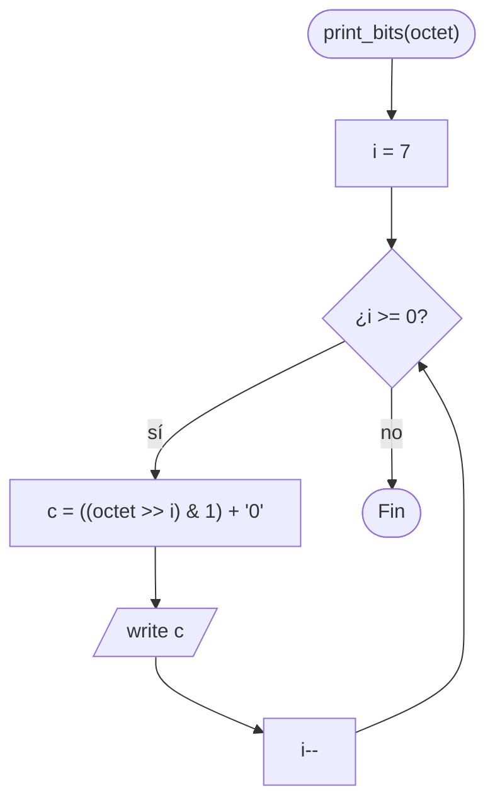

# ft_print_bits

[[Variaciones - Índice|← Índice]] · Variaciones · Bits

> Escribe en la salida estándar los **8 bits** de un byte, del más significativo al menos significativo, como `'0'` y `'1'`. Es el ejercicio de entrada a los [[Operadores de bits]]: todo se reduce a `(octet >> i) & 1`.

## Explicación sencilla

Un `unsigned char` son 8 bits numerados del 7 (izquierda) al 0 (derecha). Para leer el bit `i`, lo desplazas `i` posiciones a la derecha y te quedas solo con el último con `& 1`.

```text
print_bits(42)            42 = 0 0 1 0 1 0 1 0
                                7 6 5 4 3 2 1 0   ← posición i

 i = 5:  42 >> 5  = 0000 0001
         & 1      = 0000 0001  → 1  → escribe '1'
 i = 4:  42 >> 4  = 0000 0010
         & 1      = 0000 0000  → 0  → escribe '0'

Salida: 00101010
```

Se recorre de `i = 7` a `i = 0` para escribir primero el bit de más peso, como se lee un número.

## Prototipo

```c
void	print_bits(unsigned char octet);
```

> [!info] Variación, no forma parte de libft
> Es un ejercicio del nivel 2 del [[Exam Rank 02]] (en el examen se llama `print_bits`, sin `ft_`). No hay `man` ni cita literal: el enunciado de abajo es el habitual, resumido. En el examen manda el subject que te toque.

## Enunciado habitual

- Escribe una **función** que recibe un byte y escribe su valor en binario, **sin** salto de línea al final.
- Siempre 8 caracteres: `2` se escribe `00000010`.
- Funciones autorizadas: `write`.

## Cómo implementarla

```text
1. i = 7.
2. Mientras i >= 0:
       c = ((octet >> i) & 1) + '0'
       write c
       i--.
```

`(octet >> i) & 1` vale 0 o 1; sumarle `'0'` lo convierte en el carácter `'0'` o `'1'`.

## Diagrama de flujo



## Ejemplos

```c
print_bits(2);
print_bits(42);
print_bits(255);
print_bits(0);
print_bits(128);
print_bits(-1);         // se convierte a unsigned char: 255
```

Con un `write(1, "\n", 1)` tras cada llamada y `| cat -e`:

```text
00000010$
00101010$
11111111$
00000000$
10000000$
11111111$
```

> [!question] ¿Y `reverse_bits` y `swap_bits`?
> Son sus hermanos del mismo nivel del examen y se apoyan en las mismas operaciones. Ambos **devuelven** un `unsigned char` en vez de escribir:
> - `reverse_bits`: invierte el orden de los 8 bits. Recorres `i` de 0 a 7 y vas metiendo cada bit por la derecha: `res = (res << 1) | ((octet >> i) & 1)`.
> - `swap_bits`: intercambia las dos mitades de 4 bits: `(octet >> 4) | (octet << 4)`.
>
> Comprobado con `print_bits`:
> ```text
> 00100110 -> reverse -> 01100100
> 01000001 -> swap    -> 00010100
> ```

## Puntos clave y casos límite

- **`unsigned char`**: el parámetro garantiza 8 bits y que el desplazamiento a la derecha meta ceros. Un `-1` pasado a la función llega como `255` (ver [[Tipos enteros y conversiones]]).
- **Siempre 8 cifras**: los ceros de la izquierda se escriben. No es [[ft_putnbr_base]] con `"01"`, que escribiría `10` para el 2.
- **Sin `'\n'`**: el enunciado habitual no lo pide. Un salto de línea de más es un failure.

### Errores típicos

- **Recorrer de 0 a 7**: sale el número al revés (`01010100` para el 42).
- **Escribir el resultado de `& 1` sin sumar `'0'`**: `write` mandaría los bytes 0 y 1, que no se ven.
- **Usar `& i` en vez de `>> i` y `& 1`**: `octet & 5` no es el bit 5. Si prefieres máscaras, es `octet & (1 << i)`, y el resultado vale `1 << i`, no 1.
- **Entregar un `main`**: es una función, no un programa.

## Relacionadas

[[Operadores de bits]] · [[Tipos enteros y conversiones]] · [[ft_putnbr_base]] · [[ft_putchar_fd]] · [[Exam Rank 02]]

## Referencias

- [Bitwise shift operators — cppreference](https://en.cppreference.com/w/c/language/operator_arithmetic#Shift_operators) — `>>` y `<<` en C.
- [Bitwise operation — Wikipedia](https://en.wikipedia.org/wiki/Bitwise_operation) — `&`, `|`, desplazamientos y máscaras.
- [alexhiguera/Exam_Rank_02_42_School](https://github.com/alexhiguera/Exam_Rank_02_42_School) — `print_bits`, `reverse_bits` y `swap_bits` en la lista del nivel 2.
- Ejemplos compilados con `cc -Wall -Wextra -Werror` (Ubuntu clang 12.0.1) en Linux x86_64.
