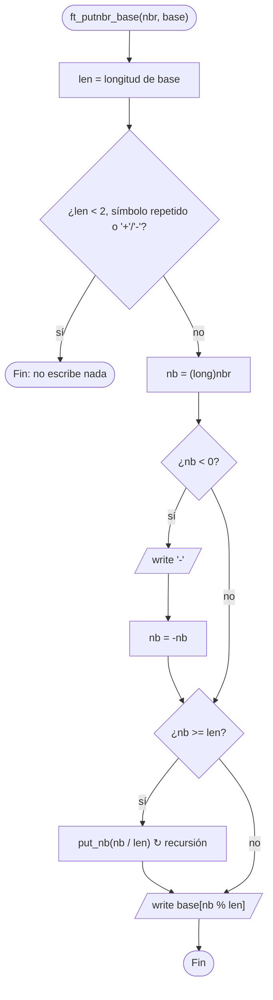

# ft_putnbr_base

[[Variaciones - Índice|← Índice]] · Variaciones · Bases

> Escribe un `int` en la salida estándar usando **cualquier base**: los símbolos de la base vienen en una cadena (`"01"` binario, `"0123456789ABCDEF"` hexadecimal, `"poneyvif"` base 8 con letras). Es [[ft_putnbr_fd]] generalizada: donde allí dividías entre 10, aquí divides entre la longitud de la base.

## Explicación sencilla

La cadena `base` es a la vez **el alfabeto** y **la base**: su longitud dice entre cuánto dividir, y el resto de cada división es el índice del símbolo que hay que escribir.

```text
ft_putnbr_base(42, "01")          base = 2

 42 / 2 = 21  resto 0  ──┐
 21 / 2 = 10  resto 1    │
 10 / 2 =  5  resto 0    │  los restos salen al revés:
  5 / 2 =  2  resto 1    │  la recursión los escribe
  2 / 2 =  1  resto 0    │  en el orden correcto
  1 < 2 → caso base: 1 ──┘

Salida: 1 0 1 0 1 0          base[1] base[0] base[1]…
```

Es el mismo truco de [[Recursión]] que en [[ft_putnbr_fd]]: primero escribes todo menos la última cifra, luego la última.

## Prototipo

```c
void	ft_putnbr_base(int nbr, char *base);
```

> [!info] Variación, no forma parte de libft
> Viene de la C Piscine y aparece como base de ejercicios del [[Exam Rank 02]] (`print_hex` es este ejercicio con la base fija `"0123456789abcdef"`). No hay `man` ni cita literal: el enunciado de abajo es el habitual, resumido. Si tienes el PDF de tu Piscina, manda lo que diga él.

## Enunciado habitual

- Escribe `nbr` en la base indicada por `base`, en la salida estándar.
- Debe funcionar con números negativos (con `'-'` delante).
- Si la base **no es válida**, no se escribe nada. Una base no es válida si:
  - está vacía o tiene **un solo** símbolo,
  - tiene algún símbolo **repetido**,
  - contiene `'+'` o `'-'`.

> [!tip] Por qué esas reglas
> Con un solo símbolo, dividir entre 1 nunca llega al caso base. Con símbolos repetidos, la salida sería ambigua (`"0113"`: ¿qué valor tiene `1`?). Y `'+'`/`'-'` se confundirían con el signo al leerlo de vuelta con [[ft_atoi_base]].

## Cómo implementarla

```text
1. len = validar(base)                 (0 si no es válida)
2. Si len < 2: salir sin escribir nada.
3. Copia nbr en un long nb             (para que -INT_MIN quepa).
4. Si nb < 0: escribe '-' y nb = -nb.
5. Si nb >= len: llámate con nb / len  (todas las cifras menos la última).
6. Escribe base[nb % len]              (la última cifra).
```

Para el paso 5 necesitas una función auxiliar `static` que reciba `long`, igual que en [[ft_putnbr_fd]].

## Diagrama de flujo



## Ejemplos

```c
ft_putnbr_base(42, "0123456789");
ft_putnbr_base(42, "01");
ft_putnbr_base(255, "0123456789ABCDEF");
ft_putnbr_base(-42, "poneyvif");
ft_putnbr_base(-2147483648, "0123456789abcdef");
ft_putnbr_base(0, "01");
ft_putnbr_base(42, "0");              // base de 1
ft_putnbr_base(42, "0123456789+");    // con '+'
ft_putnbr_base(42, "0113");           // repetido
```

```text
42
101010
FF
-vn
-80000000
0
(nada)
(nada)
(nada)
```

`"poneyvif"` tiene 8 símbolos: 42 = 5·8 + 2 → `base[5] base[2]` = `v n`.

## Puntos clave y casos límite

- **`INT_MIN`**: `-2147483648` no cabe en positivo como `int`. Pasa el valor a `long` antes de cambiarle el signo (ver [[Tipos enteros y conversiones]]).
- **`0`**: debe escribir `base[0]`. La versión recursiva lo cubre sola; un bucle `while (nb > 0)` no.
- **Validar antes de escribir nada**: si escribes el `'-'` y después descubres que la base es mala, ya has escrito basura.

### Errores típicos

- **Escribir `nb % len + '0'`** como en base 10: solo funciona si la base es `"0123…"`. El símbolo es `base[nb % len]`.
- **Comprobar duplicados solo con el siguiente carácter**: `"010"` tiene el `0` repetido pero no seguido. Hay que comparar cada símbolo con **todos** los de después.
- **Recalcular la longitud de la base en cada llamada recursiva**: funciona, pero recorre la cadena una y otra vez. Calcúlala una vez y pásala como parámetro.

## Relacionadas

[[ft_putnbr_fd]] · [[ft_atoi_base]] · [[ft_itoa_base]] · [[ft_convert_base]] · [[Recursión]] · [[Tipos enteros y conversiones]] · [[Exam Rank 02]]

## Referencias

- [Positional notation — Wikipedia](https://en.wikipedia.org/wiki/Positional_notation) — por qué dividir entre la base da las cifras.
- [Beej's Guide to C: Types II](https://beej.us/guide/bgc/html/split/types-ii-way-more-types.html) — enteros con signo, `long` y desbordamiento.
- Ejemplos compilados con `cc -Wall -Wextra -Werror` (Ubuntu clang 12.0.1) en Linux x86_64.
