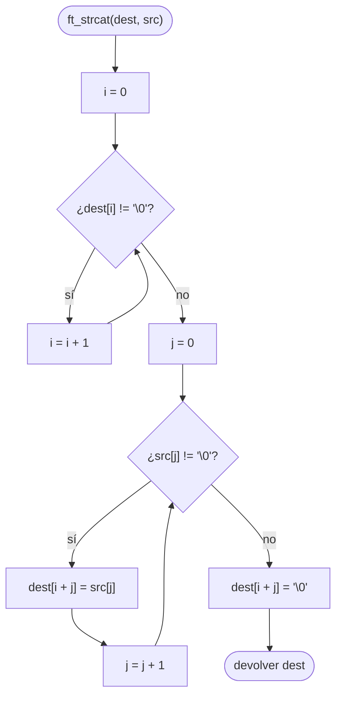

# ft_strcat

[[Variaciones - Índice|← Índice]] · Variaciones · Cadenas

> Añade `src` al final de `dest`: busca el `'\0'` de `dest`, escribe `src` a partir de ahí y vuelve a poner un `'\0'`. Igual que [[ft_strcpy]], **no sabe cuánto sitio queda** en `dest`; por eso libft te pide [[ft_strlcat]], que recibe el tamaño total del destino.

## Explicación sencilla

Es un [[ft_strcpy]] que no empieza en `dest[0]`, sino donde termina `dest`.

```text
 dest antes:  │ H │ o │ l │ a │ \0│ ? │ ? │ ? │ ? │ ? │
                                ▲ i = 4 (aquí empieza la copia)
 src:         │ , │ ␠ │ 4 │ 2 │ \0│
                j=0 j=1 j=2 j=3
 dest después:│ H │ o │ l │ a │ , │ ␠ │ 4 │ 2 │ \0│ ? │
                                ▲ el '\0' viejo se pisa
```

Dos índices: `i` para encontrar el final de `dest` y `j` para recorrer `src`. Cada carácter va a `dest[i + j]`.

## Prototipo

```c
// Original — strcat(3)
#include <string.h>
char *strcat(char *dest, const char *src);

// Variación (C Piscine)
char	*ft_strcat(char *dest, char *src);
```

Consultar: `man 3 strcat`

> [!info] Variación, no forma parte de libft
> Viene de la C Piscine, donde el prototipo va **sin `const`**. No hay subject local: el enunciado de abajo es el habitual, resumido. Si tienes el PDF de tu Piscina, manda lo que diga él.

## Enunciado habitual

- Reproduce el comportamiento de `strcat` (`man strcat`).
- Concatena `src` al final de `dest` y termina el resultado en `'\0'`.
- Devuelve `dest`.
- No hay funciones autorizadas.

## Comportamiento según el manual

> [!quote] man 3 strcat — DESCRIPTION
> The strcat() function appends the src string to the dest string, overwriting the terminating null byte ('\0') at the end of dest, and then adds a terminating null byte. The strings may not overlap, and the dest string must have enough space for the result. If dest is not large enough, program behavior is unpredictable; buffer overruns are a favorite avenue for attacking secure programs.

> [!note] Traducción
> La función strcat() añade la cadena src a la cadena dest, sobrescribiendo el byte nulo final ('\0') de dest, y después añade un byte nulo final. Las cadenas no pueden solaparse, y la cadena dest debe tener espacio suficiente para el resultado. Si dest no es lo bastante grande, el comportamiento del programa es impredecible; los desbordamientos de búfer son una vía favorita para atacar programas seguros.

> [!quote] man 3 strcat — RETURN VALUE
> The strcat() and strncat() functions return a pointer to the resulting string dest.

> [!note] Traducción
> Las funciones strcat() y strncat() devuelven un puntero a la cadena resultante dest.

## Cómo implementarla

```text
1. i = 0
2. Mientras dest[i] no sea '\0':  i = i + 1        (buscar el final de dest)
3. j = 0
4. Mientras src[j] no sea '\0':
       dest[i + j] = src[j]
       j = j + 1
5. dest[i + j] = '\0'
6. Devolver dest
```

## Diagrama de flujo



## Ejemplos

```c
#include <stdio.h>
#include <string.h>

char	*ft_strcat(char *dest, char *src);

int	main(void)
{
	char	a[20];
	char	b[20];
	char	*ret;

	strcpy(a, "Hola");
	strcpy(b, "Hola");
	ret = ft_strcat(a, ", 42");
	strcat(b, ", 42");
	printf("ft: [%s]  libc: [%s]  ret == a: %d\n", a, b, ret == a);
	ft_strcat(a, "");
	printf("src vacio: [%s]\n", a);
	a[0] = '\0';
	ft_strcat(a, "Barcelona");
	printf("dest vacio: [%s]\n", a);
	ft_strcat(ft_strcat(a, " "), "42");
	printf("encadenado: [%s]\n", a);
	return (0);
}
```

```text
ft: [Hola, 42]  libc: [Hola, 42]  ret == a: 1
src vacio: [Hola, 42]
dest vacio: [Barcelona]
encadenado: [Barcelona 42]
```

Como devuelve `dest`, se puede encadenar: `ft_strcat(ft_strcat(a, " "), "42")`.

## Puntos clave y casos límite

- **`dest` tiene que ser ya una cadena** (terminada en `'\0'`). Un array sin inicializar no vale: el primer bucle buscaría un `'\0'` en basura.
- **Espacio necesario**: `ft_strlen(dest) + ft_strlen(src) + 1` bytes. La función no lo comprueba.
- **`src` vacía**: no cambia nada (solo reescribe el `'\0'` en el mismo sitio).
- **`dest` vacía**: se comporta como [[ft_strcpy]].
- **Coste**: cada llamada recorre `dest` entera para encontrar el final. Concatenar muchas veces sobre la misma cadena es cada vez más lento.

> [!warning] Diferencia con ft_strlcat
> [[ft_strlcat]] recibe `size`, el tamaño **total** del búfer `dest` (no lo que queda libre), nunca escribe más allá de `size - 1` caracteres más el `'\0'` y devuelve la longitud que **habría tenido** el resultado (`strlen(dest) + strlen(src)` en el caso normal) para que detectes si se ha cortado. `ft_strcat` no puede protegerte porque no sabe cuánto mide `dest`.

### Errores típicos

- **Olvidar el `'\0'` final** tras copiar `src`.
- **Usar el mismo índice para las dos cadenas** (`dest[i] = src[i]`): escribiría en el principio de `dest` en vez de al final.
- **Concatenar en un literal**: `ft_strcat("Hola", s)` escribe en memoria de solo lectura → segfault (ver [[Segmentos de memoria en C]]).
- **`dest` y `src` solapadas** (`ft_strcat(s, s)`): mientras copias, pisas el `'\0'` que marcaba el final de `src` y el bucle no termina bien.

## Relacionadas

[[ft_strlcat]] · [[ft_strcpy]] · [[ft_strncpy]] · [[ft_strlen]] · [[ft_strjoin]] · [[Segmentos de memoria en C]]

## Referencias

- `man 3 strcat` — Linux man-pages 5.10 (Ubuntu 22.04): las citas en inglés están copiadas literalmente del manual; la traducción es propia.
- [strcat(3) — man7.org](https://man7.org/linux/man-pages/man3/strcat.3.html) — versión en línea del manual de Linux (puede ser más reciente que la de Ubuntu 22.04).
- [strcat — cppreference](https://en.cppreference.com/w/c/string/byte/strcat) — comportamiento según el estándar C.
- En los Mac de 42 (man de BSD/macOS) la redacción del manual puede variar.
- Ejemplos compilados con `cc -Wall -Wextra -Werror` (Ubuntu clang 12.0.1) en Linux x86_64.
