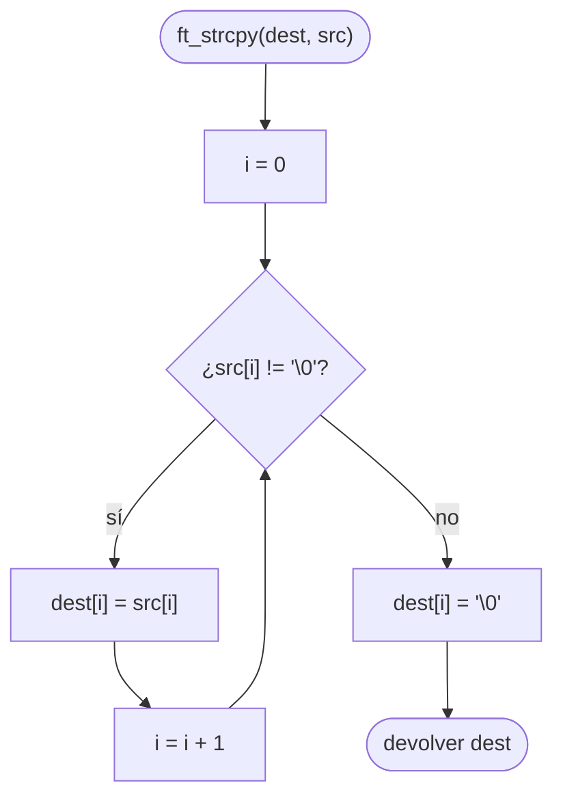

# ft_strcpy

[[Variaciones - Índice|← Índice]] · Variaciones · Cadenas

> Copia la cadena `src`, con su `'\0'` final, en `dest` y devuelve `dest`. Es la copia de cadenas más simple que existe y también la más peligrosa: **no sabe cuánto sitio hay en `dest`**. Por eso libft te pide [[ft_strlcpy]], que recibe el tamaño del destino.

## Explicación sencilla

Recorres `src` carácter a carácter y lo vas escribiendo en la misma posición de `dest`. Cuando llegas al `'\0'` de `src`, lo escribes también y paras.

```text
 src  ──►┌───┬───┬───┬───┬────┐
         │ h │ o │ l │ a │ \0 │
         └─┬─┴─┬─┴─┬─┴─┬─┴─┬──┘
           ▼   ▼   ▼   ▼   ▼        dest[i] = src[i]
 dest ──►┌───┬───┬───┬───┬────┬───┬───┐
         │ h │ o │ l │ a │ \0 │ ? │ ? │   (lo que haya detrás no se toca)
         └───┴───┴───┴───┴────┴───┴───┘
```

La función **se fía de ti**: da por hecho que `dest` tiene al menos `longitud(src) + 1` bytes. Si no los tiene, sigue escribiendo fuera del array (ver [[Arrays en C]] y [[Punteros en C]]).

## Prototipo

```c
// Original — strcpy(3)
#include <string.h>
char *strcpy(char *dest, const char *src);

// Variación (C Piscine / Exam Rank 02)
char	*ft_strcpy(char *dest, char *src);
```

Consultar: `man 3 strcpy`

> [!info] Variación, no forma parte de libft
> Viene de la C Piscine y sale también en el nivel 1 del [[Exam Rank 02]]. En la Piscina el prototipo va **sin `const`**; la original de la libc lo lleva en `src`. No hay subject local: el enunciado de abajo es el habitual, resumido. Si tienes el PDF de tu Piscina, manda lo que diga él.

## Enunciado habitual

- Reproduce el comportamiento de `strcpy` (`man strcpy`).
- Copia `src` en `dest`, **incluido** el `'\0'` final.
- Devuelve `dest`.
- No hay funciones autorizadas.

## Comportamiento según el manual

> [!quote] man 3 strcpy — DESCRIPTION
> The strcpy() function copies the string pointed to by src, including the terminating null byte ('\0'), to the buffer pointed to by dest. The strings may not overlap, and the destination string dest must be large enough to receive the copy. Beware of buffer overruns! (See BUGS.)

> [!note] Traducción
> La función strcpy() copia la cadena apuntada por src, incluido el byte nulo final ('\0'), en el búfer apuntado por dest. Las cadenas no pueden solaparse, y la cadena de destino dest debe ser lo bastante grande para recibir la copia. ¡Cuidado con los desbordamientos de búfer! (Ver BUGS.)

> [!quote] man 3 strcpy — RETURN VALUE
> The strcpy() and strncpy() functions return a pointer to the destination string dest.

> [!note] Traducción
> Las funciones strcpy() y strncpy() devuelven un puntero a la cadena de destino dest.

> [!quote] man 3 strcpy — BUGS
> If the destination string of a strcpy() is not large enough, then anything might happen. Overflowing fixed-length string buffers is a favorite cracker technique for taking complete control of the machine. Any time a program reads or copies data into a buffer, the program first needs to check that there's enough space. This may be unnecessary if you can show that overflow is impossible, but be careful: programs can get changed over time, in ways that may make the impossible possible.

> [!note] Traducción
> Si la cadena de destino de un strcpy() no es lo bastante grande, puede pasar cualquier cosa. Desbordar búferes de cadena de tamaño fijo es una técnica favorita de los atacantes para tomar el control total de la máquina. Siempre que un programa lee o copia datos en un búfer, primero tiene que comprobar que hay espacio suficiente. Puede no ser necesario si puedes demostrar que el desbordamiento es imposible, pero ten cuidado: los programas cambian con el tiempo, de formas que pueden hacer posible lo imposible.

## Cómo implementarla

```text
1. i = 0
2. Mientras src[i] no sea '\0':
       dest[i] = src[i]
       i = i + 1
3. dest[i] = '\0'          (el bucle para ANTES de copiarlo)
4. Devolver dest
```

## Diagrama de flujo



## Ejemplos

```c
#include <stdio.h>

char	*ft_strcpy(char *dest, char *src);

int	main(void)
{
	char	buf[10];
	char	*ret;

	ret = ft_strcpy(buf, "hola");
	printf("[%s] ret == buf: %d\n", buf, ret == buf);
	ft_strcpy(buf, "");
	printf("[%s]\n", buf);
	ft_strcpy(buf, "123456789");
	printf("[%s]\n", buf);
	return (0);
}
```

```text
[hola] ret == buf: 1
[]
[123456789]
```

`"123456789"` son 9 caracteres + `'\0'` = 10 bytes: cabe justo en `buf[10]`.

### Por qué es insegura: el desbordamiento

Dos arrays seguidos dentro de un `struct` (ver [[Structs y typedef]]). Copiamos en `name` (8 bytes) una cadena de 13 caracteres:

```c
typedef struct s_user
{
	char	name[8];
	char	role[8];
}	t_user;

int	main(void)
{
	t_user	u;

	ft_strcpy(u.name, "ana");
	ft_strcpy(u.role, "alumno");
	printf("antes:   name=[%s] role=[%s]\n", u.name, u.role);
	ft_strcpy(u.name, "anabelenadmin");
	printf("despues: name=[%s] role=[%s]\n", u.name, u.role);
	return (0);
}
```

```text
antes:   name=[ana] role=[alumno]
despues: name=[anabelenadmin] role=[admin]
```

`ft_strcpy` no sabe que `name` mide 8: escribe `"anabelen"` en `name` y sigue con `"admin\0"` **encima de `role`**. Nadie ha tocado `role` y ahora vale `"admin"`. Además `name` ya no termina en `'\0'` dentro de sus 8 bytes, por eso `printf` lee de corrido hasta el `'\0'` de `role`. Así funcionan muchos ataques reales.

Con un array suelto en la pila, `-fsanitize=address` lo detecta en el momento (ver [[Valgrind y sanitizers]]):

```text
==56473==ERROR: AddressSanitizer: stack-buffer-overflow on address 0x7ffd542c2484 at pc 0x0000004cb2b0 bp 0x7ffd542c23f0 sp 0x7ffd542c23e8
WRITE of size 1 at 0x7ffd542c2484 thread T0
    #0 0x4cb2af in ft_strcpy overflow.c:10:11
    #1 0x4cb3fc in main overflow.c:21:2
```

(`char buf[4]; ft_strcpy(buf, "demasiado largo");`, ruta del fichero recortada.)

## Puntos clave y casos límite

- **Copia también el `'\0'`**: el bucle termina al verlo, así que hay que escribirlo después, fuera del bucle.
- **`src` vacía**: el bucle no entra y solo se escribe `dest[0] = '\0'`. Correcto.
- **Devuelve `dest`**, no un puntero al final de la copia. Permite encadenar: `printf("%s", ft_strcpy(buf, s))`.
- **No comprueba nada**: ni tamaño de `dest`, ni `NULL`, ni solapamiento. Todo eso es responsabilidad de quien llama.

> [!warning] Diferencia con ft_strlcpy
> [[ft_strlcpy]] recibe `size` (el tamaño **total** de `dest`), copia como mucho `size - 1` caracteres, **siempre** termina en `'\0'` si `size > 0` y devuelve la longitud de `src` para que detectes si se ha cortado. `ft_strcpy` no puede hacer nada de eso porque no sabe cuánto mide `dest`.

### Errores típicos

- **Olvidar el `'\0'` final**: `dest` queda sin terminar y cualquier `printf` o `ft_strlen` posterior lee basura.
- **Copiar en un literal**: `ft_strcpy("hola", s)` escribe en memoria de solo lectura → segfault (ver [[Segmentos de memoria en C]]).
- **Copiar en un puntero sin reservar**: `char *dest; ft_strcpy(dest, s);` escribe en una dirección aleatoria. Necesitas un array o un `malloc` del tamaño correcto.
- **Devolver `dest + i`** en vez de `dest`.

## Relacionadas

[[ft_strlcpy]] · [[ft_strncpy]] · [[ft_strcat]] · [[ft_strdup]] · [[ft_strlen]] · [[Segmentos de memoria en C]] · [[Valgrind y sanitizers]] · [[Exam Rank 02]]

## Referencias

- `man 3 strcpy` — Linux man-pages 5.10 (Ubuntu 22.04): las citas en inglés están copiadas literalmente del manual; la traducción es propia.
- [strcpy(3) — man7.org](https://man7.org/linux/man-pages/man3/strcpy.3.html) — versión en línea del manual de Linux (puede ser más reciente que la de Ubuntu 22.04).
- [Buffer overflow — Wikipedia](https://en.wikipedia.org/wiki/Buffer_overflow) — por qué copiar sin límite es un fallo de seguridad.
- En los Mac de 42 (man de BSD/macOS) la redacción del manual puede variar.
- Ejemplos compilados con `cc -Wall -Wextra -Werror` (Ubuntu clang 12.0.1) en Linux x86_64.
