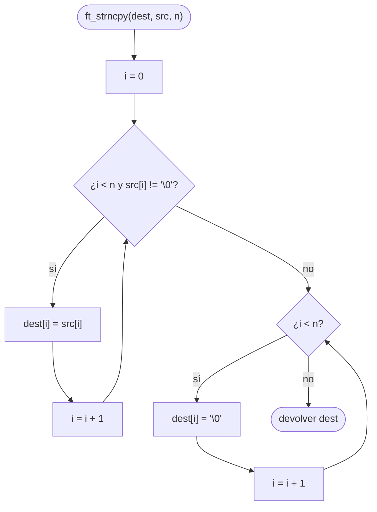

# ft_strncpy

[[Variaciones - Índice|← Índice]] · Variaciones · Cadenas

> Copia **exactamente `n` bytes** en `dest`: los de `src` mientras haya, y `'\0'` de relleno hasta llegar a `n`. Tiene dos sorpresas: si `src` es corta, **rellena** con ceros; si `src` es larga (`n` caracteres o más), **no pone `'\0'`** al final. Por eso libft usa [[ft_strlcpy]] en su lugar.

## Explicación sencilla

Piensa en `n` como el tamaño de un campo fijo de un formulario: siempre se escriben `n` casillas, ni una más ni una menos.

```text
ft_strncpy(dest, "hola", 7)         src más corta que n → relleno
 dest: │ h │ o │ l │ a │ \0│ \0│ \0│ X │
        └──── src ────┘ └─ relleno ─┘  ▲ casilla 8: no se toca

ft_strncpy(dest, "abcdef", 4)       src de n o más → SIN '\0'
 dest: │ a │ b │ c │ d │ X │ X │ X │ X │
        └──── n = 4 ───┘ ▲ aquí NO hay '\0'
```

En el segundo caso `dest` **no es una cadena válida**: si después haces `printf("%s", dest)`, seguirá leyendo memoria hasta encontrar un `'\0'` por casualidad.

## Prototipo

```c
// Original — strncpy(3)
#include <string.h>
char *strncpy(char *dest, const char *src, size_t n);

// Variación (C Piscine)
char	*ft_strncpy(char *dest, char *src, unsigned int n);
```

Consultar: `man 3 strncpy`

> [!info] Variación, no forma parte de libft
> Viene de la C Piscine. Allí el prototipo va **sin `const`** y con `unsigned int n` en lugar de `size_t`. No hay subject local: el enunciado de abajo es el habitual, resumido. Si tienes el PDF de tu Piscina, manda lo que diga él.

## Enunciado habitual

- Reproduce el comportamiento de `strncpy` (`man strncpy`).
- Copia como mucho `n` caracteres de `src` en `dest`.
- Si `src` tiene menos de `n` caracteres, completa con `'\0'` hasta escribir `n` bytes en total.
- Devuelve `dest`.
- No hay funciones autorizadas.

## Comportamiento según el manual

> [!quote] man 3 strncpy — DESCRIPTION
> The strncpy() function is similar, except that at most n bytes of src are copied. Warning: If there is no null byte among the first n bytes of src, the string placed in dest will not be null-terminated.
>
> If the length of src is less than n, strncpy() writes additional null bytes to dest to ensure that a total of n bytes are written.

> [!note] Traducción
> La función strncpy() es parecida [a strcpy()], salvo que copia como mucho n bytes de src. Aviso: si no hay ningún byte nulo entre los primeros n bytes de src, la cadena que queda en dest no terminará en nulo.
>
> Si la longitud de src es menor que n, strncpy() escribe bytes nulos adicionales en dest para asegurar que se escriben n bytes en total.

> [!quote] man 3 strncpy — RETURN VALUE
> The strcpy() and strncpy() functions return a pointer to the destination string dest.

> [!note] Traducción
> Las funciones strcpy() y strncpy() devuelven un puntero a la cadena de destino dest.

> [!quote] man 3 strncpy — NOTES
> If there is no terminating null byte in the first n bytes of src, strncpy() produces an unterminated string in dest.

> [!note] Traducción
> Si no hay byte nulo final en los primeros n bytes de src, strncpy() produce en dest una cadena sin terminar.

## Cómo implementarla

```text
1. i = 0
2. Mientras i < n y src[i] no sea '\0':      (fase de copia)
       dest[i] = src[i]
       i = i + 1
3. Mientras i < n:                           (fase de relleno)
       dest[i] = '\0'
       i = i + 1
4. Devolver dest
```

Fíjate en que **no hay** un `dest[i] = '\0'` suelto al final, como en [[ft_strcpy]]. Si `src` tenía `n` caracteres o más, la fase 3 no entra y no se escribe ningún `'\0'`.

## Diagrama de flujo



## Ejemplos

Para **ver** el relleno y la falta de `'\0'`, llenamos `dest` de `'X'` antes de copiar e imprimimos los 8 bytes uno a uno (`\0` donde hay un nulo). Se compara con la `strncpy` de la libc:

```c
#include <stdio.h>
#include <string.h>

char	*ft_strncpy(char *dest, char *src, unsigned int n);

void	dump(char *label, char *buf, int size)
{
	int	i;

	printf("%-25s", label);
	i = 0;
	while (i < size)
	{
		if (buf[i] == '\0')
			printf("\\0 ");
		else
			printf("%c  ", buf[i]);
		i++;
	}
	printf("\n");
}

int	main(void)
{
	char	a[8];
	char	b[8];

	memset(a, 'X', 8);
	memset(b, 'X', 8);
	ft_strncpy(a, "hola", 7);
	strncpy(b, "hola", 7);
	dump("ft_strncpy(\"hola\", 7)", a, 8);
	dump("strncpy(\"hola\", 7)", b, 8);
	memset(a, 'X', 8);
	memset(b, 'X', 8);
	ft_strncpy(a, "abcdef", 4);
	strncpy(b, "abcdef", 4);
	dump("ft_strncpy(\"abcdef\", 4)", a, 8);
	dump("strncpy(\"abcdef\", 4)", b, 8);
	memset(a, 'X', 8);
	ft_strncpy(a, "abcd", 4);
	dump("ft_strncpy(\"abcd\", 4)", a, 8);
	memset(a, 'X', 8);
	ft_strncpy(a, "abc", 0);
	dump("ft_strncpy(\"abc\", 0)", a, 8);
	return (0);
}
```

```text
ft_strncpy("hola", 7)    h  o  l  a  \0 \0 \0 X  
strncpy("hola", 7)       h  o  l  a  \0 \0 \0 X  
ft_strncpy("abcdef", 4)  a  b  c  d  X  X  X  X  
strncpy("abcdef", 4)     a  b  c  d  X  X  X  X  
ft_strncpy("abcd", 4)    a  b  c  d  X  X  X  X  
ft_strncpy("abc", 0)     X  X  X  X  X  X  X  X  
```

- `"hola"` con `n = 7`: 4 letras + **3** `'\0'` de relleno = 7 bytes. El octavo (`X`) no se toca.
- `"abcdef"` con `n = 4`: copia `abcd` y **no hay ningún `'\0'`**. Igual que la original.
- `"abcd"` con `n = 4`: el caso traicionero. `src` cabe "justo", pero su `'\0'` es el byte número 5 y no se copia.
- `n = 0`: no escribe nada.

## Puntos clave y casos límite

- **Escribe siempre exactamente `n` bytes** (si `src` no es más larga): con `n` grande y `src` corta rellena mucho; `dest` tiene que medir al menos `n`.
- **Sin `'\0'` si `strlen(src) >= n`**. Si necesitas una cadena válida, termínala tú: copia `n - 1` y pon `dest[n - 1] = '\0'` (es lo que propone el propio manual).
- **`n = 0`** no toca `dest`.
- **`unsigned int n`**: no hay negativos. Si alguien pasa `-1`, se convierte en `4294967295` (ver [[Tipos enteros y conversiones]]) y la función escribe sin control.

> [!warning] Diferencia con ft_strlcpy
> [[ft_strlcpy]] recibe el tamaño total de `dest`, copia como mucho `size - 1` caracteres, **siempre** pone `'\0'` (si `size > 0`), **no rellena** el resto y devuelve `strlen(src)` para detectar si se ha cortado. Arregla justo las dos sorpresas de `strncpy`.

### Errores típicos

- **Añadir `dest[i] = '\0'` al final "por si acaso"**: con `src` larga escribe el byte `n + 1`, que puede estar fuera de `dest`, y ya no se comporta como la original.
- **Olvidar la fase de relleno**: pasa los tests con `printf("%s")`, pero falla cuando la corrección mira los bytes de después del primer `'\0'`.
- **Una sola condición en el segundo bucle**: si escribes `while (src[i] != '\0')` en vez de `while (i < n)`, lees fuera de `src`.
- **Tratar el resultado como cadena** sin comprobar que tiene `'\0'`.

## Relacionadas

[[ft_strlcpy]] · [[ft_strcpy]] · [[ft_strcat]] · [[ft_strlen]] · [[Carácter nulo y puntero NULL]] · [[Tipos enteros y conversiones]]

## Referencias

- `man 3 strncpy` — Linux man-pages 5.10 (Ubuntu 22.04): las citas en inglés están copiadas literalmente del manual; la traducción es propia.
- [strncpy(3) — man7.org](https://man7.org/linux/man-pages/man3/strncpy.3.html) — versión en línea del manual de Linux (puede ser más reciente que la de Ubuntu 22.04).
- [strncpy — cppreference](https://en.cppreference.com/w/c/string/byte/strncpy) — comportamiento según el estándar C.
- En los Mac de 42 (man de BSD/macOS) la redacción del manual puede variar.
- Ejemplos compilados con `cc -Wall -Wextra -Werror` (Ubuntu clang 12.0.1) en Linux x86_64.
