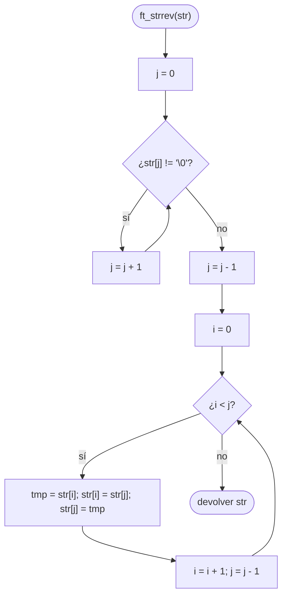

# ft_strrev

[[Variaciones - Índice|← Índice]] · Variaciones · Cadenas

> Da la vuelta a una cadena **en el mismo sitio** (sin reservar memoria) y devuelve el mismo puntero que recibe. Se resuelve con dos índices, uno al principio y otro al final, que intercambian caracteres y se acercan hasta cruzarse.

## Explicación sencilla

No hace falta una cadena nueva: intercambias el primero con el último, el segundo con el penúltimo… y paras cuando los índices se encuentran en el medio.

```text
 "hola"                         i         j
                               ┌───┬───┬───┬───┬────┐
 inicio                        │ h │ o │ l │ a │ \0 │   i = 0, j = 3
                               └───┴───┴───┴───┴────┘
 swap(0, 3)                    │ a │ o │ l │ h │ \0 │   i = 1, j = 2
 swap(1, 2)                    │ a │ l │ o │ h │ \0 │   i = 2, j = 1
                                                        i >= j → parar
```

- Con longitud **par** los índices se cruzan (`i` pasa a `j`).
- Con longitud **impar** se encuentran en el carácter central, que no se mueve.
- El `'\0'` **no** se toca: `j` empieza en `longitud - 1`.

El intercambio es el mismo truco de la variable auxiliar de [[ft_swap]].

## Prototipo

```c
// Variación (Exam Rank 02)
char	*ft_strrev(char *str);
```

No existe en la libc estándar: no hay `man 3 strrev` en Linux.

> [!info] Variación, no forma parte de libft
> Es un ejercicio del nivel 2 del [[Exam Rank 02]] (en las listas públicas). No hay subject local: el enunciado de abajo es el habitual, resumido. Si tienes el enunciado de tu examen, manda lo que diga él.

## Enunciado habitual

- Escribe una función que invierta (en el mismo sitio) la cadena que recibe.
- Devuelve el mismo puntero que recibe (`str`).
- No hay funciones autorizadas.

## Cómo implementarla

```text
1. j = 0
2. Mientras str[j] no sea '\0':  j = j + 1      (j = longitud)
3. j = j - 1                                     (último carácter; -1 si vacía)
4. i = 0
5. Mientras i < j:
       tmp = str[i]
       str[i] = str[j]
       str[j] = tmp
       i = i + 1
       j = j - 1
6. Devolver str
```

Con la cadena vacía, `j` vale `-1` tras el paso 3, `0 < -1` es falso y no se toca nada. Por eso `j` tiene que ser un `int` (con signo).

## Diagrama de flujo



## Ejemplos

Cada cadena se copia antes a un array modificable (`buf`), porque los literales no se pueden modificar (ver más abajo):

```c
#include <stdio.h>
#include <string.h>

char	*ft_strrev(char *str);

void	test(char *s)
{
	char	buf[32];
	char	*ret;

	strcpy(buf, s);
	ret = ft_strrev(buf);
	printf("\"%s\" -> \"%s\"  (ret == buf: %d)\n", s, buf, ret == buf);
}

int	main(void)
{
	test("hola");
	test("Barcelona");
	test("ab");
	test("x");
	test("");
	return (0);
}
```

```text
"hola" -> "aloh"  (ret == buf: 1)
"Barcelona" -> "anolecraB"  (ret == buf: 1)
"ab" -> "ba"  (ret == buf: 1)
"x" -> "x"  (ret == buf: 1)
"" -> ""  (ret == buf: 1)
```

### No la uses con un literal

```c
int	main(void)
{
	char	*lit;

	lit = "hola";
	ft_strrev(lit);
	printf("[%s]\n", lit);
	return (0);
}
```

```text
bash: line 1: 59629 Segmentation fault      (core dumped) ./strrev_lit
exit=139
```

Compila sin un solo aviso, pero `"hola"` vive en un segmento de **solo lectura** (ver [[Segmentos de memoria en C]]): el primer `str[i] = str[j]` provoca el segfault. Con `char buf[] = "hola";` o con memoria de `malloc` sí funciona, porque es una **copia** modificable.

## Puntos clave y casos límite

- **Cadena vacía**: `j = -1`, el bucle no entra, devuelve `str` sin tocar.
- **Un carácter**: `i = 0`, `j = 0`, `0 < 0` es falso. No hay nada que hacer.
- **Par e impar**: con `i < j` (estricto) ambos casos paran bien; el carácter central de una cadena impar se queda donde está.
- **Devuelve `str`**: el mismo puntero, no una cadena nueva. No hay `malloc`.

### Errores típicos

- **Empezar `j` en la longitud** en vez de en `longitud - 1`: el `'\0'` pasa al principio y la cadena queda "vacía".
- **Recorrer la cadena entera** (intercambiar `str[i]` con `str[len - 1 - i]` mientras `i < len`) en vez de hasta la mitad: cada pareja se intercambia dos veces y la cadena queda **igual** que al principio.
- **Usar `unsigned int` o `size_t` para `j`**: con la cadena vacía, `0 - 1` da un número enorme (ver [[Tipos enteros y conversiones]]) y el bucle escribe fuera de la cadena.
- **Probar con un literal** y pensar que la función está mal: el fallo es del programa de prueba.

## Relacionadas

[[ft_swap]] · [[ft_strlen]] · [[ft_strdup]] · [[Segmentos de memoria en C]] · [[Arrays en C]] · [[Exam Rank 02]]

## Referencias

- [String literals — cppreference](https://en.cppreference.com/w/c/language/string_literal) — modificar un literal de cadena es comportamiento indefinido.
- [Beej's Guide to C: Strings](https://beej.us/guide/bgc/html/split/strings.html) — diferencia entre `char *s = "..."` y `char s[] = "..."`.
- Ejemplos compilados con `cc -Wall -Wextra -Werror` (Ubuntu clang 12.0.1) en Linux x86_64.
