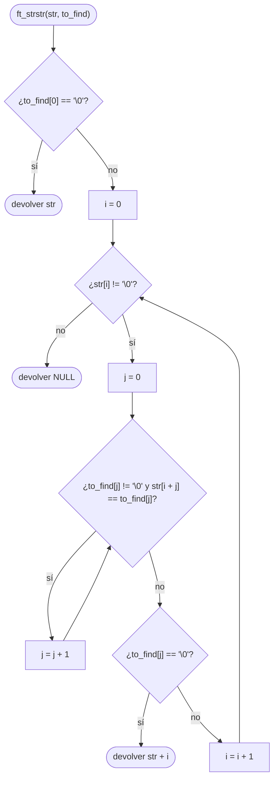

# ft_strstr

[[Variaciones - Índice|← Índice]] · Variaciones · Cadenas

> Busca la primera aparición de la cadena `to_find` dentro de `str` y devuelve un puntero a donde empieza, o `NULL` si no está. Si `to_find` está vacía, devuelve `str`. Es [[ft_strnstr]] sin el límite `len`: busca por toda `str`.

## Explicación sencilla

Pruebas cada posición `i` de `str` como posible inicio. Desde ahí comparas carácter a carácter con `to_find` usando un segundo índice `j`. Si llegas al final de `to_find` sin fallar, la has encontrado.

```text
 str:     H  o  l  a  ␠  4  2  \0          to_find: "42"
          0  1  2  3  4  5  6
 i = 0:   H≠4  ✗
 i = 1:   o≠4  ✗
 ...
 i = 5:   4=4 ✓  2=2 ✓  to_find[2] = '\0' → encontrado
                                            devolver str + 5 → "42"
```

Lo que devuelves no es un índice: es un **puntero dentro de `str`** (ver [[Punteros en C]]). Si lo imprimes con `%s`, ves el resto de `str` desde ahí.

## Prototipo

```c
// Original — strstr(3)
#include <string.h>
char *strstr(const char *haystack, const char *needle);

// Variación (C Piscine)
char	*ft_strstr(char *str, char *to_find);
```

Consultar: `man 3 strstr`

> [!info] Variación, no forma parte de libft
> Viene de la C Piscine, donde el prototipo va **sin `const`** y los parámetros se llaman `str` y `to_find` (en el manual, `haystack`, «pajar», y `needle`, «aguja»). No hay subject local: el enunciado de abajo es el habitual, resumido. Si tienes el PDF de tu Piscina, manda lo que diga él.

## Enunciado habitual

- Reproduce el comportamiento de `strstr` (`man strstr`).
- Devuelve un puntero a la primera aparición de `to_find` en `str`, o `NULL` si no aparece.
- Si `to_find` es una cadena vacía, devuelve `str`.
- No hay funciones autorizadas.

## Comportamiento según el manual

> [!quote] man 3 strstr — DESCRIPTION
> The strstr() function finds the first occurrence of the substring needle in the string haystack. The terminating null bytes ('\0') are not compared.

> [!note] Traducción
> La función strstr() encuentra la primera aparición de la subcadena needle en la cadena haystack. Los bytes nulos finales ('\0') no se comparan.

> [!quote] man 3 strstr — RETURN VALUE
> These functions return a pointer to the beginning of the located substring, or NULL if the substring is not found.

> [!note] Traducción
> Estas funciones devuelven un puntero al principio de la subcadena encontrada, o NULL si no se encuentra.

> [!tip] ¿Y si to_find está vacía?
> El manual de Linux no lo dice, pero el estándar C sí: si `needle` apunta a una cadena de longitud cero, se devuelve `haystack` (ver cppreference en Referencias). La cadena vacía «aparece» en la posición 0 de cualquier cadena. El ejemplo de abajo lo comprueba contra la `strstr` de la libc.

## Cómo implementarla

```text
1. Si to_find[0] es '\0': devolver str
2. i = 0
3. Mientras str[i] no sea '\0':
       j = 0
       Mientras to_find[j] no sea '\0' y str[i + j] == to_find[j]:
           j = j + 1
       Si to_find[j] es '\0': devolver str + i     (to_find entera coincide)
       i = i + 1
4. Devolver NULL
```

No hace falta comprobar aparte que `str[i + j]` no sea `'\0'`: si `str` se acaba, `'\0'` no es igual a ningún carácter de `to_find` (que todavía no ha terminado) y el bucle interior para solo.

## Diagrama de flujo



## Ejemplos

Cada resultado se compara con la `strstr` de la libc (mismo puntero):

```c
#include <stdio.h>
#include <string.h>

char	*ft_strstr(char *str, char *to_find);

void	test(char *s, char *f)
{
	char	*a;

	a = ft_strstr(s, f);
	if (a == NULL)
		printf("(\"%s\", \"%s\") -> NULL", s, f);
	else
		printf("(\"%s\", \"%s\") -> \"%s\" (pos %ld)", s, f, a, a - s);
	if (a == strstr(s, f))
		printf("  = strstr\n");
	else
		printf("  != strstr\n");
}

int	main(void)
{
	test("Hola 42", "42");
	test("Hola 42", "a");
	test("Hola 42", "43");
	test("aaab", "aab");
	test("ab", "abc");
	test("Hola", "");
	test("", "");
	test("", "a");
	return (0);
}
```

```text
("Hola 42", "42") -> "42" (pos 5)  = strstr
("Hola 42", "a") -> "a 42" (pos 3)  = strstr
("Hola 42", "43") -> NULL  = strstr
("aaab", "aab") -> "aab" (pos 1)  = strstr
("ab", "abc") -> NULL  = strstr
("Hola", "") -> "Hola" (pos 0)  = strstr
("", "") -> "" (pos 0)  = strstr
("", "a") -> NULL  = strstr
```

- `"aaab"` / `"aab"`: en `i = 0` coinciden `aa` y falla la `b`. Hay que **volver a empezar en `i = 1`**, no saltar a donde falló.
- `"ab"` / `"abc"`: `to_find` es más larga que lo que queda de `str`; el `'\0'` de `str` corta la comparación.
- `"Hola"` / `""` y `""` / `""`: `to_find` vacía → devuelve `str`, aunque `str` también esté vacía.

## Puntos clave y casos límite

- **`to_find` vacía → `str`**, comprobado antes del bucle. Sin esa línea, con `str = ""` el bucle no entra y devolverías `NULL`.
- **Primera aparición**: en cuanto encuentras una, devuelves. No sigas buscando.
- **Devuelve un puntero a `str`**, no una copia. Si modificas lo que devuelve, modificas `str`.
- **`NULL` como argumento**: comportamiento indefinido, igual que la original.

> [!warning] Diferencia con ft_strnstr
> [[ft_strnstr]] tiene un tercer parámetro `len`: solo busca dentro de los **primeros `len` caracteres** de `big`, y la aguja tiene que caber **entera** en ese tramo. `ft_strstr` busca hasta el `'\0'` de `str`.

### Errores típicos

- **Saltar a donde falló la comparación** (`i = i + j`) en vez de avanzar uno: pierde coincidencias como `"aab"` dentro de `"aaab"`.
- **Devolver `NULL` con `to_find` vacía** en vez de `str`.
- **Devolver `&to_find[0]`** (la aguja) en vez de `str + i` (dónde está en el pajar).
- **Quitar `to_find[j] != '\0'` del bucle interior**: si `to_find` está al final de `str` (`"Hola 42"` / `"42"`), los dos `'\0'` son iguales, `j` sigue avanzando y lees fuera de las dos cadenas.

## Relacionadas

[[ft_strnstr]] · [[ft_strncmp]] · [[ft_strlen]] · [[ft_strcpy]] · [[Punteros en C]] · [[Carácter nulo y puntero NULL]]

## Referencias

- `man 3 strstr` — Linux man-pages 5.10 (Ubuntu 22.04): las citas en inglés están copiadas literalmente del manual; la traducción es propia.
- [strstr(3) — man7.org](https://man7.org/linux/man-pages/man3/strstr.3.html) — versión en línea del manual de Linux (puede ser más reciente que la de Ubuntu 22.04).
- [strstr — cppreference](https://en.cppreference.com/w/c/string/byte/strstr) — el estándar C: si la aguja está vacía, se devuelve el pajar.
- En los Mac de 42 (man de BSD/macOS) la redacción del manual puede variar.
- Ejemplos compilados con `cc -Wall -Wextra -Werror` (Ubuntu clang 12.0.1) en Linux x86_64.
