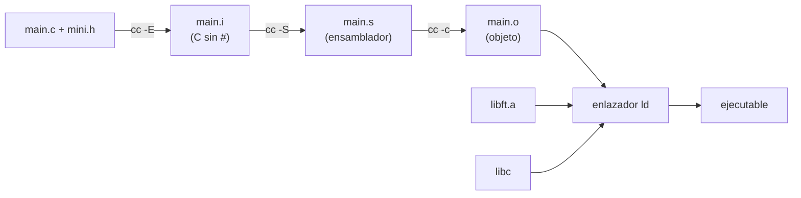

# Cómo compila C

[[Inicio|← Inicio]] · Herramientas

> Cuando escribes `cc main.c`, el compilador hace en realidad **cuatro pasos**: preprocesar, compilar a ensamblador, ensamblar a código objeto (`.o`) y **enlazar** todos los `.o` y librerías en un ejecutable. Saber qué paso falla te dice cómo arreglar el error: no es lo mismo un `implicit declaration` (paso de compilación) que un `undefined reference` (paso de enlazado).

## Vocabulario

| Término | Qué significa |
|---|---|
| **Fuente** (`.c`) | El código que escribes |
| **Header** (`.h`) | Fichero con prototipos, macros y `typedef` que se copia dentro del `.c` con `#include` |
| **Preprocesador** | Programa que resuelve las líneas que empiezan por `#` antes de compilar |
| **Código objeto** (`.o`) | Código máquina de **un** `.c`, todavía con «huecos» para las funciones de otros ficheros |
| **Símbolo** | Nombre de una función o variable global tal como lo ve el enlazador |
| **Enlazador** (*linker*, `ld`) | Programa que junta los `.o` y rellena los huecos |
| **Librería estática** (`.a`) | Un paquete de `.o` (tu `libft.a`) |

## El camino completo



Normalmente no ves los pasos intermedios: `cc` los hace todos y borra los ficheros temporales. Pero puedes pararlo en cualquier punto.

En los ejemplos uso este mini proyecto:

```text
.
├── include/mini.h      → #define DOBLE(x) ((x) * 2)  y  int ft_suma(int a, int b);
├── src/ft_suma.c       → la definición de ft_suma
└── main.c              → #include "mini.h"  y  return (DOBLE(ft_suma(1, 2)));
```

> [!info] `cc` en 42
> En los ordenadores Linux de 42, `cc` suele ser **clang** (aquí clang 12 en Ubuntu 22.04). Los mensajes de error de `gcc` dicen lo mismo con otras palabras. Todo lo de esta nota vale para los dos.

## Preprocesado: `-E`

El [[Preprocesador y headers|preprocesador]] copia el contenido de cada `#include`, sustituye las macros (`#define`) y quita los comentarios. El resultado sigue siendo C, pero sin ninguna línea `#` tuya.

```text
$ cc -E -I include main.c | tail -6
int ft_suma(int a, int b);
# 2 "main.c" 2

int main(void)
{
 return (((ft_suma(1, 2)) * 2));
}
```

Fíjate: el prototipo de `mini.h` aparece pegado arriba y `DOBLE(...)` se ha convertido en `((...) * 2)`. Las líneas `# 2 "main.c"` son marcas para que los errores digan la línea correcta.

### `-I`: dónde buscar los headers

Sin `-I include`, el preprocesador no encuentra `mini.h`:

```text
$ cc main.c
main.c:1:10: fatal error: 'mini.h' file not found
#include "mini.h"
         ^~~~~~~~
1 error generated.
```

`-I carpeta` añade una carpeta a la lista de búsqueda. `#include "x.h"` busca primero junto al `.c`; `#include <x.h>` busca solo en las carpetas del sistema y las de `-I`.

> [!tip] Cuándo usar `-E`
> Cuando una macro no hace lo que esperas, o para ver qué trae de verdad un `#include`. `cc -E main.c | less`.

## Compilación: `-S` y `-c`

El compilador traduce el C preprocesado a **ensamblador** (instrucciones de la CPU en texto). Con `-S` se para ahí:

```text
$ cc -Wall -Wextra -Werror -I include -S main.c -o main.s
$ head main.s
...
main:                                   # @main
	pushq	%rbp
	movq	%rsp, %rbp
	movl	$1, %edi
	movl	$2, %esi
	callq	ft_suma
	shll	$1, %eax
```

No necesitas entender ensamblador, pero mira: `callq ft_suma` es una llamada a una función que **este fichero no contiene**. Queda pendiente.

Con `-c` se ensambla y se obtiene el **objeto** `.o`. Es lo que hace tu [[Makefile y librerías estáticas|Makefile]] con cada `.c`:

```text
$ cc -Wall -Wextra -Werror -I include -c main.c -o main.o
$ cc -Wall -Wextra -Werror -I include -c src/ft_suma.c -o ft_suma.o
$ file main.o
main.o: ELF 64-bit LSB relocatable, x86-64, version 1 (SYSV), not stripped
```

`relocatable` = todavía no es un programa ejecutable.

### Ver los símbolos con `nm`

```text
$ nm main.o
                 U ft_suma
0000000000000000 T main
$ nm ft_suma.o
0000000000000000 T ft_suma
```

| Letra | Significado |
|---|---|
| `T` | Definido aquí (en la sección de código, *text*) |
| `U` | *Undefined*: se usa aquí pero está en otro sitio. El enlazador tendrá que encontrarlo |

> [!summary] Por qué compilar por separado
> Cada `.c` se compila **solo**, sin mirar los demás. Por eso cada fichero necesita su `#include` con los prototipos, y por eso `make` solo recompila los `.c` que has cambiado.

## Enlazado

El enlazador busca, para cada `U`, un `T` con el mismo nombre en algún `.o` o librería. Si encuentra todos, genera el ejecutable.

```text
$ cc main.o ft_suma.o -o prog
$ ./prog; echo $?
6
```

Si falta un `.o`:

```text
$ cc main.o
/usr/bin/ld: main.o: in function `main':
main.c:(.text+0x1a): undefined reference to `ft_suma'
clang: error: linker command failed with exit code 1 (use -v to see invocation)
```

El mensaje empieza por `/usr/bin/ld`: lo da el **enlazador**, no el compilador. Tu código compiló bien; lo que falta es el fichero donde está `ft_suma`. Además del tuyo, siempre se enlaza la **libc** (donde están `write`, `malloc`…), por eso no tienes que pedirla.

## Librerías estáticas `.a` y `-L` `-l`

Una `.a` es un archivo que agrupa muchos `.o`. Se crea con `ar`:

```text
$ ar rcs libmini.a ft_suma.o
$ nm libmini.a

ft_suma.o:
0000000000000000 T ft_suma
```

Para usarla:

```bash
cc main.o -L. -lmini -o prog
```

| Bandera | Significado |
|---|---|
| `-L carpeta` | Añade una carpeta donde buscar librerías (aquí `.` = la actual) |
| `-lnombre` | Enlaza `libnombre.a` (o `.so`). Se quita `lib` y la extensión: `-lft` → `libft.a`, `-lm` → `libm` (matemáticas) |

También puedes pasar la ruta entera: `cc main.o libft/libft.a -o prog`. Más detalles sobre `ar` y cómo construir `libft.a` en [[Makefile y librerías estáticas]].

> [!warning] El orden importa
> El enlazador lee de izquierda a derecha y de una librería solo coge lo que **ya** sabe que falta. Si pones la librería antes que el `.o` que la usa, falla:
> ```text
> $ cc -L. -lmini main.o -o prog2
> /usr/bin/ld: main.o: in function `main':
> main.c:(.text+0x1a): undefined reference to `ft_suma'
> ```
> Regla: **primero tus `.o`/`.c`, después las librerías**. Y si una librería usa otra (por ejemplo, tu `libftprintf.a` llama a funciones de `libft.a`), la que usa va antes: `-lftprintf -lft`.

## «implicit declaration» vs. «undefined reference»

Son los dos errores más confundidos. Vienen de pasos distintos:

| | `implicit declaration of function` | `undefined reference to` |
|---|---|---|
| Quién lo da | Compilador (`file.c:3:10: error`) | Enlazador (`/usr/bin/ld:`) |
| Qué significa | Usas una función **sin haber visto su prototipo** | Hay prototipo, pero **ningún `.o` ni librería la define** |
| Causa típica | Falta el `#include`, o el prototipo no está en el `.h` | No compilas ese `.c`, falta la `.a` en la línea, orden de `-l`, nombre mal escrito en la definición |
| Arreglo | `#include "libft.h"` / añadir el prototipo | Añadir el fichero a `SRCS`, `-L. -lft`, revisar nombres |

El primero, con y sin `-Werror`:

```text
$ cc -c noinc.c
noinc.c:3:10: warning: implicit declaration of function 'ft_suma' is invalid in C99 [-Wimplicit-function-declaration]
        return (ft_suma(1, 2));
                ^
1 warning generated.

$ cc -Wall -Wextra -Werror -c noinc.c
noinc.c:3:10: error: implicit declaration of function 'ft_suma' is invalid in C99 [-Werror,-Wimplicit-function-declaration]
```

> [!danger] El aviso que nunca hay que ignorar
> Sin prototipo, el compilador **supone** que la función devuelve `int`. Si en realidad devuelve un puntero (como [[ft_strdup]]), el valor se corta a 32 bits y el programa crashea más tarde, lejos del error. Por eso es un error con `-Werror`.

## Por qué `-Wall -Wextra -Werror`

Todos los subjects lo exigen. Cada bandera tiene un papel:

| Bandera | Qué hace |
|---|---|
| `-Wall` | Activa un grupo grande de avisos sobre código sospechoso |
| `-Wextra` | Activa avisos adicionales que `-Wall` no incluye (p. ej. parámetros sin usar) |
| `-Werror` | Convierte **todos** los avisos en errores: si hay un aviso, no se genera el ejecutable |

Ejemplo con fallos reales que compila «bien» sin banderas:

```c
#include <stdio.h>

int	f(int x)
{
	int	y;

	if (x = 1)               /* ❌ asignación en vez de comparación */
		printf("%d\n", y);   /* ❌ y sin inicializar */
}                            /* ❌ falta return */

int	main(int argc, char **argv)   /* ❌ argv sin usar */
{
	return (f(argc));
}
```

```text
$ cc warn.c -o warn            ← 2 avisos y se genera el ejecutable igualmente
warn.c:7:8: warning: using the result of an assignment as a condition without parentheses [-Wparentheses]
warn.c:9:1: warning: non-void function does not return a value [-Wreturn-type]
2 warnings generated.

$ cc -Wall -Wextra -Werror warn.c -o warn
warn.c:7:8: error: using the result of an assignment as a condition without parentheses [-Werror,-Wparentheses]
warn.c:9:1: error: non-void function does not return a value [-Werror,-Wreturn-type]
warn.c:8:18: error: variable 'y' is uninitialized when used here [-Werror,-Wuninitialized]
warn.c:11:27: error: unused parameter 'argv' [-Werror,-Wunused-parameter]
4 errors generated.
```

Con las banderas aparecen **cuatro bugs** en vez de dos, y no puedes ignorarlos. El evaluador compila con ellas: si a ti te compila sin banderas y a él no, es un 0.

> [!tip] Parámetro que no usas a propósito
> Si un `main` no usa `argv`, escribe `(void)argv;` o declara `int main(void)`.

## Banderas útiles de un vistazo

| Bandera | Paso | Para qué |
|---|---|---|
| `-E` | Preprocesado | Ver el C tras sustituir `#include`/`#define` |
| `-S` | Compilación | Generar ensamblador `.s` |
| `-c` | Ensamblado | Generar `.o` sin enlazar |
| `-o nombre` | Todos | Nombre del fichero de salida (por defecto `a.out`) |
| `-I dir` | Preprocesado | Carpeta de headers |
| `-L dir` / `-lx` | Enlazado | Carpeta de librerías / librería `libx` |
| `-g` | Compilación | Información para [[Depurar con gdb\|gdb]] y [[Valgrind y sanitizers\|Valgrind]] |
| `-fsanitize=address` | Compilación y enlazado | Detector de errores de memoria |
| `-v` | Todos | Enseña los comandos internos (verás la llamada real a `ld`) |

## Relacionadas

[[Makefile y librerías estáticas]] · [[Preprocesador y headers]] · [[Valgrind y sanitizers]] · [[Depurar con gdb]] · [[La Norma]] · [[libft - Índice]]

## Referencias

- [GCC — Options Controlling the Kind of Output](https://gcc.gnu.org/onlinedocs/gcc/Overall-Options.html) — fases de compilación y `-E`, `-S`, `-c`, `-o`, `-v`.
- [GCC — Options for Directory Search](https://gcc.gnu.org/onlinedocs/gcc/Directory-Options.html) — `-I` y `-L`, orden de búsqueda de `#include "..."` y `<...>`.
- [GCC — Options for Linking](https://gcc.gnu.org/onlinedocs/gcc/Link-Options.html) — `-l` y la importancia del orden de las librerías en la línea de comandos.
- [GCC — Options to Request or Suppress Warnings](https://gcc.gnu.org/onlinedocs/gcc/Warning-Options.html) — `-Wall`, `-Wextra`, `-Werror`, `-Wimplicit-function-declaration`.
- [GCC — Preprocessor Options](https://gcc.gnu.org/onlinedocs/gcc/Preprocessor-Options.html) — opciones del preprocesador.
- [Clang — Diagnostic flags](https://clang.llvm.org/docs/DiagnosticsReference.html) — nombres de los avisos que muestra `cc` (clang).
- [GNU Binutils — ar](https://sourceware.org/binutils/docs/binutils/ar.html) y [nm](https://sourceware.org/binutils/docs/binutils/nm.html) — crear `.a` (`rcs`) y letras de símbolos `T`/`U`.
- [ld(1) — Linux man page](https://man7.org/linux/man-pages/man1/ld.1.html) — el enlazador de GNU.
- Salidas reales generadas con clang 12 (`cc`) y GNU ld en Ubuntu 22.04.
