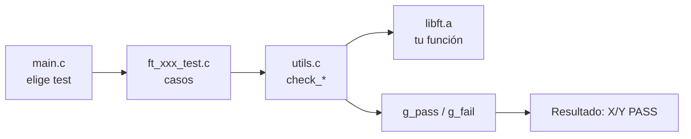

# libft - Suite de tests

[[libft - Índice|← Índice]] · Tests

> Una **suite de tests** es un programa aparte que llama a tus funciones con muchas entradas distintas y comprueba que devuelven lo esperado. Esta es la suite propia de la libft (código en `cursus/libft/tests/`): cada caso muestra **qué se prueba**, el **valor esperado**, el **valor obtenido** y si pasa (**[PASS]**) o falla (**[FAIL]**).

Ejemplo de salida (en `ft_toupper` el resultado es un `int`, por eso se ve el código ASCII: 65 es `'A'`):

```text
========== [6] ft_toupper ==========
  ft_toupper('a')                    esperado: 65             obtenido: 65             [PASS]
  ft_toupper('{') (después de 'z')   esperado: 123            obtenido: 123            [PASS]
  ft_toupper(256 + 'a')              esperado: 353            obtenido: 353            [PASS]
  Resultado: 12/12 PASS
```

> [!tip] Flujo recomendado al terminar una función
> 1. `make test_ft_xxx` → que todo salga en **[PASS]**.
> 2. `make valgrind T=ft_xxx` → **0 leaks y 0 errores**.
> 3. `make norm` → todo en `OK!`.
> 4. Cambia la propiedad `estado` de su nota a `hecho` (ver [[libft - Índice#Progreso|Progreso]]).

---

## Uso rápido

### Con `make`

Desde la raíz de la libft (`cursus/libft/`):

| Comando | Qué hace |
|---|---|
| `make test` | Compila y ejecuta **todos** los tests |
| `make test_ft_strlen` | Ejecuta **un** test concreto |
| `make norm` | Pasa `norminette` a los ficheros de la libft |
| `make valgrind` | Ejecuta todos los tests bajo `valgrind` (leaks/errores) |
| `make valgrind T=ft_strdup` | Ejecuta un solo test bajo `valgrind` |
| `make clean` / `make fclean` | Borra los `.o`, `test_runner` y (con `fclean`) `libft.a` |

### Con el ejecutable

Después de `make test_runner` (o de cualquier `make test…`):

| Comando | Qué hace |
|---|---|
| `./test_runner` | Abre el **menú** interactivo |
| `./test_runner all` | Ejecuta todos los tests |
| `./test_runner ft_strlen` | Un test por nombre |
| `./test_runner strlen` | Igual, sin el prefijo `ft_` |
| `./test_runner test_ft_strlen` | Igual, con el prefijo `test_` (es lo que hace `make test_ft_strlen`) |
| `./test_runner 14` | Igual, por número (ver [[#Lista de tests]]) |
| `./test_runner atoi 3 ft_bzero` | Varios tests seguidos (se pueden mezclar formas) |

### El menú

```text
===================================
         SUITE DE TESTS LIBFT
===================================
 1. Listar tests
 2. Ejecutar TODOS los tests
 3. Ejecutar un test por número
 0. Salir
-----------------------------------
>>> Selecciona una opción:
```

| Opción | Qué hace |
|---|---|
| **1** | Muestra la lista de tests con su número |
| **2** | Ejecuta todos y al final muestra el total (`TOTAL: 26/26 funciones sin fallos`) |
| **3** | Muestra la lista y pide el número del test |
| **0** | Sale |

---

## Lista de tests

| Nº | Función | Nº | Función | Nº | Función |
|---|---|---|---|---|---|
| 1 | [[ft_isalpha]] | 10 | [[ft_memcpy]] | 19 | [[ft_strncmp]] |
| 2 | [[ft_isdigit]] | 11 | [[ft_memmove]] | 20 | [[ft_strnstr]] |
| 3 | [[ft_isalnum]] | 12 | [[ft_memchr]] | 21 | [[ft_atoi]] |
| 4 | [[ft_isascii]] | 13 | [[ft_memcmp]] | 22 | [[ft_calloc]] |
| 5 | [[ft_isprint]] | 14 | [[ft_strlen]] | 23 | [[ft_strdup]] |
| 6 | [[ft_toupper]] | 15 | [[ft_strlcpy]] | 24 | [[ft_substr]] |
| 7 | [[ft_tolower]] | 16 | [[ft_strlcat]] | 25 | [[ft_strjoin]] |
| 8 | [[ft_memset]] | 17 | [[ft_strchr]] | 26 | [[ft_strtrim]] |
| 9 | [[ft_bzero]] | 18 | [[ft_strrchr]] | | |

> [!note] El número no es fijo
> El número de un test es su **posición en la tabla `g_tests`** de `main.c`. Si insertas un test en medio, los de detrás cambian de número.

---

## Cómo está organizada

```text
tests/
├── README.md          ← documentación
├── test.h             ← includes, colores y prototipos
├── main.c             ← tabla de tests, menú y argumentos
├── utils.c            ← funciones check_* (imprimen y cuentan PASS/FAIL)
├── ft_isalpha_test.c  ← un fichero de test por función
├── ft_isdigit_test.c
└── ...
```



### `main.c` — la tabla de tests

Relaciona cada nombre con su función de test. Antes de cada test pone `g_pass` y `g_fail` a 0 y, al acabar, imprime `Resultado: X/Y PASS`.

```c
static t_test	g_tests[] = {
{"ft_isalpha", test_ft_isalpha},
{"ft_isdigit", test_ft_isdigit},
...
};
```

### `utils.c` — las funciones de comprobación

Todas reciben `(descripción, esperado, obtenido)`, imprimen una línea y suman 1 a `g_pass` o a `g_fail`.

| Función | Para qué se usa | Ejemplo de salida |
|---|---|---|
| `check_bool` | `ft_is*`: solo importa si es 0 o distinto de 0 | esperado `verdadero`, obtenido `verdadero (1)` / `falso (0)` |
| `check_int` | Dos `int` exactos (`ft_atoi`, `ft_toupper`) | `42` |
| `check_size` | Dos `size_t` (`ft_strlen`, `ft_strlcpy`) | `4` |
| `check_sign` | `ft_memcmp`, `ft_strncmp`: solo importa el signo | `<0`, `0`, `>0` |
| `check_str` | Cadenas (admite `NULL`) | `"hola"` / `NULL` |
| `check_mem` | `n` bytes de memoria | `AAAAXXXXXX` (no imprimibles = `.`) |
| `check_ptr` | Punteros dentro de una cadena (`ft_strchr`, `ft_memchr`…) | `pos 5` (posición respecto al inicio) / `NULL` |

> [!question] ¿Por qué `check_bool` y `check_sign`?
> - Las `is*` originales devuelven «distinto de 0» (p. ej. `1024`), no necesariamente `1`. El subject pide que las tuyas devuelvan **1 o 0**, pero comparar el valor exacto con la original fallaría sin motivo.
> - `memcmp`/`strncmp` solo garantizan el **signo** del resultado (`<0`, `0`, `>0`), no el número concreto.

### `ft_xxx_test.c` — los casos

Cada fichero tiene una función `test_ft_xxx()` con una comprobación por caso:

```c
void	test_ft_toupper(void)
{
	check_int("ft_toupper('a')", 'A', ft_toupper('a'));
	//         descripción        esperado  obtenido
	check_int("ft_toupper('{') (después de 'z')", '{', ft_toupper('{'));
	...
}
```

> [!tip] Usar la original como «esperado»
> Si existe la función en la libc, el esperado se calcula con ella para no equivocarse al escribirlo a mano:
> ```c
> check_int("ft_atoi(\"  -42\")", atoi("  -42"), ft_atoi("  -42"));
> ```

> [!tip] Dos buffers para las funciones de memoria
> Se aplica la de la libft a un buffer y la original a otro idéntico, y se comparan **enteros** (más bytes que `n`). Así también se detecta si tu función **escribe de más**:
> ```c
> ft_memset(mio, 'A', 4);
> memset(orig, 'A', 4);
> check_mem("ft_memset(buf, 'A', 4)", orig, mio, 10);
> ```

---

## Casos límite que se prueban

Un **caso límite** (*edge case*) es una entrada en el borde de lo normal: cadena vacía, tamaño 0, el valor más grande posible… Es donde suelen esconderse los fallos y lo primero que prueba un evaluador.

> [!abstract]- Caracteres — `ft_is*`, `ft_toupper`, `ft_tolower`
> - Límites de cada rango (`'a'`, `'z'`, `'A'`, `'Z'`, `'0'`, `'9'`) y los caracteres justo antes y después.
> - `0`, `127`, `-1` (`EOF`), valores mayores de 255, `INT_MIN` e `INT_MAX`.

> [!abstract]- Memoria — `ft_mem*`, `ft_bzero`
> - `n = 0` y no escribir fuera de `n`.
> - Bytes `\0` en medio, bytes > 127, `c` mayor de 255 o negativo.
> - El valor devuelto.
> - En [[ft_memmove]]: solapamiento **en ambas direcciones**.

> [!abstract]- Cadenas — `ft_str*`
> - Cadenas vacías, buscar `'\0'`, no buscar más allá del `'\0'`.
> - `n`/`len`/`size` igual a 0, igual a la longitud, una más y mucho mayor.
> - En [[ft_strlcpy]]/[[ft_strlcat]]: tanto el **valor devuelto** como el **contenido de `dst`**.

> [!abstract]- `ft_atoi`
> - Espacios (`\t\n\v\f\r` y `' '`), signos `+`/`-`, varios signos seguidos.
> - Letras antes/después, ceros a la izquierda, `INT_MAX` e `INT_MIN`.

> [!abstract]- Memoria dinámica — `ft_calloc`, `ft_strdup`, `ft_substr`, `ft_strjoin`, `ft_strtrim`
> - Memoria a 0, tamaños 0, overflow (`SIZE_MAX`).
> - `start` fuera de la cadena, `len` enorme, cadenas vacías, parámetros `NULL`.
> - Todo lo reservado se libera con `free`, para que valgrind no marque leaks **del propio test**.

---

## Norminette y Valgrind

### `make norm`

Ejecuta `norminette` sobre `SRC_FILES` y `libft.h`. Si todo está bien, cada fichero sale con `OK!`. Los ficheros de `tests/` **no** se pasan (no se entregan). Ver [[La Norma]].

### `make valgrind`

Ejecuta los tests con `valgrind --leak-check=full --show-leak-kinds=all`. **Valgrind** ejecuta tu programa vigilando cada acceso a memoria: avisa de **leaks** (memoria reservada con `malloc` que nunca se libera) y de lecturas o escrituras fuera de sitio. Al final, lo que quieres ver es:

```text
All heap blocks were freed -- no leaks are possible
ERROR SUMMARY: 0 errors from 0 contexts
```

| Si aparece… | Significa | Qué hacer |
|---|---|---|
| `definitely lost` | Se reserva memoria que nunca se libera (leak) | Busca el `malloc` sin su `free` en la función que indica |
| `Invalid read` / `Invalid write` | Se lee o escribe fuera de la memoria que te corresponde | Mira la función y línea que indica valgrind; suele ser un `<=` que debía ser `<` o falta sitio para el `'\0'` |
| `Conditional jump … uninitialised value` | Se usa una variable sin inicializar | Inicialízala antes de usarla |

Más contexto en [[Valgrind y sanitizers]] y [[Segmentos de memoria en C]] y, para encontrar el fallo paso a paso, [[Depurar con gdb]].

---

## Añadir un test nuevo

Ejemplo con [[ft_itoa]]:

1. **Crea `tests/ft_itoa_test.c`:**
   ```c
   #include "test.h"

   void	test_ft_itoa(void)
   {
   	char	*r;

   	r = ft_itoa(42);
   	check_str("ft_itoa(42)", "42", r);
   	free(r);
   	r = ft_itoa(INT_MIN);
   	check_str("ft_itoa(INT_MIN)", "-2147483648", r);
   	free(r);
   }
   ```
2. **Prototipo en `tests/test.h`:**
   ```c
   void	test_ft_itoa(void);
   ```
3. **Entrada en la tabla `g_tests` de `tests/main.c`:**
   ```c
   {"ft_itoa", test_ft_itoa},
   ```
4. Comprueba que `ft_itoa.c` está en `SRC_FILES` del Makefile y su prototipo en `libft.h`. Después: `make test_ft_itoa`.

> [!info] No hace falta tocar el Makefile para añadir tests
> Compila todos los `.c` de `tests/` con `$(wildcard tests/*.c)`. Ver [[Makefile y librerías estáticas]].

> [!warning] Nombre del fichero: `ft_xxx_test.c`, no `test_ft_xxx.c`
> Es la convención de la suite: `test_ft_xxx` es el nombre de la **función** de test y del objetivo `make test_ft_xxx` (regla `test_%` del Makefile). Llamar al fichero de otra forma evita confundirlos.

---

## Limitaciones

> [!danger] Un segfault detiene todo
> No hay protección contra crashes: si una función hace segfault, el runner se para en ese test. El **último caso impreso** indica dónde estaba. Para ver la línea exacta, ejecuta el runner dentro de gdb ([[Depurar con gdb]]).

> [!warning] Cambiar solo `test.h` no recompila
> La regla `test_runner` depende de `libft.a` y de los `.c` de `tests/`, pero no de `tests/test.h`. Si solo tocas el header, borra el ejecutable (`make clean`) antes de volver a lanzar los tests.

> [!warning] No se simula que `malloc` falle
> No se comprueba qué hacen `ft_calloc`, `ft_strdup`, `ft_substr`, `ft_strjoin` y `ft_strtrim` si `malloc` devuelve `NULL`. Revísalo a mano: después de cada `malloc` debe haber
> ```c
> if (!ptr)
> 	return (NULL);
> ```
> Ver [[Control de errores en C]].

> [!warning] Antes de entregar
> El subject prohíbe entregar archivos no utilizados, y la Norma pide que el Makefile nombre los fuentes explícitamente (aquí `TEST_SRC` usa `$(wildcard tests/*.c)`). Antes de la entrega final, quita la carpeta `tests/`, el ejecutable y las reglas `test`, `test_%`, `norm` y `valgrind` del Makefile (o guárdalos en otra rama, ver [[Git para 42]]).

## Pendiente

- [ ] Test de [[ft_split]] (ya implementada; añádelo siguiendo [[#Añadir un test nuevo]], y libera cada cadena **y** el array).
- [ ] Tests del resto de la Parte 2 y de la Parte 3 a medida que se implementen.

## Relacionadas

[[libft - Índice]] · [[libft - Anexo comparativo]] · [[Valgrind y sanitizers]] · [[Depurar con gdb]] · [[Makefile y librerías estáticas]] · [[La Norma]] · [[Control de errores en C]] · [[Git para 42]]

## Referencias

- Código de la suite: `cursus/libft/tests/` (`main.c`, `utils.c`, `test.h`, `README.md`) y el `Makefile` de la libft — comandos, tabla `g_tests` y funciones `check_*` descritos en esta nota.
- [Valgrind Quick Start Guide](https://valgrind.org/docs/manual/quick-start.html) — uso básico y cómo leer el informe.
- [Valgrind Memcheck manual](https://valgrind.org/docs/manual/mc-manual.html) — significado de `definitely lost`, `Invalid read/write` y `Conditional jump ... uninitialised value`.
- [42School/norminette](https://github.com/42School/norminette) — la herramienta que ejecuta `make norm`.
- Subject de libft v19.3 (`es.subject_libft.pdf`) — se recomienda crear programas de prueba, aunque no se entregan ni se evalúan; prohibido entregar archivos no utilizados.
