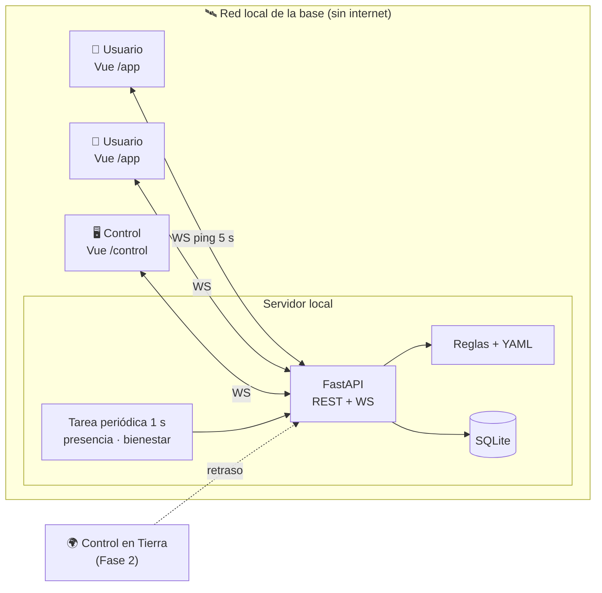
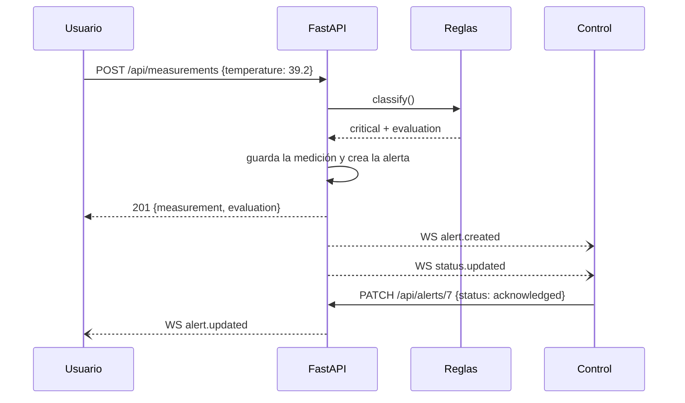

# Arquitectura y stack

## Stack (Fase 1)

| Capa            | Tecnología                                                       | Notas                                                                        |
| --------------- | ---------------------------------------------------------------- | ---------------------------------------------------------------------------- |
| Frontend        | **Vue 3 + Vite + TypeScript**                                    | `<script setup lang="ts">`                                                   |
| Estado          | **Pinia**                                                        | Un store por recurso                                                         |
| Rutas           | **Vue Router**                                                   | `/app/*` para el usuario y `/control/*` para Control, con protección por rol |
| Estilos         | **Tailwind CSS**                                                 | Colores como variables (ver [[14 - Diseño de la app]])                       |
| Gráficas        | **ECharts** (`vue-echarts`)                                      | Solo en el detalle (y una mini gráfica en la tarjeta)                        |
| Iconos          | `@iconify/vue` con **Healthicons** y **Lucide** **empaquetados** | Sin conexión                                                                 |
| Backend         | **FastAPI** + Pydantic                                           | `/docs` se genera solo                                                       |
| BD              | **SQLModel** + **SQLite**                                        | Un archivo `app.db`                                                          |
| Autenticación   | `pyjwt` + `passlib[bcrypt]`                                      |                                                                              |
| Tiempo real     | **WebSocket** de FastAPI                                         | Plan B: consultas cada 3 s ([[10 - Riesgos y plan de rescate]])              |
| Tarea periódica | **Un solo** bucle `asyncio` cada 1 s                             | Presencia y plazos de bienestar                                              |
| Escenarios      | YAML (`pyyaml`)                                                  | `mars`, `care_home`                                                          |
| Tests           | **pytest** + `TestClient` de FastAPI (backend) · **Vitest** + `@vue/test-utils` (frontend) | SQLite en memoria; CI en GitHub Actions. E2E con Playwright solo en la Fase 2 |
| Arranque        | `dev.sh` (backend y frontend)                                    | Docker solo en la Fase 2, si sobra tiempo                                    |

**Fase 2 (si sobra tiempo):** Docker Compose, tipos TypeScript generados del OpenAPI (`openapi-typescript`), endpoint de LLM.

> [!warning] Disco en 42
> `node_modules` más el `venv` pueden ocupar **más de 500 MB**. Usad `/goinfre` (si existe) o `pnpm`. Comprobadlo con `df -h ~`.

## Diagrama



## Flujo principal (es la prueba del punto de control H10)


## Estructura del repo

```
space-apps-2026/
├── AGENTS.md                 # contexto común para la IA (ver 16 - Uso de IA)
├── CLAUDE.md                 # para Claude Code: importa AGENTS.md
├── .claude/skills/           # skills del equipo: tarea, check-contrato, check-demo, escenario
├── dev.sh                    # arranca backend y frontend
├── .github/workflows/ci.yml  # ruff, pytest, eslint, vitest en cada PR
├── backend/
│   ├── app/
│   │   ├── main.py           # app, CORS, routers, arranque de la tarea periódica
│   │   ├── db.py · models.py · schemas.py
│   │   ├── auth.py           # JWT, current_user, require_control
│   │   ├── ws.py             # ConnectionManager: send_to_user, send_to_control, broadcast
│   │   ├── routers/          # auth, measurements, crew, alerts, tasks, messages, wellness, scenario, dev
│   │   ├── rules.py          # load_scenario, classify, aggregate, evaluation
│   │   ├── jobs.py           # tick() cada 1 s: presencia y plazos de bienestar
│   │   └── simulator.py
│   ├── scenarios/            # mars.yaml, care_home.yaml
│   ├── seed.py
│   ├── tests/                # conftest.py, test_rules*.py (rol 5), test_api*.py (rol 4)
│   └── pyproject.toml
├── frontend/
│   ├── src/                  # tests junto al archivo: *.spec.ts
│   │   ├── api/              # http.ts, ws.ts, mock/ (datos de prueba según el contrato)
│   │   ├── stores/           # auth, scenario, me, crew, alerts, tasks, messages, wellness
│   │   ├── components/       # StatusBadge, PresenceDot, IndicatorCard, TrendChart, BodySilhouette, AlertItem, ChatPanel, WellnessModal…
│   │   ├── views/app/        # Dashboard, Measure, Result, IndicatorDetail, Tasks, Messages
│   │   ├── views/control/    # Crew, UserDetail
│   │   └── assets/           # silueta.svg, fuentes, sonido
│   └── package.json
└── docs/                     # este vault
```

## Usuarios de demo (`seed.py`)
| Usuario | Contraseña | Rol |
|---|---|---|
| `control` | `control` | control |
| `astro1` … `astro4` | igual que el usuario | user |

Los nombres ficticios y los avatares los define el rol 6 (tarea C-10).
