# Fases y cronograma

> [!info] Fases y etapas
> - **Fase 1** = MVP · **Fase 2** = mejoras ([[01 - Visión y alcance]]).
> - **Etapas E0–E6** = tramos del fin de semana.
> - Las horas son relativas al inicio (H0). El plan asume **unas 34 horas** (sábado 09:00 → domingo 19:00). Apuntad las horas reales:
>   - H0 = `____`
>   - Hora límite de entrega = `____`

```mermaid
gantt
  dateFormat HH
  axisFormat H%H
  section Fase 1
  E1 Arranque            :e1, 00, 3h
  E2 Recorrido completo  :e2, after e1, 7h
  E3 Resto Fase 1        :e3, after e2, 10h
  E4 Margen              :e4, after e3, 2h
  section Fase 2 y entrega
  E5 Pulido y Fase 2     :e5, after e4, 6h
  E6 Entrega             :e6, after e5, 6h
```

## E0: preparación (antes del día 14)
- [ ] Todos leen [[00 - Empieza aquí]] y las notas de su rol (tabla "Qué leer según tu rol").
- [ ] Asignar los roles.
- [ ] **Reglas oficiales:** qué se puede preparar antes (normalmente la idea, la formación y el entorno, pero no el código del proyecto).
- [ ] Entorno: Node 20 o superior, `pnpm`, Python 3.11 o superior, `uv` o `venv`, VS Code (Vue, Python), herramienta de IA configurada.
- [ ] Disco: `df -h ~`; usar `/goinfre`.
- [ ] Formación de unas 2 horas: Vue 3 (roles 1, 2 y 3), FastAPI y SQLModel (4 y 5), WebSockets de FastAPI (1 y 4).
- [ ] Rol 6: leer los riesgos del NASA HRP y adelantar los textos de los indicadores.
- [ ] Crear el tablero con las tareas de [[09 - Backlog]] (si las reglas lo permiten).

## E1: arranque (H0–H3)
- H0–H0:30: leer juntos el reto y los Resources; confirmar el alcance de la Fase 1.
- En paralelo: repo y arranque (1 y 4), datos de prueba (1), wireframes (6), diseño base (2 y 3), cargador y `classify` (5).

✅ **H3:** el repo arranca con `dev.sh` · contrato congelado · datos de prueba funcionando · cada persona tiene sus 2 o 3 tareas siguientes.

## E2: recorrido completo (H3–H10)
**Objetivo:** login → medir temperatura → 🔴 → la alerta aparece en Control en tiempo real → reconocer.
El frontend avanza con los datos de prueba y **cambia a la API real en cuanto un endpoint está listo**.

✅ **H10:** ==demo del recorrido completo en dos pantallas==. Si falla, se para todo hasta que funcione.

## E3: resto de la Fase 1 (H10–H20)
Detalle con gráfica, silueta, tripulación, recomendaciones, canal general con mensajes fijados, latido, bienestar, escenario Residencia, simulador y textos.

✅ **H14** (antes de dormir): si vamos **más de 3 horas tarde** → [[10 - Riesgos y plan de rescate#🛟 MVP mínimo de rescate|plan de rescate]].
✅ **H20:** **Fase 1 completa** y demo de 7 momentos de principio a fin.

## E4: margen (H20–H22)
Errores, estados vacíos, aviso legal. **H22: congelar funcionalidades** de la Fase 1.

## E5: pulido y Fase 2 (H22–H28)
- Pulido: animaciones, pruebas en un móvil real, capturas.
- **Ensayar la demo ×2** con el guion.
- Fase 2 **solo en ramas aparte**, por orden: radiación → chats individuales → Control en Tierra → …
- **H28: lo que no esté fusionado se queda fuera.**

## E6: entrega (H28–H34)
Vídeo · presentación · README · formulario · **entregar 2 horas antes** · ensayar el pitch ×3.

## Reuniones breves
Cada 4 horas, 10 minutos, junto al tablero. Hecho, siguiente y bloqueos. El rol 1 decide los recortes.
