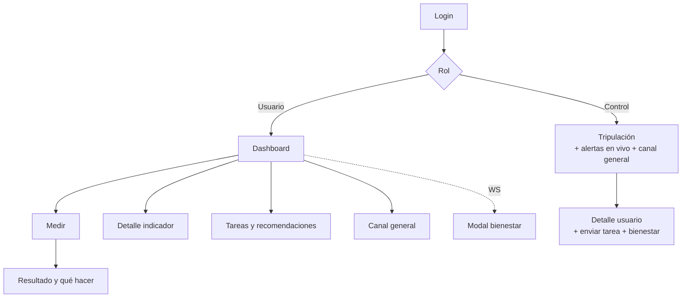

# Diseño de la app (UI/UX)

> [!important] Fase 1 frente a Fase 2 en el diseño
> **Fase 1:** solo modo oscuro · 6 pantallas de usuario (Dashboard, Medir, Resultado, Detalle, Tareas, Canal) y el modal de bienestar · **2 pantallas de Control** (Tripulación y Detalle del usuario) · pulso en el rojo · sonido en Control.
> **Fase 2:** modo claro, atajos de teclado, mensajes prioritarios y del sistema, chats individuales, anclas extra en la silueta (visión, respiración, huesos, radiación), animaciones extra.

Responsable: [[07 - Equipo y roles#Rol 6: diseño, contenido, pruebas y pitch|rol 6]], con los roles 2 y 3. Los wireframes definitivos se hacen en **FigJam** (issue D-01). Esta nota fija los criterios para que todos diseñen igual.

## 1. Principios de diseño

1. **Se entiende de un vistazo.** En menos de 3 segundos tiene que quedar claro si estoy bien y qué tengo que hacer.
2. **El color nunca va solo.** Cada estado lleva **color, icono y texto** (pensando también en el daltonismo).
3. **Calma, no alarma.** El rojo y el sonido se reservan para lo crítico. Los avisos en amarillo informan, no asustan.
4. **Explicar siempre.** Cada número va con un "¿qué significa?" y un "¿qué hago?" a un toque.
5. **Pocos toques.** Registrar una medición tiene que costar **3 toques como máximo** desde el dashboard.
6. **Primero el móvil para el usuario, primero el escritorio para Control.** El astronauta lleva una tablet o móvil; Control trabaja en una consola grande.
7. **El estado de conexión siempre visible.** Nunca se debe confundir "sin datos" con "estoy bien".

## 2. Identidad visual

### Estilo
Estética de **consola de misión** sobria: fondos oscuros, tarjetas con poca sombra, números grandes, mucho espacio. Moderno, sin parecer ciencia ficción recargada.

- **Fase 1: solo modo oscuro** (consolas de misión, menos deslumbramiento en un módulo con poca luz). *Modo claro: Fase 2.*
- Cada escenario tiene un **color de acento** propio: Marte 🟠 `#F97316`, residencia 🟣 `#8B5CF6` (y ISS 🔵 `#3B82F6` en la Fase 2). Solo se usa en la cabecera y los elementos de marca, **nunca** para estados.

### Colores de estado (tokens)

| Estado | Token | Oscuro (F1) | Claro (F2) | Icono | Texto |
|---|---|---|---|---|---|
| Normal | `status-ok` | `#22C55E` | `#15803D` | ✓ `check-circle` | "Normal" |
| Atención | `status-warn` | `#F59E0B` | `#B45309` | ! `alert-triangle` | "Atención" |
| Crítico | `status-crit` | `#EF4444` | `#B91C1C` | ✕ `alert-octagon` | "Crítico" |
| Sin datos | `status-none` | `#6B7280` | `#6B7280` | ? `help-circle` | "Sin datos" |
| Información | `status-info` | `#38BDF8` | `#0369A1` | i `info` | — |

**Neutros (oscuro):** fondo `#0B1020` · superficie `#131A2E` · borde `#23304F` · texto `#E5E9F5` · texto secundario `#94A3B8`.
**Neutros (claro):** fondo `#F8FAFC` · superficie `#FFFFFF` · borde `#E2E8F0` · texto `#0F172A` · texto secundario `#475569`.

> [!tip] Contraste
> Validad el contraste AA de cada par de colores con una herramienta (por ejemplo, el comprobador de WebAIM) antes de cerrar la paleta.

### Tipografía
- **Inter** para la interfaz y **JetBrains Mono** (o `tabular-nums`) para las cifras y horas, de modo que los números no "bailen".
- Escala: valor grande en la tarjeta 32–40 px · título 20 px · texto 16 px (mínimo en móvil) · etiquetas 13 px.
- Fuentes **empaquetadas en el repo** (sin Google Fonts en ejecución, por el modo sin conexión).

### Iconos
- **Healthicons** para los indicadores médicos y **Lucide** para la interfaz, vía `@iconify/vue` con los iconos empaquetados.
- Un icono por sistema y por indicador, siempre los mismos en toda la app.

### Espaciado y forma
- Rejilla de 4 px (escala de Tailwind). Radios de 12–16 px en las tarjetas, 8 px en los botones.
- Zonas táctiles de **44 px como mínimo**.

## 3. Arquitectura de pantallas



### Navegación
- **Usuario (móvil):** barra inferior con 4 pestañas: **Inicio · Medir · Tareas · Canal**.
- **Usuario (tablet o escritorio):** las mismas pestañas en una barra lateral.
- **Control (escritorio):** **sin barra lateral**: solo 2 pantallas. Arriba, una barra fija con el escenario (selector), el número de alertas críticas, las conexiones y el botón "Reset demo".

## 4. Wireframes de referencia (para pasar a FigJam)

### Usuario: Dashboard (móvil)
```
┌──────────────────────────────┐
│ 🟠 Mars Base   ● Conectado   │  ← acento del escenario y conexión
│ Hola, Ana          🔔 2      │
├──────────────────────────────┤
│   [ silueta ]   Estado:       │
│    🧠 🟢         🟡 ATENCIÓN  │  ← estado general (icono y texto)
│    ❤️ 🟡         1 indicador  │
│    🩸 🟢           a revisar  │
│    🦴 🟢                      │
├──────────────────────────────┤
│ ┌──────────┐ ┌──────────┐    │
│ │❤️ FC      │ │🌡️ Temp    │    │  ← IndicatorCard
│ │ 108 lpm  │ │ 36.8 °C  │    │
│ │! Atención│ │✓ Normal  │    │
│ │ ╱╲_╱‾    │ │ ‾‾‾‾‾    │    │  ← mini gráfica de tendencia
│ └──────────┘ └──────────┘    │
│ ┌──────────┐ ┌──────────┐    │
│ │🩸 Glucosa │ │🌙 Sueño   │    │
│ └──────────┘ └──────────┘    │
├──────────────────────────────┤
│ Tripulación: 🟢Leo 🟢Sam 🔴Kai│  ← resumen (solo estado)
├──────────────────────────────┤
│ 📋 Nueva recomendación (1)   │
├──────────────────────────────┤
│  🏠 Inicio  ➕ Medir  📅  💬  │
└──────────────────────────────┘
```

### Usuario: registrar medición (3 pasos)
```
1. Elegir indicador   →   2. Cómo medir (paso a paso,    →   3. Introducir valor
   (cuadrícula de         ilustración, "Ya lo tengo")         (teclado numérico,
   iconos)                                                    unidad fija) → Guardar
                                         ↓
                    Resultado: gran badge de estado y "Qué significa" y "Qué hacer"
                    (si es crítico: "Control ha sido avisado ✓")
```

### Usuario: detalle del indicador
```
❤️ Frecuencia cardíaca        [7d | 30d | Misión]
┌────────────────────────────────────┐
│  gráfica con bandas de fondo        │  ← verde, amarillo y rojo como franjas
│  ●─●──●─●──●──●                     │    según los umbrales
└────────────────────────────────────┘
Último: 108 lpm · ! Atención · hace 10 min
▸ ¿Qué es?        ▸ Cómo afecta en Marte
▸ ¿Qué hago ahora? (acciones según el estado)
▸ Cómo se mide
[ + Nueva medición ]
```

### Usuario: modal de bienestar (pantalla completa)
```
┌──────────────────────────────┐
│     🛰️ Mission Control        │
│   ¿Estás bien, Ana?          │
│      ⏱ 00:47                 │  ← cuenta atrás del plazo
│ ┌──────────────────────────┐ │
│ │      ✓ ESTOY BIEN        │ │  ← verde, enorme
│ └──────────────────────────┘ │
│ ┌──────────────────────────┐ │
│ │   ✕ NECESITO AYUDA       │ │  ← rojo
│ └──────────────────────────┘ │
└──────────────────────────────┘
```

### Control: tripulación (escritorio)
```
┌─────────────────────────────────────────────────────────────────┐
│ CONTROL · [🟠 Mars ▾] · 🔴 1 crítica · ● 4/4 conectados [Reset] │
├─────────────────────────────────────────────────────────────────┤
│ ┌───────────┐┌───────────┐┌───────────┐┌───────────┐           │
│ │ Ana  ●    ││ Leo  ●    ││ Kai  ◐ 15s ││ Sam  ●    │           │  ← presencia
│ │ 🟡 ATENC. ││ 🟢 NORMAL ││ 🔴 CRÍTICO ││ 🟢 NORMAL │           │
│ │ ❤️🟡🧠🟢🩸🟢││ ...       ││ 🌡️🔴 39.2° ││ ...       │           │
│ │ 1 alerta  ││ —         ││ 2 alertas  ││ —         │           │
│ └───────────┘└───────────┘└───────────┘└───────────┘           │
├────────────────────────────────┬────────────────────────────────┤
│ Alertas en vivo                 │ 💬 Canal general               │
│ 🔴 Kai · Temp 39.2  [Ack][Res]  │ 📌 Protocolo módulo B          │
│ 🔴 Kai · Sin señal 32s [Ack]    │ Leo: ...                       │
│                                 │ [ escribir... ]                │
└────────────────────────────────┴────────────────────────────────┘
```

### Control: detalle del usuario
Las mismas tarjetas y gráficas que ve el usuario (componentes reutilizados), más un panel lateral con **sus alertas, sus tareas y los botones de acción** (Enviar tarea o recomendación · Comprobar bienestar). *El chat individual y las alertas manuales son Fase 2.*

## 5. Componentes (sistema de diseño)

| Componente | Variantes | Usado en |
|---|---|---|
| `StatusBadge` | ok, warn, crit, none · tamaños sm, md, lg | Todo |
| `PresenceDot` | online ● · stale ◐ · offline ○ | Tripulación, cabecera |
| `IndicatorCard` | compacta o grande · con tendencia o sin ella | Dashboard, detalle del usuario |
| `BodySilhouette` | modo usuario o miniatura de tripulación | Dashboard, Control |
| `TrendChart` | con bandas de umbral · 7 días, 30 días o misión | Detalle |
| `MeasureWizard` | por indicador | Medir |
| `AlertItem` | por gravedad · open, ack o resolved | Alertas, dashboard |
| `TaskItem` | task o recommendation · pending o done | Tareas |
| `ChatPanel` y `ChatMessage` | normal o **fijado** (F1) · prioritario y sistema (F2) | Canal general |
| `WellnessModal` | rutinario (F1) · urgente (F2) | Usuario |
| `Toast` | info, warn, crit | Global |
| `EmptyState` y `Skeleton` | — | Todo |

### Mensajes en el chat
- **Normal:** burbuja neutra.
- *(Fase 2)* **Prioritario:** borde y cabecera en color de atención con el texto "PRIORIDAD".
- **Fijado:** aparece en una franja fija sobre el chat, con 📌 (como máximo 3 a la vista y "ver todos").
- *(Fase 2)* **Sistema:** centrado, en gris o con el color del estado, con un icono (⚠️ alerta, 📅 tarea, 🔔 recordatorio) y enlace a lo que se refiere.

## 6. Silueta (`BodySilhouette`)
- Silueta **frontal neutra** (sin género marcado), de un solo trazado SVG, en color de superficie.
- **Anclas** con el icono y un halo de color por sistema:

| Sistema | Ancla |
|---|---|
| 🧠 Mente y sueño | cabeza |
| 👁️ Visión (F2) | ojos |
| ❤️ Corazón y circulación | pecho izquierdo |
| 🫁 Respiración (F2) | pecho centro |
| 🩸 Metabolismo e hidratación | abdomen |
| 🌡️ Inmunidad y temperatura | lateral / cuello |
| 🦴 Huesos y músculos (F2) | pierna |
| ☢️ Radiación (F2) | aura o contorno de la silueta |

- La interacción es mínima: al tocar un ancla se baja hasta su tarjeta. **No es obligatoria.**
- En la vista de tripulación de Control sale en miniatura dentro de cada tarjeta.

## 7. Movimiento y sonido
- **Pulso** suave (escala más halo, unos 1,5 s) solo en los indicadores o sistemas **críticos**.
- Las transiciones de color al cambiar de estado duran 300 ms.
- Llegada de una alerta a Control: la tarjeta se ilumina y entra con animación desde la derecha en la lista.
- **Sonido** solo en Control y solo en las alertas **críticas**, con un botón para silenciar (no se reproduce hasta el primer clic, por la política de los navegadores).
- Se respeta `prefers-reduced-motion`.

## 8. Accesibilidad
- Contraste AA. Estado siempre con color, icono y texto.
- `aria-live="assertive"` en las alertas críticas y `polite` en los toasts.
- *(Fase 2)* Atajos de teclado en Control.
- Textos claros y sin jerga. En el escenario residencia, letra un 10 % más grande.

## 9. Vocabulario por escenario
La interfaz nunca escribe "Astronauta" fijo: usa `scenario.vocabulary.*` (ver [[06 - Escenarios y reglas de salud]]).

## 10. Plan de diseño en el hackathon
| Cuándo | Qué | Quién |
|---|---|---|
| H0–H1 | Mapa de pantallas y bocetos rápidos a mano o en FigJam | Rol 6 y todo el equipo |
| H1–H3 | Wireframes en baja fidelidad de las pantallas clave (Dashboard, Medir, Resultado, Detalle, Tripulación), validados con los roles 2 y 3 | Rol 6 |
| H2–H4 | Paleta en `tailwind.config` y tokens, iconos elegidos, silueta SVG v1 | Roles 6 y 2 |
| H3–H20 | Revisión visual de cada PR de interfaz | Rol 6 |
| H22–H28 | Pulido: animaciones, estados vacíos, móvil real, capturas para el pitch | Roles 6, 2 y 3 |

## ❓ Decisiones de diseño por confirmar
- [x] Fase 1 solo con modo oscuro (decidido).
- [x] Interfaz en inglés (decidido en [[02 - Requisitos#Requisitos no funcionales|RNF-6]]). *Los wireframes de abajo están en español solo como referencia.*
- [ ] ¿Estilo de la silueta: contorno de líneas o relleno plano?
- [ ] ¿Nombre y logotipo? (ver [[11 - Pitch y entrega#Nombre]])
